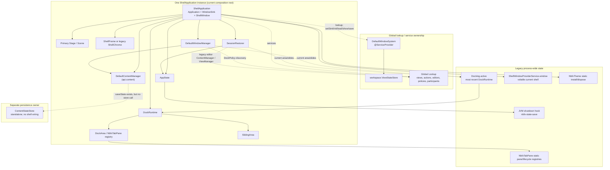
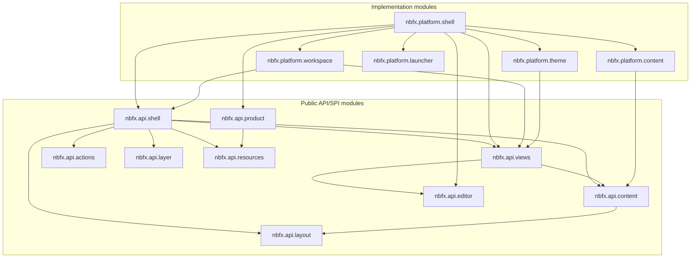

<!--

    Licensed to the Apache Software Foundation (ASF) under one
    or more contributor license agreements.  See the NOTICE file
    distributed with this work for additional information
    regarding copyright ownership.  The ASF licenses this file
    to you under the Apache License, Version 2.0 (the
    "License"); you may not use this file except in compliance
    with the License.  You may obtain a copy of the License at

      http://www.apache.org/licenses/LICENSE-2.0

    Unless required by applicable law or agreed to in writing,
    software distributed under the License is distributed on an
    "AS IS" BASIS, WITHOUT WARRANTIES OR CONDITIONS OF ANY
    KIND, either express or implied.  See the License for the
    specific language governing permissions and limitations
    under the License.

-->
# 2. Architecture overview

## Behavior summary

The baseline has a working JavaFX application shell, but its ownership is split between
per-shell objects, a global `WindowSystem` service, and legacy process-wide facades/registries.
That split is the most important fact for maintenance and testing.

There is **no** `ShellRuntime` in this baseline. `ShellApplication` currently performs several of
that role's duties directly. It creates and exposes public API handles, but it also coordinates
legacy tabs, panes, chrome, persistence, and shutdown.

Status: **Implemented** shell composition and per-shell content ownership;
**Partial** unified runtime and multi-window ownership; **Legacy** static docking/tab/session
integration; **Target only** the complete `ShellRuntime`/`FocusController` model.

## Runtime ownership



Solid arrows are direct ownership/construction relationships. Dotted arrows are lookup,
delegation, or lifecycle interactions. `Docking.active` is a static reference, not ownership: a
new shell replaces it, and `DockRuntime.dispose()` does not clear it.

## Component responsibilities

| Component | Owns | Does not own |
|---|---|---|
| `ShellApplication` | Primary stage/scene; frame or legacy chrome; one per-shell content manager and window manager; `AppState`; `SessionRestorer`; `WindowSystem` sink registration; startup/shutdown order. | A complete `SessionState`; global view/editor service lifecycles; anchored overlays; a target focus controller. |
| `ShellContext` | A non-null `Lookup` view and helpers for actions, profile, window, commands, and icons. | It does not construct services or store lifecycle state. The current record has only `lookup`, not the target's explicit service fields. |
| `ShellWindow` | Public facade over the running shell: stage, `BorderPane` root, main `TabPane`, sliding node, and `WindowManager`. | It currently exposes concrete JavaFX layout/control types and has no `windowSystem()` accessor. |
| `DefaultWindowSystem` | Lifecycle phase, listener list, discovered `ViewSpec`s, default/persisted merge, save/reset orchestration. | JavaFX scene mutation; live pane/tab reconstruction; full session/window enumeration. |
| `WindowSink` | The seam for applying one `WindowState`, capturing one `WindowState`, and showing/hiding the main window. | Persistence itself; window-system phase transitions. |
| `DockRuntime` | One `DockArea`, one `SlidingArea`, composition, area/location lookup maps, empty-pane retention during startup. | Content close/dispose; window-state persistence (`saveLayout()` is empty); global facade cleanup. |
| `Docking` | **Legacy** static delegation to the most recently registered runtime. | Independent runtime ownership or safe multi-shell isolation. |
| `DefaultWindowManager` | Public content/group operations, floating/custom handles, policy evaluation, and custom-bound persistence hooks. | A dedicated injected `DockRuntime`; most runtime access still goes through static `Docking`. |
| `DefaultContentManager` | Open content by `ContentId`, active-content property, close/dispose calls. | Multiple instances of one `ContentId`; content-state persistence; tab order or window placement. |
| `AppState` | Preferences snapshots for toolbars/editor settings/introduced views/project-tree hooks; serialized legacy pane layout; remembered custom bounds. | The window system's main geometry after migration; content payloads; a unified all-window session. |
| `SessionRestorer` | FX-thread capture/restore of legacy panes, tabs, detached windows, editor view state, and startup views. | Target `SessionState`; custom-window recreation; `ContentStateStore`; independent per-shell dock access. |
| workspace `ViewStateStore` | One persisted `WindowState`: geometry, areas, view ids/active/detach geometry, view payloads, profile id. | Pane tree/dividers, editor tabs, custom windows, full sessions. |
| shell `ViewStateStore` | SPI for per-project navigator expansion/selection. | Window geometry/layout. It is a different type in a different module. |
| `ContentStateStore` | Opaque payloads keyed by `ContentId` plus instance key. | Order, group membership, window placement, lifecycle wiring. |
| `ShutdownCoordinatorService` | One-shot coordinator over globally discovered `ShutdownParticipant`s. | Shell capture/save order; frame/content disposal; a per-application coordinator instance. |

## Construction and lookup flow

```text
GuiRunLevel
  └─ chooses highest-priority AppProvider
      └─ Application.launch(ShellApplication or product application)
          └─ ShellApplication.start(Stage) on FX thread
              ├─ new per-shell DefaultContentManager / DefaultWindowManager
              ├─ new AppState / SessionRestorer (field initialization)
              ├─ resolve WindowComposition from global registries/layer
              ├─ instantiate NbfxTabPane hosts
              ├─ Docking.create(...) → new DockRuntime + static active reference
              ├─ create ShellContext from shellLookup()
              ├─ choose default/custom ShellFrame OR legacy chrome
              ├─ lookup global WindowSystem
              │    ├─ setSink(this)
              │    ├─ init() / load() / show()
              │    └─ later save()
              └─ publish ShellWindowProvider, dispatch UiReady,
                 defer restoreSession() with Platform.runLater
```

The default `shellLookup()` is a `ProxyLookup` containing the shell itself, its
`WindowManager`, its `api.content.ContentManager`, and the global lookup. Subclasses may extend
it. The declarative frame path wraps it with an `InstanceContent` containing the selected profile,
runtime `ShellRegionHost`, and toolbar container before calling a `ShellProvider`.

See [startup](04-appshell-startup.md) for every branch and rollback point.

## Actual dependency layers



This is a simplified source-level view, not a replacement for `nbproject/project.xml`. The exact
module list, friend packages, and target differences are in
[module map and dependencies](03-module-map-and-dependencies.md).

## Ownership, threading, and disposal rules

| Concern | Rule at this baseline |
|---|---|
| JavaFX thread | `ShellApplication.start/stop`, frame/region lifecycle, live `WindowSink` methods, `WindowManager` scene mutations, and `SessionRestorer` run on the JavaFX Application Thread. |
| `WindowSystem` contract | All public methods are documented as FX-thread calls. `DefaultWindowSystem` synchronizes its lifecycle and public listener methods; `setSink` is an unsynchronized volatile write. Tests may drive the pure orchestration headlessly. |
| Region lifecycle | Mount/update/dispose/close require the FX thread. Mounted node identity is stable; contribution/renderer/scoped-command resources are disposed by the host. |
| Content lifecycle | The per-shell `DefaultContentManager` owns `close()` then `dispose()`. Host removal alone does not close content. `open`, `close`, `find`, and `openContent` are synchronized; `activeContent()` simply returns the observable property and is not synchronized. |
| Window-system save | `saveStarted` runs before `sink.snapshot()`; `saveCompleted` runs after `store.save(...)`. The store write occurs on the calling FX thread. |
| AppState save | Uses volatile snapshots and a one-shot `AtomicBoolean`; it may run on the JVM shutdown hook. It must not read live scene nodes off the FX thread. |
| Custom bounds | Saved synchronously with a preferences flush when a custom window hides or closes, on the FX thread. |
| Shutdown cleanup | Normal coordinator cleanup runs on a `CompletableFuture` worker; `stop()` fallback may run it synchronously on the FX thread. |
| Frame disposal | `ShellApplication` closes the frame, then the runtime region host, then the shell command resolver. Region disposal is idempotent. |
| Runtime disposal | `DockRuntime.dispose()` only clears its area/slides/composition references. It does not close tabs/content or clear `Docking.active`. |
| Global publication | `ShellWindowProviderService` is set after the window is usable and cleared in `stop()`. `OnUiReady` tasks therefore see the current shell. |

## Error containment

- Shell-provider count, frame root, runtime-host identity, and DOCK-mount failures abort startup.
  The frame branch closes an assigned frame and the region host, then closes the command resolver.
- The legacy chrome branch disposes created chrome and closes the resolver on failure.
- These rollback blocks do **not** undo earlier lifecycle-listener registration, theme install,
  pane creation, or `Docking.active`. Later scene/window-system failures also have no surrounding
  rollback block.
- Region renderer/contribution failures are generally logged and isolated by
  `ShellRegionHostImpl`; duplicate mounts, wrong-thread calls, and invalid DOCK roots fail fast.
- `WindowSystem` phase violations throw `IllegalStateException`. Listener exceptions are not
  caught and can abort load/save.
- Shutdown participant `RuntimeException`/`Exception` failures are logged and later participants
  continue. Errors are not caught by the coordinator.
- `stop()` is a straight-line sequence, not a `try/finally` transaction. An uncaught failure in an
  earlier step can prevent later cleanup.

## Current versus target

The [target conceptual model](../../reference/cjap-shell-ui.md#3-conceptual-model) places
`ShellRuntime`, `DockRuntime`, managers, theme, focus, and per-window contexts under one
application-scoped owner. The baseline instead has:

- a per-shell `ShellApplication` but a global `WindowSystem` service;
- an instance `DockRuntime` behind a legacy static facade;
- a per-shell content manager beside legacy global editor/view services;
- a functioning legacy layout/session path beside a separate window-system persistence path; and
- static tab/theme/current-window state.

Code against public handles (`ShellWindow`, `WindowManager`, `WindowSystem`, `ShellProvider`)
where possible. Do not make new product code depend on `ShellApplication`, `Docking`,
`NbfxTabPane`, or `AppState` implementation packages.

## Source and test index

- [ShellApplication.java](../../../nbfx-platform/nbfx.platform.shell/src/org/netbeans/modules/nbfx/platform/shell/ShellApplication.java)
- [DockRuntime.java](../../../nbfx-platform/nbfx.platform.shell/src/org/netbeans/modules/nbfx/platform/shell/DockRuntime.java)
- [Docking.java](../../../nbfx-platform/nbfx.platform.shell/src/org/netbeans/modules/nbfx/platform/shell/Docking.java)
- [DefaultWindowManager.java](../../../nbfx-platform/nbfx.platform.shell/src/org/netbeans/modules/nbfx/platform/shell/DefaultWindowManager.java)
- [DefaultWindowSystem.java](../../../nbfx-platform/nbfx.platform.workspace/src/org/netbeans/modules/nbfx/platform/workspace/DefaultWindowSystem.java)
- [DefaultContentManager.java](../../../nbfx-platform/nbfx.platform.content/src/org/netbeans/modules/nbfx/platform/content/DefaultContentManager.java)
- [DockRuntimeIsolationTest.java](../../../nbfx-platform/nbfx.platform.shell/test/unit/src/org/netbeans/modules/nbfx/platform/shell/DockRuntimeIsolationTest.java)
- [ShellContentManagerTest.java](../../../nbfx-platform/nbfx.platform.shell/test/unit/src/org/netbeans/modules/nbfx/platform/shell/ShellContentManagerTest.java)

Continue with [module map and dependencies](03-module-map-and-dependencies.md),
[startup](04-appshell-startup.md), [shutdown](05-appshell-shutdown.md),
[WindowSystem lifecycle](06-window-system-lifecycle.md), and
[window state and persistence](07-window-state-and-persistence.md).
