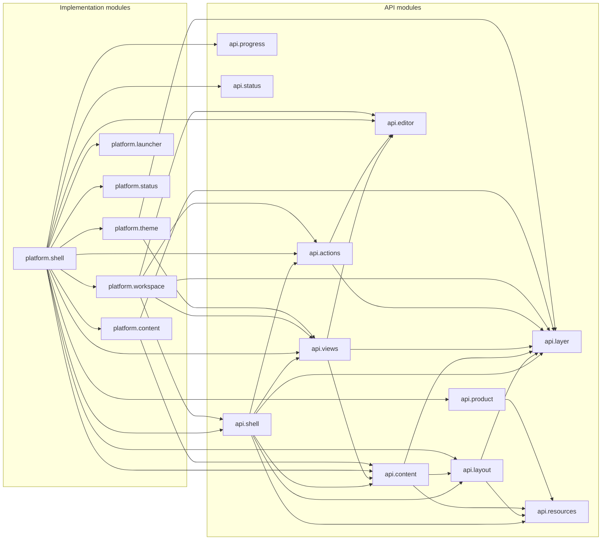

<!--

    Licensed to the Apache Software Foundation (ASF) under one
    or more contributor license agreements.  See the NOTICE file
    distributed with this work for additional information
    regarding copyright ownership.  The ASF licenses this file
    to you under the Apache License, Version 2.0 (the
    "License"); you may not use this file except in compliance
    with the License.  You may obtain a copy of the License at

      http://www.apache.org/licenses/LICENSE-2.0

    Unless required by applicable law or agreed to in writing,
    software distributed under the License is distributed on an
    "AS IS" BASIS, WITHOUT WARRANTIES OR CONDITIONS OF ANY
    KIND, either express or implied.  See the License for the
    specific language governing permissions and limitations
    under the License.

-->
# 3. Module map and dependencies

## Baseline module map

The names below are directory/module short names. Their NetBeans code-name bases are
`org.netbeans.modules.nbfx.<name>`. “Direct nbfx dependencies” lists module dependencies, not
transitive dependencies and not test dependencies.

| Module | Target tier / current role | Direct nbfx dependencies relevant to the shell | Status |
|---|---|---|---|
| `nbfx.api.shell` | T2-FX public shell/window/chrome/shutdown API and `org.netbeans.spi.nbfx.shell` SPI | `api.actions`, `api.resources`, `api.layout`, `api.content`, `api.layer`, `api.views` | **Implemented**, but some contracts remain transitional. |
| `nbfx.platform.shell` | T0 implementation/composition root | `api.layer`, `api.actions`, `api.layout`, `api.resources`, `api.product`, `api.editor`, `api.views`, `api.shell`, `platform.workspace`, `api.progress`, `platform.status`, `platform.launcher`, `api.status`, `platform.theme`, `platform.content`, `api.content` | **Implemented**; contains legacy static/session integration. |
| `nbfx.platform.workspace` | T0 dock tree/area plus pure window-system orchestration | `api.editor`, `api.actions`, `api.views`, `api.shell`, `api.layer` | **Implemented**; this is not the target `platform.docking` split. |
| `nbfx.platform.content` | T0 generic content manager/routing/store | `api.content`, `api.layer` | **Partial**; store is standalone. |
| `nbfx.api.layout` | M pure layout/value/XML/annotation API | `api.resources`, `api.layer` | **Implemented**; not the live startup schema. |
| `nbfx.api.content` | T2-FX content/id/state/drop/transfer API | `api.resources`, `api.layout`, `api.layer` | **Implemented** for the landed content vocabulary. |
| `nbfx.api.views` | T2-FX legacy/new view contracts and registrations | `api.editor`, `api.content`, `api.layer` | **Implemented** with both `api.nbfx.view` and `api.nbfx.views` packages. |
| `nbfx.api.actions` | T2-FX command/action API | `api.editor`, `api.language`, `api.layer` | **Implemented**; current dependency direction differs from target. |
| `nbfx.api.product` | M immutable product metadata | `api.resources` | **Implemented**. |
| `nbfx.api.editor` | T2-FX editor/document/content bridge | `api.language`, `api.progress` plus upstream lexer/filesystems | **Legacy** editor service remains beside generic content. |
| `nbfx.api.layer` | T1 typed layer support | Domain foundation | **Implemented**. |
| `nbfx.api.resources` | M neutral resource references | Foundation | **Implemented**. |
| `nbfx.platform.theme` | Current theme implementation; also exports an `org.netbeans.api.nbfx.theme` package | `api.layer`, `api.views` | **Legacy** relative to the target separate `api.theme` module. |
| `nbfx.platform.launcher` | Platform bootstrap and `AppProvider` selection | Upstream `core.startup`, modules, util, util.ui; ordering-only dependency on `defaults` | **Implemented**. |
| `nbfx.platform.status` / `nbfx.api.status` | Status renderer/API used by the default frame | Platform status implementation and API | **Implemented** for current shell status needs. |

Common external dependencies include the nbfx JavaFX wrapper library
(`org.netbeans.libs.nbfx.javafx`), `org.openide.util`, `org.openide.util.lookup`, and, where the
module uses files/layer data, `org.openide.filesystems`. The shell implementation additionally
uses upstream `org.netbeans.api.progress` and `org.openide.util.ui`.

Authoritative manifests:

- [api.shell project.xml](../../../nbfx-platform/nbfx.api.shell/nbproject/project.xml)
- [platform.shell project.xml](../../../nbfx-platform/nbfx.platform.shell/nbproject/project.xml)
- [platform.workspace project.xml](../../../nbfx-platform/nbfx.platform.workspace/nbproject/project.xml)
- [platform.content project.xml](../../../nbfx-platform/nbfx.platform.content/nbproject/project.xml)
- [api.layout project.xml](../../../nbfx-platform/nbfx.api.layout/nbproject/project.xml)
- [api.content project.xml](../../../nbfx-platform/nbfx.api.content/nbproject/project.xml)
- [api.views project.xml](../../../nbfx-platform/nbfx.api.views/nbproject/project.xml)
- [api.actions project.xml](../../../nbfx-platform/nbfx.api.actions/nbproject/project.xml)
- [api.product project.xml](../../../nbfx-platform/nbfx.api.product/nbproject/project.xml)
- [api.editor project.xml](../../../nbfx-platform/nbfx.api.editor/nbproject/project.xml)
- [platform.theme project.xml](../../../nbfx-platform/nbfx.platform.theme/nbproject/project.xml)
- [platform.launcher project.xml](../../../nbfx-platform/nbfx.platform.launcher/nbproject/project.xml)

## Actual dependency direction

Arrows point from a consumer to its dependency. Only the shell-related subgraph is shown.



Important consequences:

- API modules do not depend on implementation modules.
- `platform.shell` depends on `platform.workspace`. The workspace module's complete direct nbfx
  API dependency list is `api.editor`, `api.actions`, `api.views`, `api.shell`, and `api.layer`
  (`org.netbeans.modules.nbfx.api.*`); its `project.xml` has no `api.lifecycle` dependency. Within
  the platform implementation subgraph, `platform.shell` is its only direct implementation-module
  consumer, so there is no implementation cycle.
- `api.content` does not depend on `api.theme` at this baseline. The target adds that edge.
- `api.views` currently depends on `api.editor`; the target module map places `NodeView` in
  `api.views` and treats editor as a separate content consumer.
- `api.actions` currently depends on editor/language APIs; the target action module is narrower.
- `platform.shell` owns `DefaultContentManager` by constructing
  `platform.content.DefaultContentManager`, and publishes it through the shell lookup.

## Public packages and friend access

| Module | Exported/public packages | Friend-only implementation access |
|---|---|---|
| `api.shell` | `org.netbeans.api.nbfx.shell`, `org.netbeans.api.nbfx.shell.shutdown`, `org.netbeans.spi.nbfx.shell` | None; these are API/SPI. |
| `api.layout` | `org.netbeans.api.nbfx.layout` | None. |
| `api.content` | `org.netbeans.api.nbfx.content` | None. |
| `api.views` | `org.netbeans.api.nbfx.view`, `org.netbeans.api.nbfx.views`, `org.netbeans.api.nbfx.icons` | None. |
| `platform.shell` | No general public package in `project.xml` | `org.netbeans.modules.nbfx.platform.shell` is a friend package for `nbfx.ide.workbench`, `nbfx.project.ui`, and `nbfx.java.navigation`. |
| `platform.workspace` | No general public package in `project.xml` | `org.netbeans.modules.nbfx.platform.workspace` is a friend package for `platform.shell` and `ide.workbench`. |
| `platform.content` | No general public package in `project.xml` | `org.netbeans.modules.nbfx.platform.content` is a friend package for `platform.shell`. |
| `platform.theme` | Both `org.netbeans.api.nbfx.theme` and `org.netbeans.modules.nbfx.platform.theme` | The implementation package is currently exported, unlike the target separation. |
| `platform.launcher` | `org.netbeans.modules.nbfx.platform.launcher` | None declared. |

Product code should import API/SPI only. A class being `public` in Java does not make its package
available to arbitrary NBM consumers. In particular, `ShellApplication`, `Docking`,
`DockRuntime`, `NbfxTabPane`, `AppState`, and `SessionRestorer` are implementation/friend types,
not the target product API.

Test dependencies may cross layers for test classpaths; they are not shipped runtime edges. For
example, `platform.shell` tests depend on FX test support and several platform implementations.

## Package-level reality

```text
org.netbeans.api.nbfx.shell
  ShellApplication-facing API:
    ShellContext, ShellWindow, ShellProvider, ShellFrame, ShellRegionHost,
    ShellChromeProfile/ShellProfileSpec/ShellProfileResolver,
    WindowManager, DockWindow, WindowOptions, WindowContent,
    WindowSystem, WindowSink, WindowState, AreaState,
    shutdown/*

org.netbeans.api.nbfx.layout
  Pure CJAP layout model:
    PaneRole, ViewArea, DockGroupSpec, LayoutSpec, LayoutNode,
    LayoutBuilder, LayoutXml, registration annotations

org.netbeans.api.nbfx.content
  Generic content and transfer:
    Content, ContentId, ContentState, ContentManager, ContentFactory,
    DockPlacement, DropRequest/Decision/Handler

org.netbeans.modules.nbfx.platform.shell
  Live composition and legacy shell:
    ShellApplication, DefaultWindowManager, DockRuntime, Docking,
    NbfxTabPane, SlidingArea, AppState, SessionRestorer, frames/chrome

org.netbeans.modules.nbfx.platform.workspace
  Dock tree/area and window-system orchestration:
    DockArea, DockTree, DockTrees, WindowLayoutRegistry,
    DefaultWindowSystem, workspace.ViewStateStore

org.netbeans.modules.nbfx.platform.content
  DefaultContentManager, DropRouter, ContentStateStore
```

Two especially important package splits remain:

1. `PaneRole` exists in both `api.shell` and `api.layout`; the live shell uses the former.
2. `ViewArea` exists in both `api.views` and `api.layout`; `WindowSystem` defaults use the former,
   while the pure CJAP layout API uses the latter.

## Target module map and gaps

The ADR's target direction is:

```text
api.resources (M)       → none
api.product (M)         → api.resources
api.layout (M)          → api.resources, api.layer
api.theme (T2-FX)       → api.resources, api.layer, JavaFX
api.content (T2-FX)     → api.layout, api.theme, api.resources
api.docking (T2-FX)     → api.layout, api.content
api.views (T2-FX)       → api.layout, api.content, api.theme, api.nodes
api.actions (T2-FX)     → api.layer, JavaFX
api.nodes (M)           → api.resources, api.layer
api.editor (T2-FX)      → api.content, api.layout, api.theme
api.shell (T2-FX)       → api.product, api.layout, api.content, api.views,
                          api.actions, api.theme, api.docking, api.resources
api.plugins (T1)        → api.layer, api.resources
```

Target-only module boundaries not present at this baseline:

| Target module | Status | Current nearest reality |
|---|---|---|
| `api.theme` | **Target only** | Theme API package is exported from `platform.theme`. |
| `api.docking` | **Target only** | Docking requests/policies currently live in `api.shell`; dock implementation lives in `platform.workspace`/`platform.shell`. |
| `platform.docking` | **Target only** | `DockArea`/`DockTree` are in `platform.workspace`; `DockRuntime` is in `platform.shell`. |
| `platform.shell.default` | **Target only** | `DefaultShellFrame` and renderers are inside `platform.shell`. |
| `platform.design` | **Target only** | Current CSS/control kit is not a separate design-system module. |
| `api.plugins` / `platform.plugins` | **Target only** | NBM lookup/layer discovery exists; no target contribution ownership/invalidation module. |
| `ShellRuntime` owner | **Target only** | `ShellApplication` plus global/static collaborators currently fills this role. |
| `WindowStateStore` / `SessionState` | **Target only** | Workspace `ViewStateStore` plus shell `AppState` currently split persistence. |

The target also deletes `ShellBranding`, `ShellChromeProvider`, public `Docking`, public
`AppState`/`SessionRestorer`, and editor-specific transitional surfaces after consumer migration.
At this baseline those types/packages remain for compatibility or friend-internal use.

## Current versus target

Use the actual manifests for build changes at this baseline. Do not add a dependency on a target
module name that does not exist. The architectural direction is still valid: pure model modules
remain JavaFX-free, APIs stay above implementations, and platform must not depend on IDE modules.
The remaining work is to split the current combined modules and migrate consumers, not to invent
parallel APIs in product code.

Related chapters: [architecture overview](02-architecture-overview.md),
[startup](04-appshell-startup.md), [shutdown](05-appshell-shutdown.md),
[WindowSystem lifecycle](06-window-system-lifecycle.md), and
[window state and persistence](07-window-state-and-persistence.md).
