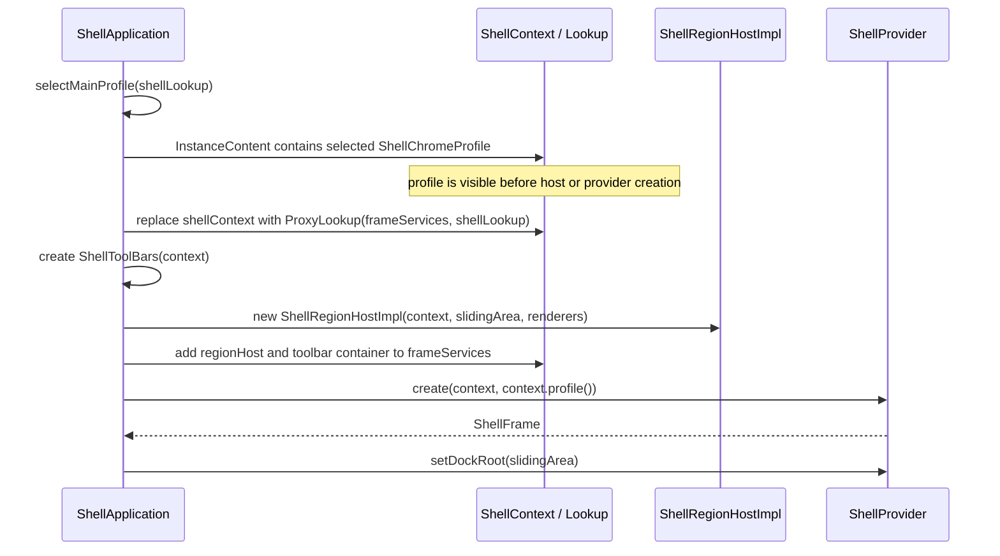

<!--

    Licensed to the Apache Software Foundation (ASF) under one
    or more contributor license agreements.  See the NOTICE file
    distributed with this work for additional information
    regarding copyright ownership.  The ASF licenses this file
    to you under the Apache License, Version 2.0 (the
    "License"); you may not use this file except in compliance
    with the License.  You may obtain a copy of the License at

      http://www.apache.org/licenses/LICENSE-2.0

    Unless required by applicable law or agreed to in writing,
    software distributed under the License is distributed on an
    "AS IS" BASIS, WITHOUT WARRANTIES OR CONDITIONS OF ANY
    KIND, either express or implied.  See the License for the
    specific language governing permissions and limitations
    under the License.

-->
# 4. AppShell startup

## Behavior summary

`ShellApplication.start(Stage)` is the current composition root. It builds content/window
managers, resolves the permanent pane composition, creates an instance `DockRuntime`, chooses a
declarative frame or legacy chrome, creates the scene, drives `WindowSystem` when present, publishes
the shell, runs `@OnUiReady` tasks, and defers session restoration.

Status: **Implemented** for the default shell, custom `ShellProvider` shell, and main-window profile
selection; **Partial** for full target runtime/session integration; **Legacy** for subclass chrome
hooks and the static docking facade.

All work in `start()` runs on the JavaFX Application Thread. The method is `final`:

```java
public final void start(Stage stage)
```

The legacy subclass hooks, in call order, are:

```java
protected void prepare()
protected WindowPaneHost createPane(WindowPane pane, WindowPaneContext context)
protected void decorate(BorderPane root)
protected void sceneReady(Scene scene)
protected void started()
protected void restoreSession()
```

New products should normally use the neutral default frame or supply a `ShellProvider`, not
subclass `ShellApplication` merely to obtain standard chrome.

## Launcher boundary

`GuiRunLevel.run()` chooses the registered `AppProvider` with the highest `priority()` and launches
its application class on a daemon thread named `nbfx-javafx-launcher`. The default
`ShellAppProvider` returns `ShellApplication.class` and has priority `0`; a product application can
win with a higher priority. Tests set `nbfx.test=true`, which suppresses automatic launch.

This happens after NetBeans module bootstrap, so global lookup services used by `start()` are
expected to be present. A missing `AppProvider` logs a severe error and asks the platform lifecycle
to exit.

## Startup sequence and branching

```mermaid
sequenceDiagram
    participant L as GuiRunLevel
    participant A as ShellApplication
    participant D as Docking / DockRuntime
    participant F as ShellProvider / DefaultShellFrame
    participant W as WindowSystem
    participant U as UiReady / ShellWindowProvider
    participant R as SessionRestorer

    L->>A: Application.launch → start(Stage) on FX thread
    A->>A: bind view/editor lifecycles; NbfxTheme.install(); prepare()
    A->>A: resolve WindowComposition; build shellLookup and panes
    A->>D: Docking.create(composition, panes)
    D-->>A: DockArea + SlidingArea; static active runtime
    A->>A: create base ShellContext

    alt more than one ShellProvider
        A->>A: close shell resolver; throw IllegalStateException
    else provider exists OR exact ShellApplication class
        A->>A: select main profile; publish it; apply stage decoration
        A->>F: create custom/default ShellFrame with runtime region host
        F->>F: mount exact runtime DOCK root
        A->>A: validate root/host/mount; initialize toolbars
    else subclass with no ShellProvider
        A->>A: legacy createChrome(); decorate(root)
    end

    A->>A: branding, Scene(1200x800), CSS/theme, sceneReady, title, close handler
    A->>A: track bounds; init editor settings; install AppState shutdown hook

    opt WindowSystem service exists
        A->>W: setSink(this); init(); load(); show()
        W->>A: apply(merged WindowState) → geometry only
        W->>A: show() → stage.show()
    else no WindowSystem
        A->>A: stage.show()
    end

    A->>A: active-component bridge; budget usable; install application menu
    A->>U: publish ShellWindow; started(); UiReady.dispatch()
    A->>R: Platform.runLater(this::restoreSession)
```

## Step-by-step implementation

### 1. Initialize per-shell services and legacy lifecycle hooks

Field initialization has already created:

- `AppState appState`;
- `SessionRestorer sessionRestorer` bound to this shell's tab/state-store hooks;
- one `org.netbeans.modules.nbfx.platform.content.DefaultContentManager`;
- one `DefaultWindowManager` bound to that content manager, `DockPolicy` lookup, shell snapshot,
  and `AppState`.

`start()` then:

1. records `Budget.mark("fxStart")` and stores the primary `Stage`;
2. installs `NbfxTabPane.ViewLifecycle` and `EditorLifecycle` callbacks in static tab-pane
   registries;
3. calls `NbfxTheme.install()`;
4. calls the legacy `prepare()` hook.

The view/editor callbacks bridge tab open/close to the per-shell generic content manager. If no
matching generic content is open on close, they fall back to `ViewProvider.viewClosed()` or editor
context unregister. These listeners are removed in `stop()`, but early startup failure does not
remove them.

### 2. Resolve composition and instantiate panes

`WindowCompositionResolver.resolve()` reads:

- permanent `WindowPane` registrations from `WindowPaneRegistry`; and
- the default `NbFx/WindowLayouts/default` tree from `WindowLayoutRegistry`, resolving divider
  weights through registered `ViewArea.weight()` values when possible.

The platform's default declaration is:

```text
H[](P:NAVIGATOR,P:MAIN)
```

which resolves to an explorer share of `0.3` when the standard explorer area is present. The pure
`api.layout.LayoutSpec` API is not consulted here.

`shellLookup()` creates the initial context. Its default implementation is:

```java
new ProxyLookup(
    Lookups.fixed(this, windowManager, contentManager),
    Lookup.getDefault())
```

A `WindowPaneContext` is created with that lookup, the composition's panes, the shell, and a
pane-host factory. `WindowPaneProvider`s are resolved from the context and sorted by descending
`priority()`.

For each declared pane:

- main/editor panes use `createMainPane()`, which may reuse the main `NbfxTabPane` from the legacy
  global `ContentManagerService`;
- other panes try providers in priority order;
- a provider returning `null` is skipped;
- a non-`NbfxTabPane` or wrong-role host is logged, disposed through its provider, and replaced by a
  default `NbfxTabPane`;
- if no usable pane exists, startup throws `IllegalStateException("The shell has no primary pane")`;
- `MAIN` is preferred as `mainPane`; otherwise the first instantiated pane is used.

### 3. Create the dock runtime

```java
dockArea = Docking.create(composition, panes);
dockRuntime = Docking.runtime();
slidingArea = Docking.slides();
```

`Docking.create` constructs a new `DockRuntime`, stores it as the static active runtime, and
returns its `DockArea`. The runtime:

- validates that supplied primary roles are permanent;
- orders panes by the composition tree and appends unmentioned registered panes;
- chooses the explicit main role (or the last role if no `MAIN`);
- applies a valid declared tree, otherwise logs and retains the area default;
- restores `keepWhenEmpty` primary panes;
- retains empty docked panes until startup layout completion; and
- creates the `SlidingArea`.

A base `ShellContext` is then created from `shellLookup()` and assigned to `shellContext`.

### 4. Choose declarative frame versus legacy chrome

All `ShellProvider` instances are resolved from the initial shell lookup. More than one is an
error **before frame creation**. There is no provider priority or silent fallback.

The declarative branch is selected when:

```java
!frameProviders.isEmpty() || getClass() == ShellApplication.class
```

Therefore:

- exact `ShellApplication` with zero providers → neutral `DefaultShellFrame`;
- any shell with exactly one provider → that provider's frame;
- a subclass with zero providers → legacy chrome branch.

### 5. Declarative branch: select and publish the main profile

Before `ShellProvider.create(...)`, the shell calls `selectMainProfile(shellLookup)`:

1. reject more than one `ProductProvider`;
2. if a product exists, resolve exactly one `ChromeProfilePolicyProvider` whose policy id equals
   `Product.chromeProfilePolicyId()`; a missing match is a startup error;
3. reject more than one explicit `ShellChromeProfile` or more than one `ShellProfileHint`;
4. call `ShellProfileResolver.resolve(WindowKind.MAIN, explicit, hint, policy, discoveredProfiles)`.

Selection precedence is:

```text
explicit profile object
  → content/group ShellProfileHint
  → product default for MAIN
  → policy fallback
  → neutral "main" profile
```

Unknown hint/policy ids fall through. An explicit profile is authoritative. The effective
decoration is the selected `ShellProfileSpec` decoration when present, otherwise `NATIVE` for the
main-selection overload. `ShellApplication.applyWindowDecoration` maps `UNDECORATED` to
`StageStyle.UNDECORATED` and every other value to `StageStyle.DECORATED`, calling `initStyle`
before the stage is shown.

Publication order is significant:



The selected id is also stored in the shell's `profileId` field for later `WindowSink.snapshot()`.
A persisted `WindowState.profileId()` is **not** consulted: `WindowSystem.load()` happens later.

### 6. Declarative branch: create and validate the frame

The runtime creates `ShellToolBars` and `ShellRegionHostImpl` with the exact `slidingArea` as the
DOCK root. Then:

- with a provider, `frame = provider.create(context, context.profile())`;
- without a provider, `frame = new DefaultShellFrame(context, regionHost)`;
- `frame.root()` must be non-null; a provider root must also be unparented;
- `frame.regions()` must be the exact runtime `regionHost` instance;
- `frame.setDockRoot(slidingArea)` is called;
- after it returns, `slidingArea` must have a parent, be inside `frame.root()`, and be registered
  as a mounted DOCK region.

The default frame itself requires exactly one applicable DOCK region. The region host mounts the
exact runtime node for DOCK; it does not create a replacement dock node.

On success, toolbar persistence is initialized from the frame's `ToolBarContainer`, and the frame
root is wrapped in a new `BorderPane` assigned to `root`.

### 7. Legacy branch

For a subclass with no `ShellProvider`:

1. `root = new BorderPane(slidingArea)`;
2. `chrome = createChrome(context)`;
3. non-null `chrome.top()`/`bottom()` are placed on the root;
4. if the chrome implements `ToolBarHost`, toolbar persistence is initialized from it;
5. `decorate(root)` is called.

The default `createChrome` chooses the highest-priority global `ShellChromeProvider`, or
`ShellChrome.NONE`. This path does not select/publish a declarative profile, does not create a
`ShellRegionHostImpl`, and leaves `profileId == null`. The IDE's `JavaFXLaunchApp` uses this legacy
path.

### 8. Branding and scene construction

`ShellBranding.select(context.lookup())` may supply branding. If present, the shell:

- adds root style classes;
- adds branding scene stylesheets;
- installs branding icons when non-empty; and
- applies positive minimum width/height values.

The scene is always initially constructed as:

```java
new Scene(root, AppState.DEFAULT_WIDTH, AppState.DEFAULT_HEIGHT)
```

with defaults `1200 × 800`. It adds the tab-pane stylesheet, applies `NbfxTheme`, then branding
styles. `sceneReady(scene)` runs before `stage.setScene(scene)`.

The title is the branding title or `ShellBranding.DEFAULT_APPLICATION_NAME`. A non-null branding
title property is subscribed; the subscription is retained for shutdown.

The stage close handler calls `requestQuit()`. A `false` result consumes the close request. See
[shutdown](05-appshell-shutdown.md).

### 9. Prepare persistence and drive the window system

Before showing, the shell:

1. subscribes to stage x/y/width/height to remember the last non-maximized geometry;
2. initializes editor view settings from global `EditorSettings`;
3. installs a JVM shutdown hook that calls `AppState.save()`; and
4. looks up the global `WindowSystem`.

If a `WindowSystem` exists:

```java
windowSystem.setSink(this);
windowSystem.init();
windowSystem.load();
windowSystem.show();
windowSystemShown = true;
```

`load()` invokes this shell's `WindowSink.apply(...)`. At this baseline that method applies only
main-window geometry/maximization; it does not attach the `AreaState` view tabs. When the merged
state has no positive width, the sink falls back to legacy `AppState.persistedWindowBounds()`.
A stored x/y is applied only when both are non-NaN and the rectangle intersects some screen's
visual bounds.

If no `WindowSystem` exists, the shell calls `stage.show()` directly. In that case
`windowSystemShown` remains `false`, so shutdown does not call `WindowSystem.save()`.

### 10. Publish usability and defer restore

After the stage is showing, the shell:

1. installs the active-component bridge for pane selection and focus inside the dock;
2. marks `Budget.usable`/`markUsable`;
3. installs the platform `ApplicationMenu`, if present;
4. publishes itself through `ShellWindowProviderService`;
5. calls `started()`;
6. calls `UiReady.dispatch()`; and
7. schedules `Platform.runLater(this::restoreSession)`.

`@OnUiReady(position = ...)` tasks are discovered as `Runnable`s at `NbFx/UIReady`, ordered by
position (default `Integer.MAX_VALUE`), and run synchronously on the FX thread. A task's
`RuntimeException` is logged and later tasks still run. `ShellWindowProvider.window()` is already
set at this point.

The base `restoreSession()` calls `SessionRestorer.restoreSession(null)` and then
`dockRuntime.completeStartupLayout()` (or the static facade fallback). With a non-empty legacy
layout, `SessionRestorer` may queue another FX runnable to apply tabs after editors open; the base
method still calls `completeStartupLayout()` immediately after scheduling, not after that later
runnable.

The IDE subclass overrides `restoreSession()` to reopen projects first. It calls the session
restorer and completes startup layout only after the last pending project settles. This is
**Legacy** product-specific session orchestration.

## Rollback and failure behavior

| Failure point | Cleanup performed by `start()` | Important gap |
|---|---|---|
| Zero usable panes | None beyond throwing. | Lifecycle callbacks/theme may already be installed. |
| More than one `ShellProvider` | Closes shell command resolver, then throws. | Runtime/panes already exist; no frame was created. |
| Profile/product/policy resolution failure in frame branch | Closes resolver; assigned frame/host are null at that point. | No rollback of runtime or pane creation. |
| Provider returns null; null/parented root; wrong host; missing/raw DOCK mount | Closes an assigned frame (runtime failure logged), closes region host, closes resolver, clears frame/host fields, rethrows. | Does not dispose `DockRuntime`, panes, or theme. |
| Default frame constructor/mount failure | Same frame-branch rollback; default frame also attempts its own partial mount cleanup. | Same earlier-startup gap. |
| Legacy `createChrome`/`decorate` failure | Disposes non-null chrome (failure logged), closes resolver, rethrows. | No pane/runtime rollback. |
| Branding/scene/window-system/active-bridge failure | No enclosing rollback block. | Previously created resources are not comprehensively unwound. |

Frame rollback catches `RuntimeException` from `frame.close()` but not `Error`. Region-host and
resolver cleanup likewise follow straight-line code rather than a complete `finally` transaction.
Startup exceptions propagate to the JavaFX launcher.

## Defaults and invariants

| Setting | Default/rule |
|---|---|
| Initial scene size | `1200 × 800` (`AppState.DEFAULT_WIDTH/HEIGHT`). |
| Main chrome profile | Neutral `main`, with `NATIVE` decoration when nothing else selects it. |
| Shell providers | Zero on exact base class → default frame; one → custom frame; more than one → fail. |
| Product providers | Zero is allowed for neutral shell operation; more than one fails during main-profile selection. |
| Product chrome policy | A present product must have exactly one matching policy provider. |
| Legacy chrome providers | Highest priority wins; default priority is `0`. |
| Main pane | `MAIN` if present; otherwise first instantiated pane. |
| DOCK root | Exact `SlidingArea` instance, mounted through the runtime region host. |
| UI-ready ordering | Lower `position()` first; default `Integer.MAX_VALUE`. |
| Restore timing | One `Platform.runLater` after `UiReady`; may enqueue further FX work. |

## Threading, ownership, and accessibility

- All pane/frame/scene/stage mutations in startup belong on the FX thread.
- `ShellProvider.create` and all `ShellRegionHost` lifecycle calls are FX-thread-only.
- The shell owns the frame and region host; a custom frame must not replace the runtime host or
  take ownership of the dock node.
- The shell owns `ShellToolBars` persistence wiring; frame close releases mounted regions and
  contributions, while host close releases any remaining mounts.
- `ShellWindowProviderService.window()` is a volatile process-wide current-shell reference. It is
  null before startup publication and cleared on stop.
- Default region wrappers provide accessible names and menu-bar/tool-bar roles; product frames
  should preserve the mounted nodes rather than recreate inaccessible substitutes.

## Test evidence

- [AppShellConformanceTest](../../../nbfx-platform/nbfx.platform.shell/test/unit/src/org/netbeans/modules/nbfx/platform/shell/AppShellConformanceTest.java)
  starts the exact default shell and proves platform-only operation.
- [CustomShellProviderTest](../../../nbfx-platform/nbfx.platform.shell/test/unit/src/org/netbeans/modules/nbfx/platform/shell/CustomShellProviderTest.java)
  covers API-only frame creation, duplicate providers, omitted DOCK mount, and raw DOCK attachment.
- [ShellProfileStartupTest](../../../nbfx-platform/nbfx.platform.shell/test/unit/src/org/netbeans/modules/nbfx/platform/shell/ShellProfileStartupTest.java)
  proves profile publication before provider creation and undecorated startup.
- [ShellProfileSelectionTest](../../../nbfx-platform/nbfx.platform.shell/test/unit/src/org/netbeans/modules/nbfx/platform/shell/ShellProfileSelectionTest.java)
  covers precedence, missing/duplicate policies/providers/hints, and decoration.
- [WindowCompositionTest](../../../nbfx-platform/nbfx.platform.shell/test/unit/src/org/netbeans/modules/nbfx/platform/shell/WindowCompositionTest.java)
  covers the default tree and divider weight.
- [UiReadyTest](../../../nbfx-platform/nbfx.platform.shell/test/unit/src/org/netbeans/modules/nbfx/platform/shell/UiReadyTest.java)
  and [ShellWindowProviderTest](../../../nbfx-platform/nbfx.platform.shell/test/unit/src/org/netbeans/modules/nbfx/platform/shell/ShellWindowProviderTest.java)
  cover UI-ready discovery and current-window publication.

## Current versus target

The target has one `ShellRuntime` per product application and one `ShellContext` per window. The
baseline has one `ShellApplication`, one global `WindowSystem` service, a static current runtime,
and a single main-shell context. Main-profile selection before frame creation is implemented, but
restored-profile selection and full multi-window frame/profile restoration remain **Target only**.

Continue with [shutdown](05-appshell-shutdown.md),
[WindowSystem lifecycle](06-window-system-lifecycle.md), and
[window state and persistence](07-window-state-and-persistence.md).
