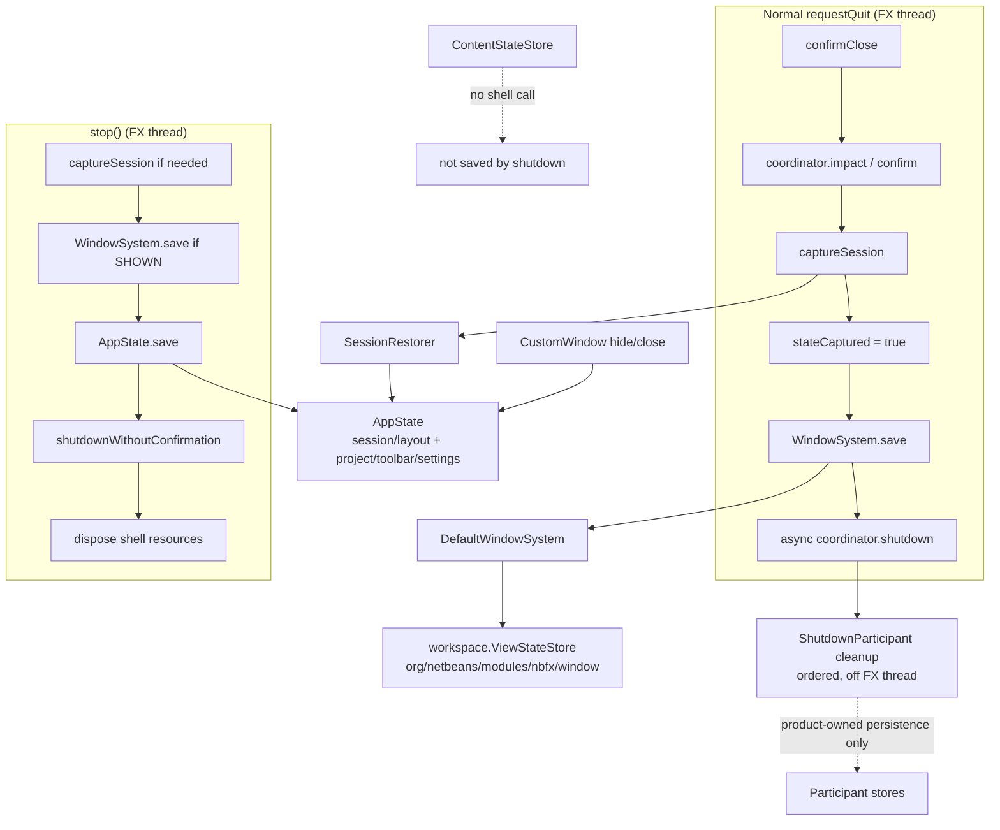

<!--

    Licensed to the Apache Software Foundation (ASF) under one
    or more contributor license agreements.  See the NOTICE file
    distributed with this work for additional information
    regarding copyright ownership.  The ASF licenses this file
    to you under the Apache License, Version 2.0 (the
    "License"); you may not use this file except in compliance
    with the License.  You may obtain a copy of the License at

      http://www.apache.org/licenses/LICENSE-2.0

    Unless required by applicable law or agreed to in writing,
    software distributed under the License is distributed on an
    "AS IS" BASIS, WITHOUT WARRANTIES OR CONDITIONS OF ANY
    KIND, either express or implied.  See the License for the
    specific language governing permissions and limitations
    under the License.

-->
# 5. AppShell shutdown

## Behavior summary

There are two shutdown entry paths:

1. **Normal close request:** the stage close handler or application menu calls
   `ShellApplication.requestQuit()`. It confirms dirty editors, collects/confirms shutdown impact,
   captures the shell session, saves `WindowSystem` state, runs coordinator cleanup off the FX
   thread, and then calls `Platform.exit()`.
2. **JavaFX `stop()` fallback:** any exit that reaches `Application.stop()` removes lifecycle
   bridges, captures state if necessary, saves window/application state, runs any outstanding
   coordinator cleanup synchronously, disposes shell resources, and asks the NetBeans platform to
   exit.

Status: **Implemented** for both paths and the default coordinator; **Partial** because shutdown is
not a single transactional owner of all content/windows/persistence and has no direct shutdown test
in this baseline; **Legacy** for the `AppState`/`SessionRestorer` capture path. Target close policies
and complete session disposal are **Target only**.

## Current signatures

```java
protected boolean confirmClose()
protected boolean requestQuit()
protected void captureSession()
protected void stopping()
@Override public void stop()
```

The public shutdown SPI is:

```java
public interface ShutdownCoordinator {
    ShutdownImpact impact();
    ShutdownSelection confirm(ShutdownImpact impact); // null means cancel
    void shutdown(ShutdownSelection selection);
}

public interface ShutdownParticipant {
    int position();
    default void contributeImpact(ShutdownImpact.Builder impact) {}
    default void shutdown(ShutdownSelection selection) throws Exception {}
}
```

`impact()` and `confirm(...)` are called on the FX thread. Normal `shutdown(...)` cleanup is called
off that thread. The `stop()` fallback may call it on the FX thread.

## Normal close-request state flow

The flags `shutdownStarted`, `shutdownCompleted`, `stateCaptured`, and `shutdownSelection` are
private implementation state, not a public state machine.

```mermaid
stateDiagram-v2
    [*] --> Running
    Running --> Running: requestQuit while shutdownStarted → false
    Running --> ConfirmEditors: requestQuit
    ConfirmEditors --> Running: dirty-editor confirmation cancelled/save failed
    ConfirmEditors --> CollectImpact: confirmed
    CollectImpact --> Running: shutdown dialog cancelled
    CollectImpact --> CaptureAndSave: empty impact or accepted selection
    CaptureAndSave --> CaptureAndSave: captureSession; stateCaptured = true
    CaptureAndSave --> CaptureAndSave: WindowSystem.save when SHOWN

    CaptureAndSave --> Exiting: no coordinator
    note right of Exiting
        shutdownCompleted = true
        Platform.exit()
        requestQuit returns true
    end note

    CaptureAndSave --> Cleaning: coordinator present
    Cleaning --> Cleaning: shutdownStarted = true; root disabled
    Cleaning --> Cleaning: coordinator.shutdown on worker; 30s wait
    Cleaning --> ExitingAfterCleanup: completion, failure, or timeout
    note right of ExitingAfterCleanup
        log failure/timeout
        shutdownCompleted = true on FX thread
        Platform.exit()
        original requestQuit returned false
    end note
    Exiting --> [*]
    ExitingAfterCleanup --> [*]
```



### 1. Reject re-entry

If `shutdownStarted` is already `true`, `requestQuit()` returns `false` immediately. The stage
close handler consumes the event, so repeated close requests cannot start another cleanup.

### 2. Confirm unsaved editors

`confirmClose()` delegates to `CloseConfirmation.confirmClose(EditorContexts.documentsSnapshot())`.

- Unmodified documents are ignored.
- Modified documents are de-duplicated by shared content, and an unsaved document is ignored when
  another clone outside the closing set remains open.
- If nothing needs saving, confirmation succeeds without UI.
- Otherwise the alert offers **Save**, **Discard**, and **Cancel** when all affected documents are
  editable. Locked documents get **Discard**/**Cancel** only.
- **Save** attempts every save. Any `IOException` is shown in an error alert and aborts shutdown.
- Cancel, dialog dismissal, or save failure returns `false`; no session capture or shutdown
  coordinator work has happened yet.

### 3. Collect and confirm shutdown impact

The shell looks up the global `ShutdownCoordinator`. If present, it calls `impact()` on the FX
thread.

- Empty impact skips `confirm(...)` and uses `ShutdownSelection.defaults(impact)` (empty maps for a
  genuinely empty impact).
- Non-empty impact calls `confirm(impact)`. A `null` result cancels shutdown before capture.
- An accepted selection is retained in `shutdownSelection` for fallback use.

The default `ShutdownCoordinatorService` builds impact from globally discovered
`ShutdownParticipant`s. It catches a participant's `RuntimeException` while collecting impact,
logs it, and continues. No concrete in-repository `ShutdownParticipant` implementation was found;
products or external modules can supply them through lookup.

### 4. Capture and save before participant cleanup

The exact order in `requestQuit()` is:

```text
confirmClose()
  → coordinator.impact() / optional confirm()
  → captureSession()
  → stateCaptured = true
  → windowSystem.save()             (only if WindowSystem reached SHOWN)
  → coordinator.shutdown(selection) (or direct Platform.exit if no coordinator)
```

`captureSession()` is a protected override point. The base implementation calls:

```java
sessionRestorer.captureSession(List.of(), List.of());
```

so it captures the legacy pane/tab layout but no project tree state. The IDE override captures
project tree state and open-project metadata, except while a previous session is still being
restored. `stateCaptured` is set after the override returns, so it means “capture was attempted,”
not “a write definitely occurred”; an override that intentionally skips capture is not retried by
`stop()`.

`WindowSystem.save()` takes its own sink snapshot and writes workspace `ViewStateStore`.
`AppState.save()` is **not** called by `requestQuit()`; it is called later in `stop()` (and by the
JVM shutdown-hook safety net). Remembered custom-window bounds are saved earlier, at each custom
window's hide/close event.

### 5. Run coordinator cleanup

If no coordinator exists:

- `shutdownCompleted` is set to `true`;
- `Platform.exit()` is called;
- `requestQuit()` returns `true`, allowing the close request to proceed.

If a coordinator exists:

- `shutdownStarted = true`;
- the shell root is disabled to prevent editing during the save/cleanup gap;
- `CompletableFuture.runAsync(() -> coordinator.shutdown(plan))` is started;
- `.orTimeout(30, TimeUnit.SECONDS)` bounds how long the shell waits;
- completion, failure, or timeout schedules `Platform.runLater(...)` on the FX thread, logs any
  failure/timeout, sets `shutdownCompleted = true`, and calls `Platform.exit()`;
- the original `requestQuit()` returns `false`, so the close event remains consumed until exit.

The timeout completes the wait exceptionally; it does **not** interrupt or cancel the coordinator
future. A blocked participant may continue running in the background after the shell starts to
exit.

## Default coordinator behavior

`ShutdownCoordinatorService` is a global `@ServiceProvider` with one
`AtomicBoolean completed` for the lifetime of that service object.

- Participants are sorted by ascending `position()`; JavaFX/global lookup order remains the tie
  order because the sort is stable.
- `shutdown(...)` uses `compareAndSet(false, true)` and returns immediately on every later call.
- A null selection is replaced with `ShutdownSelection.defaults(impact())`; the normal shell path
  supplies a non-null selection.
- Each participant's `shutdown` call is wrapped in `catch (Exception)`; failure is logged and the
  next participant still runs.
- `Error` is not caught. Once `completed` is set, even a failed first run is not retried by this
  service.
- Because the service is global rather than per shell, a second shell in the same JVM would reuse
  an already-completed coordinator.

## `stop()` fallback and cleanup order

`Application.stop()` runs on the FX thread. Its straight-line order is:

| Order | Action | Ownership/effect |
|---:|---|---|
| 1 | Remove `ViewLifecycle` and `EditorLifecycle`; null fields. | Detaches this shell's static tab lifecycle callbacks. |
| 2 | If `!stateCaptured`, call `captureSession()`. | Captures legacy session layout when normal quit has not already marked capture attempted; this branch does not set the flag itself. |
| 3 | If `windowSystemShown`, call `windowSystem.save()`. | Saves `WindowState` even if normal quit already saved it; this call is not guarded by `stateCaptured`. |
| 4 | Call `appState.save()`. | Writes toolbar/editor settings snapshot once per `AppState`. |
| 5 | Remove active-pane listener and unsubscribe scene focus subscription. | Stops active-component publication. |
| 6 | Call `shutdownWithoutConfirmation()`. | Runs coordinator synchronously only if `shutdownCompleted` is false. |
| 7 | Unsubscribe branding title subscription. | Stops stage title updates. |
| 8 | Call `branding.dispose()` and null it. | Releases branding resources. |
| 9 | Call `closeShellFrame()`. | Frame → region host → command resolver, or legacy chrome → resolver. |
| 10 | Null `shellContext`; clear application-menu flag; clear global `ShellWindowProvider`. | Removes current-shell publication. |
| 11 | Call `NbfxTheme.dispose()`. | Releases static theme installation. |
| 12 | Call `disposePanes()`. | Calls `disposePane` only for hosts created by `WindowPaneProvider`s. |
| 13 | Call legacy `stopping()` hook. | Product/subclass cleanup; IDE stops its filesystem refresher here. |
| 14 | Call `dockRuntime.dispose()` and null it. | Clears runtime references only. |
| 15 | Log and call `LifecycleManager.getDefault().exit()`. | Requests NetBeans platform shutdown. |

`stop()` does not call `WindowSystem.hide()`. Capture happens while the live scene still exists,
and the JavaFX runtime closes/hides windows as part of exit.

### Synchronous fallback coordinator

`shutdownWithoutConfirmation()` returns immediately when `shutdownCompleted` is already `true`.
Otherwise it sets that flag, looks up the coordinator, computes impact, and runs:

```java
selection = shutdownSelection == null
    ? ShutdownSelection.defaults(impact)
    : shutdownSelection;
coordinator.shutdown(selection);
```

It catches `RuntimeException` around this fallback and logs it. The default coordinator's own
one-shot flag prevents duplicate participant execution if an asynchronous cleanup is also in
progress or has completed.

## Capture/save ownership and order



The writes are independent, not atomic:

- a failure in `captureSession()` prevents later normal-quit steps because there is no catch around
  it;
- a failure in `WindowSystem.save()` prevents coordinator startup in `requestQuit()`;
- `stop()` has no surrounding `try/finally`, so an uncaught earlier failure can skip later cleanup;
- `AppState.save()` catches its own `RuntimeException` and logs it, allowing `stop()` to continue;
- frame/region/resolver/pane disposal failures are individually logged in most paths, but
  branding/theme/runtime cleanup is not individually guarded.

## Disposal rules and remaining gaps

### Explicitly disposed

- static view/editor lifecycle bridges;
- active-component listener and focus subscription;
- branding title subscription and branding;
- frame-mounted regions, renderers, contributions, and scoped commands;
- remaining region-host mounts;
- shell command resolver;
- provider-created pane hosts;
- runtime object references;
- global current-shell publication;
- static theme installation.

### Not comprehensively disposed by `stop()`

- the per-shell `DefaultContentManager` is not asked to close all open content;
- `WindowManager.windows()` is not enumerated to close every floating/custom window;
- `Docking.active` is not cleared;
- the `AppState` JVM shutdown hook cannot be removed and retains its `AppState` until JVM exit;
- `DockRuntime.dispose()` does not detach/dispose panes or content;
- `ContentStateStore` is neither flushed as part of shell shutdown nor integrated with content
  disposal;
- project/session shutdown outside overridden `captureSession()`/`stopping()` hooks remains the
  product's responsibility.

These are current implementation limits, not recommended ownership rules. The target requires
content/hosts/windows/contributions to have explicit close/unload disposal and a real session
persistence owner.

## Test evidence and uncertainty

No test directly exercising `requestQuit()`, `stop()`, `ShutdownCoordinatorService`, or a
`ShutdownParticipant` was found in this baseline. The behavior above is therefore source-derived.
Related tested pieces include:

- [CloseConfirmation.java](../../../nbfx-platform/nbfx.platform.shell/src/org/netbeans/modules/nbfx/platform/shell/CloseConfirmation.java)
- [ShutdownCoordinator.java](../../../nbfx-platform/nbfx.api.shell/src/org/netbeans/api/nbfx/shell/shutdown/ShutdownCoordinator.java)
- [ShutdownParticipant.java](../../../nbfx-platform/nbfx.api.shell/src/org/netbeans/api/nbfx/shell/shutdown/ShutdownParticipant.java)
- [ShutdownCoordinatorService.java](../../../nbfx-platform/nbfx.platform.shell/src/org/netbeans/modules/nbfx/platform/shell/ShutdownCoordinatorService.java)
- [AppStateLayoutTest.java](../../../nbfx-platform/nbfx.platform.shell/test/unit/src/org/netbeans/modules/nbfx/platform/shell/AppStateLayoutTest.java)
  covers part of the layout format that shutdown captures.

## Current versus target

The target `WindowClosePolicy` (`REDOCK`, `CLOSE_CONTENT`, `HIDE`) and owner-window propagation
are not implemented as a public policy API. The current shell has a main-stage close handler,
floating/custom handle close behavior, and a generic participant coordinator, but no unified
multi-window shutdown state machine.

Continue with [startup](04-appshell-startup.md),
[WindowSystem lifecycle](06-window-system-lifecycle.md), and
[window state and persistence](07-window-state-and-persistence.md).
