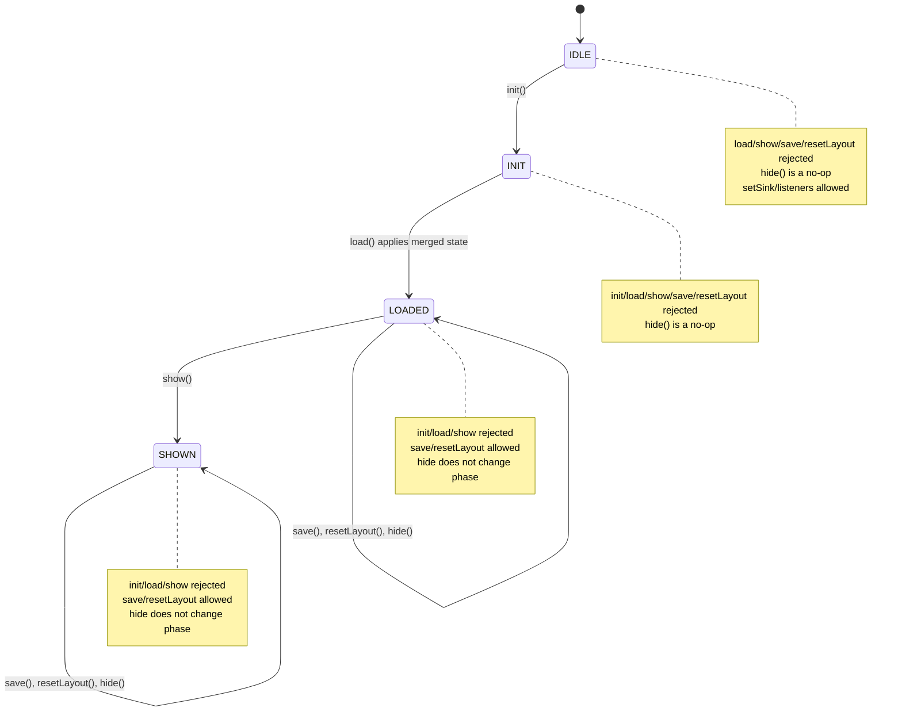

<!--

    Licensed to the Apache Software Foundation (ASF) under one
    or more contributor license agreements.  See the NOTICE file
    distributed with this work for additional information
    regarding copyright ownership.  The ASF licenses this file
    to you under the Apache License, Version 2.0 (the
    "License"); you may not use this file except in compliance
    with the License.  You may obtain a copy of the License at

      http://www.apache.org/licenses/LICENSE-2.0

    Unless required by applicable law or agreed to in writing,
    software distributed under the License is distributed on an
    "AS IS" BASIS, WITHOUT WARRANTIES OR CONDITIONS OF ANY
    KIND, either express or implied.  See the License for the
    specific language governing permissions and limitations
    under the License.

-->
# 6. WindowSystem lifecycle

## Behavior summary

`WindowSystem` is a small, phase-guarded orchestrator. It discovers view registrations, builds
layer-derived defaults, merges persisted `WindowState`, calls a `WindowSink`, and persists the
sink's current `WindowState`. It does not itself mutate JavaFX or enumerate a complete session.

Status: **Implemented** lifecycle/default merge/save/reset/listeners;
**Partial** integration with the running shell's pane/tab state;
**Legacy** for the current single-`WindowState`/`ViewStateStore` contract relative to the target;
**Target only** public `defaultState()`, `snapshot()`, `SessionState`, and `WindowStateStore`.

## Current public API

```java
public interface WindowSystem {
    void setSink(WindowSink sink);
    void init();
    void load();
    void show();
    void hide();
    void save();
    void resetLayout();
    void addWindowSystemListener(WindowSystemListener listener);
    void removeWindowSystemListener(WindowSystemListener listener);
}
```

There are no public lifecycle getters or phase enums. The implementation's `Phase` is private.

`WindowSystemListener` supplies four default no-op methods:

```java
default void loadStarted()
default void loadCompleted()
default void saveStarted()
default void saveCompleted()
```

`WindowSink` supplies the only live-shell seam:

```java
void apply(WindowState state);
WindowState snapshot();
void show();
void hide();
```

`WindowSink.snapshot()` must not be confused with a public `WindowSystem.snapshot()`; the latter
does not exist.

## Phase machine



`hide()` is deliberately not a terminal phase. A hidden `LOADED` or `SHOWN` system can still save
or reset, and there is no public transition back to `IDLE` or `INIT`.

## Operation matrix

| Operation | Required phase | Effects | Failure/notification behavior |
|---|---|---|---|
| `setSink(sink)` | Any | Performs an unsynchronized write to the `volatile` sink field; overrides any previous explicit/test sink. | Null throws `NullPointerException`. No phase guard or listener callbacks. |
| `init()` | `IDLE` only | Discovers global-lookup `WindowSystemListener`s, snapshots `registrations.get()`, enters `INIT`. | Any other phase throws `IllegalStateException`. Supplier/listener discovery failures propagate. |
| `load()` | `INIT` only | Resolves defaults + persisted state, notifies, applies through sink, enters `LOADED`. | Wrong phase throws. Listener/apply failure aborts before phase change where applicable. |
| `show()` | `LOADED` only | Calls `sink.show()`, enters `SHOWN`. | Wrong phase or sink failure throws; phase changes only after sink success. |
| `hide()` | Any | In `IDLE`/`INIT`, does nothing. In `LOADED`/`SHOWN`, calls `sink.hide()`. | Sink failure propagates; phase is unchanged. |
| `save()` | `LOADED` or `SHOWN` | `saveStarted` → `sink.snapshot()` → `store.save(...)` → `saveCompleted`. | Earlier/later phase throws. Listener/store/snapshot failures propagate; no completed callback on failure. |
| `resetLayout()` | `LOADED` or `SHOWN` | Clears persisted store, applies freshly computed defaults. Phase unchanged. | Earlier phase throws. No load/save listener callbacks. Sink failure propagates after clear. |
| `addWindowSystemListener(listener)` | Any | Adds listener; null rejected. | Duplicate adds are allowed. |
| `removeWindowSystemListener(listener)` | Any | Removes the first matching occurrence. | Null is not explicitly rejected; usually a no-op. |

The lifecycle methods (`init`, `load`, `show`, `hide`, `save`, `resetLayout`) and public listener
methods (`addWindowSystemListener`, `removeWindowSystemListener`) are `synchronized` on the
`DefaultWindowSystem` instance. `setSink` is not synchronized; it publishes through the
`volatile` sink field. The API nevertheless requires callers to use the FX thread in a running
shell; synchronization is not permission to mutate JavaFX from a worker.

## Sink resolution

The service constructor uses:

```java
ViewRegistry::discover
new ViewStateStore()
null sink
Lookup.getDefault()
```

For each sink operation, resolution is:

1. the sink explicitly supplied to the constructor or `setSink(...)`;
2. otherwise `Lookup.getDefault().lookup(WindowSink.class)`;
3. otherwise a shared no-op sink whose `snapshot()` returns `WindowState.empty()`.

The no-op sink makes headless lifecycle execution safe, but it also means a missing shell adapter
can silently discard save state. `ShellApplication.start()` explicitly registers itself before
`init()`/`load()`/`show()`.

## Initialization

`init()`:

1. requires `IDLE`;
2. iterates `services.lookupAll(WindowSystemListener.class)` and adds each listener only if the
   list does not already contain it;
3. takes `List.copyOf(registrations.get())`;
4. sets `discovered` and enters `INIT`.

Explicit listeners added before `init()` remain in insertion order. Lookup-discovered listeners
are appended in lookup order. Explicit duplicate additions are not de-duplicated. Notification
uses a snapshot array, so listener-driven add/remove calls do not modify the iteration in progress.

Registration discovery happens once. A later layer/view change is not rediscovered by `load()` or
`resetLayout()` on the same `WindowSystem` instance.

## Load: defaults, persisted state, and merge

### Default construction

`defaultAreas()` starts with the five legacy `ViewArea.defaults()` in this exact order:

1. `editor`;
2. `explorer`;
3. `navigator`;
4. `properties`;
5. `output`.

Registrations for other area ids are appended in first-discovery order. Within each area,
`ViewSpec`s are sorted by:

```text
position ascending, then id ascending
```

A registration is attached at startup only when:

```java
(openAtStartup || navigator) && persistenceType != PersistenceType.NEVER
```

`PersistenceType.ONLY_OPENED` is not special-cased here; like `ALWAYS`, it is persistable. Only
`NEVER` is excluded from startup attachment, payload defaults, and merge pruning.

Each area becomes `AreaState.docked(areaId, attachedIds, firstIdOrNull)`. Docked geometry is
`NaN`; `detached` is false.

`defaultViewPayloads()` gives every discovered registration whose persistence type is not `NEVER`
an empty-string payload. It does not limit payload defaults to startup views.

The default `WindowState` is therefore:

```java
new WindowState(
    defaultAreas(),
    Double.NaN, Double.NaN, Double.NaN, Double.NaN,
    false,
    defaultViewPayloads())
```

The source-compatible constructor leaves `profileId == null`.

### Merge rules

If `store.load()` is empty, defaults are applied unchanged. Otherwise `merge(persisted, defaults)`
uses these rules:

| Field | Rule |
|---|---|
| Areas | Iterate **default** areas only. A persisted area absent from defaults is dropped. If duplicate persisted area ids exist, the last one wins in the lookup map. |
| View order | For a persisted default area, remove ids that are unregistered or `PersistenceType.NEVER`. Kept order and duplicates are preserved. |
| Active view | Keep persisted active only if it occurs in the kept list; otherwise use first kept or `null`. |
| Detached area | Preserve `detached=true` and the persisted x/y/width/height values. There is no screen/bounds validation in the merge. |
| Docked area | Recreate with `AreaState.docked`, discarding any persisted geometry. |
| View payloads | Start with defaults, then overlay persisted entries only for registered, non-`NEVER` views. Unknown/never-persisting payloads are dropped. |
| Main x/y | Use persisted values when they are not NaN (`value == value` test); otherwise defaults. This test does not reject infinities. |
| Main width/height | Use persisted values only when `> 0`; otherwise defaults. This test does not reject positive infinity. |
| Maximized | Persisted boolean always wins, including `false`. |
| Profile id | Persisted non-null id wins; otherwise default (normally null). Blank ids are normalized to null by the store. |

There is no union of newly registered startup views into an already-persisted area. The separate
legacy `SessionRestorer.openStartupViews()` path handles “introduced default view” behavior for its
own layout model.

### Actual callback order

Despite the listener Javadoc saying `loadStarted()` runs before state is resolved, the
implementation resolves defaults, loads persisted state, and merges **before** calling
`loadStarted()`:

```text
defaultAreas/defaultViewPayloads
  → store.load + merge
  → loadStarted()
  → sink.apply(merged)
  → phase = LOADED
  → loadCompleted()
```

Tests assert that no state has been applied at `loadStarted`, not that disk/preferences resolution
has not occurred.

## Save

`save()` is valid in `LOADED` and `SHOWN` and may be repeated:

```text
saveStarted()
  → sink.snapshot()
  → store.save(snapshot)
  → saveCompleted()
```

It writes only the persisted side; it never rewrites layer/view defaults. The store write replaces
the prior snapshot. The phase remains unchanged.

A listener exception, sink exception, or preferences exception propagates. `saveCompleted()` is
not called if capture/write fails. A `saveCompleted()` exception occurs after the write and phase
change considerations do not apply because save does not change phase.

## Reset layout

`resetLayout()` is valid in `LOADED` and `SHOWN`:

```text
store.clear()
  → apply(defaultAreasAndPayloads())
```

It does not transition phase, call `loadStarted/loadCompleted`, rediscover registrations, or call
`DockRuntime.resetLayout()`. In the running shell, the sink currently applies geometry only, so
this is not a complete visible pane/tab reset. The legacy `AppState` session layout is not cleared
by this operation.

## `ShellApplication` as the real sink

The contract says `apply` attaches/detaches tabs and restores area/detach geometry. The running
shell currently implements a narrower adapter:

### `apply(WindowState)`

- returns immediately if `stage == null`;
- reads x/y/width/height/maximized;
- if width is not positive, replaces all four geometry values and maximized from legacy
  `AppState.persistedWindowBounds()`;
- sets stage width/height;
- sets x/y only when both are non-NaN and `AppState.isVisibleOnAnyScreen(...)` is true;
- logs an off-screen-position message otherwise, but does not explicitly compute a centered
  position;
- updates remembered restore width/height and sets stage maximized;
- **ignores `areas`, `viewState`, and `profileId`.**

### `snapshot()`

- determines maximization with `isMaximized()`;
- while maximized, uses remembered restore x/y/width/height; otherwise live stage geometry;
- returns:

```java
new WindowState(
    List.of(), x, y, width, height, maximized,
    Map.of(), profileId)
```

Thus area/view data round-trips in `FxWindowSystemTest` with a recording sink, but not through the
actual shell sink. The main profile id is the one selected at startup, not a persisted id read
back before frame creation.

### Maximized detection

`isMaximized()` returns false when `stage.isMaximized()` is false. Otherwise it returns true for
NaN geometry or no screen containing the stage rectangle. For the first intersecting screen, it
requires `stageWidth >= visualWidth - 4` and `stageHeight >= visualHeight - 4`. There is no upper
bound, so an oversized window also satisfies the test. This is a heuristic, not an OS window-state
query.

## `WindowState` and `AreaState` current shape

```java
public record WindowState(
    List<AreaState> areas,
    double x, double y, double width, double height,
    boolean maximized,
    Map<String, String> viewState,
    String profileId) {}

public record AreaState(
    String areaId,
    List<String> viewIds,
    String activeViewId,
    double x, double y, double width, double height,
    boolean detached) {}
```

Both records defensively copy their collections. `WindowState` validates a non-null profile id
with `ShellTokens.require`. `WindowState.empty()` has no areas, NaN geometry, `false`, empty maps,
and no profile.

These types do not contain a `DockTree`, dividers, editor document order, arbitrary `ContentId`
instances, custom-window collection, active-window id, or decoration. `DockWindow.state()` exists
for individual handles, but there is no aggregation into `SessionState`.

## Error and recovery rules

| Condition | Result |
|---|---|
| `load` before `init` | `IllegalStateException`. |
| `init` twice or `load` twice | `IllegalStateException`; there is no reinitialize/reload operation. |
| `show` before load or twice | `IllegalStateException`. |
| `save`/`resetLayout` before load | `IllegalStateException`. |
| `hide` before load | Silent no-op. |
| Missing explicit/global sink | No-op sink; load/show/save/reset still execute. |
| Missing persisted schema | `ViewStateStore.load()` returns empty; defaults apply. |
| Partial/corrupt persisted values | Readable pieces are retained; merge falls back per field/area/view. |
| Invalid nonblank persisted profile token | `ViewStateStore.load()` constructs `WindowState`, whose `ShellTokens.require` validation throws `IllegalArgumentException`; load aborts instead of falling back. Blank/missing profile remains null. |
| Stale area/view ids | Pruned by merge, not by the shell sink. |
| Listener throws | Propagates; later callbacks/listeners are not guaranteed. |
| Sink `apply`/`show`/`hide`/`snapshot` throws | Propagates; phase changes only where the implementation has already completed them. |

## Isolated lifecycle example

This is useful in a headless harness, not inside an already-started shell (whose `WindowSystem`
is already `SHOWN`):

```java
WindowSystem ws = Lookup.getDefault().lookup(WindowSystem.class);
if (ws != null) {
    ws.setSink(mySink); // non-null WindowSink
    ws.init();
    ws.load();
    ws.show();
    ws.save();          // repeatable while LOADED/SHOWN
    ws.resetLayout();   // clears persisted state, reapplies defaults
    ws.hide();          // phase stays SHOWN
}
```

In `ShellApplication`, the equivalent sequence is already executed during `start()`. Products
should not call `init/load/show` again on the global service.

## Source evidence

- [WindowSystem.java](../../../nbfx-platform/nbfx.api.shell/src/org/netbeans/api/nbfx/shell/WindowSystem.java)
- [WindowSink.java](../../../nbfx-platform/nbfx.api.shell/src/org/netbeans/api/nbfx/shell/WindowSink.java)
- [WindowSystemListener.java](../../../nbfx-platform/nbfx.api.shell/src/org/netbeans/api/nbfx/shell/WindowSystemListener.java)
- [DefaultWindowSystem.java](../../../nbfx-platform/nbfx.platform.workspace/src/org/netbeans/modules/nbfx/platform/workspace/DefaultWindowSystem.java)
- [workspace ViewStateStore.java](../../../nbfx-platform/nbfx.platform.workspace/src/org/netbeans/modules/nbfx/platform/workspace/ViewStateStore.java)
- [ShellApplication.java](../../../nbfx-platform/nbfx.platform.shell/src/org/netbeans/modules/nbfx/platform/shell/ShellApplication.java)

## Test evidence

[FxWindowSystemTest](../../../nbfx-platform/nbfx.platform.workspace/test/unit/src/org/netbeans/modules/nbfx/platform/workspace/FxWindowSystemTest.java)
covers:

- first-load defaults and startup-tab selection;
- persisted order/active/geometry override;
- stale view and stale-area pruning;
- `NEVER` persistence filtering;
- save/reload round-trip and profile-id round-trip;
- missing profile key and corrupt/partial fallback;
- reset clearing persisted state;
- lifecycle guards; and
- lookup/explicit listener notification order.

Those tests use `RecordingSink`; they do not prove that `ShellApplication` applies area/tab state.

## Current versus target

The target `WindowSystem` is expected to load/save/reset a complete per-application session and
expose `snapshot()` returning `SessionState`, with `WindowStateStore` as the owner. The baseline
has only the single-window lifecycle above and a separate legacy session path. See
[window state and persistence](07-window-state-and-persistence.md) for the actual storage split.

Related: [startup](04-appshell-startup.md), [shutdown](05-appshell-shutdown.md), and
[architecture overview](02-architecture-overview.md).
