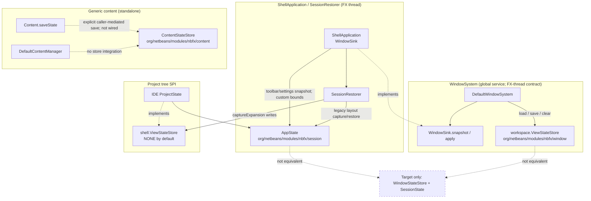
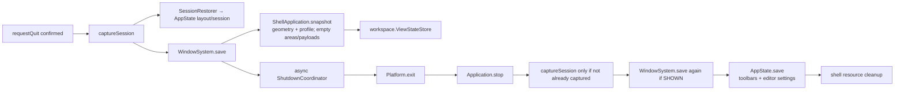

<!--

    Licensed to the Apache Software Foundation (ASF) under one
    or more contributor license agreements.  See the NOTICE file
    distributed with this work for additional information
    regarding copyright ownership.  The ASF licenses this file
    to you under the Apache License, Version 2.0 (the
    "License"); you may not use this file except in compliance
    with the License.  You may obtain a copy of the License at

      http://www.apache.org/licenses/LICENSE-2.0

    Unless required by applicable law or agreed to in writing,
    software distributed under the License is distributed on an
    "AS IS" BASIS, WITHOUT WARRANTIES OR CONDITIONS OF ANY
    KIND, either express or implied.  See the License for the
    specific language governing permissions and limitations
    under the License.

-->
# 7. Window state and persistence

## Behavior summary

Persistence at this baseline is split across four unrelated owners plus one standalone store:

1. workspace `ViewStateStore` persists the `WindowSystem`'s single `WindowState`;
2. shell `AppState` persists the legacy pane/tab layout, toolbar/editor settings, introduced views,
   project-tree hooks, and remembered custom-window bounds;
3. `SessionRestorer` captures and restores that legacy layout against live JavaFX panes/tabs;
4. shell `ViewStateStore` is only an SPI for per-project navigator tree writes; and
5. `ContentStateStore` stores opaque generic-content payloads but is not wired into shell lifecycle.

Status: **Implemented** for each existing store's current behavior;
**Partial** for integrated window/content persistence and profile restore;
**Legacy** for `AppState`/`SessionRestorer`;
**Target only** for `SessionState`, `WindowStateStore`, and a unified migration/session transaction.

## Ownership map



The two stores named `ViewStateStore` are different types in different modules. Neither is the
target `WindowStateStore`.

## Current state vocabularies

| Type | Fields / purpose | Persistence status |
|---|---|---|
| `api.shell.WindowState` | `areas`, main x/y/width/height, maximized, view payload map, profile id | Written/read by workspace `ViewStateStore`. |
| `api.shell.AreaState` | Area id, view ids/order, active view, optional detach geometry, detached flag | Nested in `WindowState`. |
| `AppState.Layout` | Legacy panes, focused pane index, `DockTree`, maximized pane index | Serialized by `AppState`; restored by `SessionRestorer`. |
| `AppState.PaneLayout` | Role, optional detached bounds, tabs/order/active index, minimized anchor, pane kind | One serialized pane line. |
| `AppState.TabEntry` | Editor/view kind, stable id, editor scroll/caret, optional editor split | One tab field in a pane line. |
| `api.content.ContentState` | `ContentId`, non-blank instance key, opaque string payload map | Written/read by standalone `ContentStateStore`. |
| `api.shell.WindowContentState` | Window id, optional `LayoutNode`, opaque payload | Returned by `WindowContent.saveState()`; not automatically written anywhere. |
| `DockWindow.state()` | Per-handle `WindowState` snapshot | Read-only snapshot; not a session store. |
| `SessionState` | All windows plus active window | **Target only**; no source type exists. |

## 1. Workspace `ViewStateStore` — `WindowSystem` state

Source: [`platform.workspace/.../ViewStateStore.java`](../../../nbfx-platform/nbfx.platform.workspace/src/org/netbeans/modules/nbfx/platform/workspace/ViewStateStore.java).

### API and location

```java
public final class ViewStateStore {
    public ViewStateStore()
    public boolean hasState()
    public Optional<WindowState> load()
    public void save(WindowState state)
    public void clear()
}
```

The test constructor taking a `Preferences` node is package-private. The default preferences node
is:

```text
org/netbeans/modules/nbfx/window
```

This class is implementation/friend code, not a public product API.

### Stored schema

| Preferences location | Keys / meaning |
|---|---|
| Root node | `schema` marker (`"1"` on save), `x`, `y`, `width`, `height`, `maximized`, optional `profile` |
| `areas/<areaId>` | `order` (comma-separated view ids), optional `active`, `detached`; when detached: `x`, `y`, `width`, `height` |
| `views/<viewId>` | Direct key named by view id; value is the opaque per-view string payload |

The `schema` value is only a presence marker. `load()` does not validate its value or use it to
select a schema version.

### Load behavior

`hasState()` is true whenever the root `schema` key is non-null. With no marker, `load()` returns
`Optional.empty()`.

With a marker:

- area child names are read in preferences enumeration order;
- `order` is split on commas and capped at 1024 entries; there is no escaping for commas in ids;
- an active id not in the order is replaced by the first id, or null for an empty area;
- detached defaults to false and detach geometry defaults to NaN;
- view payload keys are copied as strings;
- missing/blank profile loads as null;
- a `BackingStoreException` aborts the remainder of that section but retains entries already read;
  the area list or payload map is empty only if no entry was read before the failure; main geometry
  is still read;
- malformed numeric preference values are handled by `Preferences.getDouble` defaults;
- the method returns a present `WindowState` even when sections are empty.

Pruning of unknown areas/views and fallback to layer defaults happens in `DefaultWindowSystem.merge`,
not in this store.

### Save behavior

`save` writes `schema="1"`, root geometry/maximized/profile, all area fields, and all view payloads.
A null profile removes the old key. Detached geometry is written only for detached areas.

The method is content-idempotent but not one-shot: repeated calls perform writes again. It does not
explicitly call `Preferences.flush()` and is not synchronized.

Two implementation details matter:

- stale **view** keys are removed by iterating `viewsNode.keys()`;
- stale **area child nodes** are intended to be removed, but the code also iterates
  `areasNode.keys()` and then calls `areasNode.node(stale).removeNode()`. Because area data lives in
  child nodes rather than direct keys, this does not reliably enumerate stale area children. The
  window-system merge drops stale areas on read, but the old child data may remain.

### Clear behavior

`clear()` removes the `areas` and `views` child nodes and all root state keys, including `schema`.
All operations are inside one `try`; a `BackingStoreException` aborts the remaining operations and
is logged/swallowed as best effort. In particular, removing an already-absent child can prevent
later root-key removal on preferences implementations that throw for absent nodes.

## 2. `AppState` — legacy shell/session state

Source: [`platform.shell/.../AppState.java`](../../../nbfx-platform/nbfx.platform.shell/src/org/netbeans/modules/nbfx/platform/shell/AppState.java).

### API and location

`AppState` is an internal/friend implementation class with a public Java constructor for tests and
shell code. Its stable preferences node is:

```text
org/netbeans/modules/nbfx/session
```

Important methods:

```java
public void save()
public WindowBounds persistedWindowBounds()
public WindowBounds customWindowBounds(WindowId id)
public void saveCustomWindowBounds(WindowId id, double x, double y, double width, double height)
public Set<String> getIntroducedViews()
public void setIntroducedViews(Set<String> ids)
public List<String> getExpandedNodes(String projectPath)
public void setExpandedNodes(String projectPath, List<String> nodes)
public String getSelectedNode(String projectPath)
public void setSelectedNode(String projectPath, String nodeId)
```

Layout access is package-private except for the legacy migration helpers:

```java
Layout getSessionLayout()
void setSessionLayout(Layout layout)
public boolean hasSessionLayout()
public boolean hasLegacyLayouts()
public Layout readLegacyLayout(String projectPath)
public void clearLegacyLayouts()
public void migrateSessionLayout(Layout layout)
```

### What `save()` writes

`AppState.save()` uses a one-shot `AtomicBoolean saved`; only the first call writes. It persists:

- `toolbars.arrangement` when a toolbar snapshot exists;
- `toolbars.hidden` when a hidden-toolbar snapshot exists;
- `view.showLineNumbers` (default true);
- `view.showBreadcrumbs` (default true); and
- flushes preferences.

It does **not** write the pane layout, custom bounds, project-tree state, main geometry, or generic
content payloads. Those have separate write paths. Because `saved` is never reset, later changes
after the first `save()` are not written by another `save()` call; the flag is set before writing,
so a failed first write is not retried by `save()` either. The JVM shutdown hook installed at
startup calls this same method, so it is a safety net only if `stop()` has not already saved.

Toolbar and editor-setting values are kept in volatile snapshots updated on the FX thread, so
`save()` can run from the shutdown-hook thread without touching live scene nodes.

### Main-window geometry is legacy read-only state

Keys `window.x`, `window.y`, `window.width`, `window.height`, and `window.maximized` remain readable
through `persistedWindowBounds()`. The default size is `1200 × 800`; invalid non-positive stored
sizes fall back to that size.

Current `save()` does not write these keys. `ShellApplication.apply(WindowState)` reads them only
when the window-system state has no positive width, providing a migration fallback for old
userdirs. New main geometry is owned by workspace `ViewStateStore`.

### Introduced views

`views.introduced` is a newline-separated set of startup view ids. `SessionRestorer` uses it to
distinguish a newly shipped default view from one the user deliberately closed. Writes flush
immediately. An empty set removes the key.

### Project-tree state

Tree expansion/selection live under:

```text
tree.expanded/<hex project-path hash>
tree.selected/<hex project-path hash>
```

Values include the project path as a guard line, then expanded-node ids or the selected-node id.
Hash collisions are handled by checking the guard line. Writes flush immediately.

The base shell's `viewStateStore()` returns the no-op shell `ViewStateStore.NONE`. The IDE supplies
`ProjectState`, which reads/writes these `AppState` methods and also owns recent/open/selected
project metadata in the same preferences node.

### Legacy layout format

The full legacy layout is stored as one text value at:

```text
layout/session
```

`AppState.Layout` contains:

- every captured `PaneLayout` in capture order;
- `focusedIndex` (`-1` when unknown);
- optional `DockTree dock` (null means stack docked panes in default arrangement);
- `maximizedIndex` (`-1` for none).

The first line is:

```text
<guard>\t<focusedIndex>\t<formattedDockTree>\t<maximizedIndex>
```

The session guard is empty. Each later line serializes one pane:

- role name, optionally `#EDITOR` when kind differs from the role default;
- optional minimized state encoded as `@side@size@anchorLeaf@anchorSide@share@anchorPane@anchorFar`;
- x, y, width, height, active tab index;
- tab fields separated by tabs; editor/view kind, id, top paragraph, caret paragraph, caret column;
- optional editor-split orientation and second-editor view position, separated by carriage returns.

Editor tab ids are absolute file paths. View tab ids are provider ids. Detached panes carry stage
bounds; docked/minimized panes normally carry NaN bounds.

Parsing is tolerant:

- blank/malformed pane lines are skipped;
- role names must match `\\w+`;
- unknown enum values generally produce null/default fields;
- malformed tab fields are skipped;
- active indexes are only upper-clamped with `Math.min(parsedIndex, tabs.size() - 1)`; negative
  values (including values below `-1`) are preserved and later interpreted as no active tab;
- a non-permanent pane with no tabs is dropped;
- a layout with no readable panes becomes `Layout.EMPTY`;
- old `NAVIGATOR` tab kind is accepted as `VIEW`;
- older lines without focus/tree/maximized/minimized fields remain readable.

The pure CJAP `LayoutSpec`/`LayoutNode` XML format is not used here. `DockTree` is an implementation
type and is serialized with `DockTrees.format/parse`.

### Legacy migration

Legacy per-project layout keys are hexadecimal project-path hashes under the `layout` node, with a
`global` fallback. The IDE's `ProjectState.migrateLegacySession` performs a one-time conversion when
there is no session layout and legacy state/flag exists:

1. choose the last legacy project;
2. read its layout or the global legacy layout;
3. clear all legacy layout keys;
4. write the result as `layout/session`;
5. migrate open/selected project metadata.

This is a real legacy migration, but it does not retain the target's required backup and is not a
general versioned `SessionState` migration. Clearing old keys precedes writing the new value, so a
write failure can leave no layout copy.

## 3. `SessionRestorer` — live capture and restore

Source: [`platform.shell/.../SessionRestorer.java`](../../../nbfx-platform/nbfx.platform.shell/src/org/netbeans/modules/nbfx/platform/shell/SessionRestorer.java).

This class is FX-thread-bound and reaches global lookup, tabs, panes, stages, files, and
`Platform.runLater`. It is not a pure persistence API.

### Capture

```java
public void captureSession(Collection<File> projects,
        Collection<? extends ViewStateProvider> providers)
```

Order:

1. for each non-null project, resolve its `FileObject`, gather expanded/selected paths from the
   supplied view-state providers, and write through the shell `ViewStateStore` supplier;
2. capture the live pane/tab layout.

`captureLayout()`:

1. temporarily restores a maximized pane so the persisted tree is the underlying layout; it does
   not re-maximize after capture;
2. iterates `NbfxTabPane.panesByRole()`;
3. skips the sliding host pane and detached panes with no stage;
4. captures each pane's tabs in order and selected tab; minimized panes use the sliding area's
   borrowed tab list/selection;
5. skips non-permanent panes with no persistable tab;
6. records editor absolute path, scroll/caret, and split state; records view provider ids; skips
   tabs with no stable id;
7. records detached stage geometry;
8. prunes skipped leaves from the dock tree;
9. records minimized side/size/anchor, focused pane index, and maximized pane index; and
10. writes `AppState.setSessionLayout(...)` immediately.

It does not capture custom windows, `WindowContentState`, `ContentState`, decoration, chrome profile,
or a target active-window id. Existing view tabs are captured by stable view id without consulting
`ViewSpec.persistenceType()` here; in particular, this legacy path does not apply the window
system's `NEVER` filter to an already-open view tab.

### Restore

```java
public Layout startupLayout()
public void restoreSession(Consumer<EditorDocument> done)
```

`startupLayout()` returns the saved layout with editor tabs removed and remaps minimized/tree
anchors. The IDE uses this to introduce first-run views before projects load.

`restoreSession(null)` is deferred from base startup. Its behavior:

1. read `AppState.getSessionLayout()`;
2. if empty, open not-yet-introduced startup views and invoke `done(null)`;
3. if non-empty but no legacy global `ContentManager` exists, log, open startup views, and stop;
4. de-duplicate editor paths and call `ContentManager.openFile(...)`; missing files are skipped;
5. queue an FX runnable to apply the layout after editor tabs attach;
6. shape the dock area from the recorded tree, or build a fallback tree with permanent panes and
   stacked docked panes;
7. resolve view tabs through the supplied factory and editor tabs/clones through the content
   manager;
8. recreate detached panes with `AppState.clampBounds(...)`;
9. move/select tabs, recreate minimized panes and anchors, close unplaced registered view tabs,
   introduce new startup defaults, restore maximized state, and restore focus;
10. restore editor scroll/caret and split state; and
11. invoke `done(focusedDocument)` on the FX thread.

If a pane role no longer exists, its tabs move to the main editor pane or default view pane instead
of being dropped. Dynamic views with no `ViewSpec` are not closed by `closeUnplacedViewTabs`.
Reapplying an unchanged layout reuses tabs and avoids moving tabs already at the requested index.

This is a rich **legacy session-like restore** for main/detached panes, views, and editors. It is
not full target session restore: there is no `SessionState`, custom-window recreation, generic
content-factory restore, per-window profile/decoration restore, or unified active-window identity.

## 4. Remembered custom-window bounds (C3-2r)

Sources:
[`WindowOptions.java`](../../../nbfx-platform/nbfx.api.shell/src/org/netbeans/api/nbfx/shell/WindowOptions.java),
[`DefaultWindowManager.java`](../../../nbfx-platform/nbfx.platform.shell/src/org/netbeans/modules/nbfx/platform/shell/DefaultWindowManager.java),
[`CustomWindow.java`](../../../nbfx-platform/nbfx.platform.shell/src/org/netbeans/modules/nbfx/platform/shell/CustomWindow.java).

`WindowOptions` has no convenience constructor/default factory; callers provide all fields,
including `rememberBounds`. Dimensions must be finite and positive. The built-in floating default
options use `rememberBounds=false`.

For `WindowManager.createCustomWindow(...)`:

1. require `WindowKind.CUSTOM`, non-null arguments, a unique live `WindowId`, and an unattached
   content root;
2. if `rememberBounds` is true and `AppState` exists, look up bounds by stable id;
3. invalid/missing stored width/height yields no remembered bounds;
4. valid bounds are passed through `AppState.clampBounds`:
   - non-positive size falls back to `900 × 650`;
   - NaN x/y or a rectangle not intersecting any screen centers on the primary screen's visual
     bounds;
   - otherwise x/y/size are preserved;
5. constructor default width/height are replaced by the effective remembered size;
6. the custom window is shown immediately.

The preferences key is:

```text
custom.window.<base64url(WindowId.value())>
```

with `.x`, `.y`, `.width`, and `.height` suffixes. Encoding is URL-safe Base64 without padding over
UTF-8. `customWindowBounds` accepts NaN x/y, rejects non-finite/non-positive width/height, and always
returns `maximized=false`.

Bounds save on both `hide()` and `close()`/native close disposal when `rememberBounds` is true.
`AppState.saveCustomWindowBounds` validates size and flushes immediately. Closing a window that was
hidden can write the same bounds twice. Bounds are not removed on close.

This persists **geometry only**. It does not recreate a closed custom window at next launch, restore
its `WindowContent.saveState()` payload, or remember maximized/custom profile/decoration state.

## 5. Standalone `ContentStateStore`

Source: [`platform.content/.../ContentStateStore.java`](../../../nbfx-platform/nbfx.platform.content/src/org/netbeans/modules/nbfx/platform/content/ContentStateStore.java).

### API and location

```java
public final class ContentStateStore {
    public ContentStateStore()
    public synchronized void save(ContentState state)
    public synchronized Optional<ContentState> load(ContentId id, String instanceKey)
    public synchronized List<ContentState> loadAll()
    public synchronized void remove(ContentId id, String instanceKey)
    public synchronized void clear()
}
```

Default preferences node:

```text
org/netbeans/modules/nbfx/content
```

`ContentState` requires a non-null `ContentId`, a non-null/non-blank instance key, and a defensively
copied non-null payload map.

### Keying and encoding

Each entry is a child node named by lowercase SHA-256 hex of:

```text
ContentId.value() + '\u0000' + instanceKey
```

The child stores:

- `id`: canonical `namespace:name`;
- `instance`: instance key;
- `payload`: newline-separated `base64url(key)=base64url(value)` entries, without padding.

The store never interprets payload keys/values and never stores order, group, or window placement.
Saving the same id/instance replaces its payload. Different instance keys stay distinct.

### Error behavior

- null ids/instance keys/state throw `NullPointerException`/`IllegalArgumentException` according to
  the value contract;
- missing nodes load as empty;
- missing id/instance, blank instance, or invalid `ContentId` loads as empty;
- malformed encoded lines without `=` are skipped; duplicate decoded keys use the last value;
- invalid Base64 in a payload is **not caught** by `read`, so `IllegalArgumentException` can escape
  despite the general “unreadable” documentation;
- `loadAll()` catches `BackingStoreException` while enumerating children, but a decoding exception
  from one child can abort the whole call;
- `remove`/`clear` treat `BackingStoreException` as best effort;
- methods are synchronized, but there is no explicit flush, schema version, or migration.

### Integration gap

No production code constructs or calls `ContentStateStore`; only its unit test does.
`DefaultContentManager.close()` calls `content.close()` then `content.dispose()` without first
calling `saveState()` or saving it. Shell capture/shutdown never enumerates generic content state.
The current `EditorContent` and `ViewContent` adapters also return empty `ContentState` payloads;
editor path/caret/split data is carried only by the separate legacy `AppState` layout. The store is
therefore **Implemented** as a standalone component and **Partial** as CJAP persistence.

## 6. `DockWindow` snapshots are not persistence

`WindowManager.windows()` currently returns the main window first (when its area has a scene), then
live floating windows, then live custom windows. Each handle can produce state, but no shell path
aggregates or stores those states.

| Handle | `state()` behavior | `content().saveState()` behavior |
|---|---|---|
| Main | One docked `AreaState` per live dock leaf keyed by group id (`detached=false`, NaN area geometry); only non-blank view ids are listed, so editor tabs are omitted. Main-window geometry/profile/view payload come from the shell state supplier. | `WindowContentState.empty(mainId, layout())`; no payload. |
| Floating | One detached area keyed by group id with view ids/active and stage geometry; no profile. | Payload contains `selectedTab` as a string; layout is one group. |
| Custom | Empty areas, stage geometry, `maximized=false`, profile id from options. | Implemented by product content; the shell does not call it during state capture. |

`WindowContentState` and `ContentState` are different contracts. Neither `DockWindow.state()` nor
`WindowContent.saveState()` implicitly writes preferences.

## Startup persistence data flow

```mermaid
sequenceDiagram
    participant S as ShellApplication
    participant W as WindowSystem
    participant V as workspace.ViewStateStore
    participant A as AppState
    participant R as SessionRestorer
    participant D as DockRuntime / panes

    S->>W: setSink(this); init(); load()
    W->>V: load()
    V-->>W: Optional<WindowState>
    W->>W: merge over ViewRegistry defaults
    W->>S: apply(WindowState)
    Note over S: current sink applies main geometry only
    S->>S: show; publish shell; UiReady
    S->>R: Platform.runLater(restoreSession)
    R->>A: getSessionLayout()
    alt empty legacy layout
        R->>R: openStartupViews()
    else non-empty layout
        R->>R: open editor paths through legacy ContentManager
        R->>D: queued layout apply / detached windows / focus
    end
    R-->>S: restoreSession returns (layout apply may still be queued)
    S->>D: completeStartupLayout()
```

Profile selection has already happened before `WindowSystem.load()`. The persisted
`WindowState.profileId()` therefore does not select the frame at this baseline. Similarly, when
the legacy layout is empty, `SessionRestorer.openStartupViews()` considers `openAtStartup` only;
`WindowSystem` defaults also consider `navigator`, but the current shell sink does not apply those
default area tabs.

## Shutdown persistence data flow



Custom bounds follow an event-driven path instead: hide/close → `DefaultWindowManager` →
`AppState.saveCustomWindowBounds` → immediate preferences flush. `ContentStateStore` has no arrow
from this flow.

## Defaults, corruption, and missing data

| Data | Missing/corrupt behavior |
|---|---|
| Workspace `WindowState` | No schema → defaults. A failed section read retains entries read before the `BackingStoreException`, then merge applies per-field/area/view fallback. Stale areas/views → pruned by `DefaultWindowSystem`. |
| Main geometry | Width not `> 0` in merged state → shell sink uses legacy `AppState` bounds for all geometry/maximization, ultimately `1200 × 800` when none are stored. Height alone does not trigger fallback. NaN x/y → stage default position. Off-screen x/y → not applied. |
| Profile id | Missing/blank preference → null. An invalid nonblank token throws `IllegalArgumentException` during `WindowState` construction. Startup selects profile from current lookup/policy, not persisted id. |
| Legacy layout | Missing/blank/malformed-to-empty → `Layout.EMPTY`; startup views open. Individual bad pane/tab lines are skipped. |
| Editor file | Missing path/file is logged/skipped during restore. |
| Pane role | Missing live target → tabs move to editor/default-view fallback. |
| Recorded dock tree | Tree not accepted or leaf/pane mismatch → warning and fallback tree. |
| Detached bounds | NaN x/y or off-screen → center on primary visual bounds; NaN/non-positive size → `900 × 650`. |
| Custom bounds | Missing/invalid size → constructor defaults. Off-screen saved position → centered on restore. |
| Content payload | Missing/missing metadata → empty. Invalid Base64 can throw rather than fall back. |
| Monitor removal | Main/custom/detached geometry uses intersection/centering checks; there is no target diagnostic/backup system. |

## Threading, ownership, and disposal

| Concern | Rule |
|---|---|
| `WindowSystem` store access | Called by the FX-thread lifecycle; workspace `ViewStateStore` itself is not synchronized. |
| `SessionRestorer` | FX thread only; capture while windows still show; restore may queue further FX work. |
| `AppState.save()` | Safe off FX thread because it reads volatile snapshots; one-shot per instance. |
| Layout/custom/tree writes | `AppState` methods flush immediately and are called from FX-thread shell/product code in current paths. |
| `ContentStateStore` | Synchronized and JavaFX-free; safe for explicit caller use from any thread. |
| Content state lifetime | `Content.saveState()` is documented as callable before disposal, but current manager/shutdown does not call it automatically. |
| Store ownership | No store closes content, windows, or scene nodes. No shell resource is disposed by a persistence write. |
| Transactions | There is no transaction spanning workspace state, legacy layout, custom bounds, content payloads, and shutdown participants. |

## Test evidence

- [FxWindowSystemTest](../../../nbfx-platform/nbfx.platform.workspace/test/unit/src/org/netbeans/modules/nbfx/platform/workspace/FxWindowSystemTest.java)
  covers window-state defaults/merge/round-trip/profile/corruption/reset.
- [AppStateLayoutTest](../../../nbfx-platform/nbfx.platform.shell/test/unit/src/org/netbeans/modules/nbfx/platform/shell/AppStateLayoutTest.java)
  covers minimized-pane serialization, anchors, editor kind, old formats, and anchor remapping.
- [SessionRestorerTest](../../../nbfx-platform/nbfx.platform.shell/test/unit/src/org/netbeans/modules/nbfx/platform/shell/SessionRestorerTest.java)
  covers fallback of view tabs from a removed pane role. It does not cover a full session round-trip.
- [CustomWindowTest](../../../nbfx-platform/nbfx.platform.shell/test/unit/src/org/netbeans/modules/nbfx/platform/shell/CustomWindowTest.java)
  covers remembered custom bounds across manager instances.
- [ContentStateStoreTest](../../../nbfx-platform/nbfx.platform.content/test/unit/src/org/netbeans/modules/nbfx/platform/content/ContentStateStoreTest.java)
  covers opaque payload round-trip, instance separation, replacement, and clear.

No direct test was found for a complete `ShellApplication` capture/save/stop/restart cycle, full
`SessionRestorer` round-trip, workspace `ViewStateStore.clear()` edge cases, or shutdown integration
with `ContentStateStore`.

## Current versus target

The [target persistence contract](../../reference/cjap-shell-ui.md#19-persistence) requires:

- `WindowStateStore` owning one `SessionState` with all windows and active window;
- `WindowState` containing groups/tree/dividers/content order/active/geometry/profile/decoration;
- `ContentStateStore` owning only per-content payloads;
- no JavaFX types persisted;
- one-time migration with backup, deterministic corruption fallback, and diagnostics; and
- `DockWindow.state()` plus `WindowSystem.snapshot()` as the capture surface.

The baseline has per-window snapshot methods and a standalone content store, but no `SessionState`
aggregation, no public `WindowSystem.snapshot()`, no `WindowStateStore`, legacy JavaFX-coupled
layout serialization, and no backup-bearing unified migration. Remembered custom bounds are a
real C3-2r feature, not evidence of full custom-window/session restoration.

Related: [startup](04-appshell-startup.md), [shutdown](05-appshell-shutdown.md),
[WindowSystem lifecycle](06-window-system-lifecycle.md), and
[architecture overview](02-architecture-overview.md).
