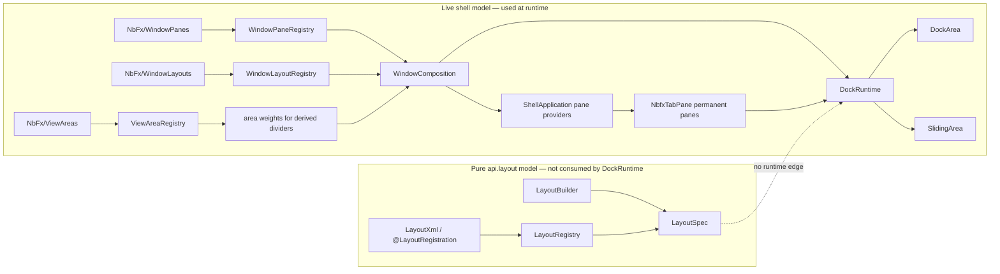
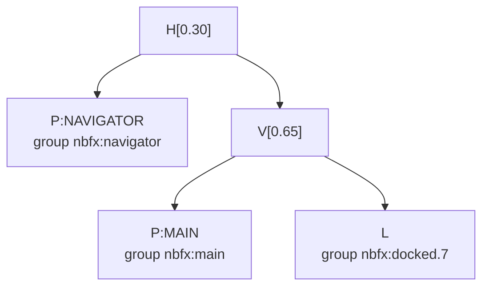

<!--

    Licensed to the Apache Software Foundation (ASF) under one
    or more contributor license agreements.  See the NOTICE file
    distributed with this work for additional information
    regarding copyright ownership.  The ASF licenses this file
    to you under the Apache License, Version 2.0 (the
    "License"); you may not use this file except in compliance
    with the License.  You may obtain a copy of the License at

      http://www.apache.org/licenses/LICENSE-2.0

    Unless required by applicable law or agreed to in writing,
    software distributed under the License is distributed on an
    "AS IS" BASIS, WITHOUT WARRANTIES OR CONDITIONS OF ANY
    KIND, either express or implied.  See the License for the
    specific language governing permissions and limitations
    under the License.

-->
# 8. Layout and window composition

**Baseline:** `f2e43e8b58` (C3-2r).
**Audience:** product developers, shell maintainers, and contributors declaring panes or layouts.

## 8.1 Status at a glance

| Area | Status | What that means in this baseline |
|---|---|---|
| Registered panes, view areas, first-run `DockTree`, `WindowComposition`, `DockArea`, and `SlidingArea` | **Implemented** | These are the models the live shell actually builds and mutates. |
| Per-shell `DockRuntime` ownership | **Implemented** | A runtime owns its area, slides, composition, and lookup snapshots. |
| Static `Docking` facade | **Legacy** | It delegates to the most recently created runtime; new product code should not depend on it. |
| `org.netbeans.spi.nbfx.shell.WindowPane*` | **Legacy** | The SPI remains, but its host is still the shell's internal `NbfxTabPane`. |
| Pure `api.layout.LayoutSpec` builder, XML, annotations, and registry | **Implemented** | Immutable, content-free layouts can be authored and discovered. |
| Consumption of `LayoutSpec` by the live dock runtime | **Target only** | `DockRuntime` does **not** read `LayoutRegistry` or build itself from `LayoutSpec`. |
| Target area capabilities, presentations, empty policies, and declarative docking-policy specs affecting live panes | **Target only** | The pure metadata exists, but the live pane runtime does not enforce it. |

The central rule for this chapter is:

> There are two layout models. The live model is `WindowComposition` + `WindowPane` + legacy `ViewArea` + `DockTree`. The pure model is `LayoutSpec` + `LayoutNode` + `api.layout.ViewArea` + `DockGroupSpec`. They are not interchangeable, and no adapter currently turns the second into the first.

See [WindowManager and identities](09-window-manager-and-identities.md) for the public handles over the live model and [docking operations](11-docking-operations-and-pane-behavior.md) for mutations.

## 8.2 The two models side by side



### 8.2.1 Same-looking names, different contracts

| Concept | Live type | Pure type | Important difference |
|---|---|---|---|
| Pane/area identity | `org.netbeans.api.nbfx.shell.PaneRole` | `org.netbeans.api.nbfx.layout.PaneRole` | Live roles name panes (`MAIN`, `NAVIGATOR`, `DOCKED`, `DETACHED`, `SLIDE`, or a word-like product role). Pure roles identify logical areas (`nbfx:main`, `nbfx:side`, `nbfx:bottom`, `nbfx:center`, or `namespace:name`). |
| Area | `org.netbeans.api.nbfx.views.ViewArea` | `org.netbeans.api.nbfx.layout.ViewArea` | Live areas have four fields and route views to panes. Pure areas have policy, presentation, capability, style, visibility, empty-state, and ordering metadata. |
| Pane semantics | `org.netbeans.api.nbfx.views.PaneKind` | `org.netbeans.api.nbfx.layout.PaneKind` | Both currently have `EDITOR` and `VIEW`, but they are distinct types in distinct modules. |
| Routing location | `org.netbeans.api.nbfx.views.DockLocation` | `org.netbeans.api.nbfx.layout.DockLocation` | Live values are concrete desktop locations; pure values are logical `CENTER/START/END/TOP/BOTTOM`. |
| Tree | `org.netbeans.modules.nbfx.platform.workspace.DockTree` | `org.netbeans.api.nbfx.layout.LayoutNode` | Live leaves denote pane positions; pure leaves reference declared physical groups or runtime slots. |
| Physical group | `DockGroupId` assigned to each `NbfxTabPane` | `DockGroupSpec` declared in `LayoutSpec` | Live group ids are assigned by pane construction. Pure group specs are declarations, not live panes. |

Do not cast or substitute one family for the other. In particular, a live `PaneRole.MAIN` is not a pure `PaneRole.MAIN`, and a live `ViewArea` cannot be passed where a pure `ViewArea` is required.

## 8.3 Live composition: declarations and registries

### 8.3.1 `WindowComposition`

Source: [`WindowComposition.java`](../../../nbfx-platform/nbfx.platform.shell/src/org/netbeans/modules/nbfx/platform/shell/WindowComposition.java).

```java
public record WindowComposition(List<WindowPane> panes, DockTree tree) {
    public Optional<WindowPane> pane(String id);
    public Optional<WindowPane> paneForArea(String areaId);
    public PaneRole defaultViewRole();
}
```

- The constructor defensively copies `panes`.
- `tree` may be `null`; the area then uses its default shape.
- `pane` and `paneForArea` return the **first** case-insensitive match.
- `paneForArea` returns empty for null/blank area ids.
- `defaultViewRole()` chooses the lowest-position registered `VIEW` pane, never an editor pane, and falls back to `PaneRole.NAVIGATOR`.

This is a resolved startup snapshot. `DockRuntime` uses its stored composition for pane/area lifecycle lookups rather than re-reading the registries after every operation.

### 8.3.2 `WindowPane` and `@PaneRegistration`

Sources: [`WindowPane.java`](../../../nbfx-platform/nbfx.api.shell/src/org/netbeans/spi/nbfx/shell/WindowPane.java), [`PaneRegistration.java`](../../../nbfx-platform/nbfx.api.views/src/org/netbeans/api/nbfx/views/PaneRegistration.java).

```java
public record WindowPane(
        String id, String displayName, PaneKind kind, String area,
        boolean keepWhenEmpty, int position) {
    public PaneRole role();
}

@Repeatable(PaneRegistrations.class)
@Retention(RetentionPolicy.SOURCE)
@Target(ElementType.TYPE)
public @interface PaneRegistration {
    String id();
    String displayName();
    PaneKind kind() default PaneKind.VIEW;
    String area() default "";
    boolean keepWhenEmpty() default false;
    int position() default Integer.MAX_VALUE;
}
```

The processor writes `NbFx/WindowPanes/<id>`. `WindowPaneRegistry.discover()` reads that folder, sorts by `position` then id, and returns an immutable list. Its cache is invalidated when entries below `NbFx/WindowPanes` change.

Registry rules are stricter than the record constructor:

- The file id must match `\w+`.
- Reserved non-permanent live roles (`DOCKED`, `DETACHED`, `SLIDE`) are rejected as declarations.
- An unknown string kind is logged and skipped. An absent or wrong-typed kind attribute silently defaults to `VIEW`.
- `MAIN` is forced to `EDITOR`; no other declaration may be an editor pane.
- Missing/blank display names fall back to the id.
- Missing area becomes `""`; missing `keepWhenEmpty` becomes `false`; missing position becomes `Integer.MAX_VALUE`.

The platform declares its permanent panes exactly like product panes:

| id | display name | kind | area | `keepWhenEmpty` | position |
|---|---|---|---|---:|---:|
| `NAVIGATOR` | Navigator | `VIEW` | `explorer` | `false` | 10 |
| `MAIN` | Editor | `EDITOR` | `editor` | `true` | 20 |

Source: [`PlatformWindowPanes.java`](../../../nbfx-platform/nbfx.platform.shell/src/org/netbeans/modules/nbfx/platform/shell/PlatformWindowPanes.java).

### 8.3.3 Live `PaneRole`

Source: [`api.shell.PaneRole`](../../../nbfx-platform/nbfx.api.shell/src/org/netbeans/api/nbfx/shell/PaneRole.java).

```java
public static final PaneRole NAVIGATOR; // permanent
public static final PaneRole MAIN;      // permanent
public static final PaneRole DOCKED;    // non-permanent
public static final PaneRole DETACHED;  // non-permanent
public static final PaneRole SLIDE;     // non-permanent

public String name();
public boolean isPermanent();
public boolean isMain();
public PaneKind defaultKind();
public static PaneRole of(String name);
```

`of` accepts only a non-null `\w+` name. Built-in names are case-sensitive; an unknown word becomes a permanent product role. Equality/hash code use the name. `MAIN.defaultKind()` is `EDITOR`; every other role defaults to `VIEW`.

`DETACHED` and `SLIDE` are runtime states expressed as legacy pane roles. This is precisely the modeling the target replaces: in the target, `DOCKED`, `DETACHED`, and `SLIDE` are runtime group/window states, not logical `PaneRole` values.

### 8.3.4 Live `ViewArea` and `ViewAreaRegistry`

Sources: [`api.views.ViewArea`](../../../nbfx-platform/nbfx.api.views/src/org/netbeans/api/nbfx/views/ViewArea.java), [`ViewAreaRegistry.java`](../../../nbfx-platform/nbfx.api.views/src/org/netbeans/api/nbfx/views/ViewAreaRegistry.java), [`AreaRegistration.java`](../../../nbfx-platform/nbfx.api.views/src/org/netbeans/api/nbfx/views/AreaRegistration.java).

```java
public record ViewArea(String id, String displayName,
                       DockLocation location, double weight) {
    public static final ViewArea EDITOR;
    public static final ViewArea EXPLORER;
    public static final ViewArea NAVIGATOR;
    public static final ViewArea PROPERTIES;
    public static final ViewArea OUTPUT;
    public static List<ViewArea> defaults();
    public static Optional<ViewArea> defaultFor(DockLocation location);
    public static Optional<ViewArea> lookUp(String id);
}

@Repeatable(AreaRegistrations.class)
@Retention(RetentionPolicy.SOURCE)
@Target(ElementType.TYPE)
public @interface AreaRegistration {
    String id();
    String displayName();
    DockLocation location();
    double weight() default 0.3d;
    int position() default Integer.MAX_VALUE;
}
```

Construction requires non-null fields and a non-NaN weight in `[0,1]`. The registry merges the five built-in defaults with `NbFx/ViewAreas/<id>` declarations; a declaration with a default id overrides that metadata. New ids add destinations. `find` is case-insensitive and blank/null returns empty.

Registry parsing requires a valid location. Missing display name falls back to the folder name; missing/invalid weight falls back to `0.3` only when absent, while an explicitly out-of-range value causes the declaration to be logged and skipped. Discovery orders areas by `DockLocation.ordinal()`, declared position, then id.

Platform defaults:

| id | location | weight | position |
|---|---|---:|---:|
| `editor` | `CENTER` | 1.0 | 10 |
| `explorer` | `LEFT` | 0.3 | 20 |
| `navigator` | `LEFT_BOTTOM` | 0.5 | 30 |
| `properties` | `RIGHT` | 0.3 | 40 |
| `output` | `CENTER_BOTTOM` | 0.3 | 50 |

Source: [`PlatformViewAreas.java`](../../../nbfx-platform/nbfx.platform.workspace/src/org/netbeans/modules/nbfx/platform/workspace/PlatformViewAreas.java).

The live `DockLocation` values are `LEFT`, `LEFT_BOTTOM`, `CENTER`, `CENTER_BOTTOM`, `BOTTOM`, and `RIGHT`. A live area is a routing destination; the `DockTree` decides actual geometry.

## 8.4 Live `DockTree`: persisted shape without content

Sources: [`DockTree.java`](../../../nbfx-platform/nbfx.platform.workspace/src/org/netbeans/modules/nbfx/platform/workspace/DockTree.java), [`DockTrees.java`](../../../nbfx-platform/nbfx.platform.workspace/src/org/netbeans/modules/nbfx/platform/workspace/DockTrees.java).

```java
public sealed interface DockTree {
    record Leaf(String primary) implements DockTree {
        public boolean isPrimary();
    }
    DockTree DOCKED = new Leaf(null);
    static DockTree primary(String role);

    record Split(Orientation orientation, List<DockTree> children,
                 List<Double> dividers) implements DockTree {}

    default int leafCount();
    default List<Leaf> leaves();             // depth-first
    default int indexOf(String role);        // -1 when absent
    default boolean hasDistinctPrimaries();
    default DockTree retainLeaves(IntPredicate keep);
}
```

- A primary leaf names a permanent role; each role may appear at most once in a valid area tree.
- A `null` primary denotes a docked pane. Multiple docked leaves are distinct by depth-first position, not by an id stored in the tree.
- `Split` requires at least two children and exactly `children.size() - 1` dividers; collections are copied.
- The live `Split` constructor checks arity but does **not** enforce the pure model's strict divider range/order invariants.
- `retainLeaves` collapses one-child splits, redistributes removed space, and returns null when no leaf remains.

### 8.4.1 Text form

`DockTrees.format`/`parse` use:

```text
P:ROLE                         permanent pane
L                              docked pane
H[dividers](child,child,...)   horizontal split: side by side
V[dividers](child,child,...)   vertical split: stacked
```

Example:

```text
H[0.2200](P:NAVIGATOR,V[0.6500](P:MAIN,L))
```

`H[](...)` and `V[](...)` mean “derive dividers from registered area weights.” `DockTrees.DERIVE` is `Double.NaN`. `parse` returns null for malformed text rather than throwing. `format` prints four decimal places; `print` produces an indented debug tree.

Divider derivation works recursively:

1. A leaf with no area, or an area weight outside `(0,1)`, is flexible.
2. Fixed side-area weights are reserved first.
3. Flexible leaves/splits share the remaining weight equally.
4. Shares are normalized to sum to one; if the total is non-positive, children receive equal shares.
5. A split's explicit divider list wins only when **none** of its dividers is NaN. If any divider is NaN, every divider at that split is recomputed from the child shares; child splits are still resolved recursively.

### 8.4.2 First-run layout registration

Source: [`WindowLayoutRegistration.java`](../../../nbfx-platform/nbfx.api.views/src/org/netbeans/api/nbfx/views/WindowLayoutRegistration.java).

```java
@Repeatable(WindowLayoutRegistrations.class)
@Retention(RetentionPolicy.SOURCE)
@Target(ElementType.TYPE)
public @interface WindowLayoutRegistration {
    String id() default "default";
    String tree();
}
```

The processor writes `NbFx/WindowLayouts/<id>`. `WindowLayoutRegistry.defaultTree()` reads `default`; `find(id)` reads another id. Missing, non-string, blank, or malformed trees produce `Optional.empty()`; malformed text is logged. Persisted live pane/tab layout is restored separately by `AppState`/`SessionRestorer` and wins over this first-run declaration. `WindowSystem` is not the pane/tab restore path in this baseline: the shell `WindowSink.apply` consumes main geometry/maximized state only, and `ShellApplication.snapshot()` returns no areas or tabs.

The platform default is:

```java
@WindowLayoutRegistration(id = "default", tree = "H[](P:NAVIGATOR,P:MAIN)")
```

With the default explorer weight, the resolved tree is `H[0.3000](P:NAVIGATOR,P:MAIN)`.

## 8.5 How the live window is assembled

Sources: [`WindowCompositionResolver.java`](../../../nbfx-platform/nbfx.platform.shell/src/org/netbeans/modules/nbfx/platform/shell/WindowCompositionResolver.java), [`DockRuntime.java`](../../../nbfx-platform/nbfx.platform.shell/src/org/netbeans/modules/nbfx/platform/shell/DockRuntime.java), [`ShellApplication.java`](../../../nbfx-platform/nbfx.platform.shell/src/org/netbeans/modules/nbfx/platform/shell/ShellApplication.java).

### 8.5.1 Resolution and pane creation

1. `WindowCompositionResolver.resolve()` reads `WindowPaneRegistry.discover()`.
2. It reads `WindowLayoutRegistry.defaultTree()`.
3. For each primary leaf, it finds the first registered pane with that role, then the first `ViewArea` matching the pane's nonblank area id, and uses that area's weight to resolve missing dividers.
4. It returns a new `WindowComposition` containing the immutable pane list and resolved tree.
5. `ShellApplication.start` creates a `WindowPaneContext` over that snapshot.
6. Panes are instantiated in declaration order. The editor pane is resolved through the content-manager path. For other panes, the highest-priority `WindowPaneProvider` that returns a host wins; otherwise the shell creates a default `NbfxTabPane`.
7. A provider must return the shell-created host with the declared role. An unsupported host or wrong role is logged, disposed through its provider, and replaced with a default pane.
8. No instantiated primary pane is a startup error.

`WindowPaneContext.createHost` is the supported way for a provider to obtain the host. A fully arbitrary node type is not yet supported: `WindowPaneHost.pane()` still returns `TabPane`.

### 8.5.2 `DockRuntime` construction

```java
public DockRuntime(WindowComposition composition,
                   Map<String, NbfxTabPane> primaries);
```

The constructor performs these steps:

1. Validate every supplied role with live `PaneRole.isPermanent()`.
2. Order panes by the composition tree's primary leaves, then append registered panes omitted from the tree.
3. If exactly two panes remain, use the registered `explorer` weight (fallback `0.3`) as their divider; otherwise use equal shares.
4. Choose `MAIN` as the area's main role when present, otherwise the last ordered pane.
5. Build `DockArea`, initially retaining empty docked leaves so restored/startup content can find them.
6. Apply the declared tree only when `DockArea.accepts(tree)` succeeds. Unknown permanent roles cause a warning and leave the area's default shape in place.
7. Re-show any `keepWhenEmpty` primary hidden by the applied shape.
8. Snapshot the first pane for each declared area id and the first area for each legacy location.
9. Build the `SlidingArea` around the dock area.

`DockRuntime.paneAt(DockLocation)` prefers a registered area at that location; otherwise it uses the legacy fixed mapping. `paneOf(ViewArea)` prefers the pane whose declaration names the area id, then falls back to the area's location. `completeStartupLayout()` releases retained empty docked leaves and hides still-empty non-main permanent panes.

`resetLayout()` reapplies the declared/default shape only when the current area accepts it. `saveLayout()` is currently a no-op; the target `WindowStateStore` integration is not present.

### 8.5.3 Ownership and disposal

- `ShellApplication` owns the `DockRuntime` and calls `dispose()` during shell teardown.
- `DockRuntime.dispose()` clears its area, slides, and composition references. It does not close content or dispose every pane.
- Provider-created panes are released through `WindowPaneProvider.disposePane` by the shell.
- The static `Docking` facade points at the most recently **registered** runtime. Constructing a `DockRuntime` directly does not replace that facade pointer.
- A disposed runtime reports null from `area()`/`slides()`; other methods are not a supported post-disposal API.

## 8.6 A live scene, including group identities

`DockTree` itself has no physical group ids. `DefaultWindowManager` obtains those from the `NbfxTabPane` at each depth-first leaf. For example:



Equivalent persisted/debug shape:

```text
H [0.30]
├─ P:NAVIGATOR     nbfx:navigator
└─ V [0.65]
   ├─ P:MAIN        nbfx:main
   └─ L            nbfx:docked.7
```

The `7` is illustrative: `DOCKED` and `DETACHED` pane ids come from a process-local sequence. Permanent roles use stable role-derived ids. See [WindowManager and identities](09-window-manager-and-identities.md).

The sliding panel is another live pane (`SLIDE`, group `nbfx:slide`). While a minimized tab is on loan to that panel, its actual JavaFX parent is the slide pane; this affects raw pane enumeration and `groupOf` even though the minimized group remains the tab's logical home.

## 8.7 Pure `api.layout` model

Everything in this section is **Implemented** as a pure API. None of it is consumed by the live `DockRuntime` in this baseline.

### 8.7.1 Pure `PaneRole` and `ViewAreaKind`

Sources: [`layout.PaneRole`](../../../nbfx-platform/nbfx.api.layout/src/org/netbeans/api/nbfx/layout/PaneRole.java), [`ViewAreaKind.java`](../../../nbfx-platform/nbfx.api.layout/src/org/netbeans/api/nbfx/layout/ViewAreaKind.java), [`Ids.java`](../../../nbfx-platform/nbfx.api.layout/src/org/netbeans/api/nbfx/layout/Ids.java).

```java
public final class PaneRole {
    public static final PaneRole MAIN;   // nbfx:main
    public static final PaneRole SIDE;   // nbfx:side
    public static final PaneRole BOTTOM; // nbfx:bottom
    public static final PaneRole CENTER; // nbfx:center
    public static PaneRole of(String value);
    public String value();
}

public final class ViewAreaKind {
    public static final ViewAreaKind MAIN;
    public static final ViewAreaKind SIDE;
    public static final ViewAreaKind BOTTOM;
    public static final ViewAreaKind CANVAS;
    public static final ViewAreaKind TOOL;
    public static final ViewAreaKind CUSTOM;
    public static ViewAreaKind of(String value);
    public String value();
}
```

Built-in short and canonical forms are case-insensitive. Product ids require `namespace:name`; each part must match `[A-Za-z0-9][A-Za-z0-9._-]*`. Product namespaces/names remain case-sensitive. `EDITOR`, `NAVIGATOR`, `OUTPUT`, and `PROPERTIES` are not built-in pure roles; products define them.

### 8.7.2 Pure `ViewArea`

Source: [`layout.ViewArea`](../../../nbfx-platform/nbfx.api.layout/src/org/netbeans/api/nbfx/layout/ViewArea.java).

```java
public record ViewArea(
        PaneRole id,
        ViewAreaKind kind,
        String displayName,
        DockLocation defaultLocation,
        double weight,
        PresentationId defaultPresentation,
        Set<ViewAreaCapability> capabilities,
        String policyId,
        AreaStyle style,
        ViewAreaVisibility visibility,
        EmptyAreaPolicy emptyPolicy,
        int order) {}
```

Validation requires non-null fields, a nonblank display name and policy id, a non-NaN weight in `[0,1]`, and defensively copies capabilities. `AreaStyle` defensively copies its class set and resource lists; `AreaStyle.EMPTY` is the neutral value.

| Type | Values |
|---|---|
| `DockLocation` | `CENTER`, `START`, `END`, `TOP`, `BOTTOM` |
| `PresentationId` built-ins | `TABBED`, `SINGLE`, `CANVAS`, `OVERLAY`, `HEADERLESS` (`nbfx:*`) |
| `ViewAreaCapability` | `CLOSABLE`, `MOVABLE`, `REORDERABLE`, `DETACHABLE`, `MINIMIZABLE`, `MAXIMIZABLE`, `SPLITTABLE`, `COLLAPSIBLE`, `ACCEPTS_DROPS`, `ACCEPTS_FILES`, `SCROLLABLE` |
| `ViewAreaVisibility` | `STARTUP`, `ON_DEMAND`, `ALWAYS` |
| `EmptyAreaPolicy` | `KEEP`, `HIDE`, `COLLAPSE` |

`defaultLocation` and `weight` are routing defaults. Explicit tree geometry wins. These fields do not yet control the live `DockArea`.

### 8.7.3 `DockGroupSpec`

Source: [`DockGroupSpec.java`](../../../nbfx-platform/nbfx.api.layout/src/org/netbeans/api/nbfx/layout/DockGroupSpec.java).

```java
public record DockGroupSpec(
        DockGroupId id,
        PaneRole area,
        PaneKind kind,
        PresentationId presentation,
        ContentCapacity capacity,
        String policyId,
        GroupLifetime lifetime,
        AreaStyle style) {}
```

All fields are required and non-null; `policyId` must be nonblank. Enums are:

- `PaneKind`: `EDITOR`, `VIEW`.
- `ContentCapacity`: `NONE`, `ONE`, `MANY`.
- `GroupLifetime`: `PERSISTENT`, `TRANSIENT`, `PINNED`.

`DockGroupId.of("product:editor.main")` creates a stable namespaced identity with `namespace()`, `name()`, and `value()`. It is a declaration identity, not the id currently assigned to an `NbfxTabPane`.

### 8.7.4 `LayoutSpec` and `LayoutNode`

Sources: [`LayoutSpec.java`](../../../nbfx-platform/nbfx.api.layout/src/org/netbeans/api/nbfx/layout/LayoutSpec.java), [`LayoutNode.java`](../../../nbfx-platform/nbfx.api.layout/src/org/netbeans/api/nbfx/layout/LayoutNode.java).

```java
public record LayoutSpec(
        String id,
        int formatVersion,
        Map<PaneRole, ViewArea> areas,
        Map<DockGroupId, DockGroupSpec> groups,
        LayoutNode root,
        Map<String, String> metadata) {
    public LayoutSpec normalized();
}

public sealed interface LayoutNode {
    static Group group(String groupId);
    static Group group(DockGroupId groupId);
    static Slot slot(String id, PaneRole area, DockSide side);

    record Split(SplitOrientation orientation, List<LayoutNode> children,
                 List<Double> dividers) implements LayoutNode {}
    record Group(DockGroupId groupId) implements LayoutNode {}
    record Slot(SlotId id, PaneRole area, DockSide side) implements LayoutNode {}
}
```

`SplitOrientation` is `HORIZONTAL`/`VERTICAL`; `DockSide` is `START/END/TOP/BOTTOM/CENTER`.

Construction invariants:

- `id` is nonblank; `formatVersion >= 1`; root is non-null and must be `Split` or `Group`, never `Slot`.
- Maps are copied and unmodifiable.
- Map keys must equal the contained area/group ids.
- Every referenced group must exist and occur once.
- Every group must reference an existing area.
- Unreferenced groups are invalid unless `TRANSIENT`.
- Slot ids are unique and slot areas must exist.
- A split has at least two children and exactly N−1 dividers.
- Dividers are finite by implication of the NaN check, strictly increasing, and in `[0,1]`; endpoints `0.0` and `1.0` are allowed.
- There are no content ids or content instances in a layout. A zero-content layout is valid.

`normalized()` returns an idempotent canonical copy: areas by `order`/id, groups by id, metadata by key; unreferenced transient groups are removed; referenced transient groups remain; signed-zero dividers become positive zero. Invalid geometry is rejected, not clamped.

### 8.7.5 Builder and XML defaults

Sources: [`LayoutBuilder.java`](../../../nbfx-platform/nbfx.api.layout/src/org/netbeans/api/nbfx/layout/LayoutBuilder.java), [`LayoutXml.java`](../../../nbfx-platform/nbfx.api.layout/src/org/netbeans/api/nbfx/layout/LayoutXml.java).

```java
public static LayoutBuilder builder(String id, int formatVersion);
public LayoutBuilder area(ViewArea area);
public LayoutBuilder group(DockGroupSpec group);
public LayoutBuilder metadata(String key, String value);
public LayoutBuilder split(SplitOrientation orientation, List<Double> dividers,
                           LayoutNode... children);
public LayoutBuilder root(LayoutNode root);
public LayoutSpec build();

public static LayoutSpec read(InputStream input) throws IOException;
public static LayoutSpec read(InputStream input, IncludeResolver resolver) throws IOException;
public static void write(LayoutSpec layout, OutputStream output) throws IOException;
```

The builder is mutable and **not thread-safe**. Duplicate area/group ids throw `IllegalArgumentException`; building without a root throws `IllegalStateException`; final model validation happens in `LayoutSpec`.

XML supports format version 1 only. The caller owns and closes the main stream. Resolver-opened include streams are closed by `LayoutXml`; includes are allowed only under `<areas>`/`<groups>`, have no implicit filesystem/classpath/network resolution, reject cycles, and are limited to 64 levels. The no-resolver overload rejects includes. DTDs, external entities, XInclude, and external resources are disabled. Unknown grammar and invalid values are rejected with XPath-like diagnostics; malformed XML is an `IOException`.

| XML element | Required | Defaults |
|---|---|---|
| `<layout>` | `id`, `version`, `tree` | `areas`, `groups`, `metadata` optional |
| `<area>` | `id`, `displayName` | `kind=MAIN`, `location=CENTER`, `weight=1.0`, `presentation=tabbed`, empty capabilities, `policyId=default`, `visibility=STARTUP`, `emptyPolicy=KEEP`, declaration index for `order` |
| `<group>` | `id`, `area` | `kind=VIEW`, `capacity=MANY`, `lifetime=PERSISTENT`; omitted presentation/policy inherit from area |
| tree `<group>` | `ref` | none |
| tree `<slot>` | `id`, `area` | `side=CENTER`; not allowed as root |
| tree `<split>` | `dividers`, at least two children | `orientation=HORIZONTAL` |
| `<style>` | none | optional class, stylesheet, theme-overlay children |
| metadata `<entry>` | `key`, `value` | value may be empty |
| `<include>` | `path` | only in areas/groups |

### 8.7.6 Declarative pure layouts and registry

Sources: [`LayoutRegistration.java`](../../../nbfx-platform/nbfx.api.layout/src/org/netbeans/api/nbfx/layout/LayoutRegistration.java), [`LayoutRegistry.java`](../../../nbfx-platform/nbfx.api.layout/src/org/netbeans/api/nbfx/layout/LayoutRegistry.java).

```java
@Repeatable(LayoutRegistrations.class)
@Retention(RetentionPolicy.SOURCE)
@Target(ElementType.TYPE)
public @interface LayoutRegistration {
    String id();
    String xml();
}

// Methods on LayoutRegistry:
public static List<LayoutSpec> discover();
public static Optional<LayoutSpec> find(String id);
public static List<ViewArea> areas();
public static Optional<ViewArea> findArea(String id);
public static List<DockGroupSpec> groups();
public static Optional<DockGroupSpec> findGroup(String id);
```

The annotation processor validates complete self-contained version-1 XML, checks `#key` display names against the package bundle, canonicalizes UTF-8, and writes `NbFx/Layouts/<id>.xml`. Includes are not allowed in annotation XML. The XML layout id must equal the annotation id.

`LayoutRegistry` reads three **independent** catalogs:

- `NbFx/Layouts` → complete `LayoutSpec`s ordered by id;
- `NbFx/LayoutAreas` → standalone pure areas ordered by order/id;
- `NbFx/DockGroups` → standalone pure groups ordered by id.

Malformed entries are logged and skipped. A standalone group with an unresolved area is skipped. The catalogs are not implicitly merged into each other or into the live view-area/window-pane registries.

### 8.7.7 Pure-layout example

```java
PaneRole side = PaneRole.of("product:side");
PaneRole editor = PaneRole.of("product:editor");
DockGroupId sideGroup = DockGroupId.of("product:side.main");
DockGroupId editorGroup = DockGroupId.of("product:editor.main");

ViewArea sideArea = new ViewArea(
        side, ViewAreaKind.SIDE, "#side", DockLocation.START, 0.25,
        PresentationId.TABBED, Set.of(ViewAreaCapability.MOVABLE),
        "default", AreaStyle.EMPTY, ViewAreaVisibility.STARTUP,
        EmptyAreaPolicy.KEEP, 0);
ViewArea editorArea = new ViewArea(
        editor, ViewAreaKind.MAIN, "#editor", DockLocation.CENTER, 1.0,
        PresentationId.TABBED, Set.of(ViewAreaCapability.SPLITTABLE),
        "default", AreaStyle.EMPTY, ViewAreaVisibility.STARTUP,
        EmptyAreaPolicy.KEEP, 1);

LayoutSpec layout = LayoutBuilder.builder("product.default", 1)
        .area(sideArea)
        .area(editorArea)
        .group(new DockGroupSpec(sideGroup, side, PaneKind.VIEW,
                PresentationId.TABBED, ContentCapacity.MANY, "default",
                GroupLifetime.PERSISTENT, AreaStyle.EMPTY))
        .group(new DockGroupSpec(editorGroup, editor, PaneKind.VIEW,
                PresentationId.TABBED, ContentCapacity.MANY, "default",
                GroupLifetime.PERSISTENT, AreaStyle.EMPTY))
        .split(SplitOrientation.HORIZONTAL, List.of(0.25),
                LayoutNode.group(sideGroup), LayoutNode.group(editorGroup))
        .build();
```

This creates a valid immutable declaration. It does **not** change the running shell. To affect the live window in this baseline, use the live pane/area/layout declarations described earlier.

## 8.8 Threading, errors, and invariants

- Live pane/scene/window creation and mutation belong on the JavaFX Application Thread.
- Pure layout records are immutable and safe to share; `LayoutBuilder` is not thread-safe.
- `WindowPaneRegistry` uses a synchronized lazy cache; `ViewAreaRegistry`, `WindowLayoutRegistry`, and `LayoutRegistry` read layer files when called.
- Invalid live declarations are generally logged and skipped. Invalid constructor arguments throw `IllegalArgumentException`; missing runtime primaries or an unsupported provider host are startup errors/fallbacks as described above.
- A `DockTree` with unknown or duplicate permanent roles is rejected by `DockArea.accepts`; startup logs and retains the default shape. `applyTree` itself throws when called directly with an unacceptable tree.
- Moving or removing a pane never implies closing its content. Content close/dispose remains a separate lifecycle; see [content lifecycle](19-content-view-and-editor-lifecycle.md).

## 8.9 Tests and source map

Key tests:

- [`WindowCompositionTest.java`](../../../nbfx-platform/nbfx.platform.shell/test/unit/src/org/netbeans/modules/nbfx/platform/shell/WindowCompositionTest.java) — pane/area lookup, default role, derived first-run divider.
- [`DockingCompositionTest.java`](../../../nbfx-platform/nbfx.platform.shell/test/unit/src/org/netbeans/modules/nbfx/platform/shell/DockingCompositionTest.java) — runtime lookups use the resolved composition.
- [`DockRuntimeIsolationTest.java`](../../../nbfx-platform/nbfx.platform.shell/test/unit/src/org/netbeans/modules/nbfx/platform/shell/DockRuntimeIsolationTest.java) — isolated areas, facade independence, disposal, zero-content shape.
- [`WindowPaneRegistryTest.java`](../../../nbfx-platform/nbfx.platform.shell/test/unit/src/org/netbeans/modules/nbfx/platform/shell/WindowPaneRegistryTest.java) and [`WindowPaneProviderTest.java`](../../../nbfx-platform/nbfx.platform.shell/test/unit/src/org/netbeans/modules/nbfx/platform/shell/WindowPaneProviderTest.java).
- [`DockTreesTest.java`](../../../nbfx-platform/nbfx.platform.workspace/test/unit/src/org/netbeans/modules/nbfx/platform/workspace/DockTreesTest.java) and [`DockAreaTest.java`](../../../nbfx-platform/nbfx.platform.workspace/test/unit/src/org/netbeans/modules/nbfx/platform/workspace/DockAreaTest.java).
- [`LayoutSpecTest.java`](../../../nbfx-platform/nbfx.api.layout/test/unit/src/org/netbeans/api/nbfx/layout/LayoutSpecTest.java), [`LayoutXmlTest.java`](../../../nbfx-platform/nbfx.api.layout/test/unit/src/org/netbeans/api/nbfx/layout/LayoutXmlTest.java), [`LayoutIdTest.java`](../../../nbfx-platform/nbfx.api.layout/test/unit/src/org/netbeans/api/nbfx/layout/LayoutIdTest.java), and [`LayoutRegistryTest.java`](../../../nbfx-platform/nbfx.api.layout/test/unit/src/org/netbeans/api/nbfx/layout/LayoutRegistryTest.java).

## 8.10 Current versus target

The [ADR](../../architecture/adr-0001-cjap-shell-ui.md) and [target reference](../../reference/cjap-shell-ui.md) require the runtime to be built from `LayoutSpec`, with logical areas containing physical groups and explicit capabilities/presentations. This baseline instead retains the implementation-led pane/tree runtime. The pure API is real and tested, but it is not a product-facing way to change the live window yet.

Also still target-only: runtime enforcement of area capabilities and empty policies, tabbed/single/canvas/overlay/headerless presentation hosts, `DockPolicySpec` resolution from pure layout metadata, and removal of static `Docking`/`WindowPane*` after migration. See [current-to-target migration](27-current-to-target-migration.md).
