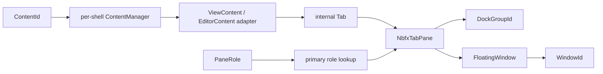

<!--

    Licensed to the Apache Software Foundation (ASF) under one
    or more contributor license agreements.  See the NOTICE file
    distributed with this work for additional information
    regarding copyright ownership.  The ASF licenses this file
    to you under the Apache License, Version 2.0 (the
    "License"); you may not use this file except in compliance
    with the License.  You may obtain a copy of the License at

      http://www.apache.org/licenses/LICENSE-2.0

    Unless required by applicable law or agreed to in writing,
    software distributed under the License is distributed on an
    "AS IS" BASIS, WITHOUT WARRANTIES OR CONDITIONS OF ANY
    KIND, either express or implied.  See the License for the
    specific language governing permissions and limitations
    under the License.

-->
# 9. WindowManager and identities

**Baseline:** `60143d8f59` (C4-3e).
**Audience:** product code that locates, selects, moves, attaches, or closes docked content.

## 9.1 Status at a glance

| Area | Status | Baseline behavior |
|---|---|---|
| Public `WindowManager` over `ContentId`/`DockGroupId` | **Implemented** | Groups, primary lookup, `groupOf`, select, move, attach, close, requests, floating, redocking, custom windows, and enumeration exist. |
| `DefaultWindowManager` | **Implemented**, internally | The implementation is package-private and translates handles to internal tab-pane operations. |
| Stable ids for live panes | **Implemented** | Permanent roles have role-derived ids; docked/detached panes have unique sequenced ids. |
| Generic content lookup | **Partial** | Only `ViewContent`, `EditorContent`, and the `nbfx:view.*` convention resolve to tabs. Arbitrary open `Content` does not. |
| `WindowClosePolicy` and floating close dispatch | **Implemented** | `HIDE`, `REDOCK`, and `CLOSE_CONTENT` are dispatched by floating handles and native close requests. |
| Custom-window close dispatch | **Partial** | `HIDE` and `CLOSE_CONTENT` work; `REDOCK` is rejected for custom windows. |
| `DockWindow.show()` activation | **Implemented** | Main, floating, and custom handles show, bring to front, and request focus through `WindowActivation`. |
| Group enumeration as a pure logical-area model | **Partial** | Enumeration includes all tracked panes, including transient/minimized/slide state, not only pure `DockGroupSpec`s. |
| Public tab/pane-handle operations | **Legacy** | `Tab` and `WindowPaneHost` remain in the platform, but are not `WindowManager` operation handles. |
| Target `DockController`, `api.docking` contracts, and complete cross-window identity routing | **Target only** | Docking request types still live in `api.shell`; no `api.docking` module exists in this baseline. |

Start with [layout and composition](08-layout-and-window-composition.md) if you need to understand where groups come from. Request validation and policies are in [chapter 10](10-docking-requests-and-policies.md); physical split/relocate behavior is in [chapter 11](11-docking-operations-and-pane-behavior.md).

## 9.2 Current public surface

Source: [`WindowManager.java`](../../../nbfx-platform/nbfx.api.shell/src/org/netbeans/api/nbfx/shell/WindowManager.java).

```java
public interface WindowManager {
    List<DockGroupId> groups();
    Optional<DockGroupId> primary(PaneRole role);
    Optional<DockGroupId> groupOf(ContentId content);

    void select(ContentId content);
    void move(ContentId content, DockGroupId target, int index);
    void attach(ContentId content, DockGroupId group, int index);
    void closeGroup(DockGroupId group);

    DockDecision canDock(DockRequest request);
    DockResult dock(DockRequest request);

    DockWindow floatContent(ContentId content, WindowOptions options);
    DockWindow floatGroup(DockGroupId group, WindowOptions options);
    DockWindow createCustomWindow(WindowId id, WindowOptions options,
                                  WindowContent content);
    DockResult redock(DockWindow window, DockRequest request);

    List<DockWindow> windows();
}
```

All scene/window-changing methods must run on the JavaFX Application Thread. `groups()` and `windows()` return immutable snapshots. `primary(null)` returns empty. Unknown ids are ignored by select/move/attach/closeGroup; request-based methods instead return a rejected decision/result.

`ShellApplication` creates one manager over its per-shell `DefaultContentManager`, global `DockPolicy` lookup, shell snapshot supplier, and `AppState`. The manager is published in the shell lookup and reachable through `ShellWindow.windowManager()`.

## 9.3 Identity model



### 9.3.1 `ContentId`

Source: [`ContentId.java`](../../../nbfx-platform/nbfx.api.content/src/org/netbeans/api/nbfx/content/ContentId.java).

```java
public record ContentId(String namespace, String name) {
    public static ContentId of(String value);
    public String value();
}
```

Ids use `namespace:name`, with the same part grammar as other typed ids. They identify open content, not tabs or files. Two document clones may have different content ids even when they share a file.

Important adapter conventions:

- `ViewContent.id()` is `nbfx:view.<sanitized-view-id>`. Characters outside `[A-Za-z0-9._-]` become `-`.
- `EditorContent` assigns `nbfx:editor.<sanitized-path>-<sequence>` per document instance. The sequence distinguishes clones and untitled documents.
- The manager's fallback scanner also recognizes any `ContentId` whose value starts with `nbfx:view.`, even if the open content is not a `ViewContent`.

Sources: [`ViewContent.java`](../../../nbfx-platform/nbfx.api.views/src/org/netbeans/api/nbfx/views/ViewContent.java), [`EditorContent.java`](../../../nbfx-platform/nbfx.platform.shell/src/org/netbeans/modules/nbfx/platform/shell/EditorContent.java).

### 9.3.2 `DockGroupId`

Source: [`DockGroupId.java`](../../../nbfx-platform/nbfx.api.layout/src/org/netbeans/api/nbfx/layout/DockGroupId.java).

```java
public record DockGroupId(String namespace, String name) {
    public static DockGroupId of(String value);
    public String value();
}
```

Every `NbfxTabPane` receives its group id at construction. Source: [`NbfxTabPane.java`](../../../nbfx-platform/nbfx.platform.shell/src/org/netbeans/modules/nbfx/platform/shell/NbfxTabPane.java).

| Live pane role | Assigned group id | Stability |
|---|---|---|
| `MAIN` | `nbfx:main` | Stable for the pane/session. |
| `NAVIGATOR` | `nbfx:navigator` | Stable for the pane/session. |
| Other permanent product role | `nbfx:<lowercase-sanitized-role>` | Stable while that pane object lives. |
| `DOCKED` | `nbfx:docked.<N>` | Unique; `N` comes from a process-local atomic sequence. |
| `DETACHED` | `nbfx:detached.<N>` | Unique; `N` comes from the same process-local sequence. |
| `SLIDE` | `nbfx:slide` | Identifies the transient slide-panel pane. |

Sanitization lowercases the role and replaces characters outside `[a-z0-9._-]` with `-`. The sequence is not a persisted product identity. Do not construct a guessed `nbfx:docked.N`; obtain it from `groups()`, `groupOf()`, a request result, or a window handle.

A group id belongs to a pane, not to an area declaration. Moving the last tab out of a docked pane can remove that pane and its group. Floating one tab creates a new `DETACHED` group; floating a whole group preserves its existing group id.

### 9.3.3 `WindowId` is separate

`DockWindow.id()` is a `WindowId`, not a `DockGroupId`. Main uses `nbfx:window.main`; floating handles derive `nbfx:window.<group-name>`; custom windows use the caller's stable namespaced id. See [main, custom, and multiwindow handles](13-main-custom-and-multiwindow-handles.md).

## 9.4 Lookup algorithms and actual ordering

### 9.4.1 `groups()`

Implementation:

```java
return NbfxTabPane.panesByRole().stream()
        .filter(NbfxTabPane.class::isInstance)
        .map(NbfxTabPane::groupId)
        .toList();
```

`panesByRole()` builds the list in this order:

1. Current `DockArea.leaves()` in depth-first tree order.
2. Registered permanent panes not already present, in resolved-composition declaration order (includes hidden/minimized permanent panes).
3. Every remaining tracked `NbfxTabPane`, in creation order (includes minimized docked panes, detached panes, the slide pane, and test/legacy panes not attached to the area).

Consequences:

- The result is broader than “visible groups” and broader than a pure `LayoutSpec.groups()` catalog.
- A hidden empty permanent pane may still have a group id.
- A minimized pane remains enumerated.
- The transient `SLIDE` pane is tracked and can appear.
- Detached panes are included, but the list is not grouped by `DockWindow`; it is pane enumeration order.

### 9.4.2 `primary(PaneRole role)`

The implementation asks `NbfxTabPane.paneWithRole(role)`, which scans tracked panes in creation order and returns the first matching live role. It then returns that pane's group id.

This is a role lookup, not a geometry lookup. For unique permanent roles it is deterministic. For repeated runtime roles such as `DOCKED`, `DETACHED`, or `SLIDE`, “first” is an implementation-order choice; use an explicit `DockGroupId` when you mean a particular pane.

### 9.4.3 `groupOf(ContentId content)` and `findTab`

`groupOf` resolves a tab, reads `Tab.getTabPane()`, and returns the group id only when that pane is an `NbfxTabPane`.

`findTab` uses the per-shell `ContentManager` first:

1. Null content id → empty.
2. Content not open in the manager → empty.
3. Open `ViewContent` → `NbfxTabPane.findViewTab(view.getId())`.
4. Open `EditorContent` → `NbfxTabPane.findTab(document)` by document object identity.
5. Otherwise, if `contentId.value()` starts with `nbfx:view.`, scan for that view id.
6. Otherwise → empty.

View scans search every tracked pane and return the first tab with the matching view id. Editor scans compare the associated `EditorDocument` instance.

### 9.4.4 Content lookup limitations

These are real baseline constraints, not suggested future extensions:

- An arbitrary `Content` implementation can be open in `ContentManager` and still be invisible to `WindowManager`, because there is no generic tab/content association.
- `ViewContent` identity sanitization can collapse two different raw view ids to the same `ContentId`; `DefaultContentManager` then keeps the first open content.
- If legacy code creates duplicate tabs with one view id, the first tracked tab wins; `groupOf` cannot distinguish them.
- While a minimized tab is on loan to the sliding panel, its `Tab.getTabPane()` is the `SLIDE` pane, so `groupOf` reports `nbfx:slide`. `SlidingArea.groupOf(tab)` retains the logical minimized-group relationship, but that is not the public manager API.
- A content id that is open but whose tab was never created is treated as not docked.
- `WindowManager.attach` does not create a tab for open content. It only moves an already resolvable tab.

For reliable integration, use the provided view/editor paths or obtain a handle from an operation result rather than synthesizing ids.

## 9.5 Select, move, attach, and close

### 9.5.1 `select`

```java
findTab(content).ifPresent(NbfxTabPane::selectTabAndMoveToFront);
```

Selection does more than change a tab index:

- If the target pane is minimized, the tab slides in.
- If the pane is set aside by maximize, maximize is restored.
- The tab is selected and its stage is brought to front.
- Focus is requested on the selected content; editor focus goes through the document, other focusable content directly. Focus requests are queued with `Platform.runLater`.
- A null/unknown/undocked content id is ignored.

There is no separate `FocusController`; selection, OS activation, and keyboard focus are coordinated by legacy listeners.

### 9.5.2 `move`

```java
void move(ContentId content, DockGroupId target, int index);
```

Algorithm:

1. Resolve the source tab and target pane; if either is absent, return.
2. Remove the tab from its current pane, if any.
3. Insert it at `Math.clamp(index, 0, target.getTabs().size())`.
4. Reinstall drag handlers.

`move` deliberately does **not** select the tab or front its window. A negative index means zero, not append. An index beyond the end appends. The content instance and tab identity are preserved.

### 9.5.3 `attach`

```java
void attach(ContentId content, DockGroupId group, int index);
```

Algorithm:

1. Resolve the existing tab and target pane; if either is absent, return.
2. If `index < 0` or `index >= target.getTabs().size()`, append through `attachTab`.
3. Otherwise move to the clamped index, then select and front.
4. `attachTab` also selects/fronts, so both branches activate the content.

Unlike `move`, `attach` is an activation-oriented operation. It is not a content factory and cannot make an unresolved open `Content` dockable.

### 9.5.4 `closeGroup`

```java
void closeGroup(DockGroupId group);
```

Unknown groups are ignored. A known group delegates to the same `TabContextMenu.closeGroup` path used by the pointer context menu:

1. Snapshot the group's tabs.
2. Partition them into editor documents and view tabs.
3. Confirm all dirty editors once through `DocumentCloser.closeDocuments`.
4. If the user cancels or a save fails, close **none** of the group's views either.
5. If confirmed, close the editor documents and then remove/view-close the view tabs.
6. Pane emptiness listeners remove empty docked panes, hide eligible empty permanent panes, or leave the main pane empty.

View tab removal is deferred with `Platform.runLater`; editor closing uses the editor content-manager/context path. `closeGroup` returns no veto/result, so callers cannot synchronously distinguish “unknown,” “cancelled,” and “closed” from its return value.

For a single tab, plain pointer close uses the same document confirmation for editors and direct close for views. Shift+close invokes close-all; Alt/Option+close invokes close-other for editor tabs. See [pane behavior](11-docking-operations-and-pane-behavior.md).

### 9.5.5 `DockWindow.show()` and close-policy dispatch

Sources: [`WindowClosePolicy.java`](../../../nbfx-platform/nbfx.api.shell/src/org/netbeans/api/nbfx/shell/WindowClosePolicy.java), [`WindowActivation.java`](../../../nbfx-platform/nbfx.platform.shell/src/org/netbeans/modules/nbfx/platform/shell/WindowActivation.java), [`DefaultWindowManager.java`](../../../nbfx-platform/nbfx.platform.shell/src/org/netbeans/modules/nbfx/platform/shell/DefaultWindowManager.java).

`DockWindow.show()` now calls `WindowActivation.show(stage)`, which performs `stage.show()`,
`stage.toFront()`, and `stage.requestFocus()`. A closed floating/custom handle still throws
`IllegalStateException` when shown again.

`WindowOptions.closePolicy()` controls what `DockWindow.close()` and the native close request do:

| Policy | Floating window | Custom window |
|---|---|---|
| `HIDE` | Hides the stage; handle, pane, tabs, and content stay live/managed and can be shown or redocked later. | Hides the stage; handle and content stay live/managed. |
| `REDOCK` | Moves tabs to their live home pane or main fallback, releases floating chrome, unregisters detached/docked pane identity, and selects the previously selected tab. | Rejected by `createCustomWindow` with `IllegalArgumentException`. |
| `CLOSE_CONTENT` | Runs the normal floating-pane editor/view close lifecycle, including existing close confirmation behavior. | Calls `WindowContent.close()`, removes the handle, and closes the stage. |

For floating native close requests, `HIDE` and `REDOCK` are consumed and dispatched by the handle;
`CLOSE_CONTENT` follows the normal close path. Custom native close requests consume/hide for
`HIDE`; otherwise they dispose the custom content host.

The eleven-argument `WindowOptions` compatibility constructor defaults to `CLOSE_CONTENT`, and the
built-in floating options use it. The target's default floating `REDOCK` policy is therefore not
the current default.

Close policy is behavior, not content ownership. `HIDE` and `REDOCK` preserve content and do not
call its close/dispose lifecycle. `CLOSE_CONTENT` enters that lifecycle; generic content remains
owned by `DefaultContentManager`, while a custom window invokes its `WindowContent.close()` host
cleanup directly. Placement operations such as move, attach, float, and explicit `redock` still do
not close content.

## 9.6 Example: use handles, not tabs

```java
// Runs on the JavaFX Application Thread.
ShellWindow shell = context.window();
WindowManager windows = shell.windowManager();
ViewManager views = context.lookup().lookup(ViewManager.class);

views.show(myView); // creates/selects the view through the normal view lifecycle
ContentId id = new ViewContent(myView).id();
DockGroupId navigator = windows.primary(PaneRole.NAVIGATOR).orElseThrow();

windows.move(id, navigator, 0); // reorder without activation
windows.select(id);            // activate and front

Optional<DockGroupId> current = windows.groupOf(id);
windows.attach(id, navigator, -1); // append and activate

// Later, if closing the entire navigator group is intended:
windows.closeGroup(navigator);
```

Use `org.netbeans.api.nbfx.shell.PaneRole` here, not the pure layout role with the same simple name. If the view is already open, `ViewManager.show` selects its existing tab rather than creating a duplicate.

## 9.7 Ownership, threading, and failure rules

- `WindowManager` does not own content close/dispose. Moving, attaching, selecting, floating, and explicit redocking change placement only.
- `DefaultContentManager` owns open content and calls `Content.close()` then `Content.dispose()` when its own close operation succeeds.
- `closeGroup` intentionally enters the normal editor/view close lifecycle; it is not a mere detach.
- `WindowClosePolicy.HIDE` and `REDOCK` preserve content; `CLOSE_CONTENT` enters the normal close lifecycle. Custom `REDOCK` is invalid, and custom `CLOSE_CONTENT` calls `WindowContent.close()` directly.
- Manager collections are snapshots. Holding a `DockGroupId` does not keep the pane alive; later operations can report it missing.
- The content manager is per-shell, but pane tracking and the active `Docking` area are still process-wide. Two concurrent managers are not fully isolated from each other's panes.
- No method enforces FX-thread affinity at runtime. Calling mutation methods from a background thread violates the contract and can corrupt scene state or throw JavaFX errors.
- Policy exceptions during `canDock`/`dock` are not caught or converted to reason keys.
- Null handling differs by method: `primary(null)` is empty; move/attach with unresolved handles are no-ops; request/window methods have the explicit errors documented in chapters 10, 12, and 13.

## 9.8 Tests and source map

- [`DefaultWindowManager.java`](../../../nbfx-platform/nbfx.platform.shell/src/org/netbeans/modules/nbfx/platform/shell/DefaultWindowManager.java) — all algorithms in this chapter.
- [`NbfxTabPane.java`](../../../nbfx-platform/nbfx.platform.shell/src/org/netbeans/modules/nbfx/platform/shell/NbfxTabPane.java) — group assignment, tracked-pane order, tab lookup, move/select/close, slide lending.
- [`WindowManagerTest.java`](../../../nbfx-platform/nbfx.platform.shell/test/unit/src/org/netbeans/modules/nbfx/platform/shell/WindowManagerTest.java) — group/content operations, unique docked ids, normal close lifecycle, policies, relative placement, split/edge, float/redock, main-first enumeration, and floating `HIDE`/`REDOCK` close behavior.
- [`CustomWindowTest.java`](../../../nbfx-platform/nbfx.platform.shell/test/unit/src/org/netbeans/modules/nbfx/platform/shell/CustomWindowTest.java) — custom close/hide/re-show, `HIDE` policy, `REDOCK` rejection, and remembered bounds.
- [`WindowActivationTest.java`](../../../nbfx-platform/nbfx.platform.shell/test/unit/src/org/netbeans/modules/nbfx/platform/shell/WindowActivationTest.java) — show brings the stage to front.
- [`DockWindowContractTest.java`](../../../nbfx-platform/nbfx.api.shell/test/unit/src/org/netbeans/api/nbfx/shell/DockWindowContractTest.java) — window-id, opaque content-state, and compatibility-constructor `CLOSE_CONTENT` default.
- [`DefaultContentManager.java`](../../../nbfx-platform/nbfx.platform.content/src/org/netbeans/modules/nbfx/platform/content/DefaultContentManager.java) and [`DefaultContentManagerTest.java`](../../../nbfx-platform/nbfx.platform.content/test/unit/src/org/netbeans/modules/nbfx/platform/content/DefaultContentManagerTest.java) — open-content ownership.

## 9.9 Current versus target

The target keeps `WindowManager` as the public operation surface but places docking contracts in `api.docking`, introduces an internal controller, and guarantees content/group routing independent of tab implementation. This baseline has the public handle surface and a working adapter, but content lookup is still coupled to `ViewContent`/`EditorContent` and internal tabs.

The target also separates logical areas, physical groups, and runtime window states. Here, live `PaneRole` still contains `DOCKED`/`DETACHED`/`SLIDE`, and `groups()` exposes tracked panes rather than a declarative group registry. Individual `WindowClosePolicy` dispatch now exists, but owner-window propagation and a unified multi-window close state machine remain target-only. See [current-to-target migration](27-current-to-target-migration.md).
