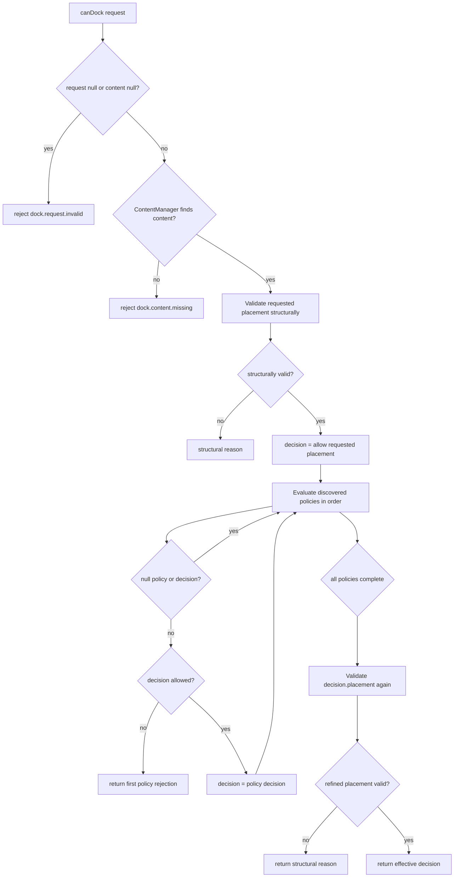

<!--

    Licensed to the Apache Software Foundation (ASF) under one
    or more contributor license agreements.  See the NOTICE file
    distributed with this work for additional information
    regarding copyright ownership.  The ASF licenses this file
    to you under the Apache License, Version 2.0 (the
    "License"); you may not use this file except in compliance
    with the License.  You may obtain a copy of the License at

      http://www.apache.org/licenses/LICENSE-2.0

    Unless required by applicable law or agreed to in writing,
    software distributed under the License is distributed on an
    "AS IS" BASIS, WITHOUT WARRANTIES OR CONDITIONS OF ANY
    KIND, either express or implied.  See the License for the
    specific language governing permissions and limitations
    under the License.

-->
# 10. Docking requests and policies

**Baseline:** `60143d8f59` (C4-3e).
**Audience:** contributors implementing programmatic docking, policy providers, and request-based UI commands.

## 10.1 Status at a glance

| Area | Status | Baseline behavior |
|---|---|---|
| `DockRequest`, `DockDecision`, `DockResult`, `DockModifier` | **Implemented** | Immutable public contracts in `api.shell`. |
| Executable `DockPolicy`, `allOf`, `anyOf` | **Implemented** | Deterministic composition with first-rejection/first-allowance rules. |
| Declarative `DockPolicySpec` + `DockPolicy.fromSpec` | **Implemented** | Immutable predicate data can be adapted into an executable policy. |
| Structural validation before and after policy refinement | **Implemented** | `canDock` validates the requested placement, runs policies, then validates the effective placement. |
| All placements except `NEW_WINDOW` | **Implemented** | Group, relative tab, split, edge, and float paths exist. |
| `NEW_WINDOW` | **Target only** | Structural validation rejects it as unsupported before normal manager policy evaluation. |
| Transfer copy/link and modifier semantics | **Partial** | Fields are carried and visible to policies, but the runtime always moves and ignores modifiers. |
| Production spec registration, `ViewArea.policyId` wiring, and `api.docking` placement | **Target only** | The adapter exists, but the shell does not discover specs from area metadata or move the contracts to `api.docking`. |
| Pointer tab dragging through `DockPolicy` | **Target only** | Legacy pointer dragging calls `DockArea` directly; the request/policy pipeline is programmatic. |

See [WindowManager and identities](09-window-manager-and-identities.md) for handle lookup and [docking operations](11-docking-operations-and-pane-behavior.md) for the physical algorithms.

## 10.2 Contracts and defaults

### 10.2.1 `DockRequest`

Source: [`DockRequest.java`](../../../nbfx-platform/nbfx.api.shell/src/org/netbeans/api/nbfx/shell/DockRequest.java).

```java
public record DockRequest(
        ContentId content,
        DockGroupId sourceGroup,
        PaneRole targetArea,
        DockGroupId targetGroup,
        ContentId targetContent,
        DockPlacement placement,
        TransferMode mode,
        Set<DockModifier> modifiers) {

    // Compatibility constructor; targetContent is null.
    public DockRequest(ContentId content, DockGroupId sourceGroup,
                       PaneRole targetArea, DockGroupId targetGroup,
                       DockPlacement placement, TransferMode mode,
                       Set<DockModifier> modifiers);
}
```

- `content`, `placement`, and `mode` must be non-null.
- `sourceGroup`, `targetArea`, `targetGroup`, and `targetContent` may be null.
- Null modifiers become an empty immutable set; supplied modifiers are copied.
- The record does not validate that the source/target exists. That is the manager's job.

Current fields have these actual roles:

| Field | Used structurally? | Notes |
|---|---|---|
| `content` | Yes | Must be open; executable placements also need a resolvable tab. |
| `sourceGroup` | **No** | Not compared with the tab's current group. `DockPolicy.fromSpec` may resolve it for the cross-area check. |
| `targetArea` | Fallback | Manager structure uses the first live pane with this legacy `PaneRole` when `targetGroup` is null. A spec policy instead gives an explicit `targetArea` precedence over `targetGroup`. |
| `targetGroup` | Yes, for group/split placements | Wins over `targetArea` in manager structure when both are supplied; a spec policy can still evaluate the explicit area instead. |
| `targetContent` | Only `BEFORE`/`AFTER` | Must be a different tab in the resolved target group. |
| `placement` | Yes | Selects the operation and may be refined by an allowing policy. |
| `mode` | **No** | `MOVE`, `COPY`, and `LINK` all execute as a move. A policy can reject a mode, but cannot enable copy/link. |
| `modifiers` | **No** | `COPY`, `FLOAT`, and `NEW_WINDOW` modifiers do not alter execution. Use `placement=FLOAT`; `NEW_WINDOW` remains unsupported. |

`targetArea` here is `org.netbeans.api.nbfx.shell.PaneRole`, not the pure `api.layout.PaneRole`.

### 10.2.2 `DockDecision` and `DockResult`

Sources: [`DockDecision.java`](../../../nbfx-platform/nbfx.api.shell/src/org/netbeans/api/nbfx/shell/DockDecision.java), [`DockResult.java`](../../../nbfx-platform/nbfx.api.shell/src/org/netbeans/api/nbfx/shell/DockResult.java).

```java
public record DockDecision(boolean allowed, DockPlacement placement, String reasonKey) {
    public static DockDecision allow(DockPlacement placement);
    public static DockDecision reject(String reasonKey);
}

public record DockResult(DockDecision decision, DockGroupId group) {
    public static DockResult accepted(DockDecision decision, DockGroupId group);
    public static DockResult rejected(DockDecision decision);
}
```

- A rejected decision must have a nonblank reason key; `reject` sets placement to null.
- An accepted decision normalizes a null reason key to `""`; a caller-supplied nonempty reason is not cleared.
- `allow(null)` is constructible, but the manager's structural revalidation rejects the null effective placement as unsupported.
- An accepted result requires a non-null target group. The `rejected` factory supplies a null group, but the constructor only forbids `allowed + null`; `rejected + non-null` is also a valid record even though the factory does not produce it.
- `decision` is never null in a valid result.

### 10.2.3 `DockPolicy`

Sources: [`DockPolicy.java`](../../../nbfx-platform/nbfx.api.shell/src/org/netbeans/api/nbfx/shell/DockPolicy.java), [`DockPolicySpec.java`](../../../nbfx-platform/nbfx.api.shell/src/org/netbeans/api/nbfx/shell/DockPolicySpec.java).

```java
@FunctionalInterface
public interface DockPolicy {
    DockDecision evaluate(DockRequest request);

    static DockPolicy fromSpec(
            DockPolicySpec spec,
            Function<ContentId, Optional<ContentKind>> contentKinds,
            Function<DockGroupId, Optional<PaneRole>> groupAreas);

    static DockPolicy allOf(DockPolicy... policies);
    static DockPolicy anyOf(DockPolicy... policies);
}

public record DockPolicySpec(
        Set<ContentKind> acceptedKinds,
        Set<PaneRole> acceptedAreas,
        Set<DockPlacement> placements,
        Set<TransferMode> modes,
        boolean allowCrossArea,
        boolean allowFloat) {
    public static DockPolicySpec allowAll();
}
```

Composition rules:

- `allOf` evaluates in array order. The first rejection wins and short-circuits. Every allowance replaces the current effective decision, so the **last** allowance supplies the placement.
- `anyOf` evaluates in order and returns the first allowance. If all reject, it returns the first rejection. With no policies it rejects with `dock.policy.none`.
- `allOf()` with no policies allows the request's original placement.
- Combinators copy the array, reject null elements immediately, and require non-null decisions at evaluation time.
- `DefaultWindowManager` is slightly more tolerant: it skips null policy objects and null policy decisions. Its policy supplier/collection itself must be usable.

`DockPolicySpec` defensively copies all four sets. Null sets and null elements are rejected. **Empty sets mean unrestricted**, not deny-all; `allowAll()` is the canonical empty-set specification with `allowCrossArea=true` and `allowFloat=true`.

`fromSpec` requires a non-null spec and both resolver functions. `contentKinds` is resolved only when the kind allow-list is nonempty and the content id is non-null. After the kind check, the policy attempts target-area resolution whenever `targetArea` is absent and `targetGroup` is non-null—even if every predicate set is empty and both boolean gates allow everything. Source-area resolution occurs only for an active cross-area check. Null ids, a null `Optional`, and `Optional.empty()` all mean unknown. Resolver exceptions propagate. Evaluation order and rejection keys are:

1. content kind → `dock.policy.kind` when `acceptedKinds` is nonempty and the kind is unknown/not accepted;
2. target area → `dock.policy.area` when `acceptedAreas` is nonempty and the resolved area is known/not accepted;
3. placement → `dock.policy.placement`;
4. transfer mode → `dock.policy.mode`;
5. cross-area → `dock.policy.cross-area` when disabled and both source/target areas resolve differently;
6. float → `dock.policy.float` when disabled and placement is `FLOAT` or `NEW_WINDOW`;
7. otherwise allow the request's original placement.

Unknown target areas skip the area predicate; unknown source/target areas skip the cross-area predicate. For target-area resolution the spec policy uses explicit `request.targetArea()` first, then resolves `request.targetGroup()`. Manager structure does the opposite precedence (`targetGroup` first), so a request containing conflicting fields can be judged against different areas. Structural validation still runs first in `WindowManager`: a normal `NEW_WINDOW` request therefore returns `dock.placement.unsupported` before a discovered policy can return `dock.policy.float`.

### 10.2.4 Placement vocabulary

Source: [`DockPlacement.java`](../../../nbfx-platform/nbfx.api.content/src/org/netbeans/api/nbfx/content/DockPlacement.java).

```text
INTO_GROUP, BEFORE, AFTER, TAB_STRIP,
SPLIT_LEFT, SPLIT_RIGHT, SPLIT_TOP, SPLIT_BOTTOM,
EDGE_LEFT, EDGE_RIGHT, EDGE_TOP, EDGE_BOTTOM,
FLOAT, NEW_WINDOW
```

`TransferMode` is `MOVE`, `COPY`, or `LINK`. `DockModifier` is `COPY`, `FLOAT`, or `NEW_WINDOW`. Their current execution limitations are listed above.

## 10.3 Placement matrix

The matrix describes the implementation, not merely the enum names.

| Placement | Required target | Execution | Ignored fields / special rules |
|---|---|---|---|
| `INTO_GROUP` | Existing `targetGroup`, or `targetArea` resolving to a pane | Append tab, select, front | `targetContent` ignored. |
| `TAB_STRIP` | Same as `INTO_GROUP` | Currently identical to append/select/front | No distinct tab-strip geometry. |
| `BEFORE` | Existing target group + `targetContent` in that group | Insert before target, select, front | Self, missing, or foreign-group target rejects. |
| `AFTER` | Same as `BEFORE` | Insert after target, select, front | Same-pane source index is adjusted before insertion. |
| `SPLIT_LEFT/RIGHT/TOP/BOTTOM` | `targetGroup`/`targetArea` resolving to an `NbfxTabPane` contained in the active area | Relocate a qualifying single-tab source pane, or extract the tab into a new split pane | `targetContent` ignored. Splitting a single-tab pane relative to itself extracts the tab instead of relocating the pane. |
| `EDGE_LEFT/RIGHT/TOP/BOTTOM` | Active dock area | Relocate a qualifying single-tab source pane, or extract the tab into a new area-edge pane | `targetArea`, `targetGroup`, and `targetContent` ignored. |
| `FLOAT` | A resolvable tab | Float content with default floating options and return its group | All target fields ignored. Already-floating content is shown again. |
| `NEW_WINDOW` | None | Reject with `dock.placement.unsupported` | No distinct semantics implemented. |

## 10.4 Validation and policy pipeline

Sources: [`DefaultWindowManager.java`](../../../nbfx-platform/nbfx.platform.shell/src/org/netbeans/modules/nbfx/platform/shell/DefaultWindowManager.java), [`DockPolicyTest.java`](../../../nbfx-platform/nbfx.api.shell/test/unit/src/org/netbeans/api/nbfx/shell/DockPolicyTest.java).



### 10.4.1 Initial structural validation

`validatePlacement(request, placement)` checks:

- **FLOAT:** the content must resolve to a tab.
- **Group/relative:** resolve `targetGroup` directly, or `targetArea` through the first pane with that role; the pane must exist. For `BEFORE`/`AFTER`, `targetContent` must be non-null, different from `content`, resolvable, and attached to that exact target pane.
- **Split:** the active area must exist; the resolved target must be an `NbfxTabPane` currently contained in that area.
- **Edge:** the active area must exist. No target pane is required.
- **Anything else:** reject `dock.placement.unsupported`.

The initial `ContentManager.find` check is not enough to prove dockability. A content object may be open without a tab; FLOAT validation and final execution catch that separately.

### 10.4.2 Policy discovery

- The default `DefaultWindowManager` constructor supplies `() -> Lookup.getDefault().lookupAll(DockPolicy.class)`.
- `ShellApplication` supplies the same global lookup explicitly.
- Package-private test constructors can inject a supplier; there is no public per-shell policy registry in this baseline.
- The supplier is invoked on each `canDock` call. Policy instances/order are not snapshotted by the manager.
- There are no built-in production `DockPolicy` registrations in this tree. With no discovered policies, a structurally valid request is allowed.
- A policy exception propagates. The manager does not log-and-deny, retry, or translate it to a reason key.

### 10.4.3 Refinement and structural revalidation

Every allowing policy replaces the prior decision. After all policies complete, the manager validates the **effective** placement, not just the original one.

Example: a request for `INTO_GROUP` with no target is rejected before policies run. A request with a valid target may be refined to `SPLIT_LEFT`; if its target group is not a current area pane, revalidation rejects with `dock.target.missing`. A policy may also refine a valid group request to `FLOAT`, which needs no target, or to `NEW_WINDOW`, which revalidation rejects as unsupported.

Revalidation does not rerun earlier policies against a rewritten request. Policies always see the original `DockRequest`; only the final decision placement is checked structurally.

## 10.5 `dock` execution algorithm

`dock` calls `canDock` internally. Callers do not need to call both, and doing so evaluates policies twice.

1. If the decision rejects, return `DockResult.rejected(decision)` without mutation.
2. Resolve the content's tab. If it vanished or never existed, reject `dock.content.missing`.
3. Branch on the effective placement.

### 10.5.1 FLOAT

1. Call `floatContent(content, defaultFloatingOptions())`.
2. Read the resulting group with `groupOf`.
3. Return accepted with that group, or `dock.content.missing` if no group is found.

Defaults are exactly:

```java
new WindowOptions(WindowKind.FLOATING, null, null, null, null,
                  false, 600, 400, true, false, null,
                  WindowClosePolicy.CLOSE_CONTENT);
```

The implementation uses the 11-argument compatibility constructor, which now defaults to `CLOSE_CONTENT`; it does **not** choose the target's floating `REDOCK` default. See [floating close policies](12-floating-and-redocking.md#129-close-policies).

### 10.5.2 INTO_GROUP / TAB_STRIP

1. Resolve and find the target pane; if absent, reject `dock.target.missing`.
2. Append the existing tab through `NbfxTabPane.attachTab`.
3. Return the target pane's group id.

Appending selects and fronts the content.

### 10.5.3 BEFORE / AFTER

1. Resolve/find the target pane.
2. Resolve `targetContent` and verify it still belongs to that pane; otherwise reject `dock.target.missing`.
3. Compute the target tab's current index.
4. If the source is already in the same pane and precedes the target, decrement the index to account for source removal.
5. For `AFTER`, increment the index.
6. Move the source tab to that index, then select/front it.
7. Return the target group id.

This produces stable before/after semantics for same-pane reordering as well as cross-pane moves.

### 10.5.4 SPLIT / EDGE

1. Get the active `Docking.area()`; if absent, reject `dock.target.missing`.
2. For split placements, resolve the target pane and require it to be in the area.
3. Build a `DropTarget`: split uses the target pane plus a side; edge uses a null pane plus a side.
4. If the source is in the area, has exactly one tab, and this is an edge move **or** the source differs from the split target, call `area.relocate(source, target)`. A non-main source keeps its group id. For `MAIN`, relocation moves the content into a newly split group, but the manager currently returns the source `nbfx:main` id from `DockResult.group()`; call `groupOf(content)` for the content's actual group.
5. Otherwise remove the source tab, call `area.split(target)`, and move the tab to index zero in the new pane.
6. Return the source group after the relocation branch (including the `MAIN` mismatch above), or the newly created pane's group after extraction.

The single-tab/self-target distinction, main-pane behavior, and geometry are detailed in [chapter 11](11-docking-operations-and-pane-behavior.md).

## 10.6 Complete built-in reason keys

These are all reason keys emitted by production docking code in this baseline. Policy-defined keys are additional and arbitrary.

| Key | Emitter | Trigger |
|---|---|---|
| `dock.request.invalid` | `DefaultWindowManager` | Null request passed to `canDock`/`dock`; null request passed to `redock`. |
| `dock.content.missing` | `DefaultWindowManager` | Content not open in `ContentManager`; open content has no resolvable tab; FLOAT cannot resolve a tab; FLOAT execution cannot find a resulting group; defensive empty-pane check during redock (normally the earlier representative check returns `dock.window.mismatch` for an empty pane). |
| `dock.target.missing` | `DefaultWindowManager` | Missing/unknown target group or area pane; missing/foreign/self relative target; missing active area for split/edge; invalid split target; target/tab disappears between validation and execution. |
| `dock.placement.unsupported` | `DefaultWindowManager` | `NEW_WINDOW`, null effective placement, or any placement outside the implemented branches. |
| `dock.window.missing` | `DefaultWindowManager.redock` | Handle is not a `FloatingWindow`, belongs to another manager, has no stage, or its pane is no longer registered. |
| `dock.window.mismatch` | `DefaultWindowManager.redock` | `request.content()` does not resolve to a tab in the floating window's pane. |
| `dock.policy.kind` | `DockPolicy.fromSpec` | Nonempty `acceptedKinds` and the content kind is unknown or not accepted. |
| `dock.policy.area` | `DockPolicy.fromSpec` | Nonempty `acceptedAreas` and the resolved target area is known but not accepted. |
| `dock.policy.placement` | `DockPolicy.fromSpec` | Nonempty `placements` excludes the requested placement. |
| `dock.policy.mode` | `DockPolicy.fromSpec` | Nonempty `modes` excludes the requested transfer mode. |
| `dock.policy.cross-area` | `DockPolicy.fromSpec` | Cross-area moves disabled and both areas resolve differently. |
| `dock.policy.float` | `DockPolicy.fromSpec` | Float moves disabled and placement is `FLOAT` or `NEW_WINDOW` when the policy is evaluated directly. |
| `dock.policy.none` | `DockPolicy.anyOf` | `anyOf` is evaluated with no policies. |

Notes:

- Rejections from custom policies pass through unchanged; `DockDecision` requires only a nonblank key.
- Test fixtures use illustrative keys such as `dock.policy.denied`, `dock.policy.first`, and `dock.policy.second`; these are not built-in runtime keys.
- There are no bundle entries in this baseline mapping the built-in keys to user-visible text. A UI must not present the raw key as polished localized copy without its own mapping.
- `NEW_WINDOW` normally never reaches a discovered policy through `WindowManager`, because structural validation rejects it first; `dock.policy.float` for `NEW_WINDOW` is observable when evaluating `fromSpec` directly. A policy that refines another placement to `NEW_WINDOW` is caught by final structural revalidation as `dock.placement.unsupported`.

## 10.7 Ignored and unsupported semantics

Do not infer behavior from the presence of a field or enum value:

- `sourceGroup` is not checked against the tab's actual group by manager structure. A `fromSpec` policy can use it for cross-area evaluation, but a stale/wrong value is not otherwise rejected.
- `TransferMode.COPY` does not clone content. `LINK` does not create a link. Both move the existing tab.
- `DockModifier.COPY`, `FLOAT`, and `NEW_WINDOW` do not change the placement. Only `DockPlacement.FLOAT` invokes floating.
- `NEW_WINDOW` is not an alias for FLOAT or CUSTOM.
- `TAB_STRIP` is currently the same append behavior as `INTO_GROUP`.
- Area capabilities, group capacity, group lifetime, and pure `ViewArea.policyId` are not consulted.
- `DockPolicySpec` has no production registration/discovery path and is not selected through `ViewArea.policyId`; callers must construct/register a `DockPolicy` themselves.
- Discovered executable policy registration is global, not scoped to a product/window/area.
- The runtime does not provide one-gesture undo or rollback. A later exception after tabs/panes have moved is not automatically reversed.

## 10.8 Pointer dragging is a separate path

The request/policy pipeline is used by `WindowManager.canDock`/`dock` and `redock`. Legacy internal tab dragging in `NbfxTabPane` instead:

1. Uses `DockArea.dropTargetAt` to choose join/split/area-edge geometry.
2. Calls `NbfxTabPane.dock`, which relocates or extracts directly.
3. Does not construct a `DockRequest` and does not consult `DockPolicy`.

External/domain drags use `DropRouter`/`DropHandler`, also a separate path. See [drag and drop](20-drag-and-drop.md). Therefore, registering a `DockPolicy` does not veto pointer tab dragging in this baseline.

## 10.9 Example: a policy that rejects an unsupported mode

```java
import org.netbeans.api.nbfx.content.TransferMode;
import org.netbeans.api.nbfx.shell.DockDecision;
import org.netbeans.api.nbfx.shell.DockPolicy;
import org.netbeans.api.nbfx.shell.DockRequest;
import org.openide.util.lookup.ServiceProvider;

@ServiceProvider(service = DockPolicy.class)
public final class RejectCopyDockPolicy implements DockPolicy {
    @Override
    public DockDecision evaluate(DockRequest request) {
        if (request.mode() == TransferMode.COPY) {
            return DockDecision.reject("product.dock.copy.unsupported");
        }
        return DockDecision.allow(request.placement());
    }
}
```

This rejects COPY before execution; it does not implement copying. Because discovery uses global lookup, the policy applies to every manager using that lookup unless an injected test supplier says otherwise.

Declarative-spec adapter example:

```java
DockPolicySpec spec = new DockPolicySpec(
        Set.of(ContentKind.VIEW), Set.of(PaneRole.NAVIGATOR),
        Set.of(DockPlacement.INTO_GROUP), Set.of(TransferMode.MOVE),
        false, true);
DockPolicy policy = DockPolicy.fromSpec(
        spec,
        contentId -> contentManager.find(contentId).map(Content::kind),
        groupId -> Optional.of(PaneRole.NAVIGATOR));
```

The resolver functions must return `Optional`; null/empty means unknown. This example still requires explicit registration—there is no `ViewArea.policyId` auto-wiring.

Composition example:

```java
DockPolicy noNewWindow = request ->
        request.placement() == DockPlacement.NEW_WINDOW
                ? DockDecision.reject("product.dock.new-window.unsupported")
                : DockDecision.allow(request.placement());

DockPolicy preferTabStrip = request ->
        DockDecision.allow(DockPlacement.TAB_STRIP);

DockPolicy combined = DockPolicy.allOf(noNewWindow, preferTabStrip);
```

For an allowed request, `combined` refines the effective placement to `TAB_STRIP`. The manager then revalidates that placement against the request's target.

## 10.10 Threading and concurrency

- Call `canDock`/`dock` on the JavaFX Application Thread when they inspect or mutate the live shell.
- Policies execute synchronously on the caller's thread and should be side-effect-free.
- `dock` is not transactional. Between validation and mutation, another FX task normally cannot interleave synchronously, but deferred pane-removal work and policy side effects can still invalidate assumptions.
- Calling `canDock` and later `dock` repeats discovery/evaluation. Treat `canDock` as a preview, not a reservation.
- `DefaultWindowManager` still reaches the active area through static `Docking`; its content manager is per-shell, but pane/area access is not fully isolated for concurrent shell instances.

## 10.11 Tests and source map

- [`WindowManagerTest.java`](../../../nbfx-platform/nbfx.platform.shell/test/unit/src/org/netbeans/modules/nbfx/platform/shell/WindowManagerTest.java) — policy rejection, group/relative/split/edge/FLOAT execution, `NEW_WINDOW` rejection.
- [`DockPolicyTest.java`](../../../nbfx-platform/nbfx.api.shell/test/unit/src/org/netbeans/api/nbfx/shell/DockPolicyTest.java) — all-of/any-of ordering, short-circuiting, refinement, empty composition, and `fromSpec` kind/area/placement/mode/cross-area/float predicates plus set copying.
- [`DefaultWindowManager.java`](../../../nbfx-platform/nbfx.platform.shell/src/org/netbeans/modules/nbfx/platform/shell/DefaultWindowManager.java) — validation, policy loop, execution, reason keys.
- [`DockArea.java`](../../../nbfx-platform/nbfx.platform.workspace/src/org/netbeans/modules/nbfx/platform/workspace/DockArea.java) — split/relocate primitives used after acceptance.

## 10.12 Current versus target

The [target reference](../../reference/cjap-shell-ui.md#7-docking-policy-and-transfer) places these contracts in `api.docking` and requires internal drags to pass through policy before drop handling. This baseline implements `DockPolicySpec` and `fromSpec` in `api.shell`, but with **empty sets meaning unrestricted**; that differs from the target's deny-all-empty-spec rule. No production spec registration or `ViewArea.policyId` wiring exists, and no discovered policies means structurally valid requests are allowed.

Also target-only: distinct `NEW_WINDOW` semantics, copy/link transfer behavior, capability/capacity enforcement, per-area policy resolution, pointer-policy integration, and gesture-scoped undo. See [current-to-target migration](27-current-to-target-migration.md).
