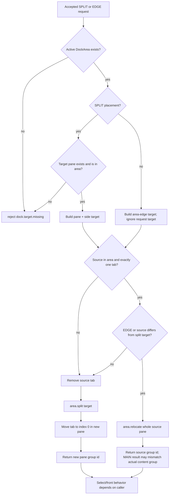

<!--

    Licensed to the Apache Software Foundation (ASF) under one
    or more contributor license agreements.  See the NOTICE file
    distributed with this work for additional information
    regarding copyright ownership.  The ASF licenses this file
    to you under the Apache License, Version 2.0 (the
    "License"); you may not use this file except in compliance
    with the License.  You may obtain a copy of the License at

      http://www.apache.org/licenses/LICENSE-2.0

    Unless required by applicable law or agreed to in writing,
    software distributed under the License is distributed on an
    "AS IS" BASIS, WITHOUT WARRANTIES OR CONDITIONS OF ANY
    KIND, either express or implied.  See the License for the
    specific language governing permissions and limitations
    under the License.

-->
# 11. Docking operations and pane behavior

**Baseline:** `60143d8f59` (C4-3e).
**Audience:** contributors changing split/move/close behavior or debugging pane lifecycle and slides.

## 11.1 Status at a glance

| Area | Status | Baseline behavior |
|---|---|---|
| Programmatic split and edge placements | **Implemented** | `WindowManager.dock` relocates a qualifying pane or extracts one tab into a new pane. |
| `DockArea` split/relocate/detach geometry | **Implemented** | Nested `SplitPane` tree, anchors, default shares, emptiness tracking, maximize, minimize, and redock primitives exist. |
| Empty/permanent/main pane lifecycle | **Implemented** | Docked panes disappear when empty; eligible permanent panes hide; the main pane remains and may absorb an editor-like neighbor. |
| Pointer and keyboard move/split | **Implemented** | Legacy drag zones and `TabMover` provide direct alternatives. |
| Minimize/maximize/slides | **Implemented** | Sliding sides, tab loans, sticky/hover panels, anchors, and maximize set-aside behavior exist. |
| Pointer/programmatic close parity | **Implemented** | `closeGroup` delegates to the context-menu lifecycle, including editor confirmation. |
| Policy/capability enforcement on pointer moves | **Target only** | Pointer dragging bypasses `DockPolicy`; pure area capabilities do not constrain operations. |
| Undo per gesture and target `FocusController` | **Target only** | No gesture transaction or separate focus controller exists. |

Request acceptance is covered in [chapter 10](10-docking-requests-and-policies.md). This chapter starts after a placement has been accepted.

## 11.2 Split versus relocate decision tree

Sources: [`DefaultWindowManager.java`](../../../nbfx-platform/nbfx.platform.shell/src/org/netbeans/modules/nbfx/platform/shell/DefaultWindowManager.java), [`NbfxTabPane.java`](../../../nbfx-platform/nbfx.platform.shell/src/org/netbeans/modules/nbfx/platform/shell/NbfxTabPane.java), [`DockArea.java`](../../../nbfx-platform/nbfx.platform.workspace/src/org/netbeans/modules/nbfx/platform/workspace/DockArea.java).



Important distinctions:

- **Pane relocation preserves the pane object, role, kind, group id, and all tabs.** It is used only for a single-tab source in the current area.
- **Tab extraction preserves the tab/content but creates a new pane/group.** It is used for multi-tab sources, sources outside the area, and a single-tab pane split relative to itself.
- An **edge** placement never needs a target pane. A qualifying single-tab source in the area is relocated to the area edge.
- A **split** placement is relative to the requested target pane. `SPLIT_RIGHT` on a pane's own sole tab deliberately creates a new pane to the right instead of treating the request as a no-op.

One low-level edge case remains: `DockArea.relocate` returns without mutation when the source is the area's only pane (`pane == root`). The manager can therefore report the existing group as accepted for such an edge request even though no new geometry was created.

## 11.3 Geometry rules

### 11.3.1 New split share and orientation

`DockArea.DEFAULT_SHARE` is `0.35`.

- Left/right creates a horizontal split (side by side).
- Top/bottom creates a vertical split (stacked).
- If the target already has a parent split of the matching orientation, the new pane joins that split beside the target.
- If the whole-area root already has the matching orientation, an area-edge pane joins at the beginning/end.
- Otherwise the target is replaced by a new two-child split.
- Existing children are resized proportionally; the new pane takes its share from the target, or from the whole area for an edge split.

`splitNode` always ends maximize first through the public split/relocate entry points. `DockArea.applyTree` also restores maximize and minimized panes before rebuilding.

### 11.3.2 New pane kind

`DockRuntime.createDockedPane(beside)` chooses:

- `EDITOR` when `beside` is an editor-kind pane;
- `VIEW` otherwise, including a pane created along an area edge (`beside == null`).

A tab with an `EditorDocument` floated into a detached pane also forces editor kind. This preserves editor header/close behavior after extraction.

### 11.3.3 Main pane relocation

The main pane never physically moves. In `DockArea.relocate`:

- Relocating the main pane to a split/edge target moves its **content** into a newly split pane and leaves the main pane empty.
- Relocating a non-main pane detaches that pane and reinserts the same object at the requested target.
- Relocating a pane beside itself or relocating the sole pane is a no-op.

This is why a single-tab `MAIN` can yield a new actual content group for a split/edge request: the content is extracted even though the `MAIN` pane/group remains. There is a baseline result mismatch on this path: after `area.relocate`, `DefaultWindowManager` returns the source group (`nbfx:main`) in `DockResult.group()`, not the newly created content group. Use `groupOf(content)` to obtain the actual destination. The sole-pane edge no-op noted above still performs no extraction.

## 11.4 Tab extraction versus pane relocation

| Situation | Result | Group identity |
|---|---|---|
| Multi-tab source split to another pane | One tab moves to a newly created pane | New group id. |
| Multi-tab source moved to area edge | One tab moves to a newly created edge pane | New group id. |
| Single-tab source split beside a different pane | Whole pane moves | Existing group id. |
| Single-tab source split beside itself | Tab extracted into a new pane; old pane becomes empty | New group id for content; old pane cleanup follows. |
| Single-tab non-main source in area moved to any area edge | Whole pane moves, except the sole-pane no-op | Existing group id. |
| Main pane with one tab split/edge | Main content moves to a new pane; main stays empty | New actual content group; `nbfx:main` remains, but `DockResult.group()` currently returns `nbfx:main`. Use `groupOf(content)`. |
| Source already floating | Programmatic split/edge extracts the tab into the main area; use `redock` for the supported whole-window lifecycle | New main-area group; floating cleanup is indirect. |

The public `move` method is different again: it always moves one tab between existing groups and never splits geometry. Use `dock` when the placement itself should create/relocate a pane.

## 11.5 Empty, permanent, and main pane behavior

### 11.5.1 Emptiness tracking

`DockArea` asks its `DockHost` for an `ObservableValue<Boolean>` per pane and retains that observable strongly while tracking the pane. For the shell runtime, emptiness means:

```text
tab list is empty AND no tab from this pane is on loan to the sliding panel
```

When emptiness becomes true, removal/hiding is deferred by one FX pulse. This prevents a remove-and-readd reorder from destroying a pane. Startup has an additional retention mode: `retainEmptyDockedPanes(true)` keeps declared empty docked leaves until initial views/session layout arrive; `completeStartupLayout()` turns it off and schedules cleanup.

### 11.5.2 Docked panes

A non-permanent docked pane exists only while it holds content:

- Last tab removed → pane detached, split collapsed, host `disposeDockedPane` called.
- If it was the last docked pane and the main pane was absent from a restored shape, the main pane is shown again.
- If the last docked pane empties while every permanent pane is hidden, the area rebuilds its default tree.
- A docked pane emptied while minimized is forgotten and disposed rather than restored empty.

`DockRuntime.disposeDockedPane` unregisters the `NbfxTabPane`, removing it from lookup/persistence/focus tracking. It does not close content.

### 11.5.3 Other permanent panes

When a non-main permanent pane becomes empty:

- If its declaration has `keepWhenEmpty=true`, it stays visible.
- Otherwise it leaves the tree, remembering an anchor describing its former neighbor/side/share.
- When content arrives, it is reattached at that anchor when possible; otherwise at its default side/share.
- A minimized permanent pane stays minimized even when it receives content; only restore brings it back.

### 11.5.4 Main pane

The main pane never hides merely because it is empty. It keeps the editor placeholder and remains the area's main role.

To avoid an empty editor pane beside a usable editor group, `absorbNeighbourInto` looks at the immediate neighbor after first, then before:

- A single docked neighbor of the main area's kind hands its content to main and disappears.
- A nested neighbor split contributes its nearest editor-like docked leaf; main takes that leaf's slot and the leaf's content.
- Tool/view-only neighbors are not absorbed because `DockRuntime.belongsToMainArea` is true only for editor-kind panes.
- With no qualifying neighbor, main simply stays empty.

The main role is `MAIN` when supplied, otherwise the last ordered primary. `ShellApplication` falls back to the first instantiated pane as its `mainPane` field if no `MAIN` exists, but `DockRuntime` still applies its own explicit main-role rule.

## 11.6 Closing tabs and groups

Sources: [`TabContextMenu.java`](../../../nbfx-platform/nbfx.platform.shell/src/org/netbeans/modules/nbfx/platform/shell/TabContextMenu.java), [`DocumentCloser.java`](../../../nbfx-platform/nbfx.platform.shell/src/org/netbeans/modules/nbfx/platform/shell/DocumentCloser.java), [`CloseConfirmation.java`](../../../nbfx-platform/nbfx.platform.shell/src/org/netbeans/modules/nbfx/platform/shell/CloseConfirmation.java).

### 11.6.1 Pointer/programmatic group close

`WindowManager.closeGroup(group)` and the pointer **Close Window Group** action share this sequence:

1. Snapshot all tabs in the group.
2. Collect editor documents and view tabs separately.
3. Call `DocumentCloser.closeDocuments` for the editors. Dirty documents are confirmed once for the whole group.
4. The confirmation offers Save, Discard, Cancel when saving is allowed; locked documents offer Discard/Cancel.
5. Save failures are shown and abort the close.
6. Cancellation leaves the editors and all views in the group untouched.
7. On confirmation, editor documents close through the editor content manager; views then close through deferred tab removal.
8. Empty-pane listeners perform the docked/permanent/main cleanup described above.

`CloseConfirmation` suppresses a prompt when another open clone outside the closing set shares the modified content, because closing this set would not lose the last editable copy.

### 11.6.2 Single-tab close

- Editor tab → `DocumentCloser.closeDocument` → confirmation → editor content-manager close.
- View tab → `NbfxTabPane.closeTab` → deferred removal → view lifecycle/fallback `viewClosed`.
- Shift+editor close → close all documents.
- Alt/Option+editor close → close other documents.

Tab-removal listeners defer “unregister if closed” work so a tab moved between panes in one pulse is not mistaken for a closed tab. Once no tracked pane holds it, editor split clones are disposed, view/editor lifecycle is notified, and editor context unregister is used as fallback.

### 11.6.3 Closing is not detaching

Move, split, float, and redock preserve content ownership. Close operations enter the content lifecycle. A window/group close must not be implemented by merely removing tabs if editor confirmation and view/editor disposal are expected.

## 11.7 Minimize and sliding sides

Source: [`SlidingArea.java`](../../../nbfx-platform/nbfx.platform.shell/src/org/netbeans/modules/nbfx/platform/shell/SlidingArea.java).

### 11.7.1 What can be minimized

`SlidingArea.isMinimizable(pane)` requires all of:

- pane is currently in the dock area;
- pane is not the main pane;
- pane kind is `VIEW`.

Minimizing an editor pane is therefore not the normal operation; editor panes use maximize. `DockArea.minimize` itself throws for the main pane, the sole pane, or a pane set aside by maximize.

### 11.7.2 Minimize a group

1. End any maximize state.
2. Guess the nearest side relative to the main pane from tree shape; fall back to scene bounds, then left.
3. Record side and current slide size.
4. `DockArea.minimize` removes the pane from the tree and records its anchor.
5. A side bar shows one button per tab.
6. If the pane had focus, focus moves to the main pane's selected tab.

### 11.7.3 Minimize one tab

- If it is the source pane's only tab, minimize the whole pane.
- Otherwise create a new `DOCKED` view pane, move the tab into it, and minimize it with an `Anchor.into(source)`.
- Side and slide size are copied from the source.
- Dock/restore can consequently rejoin the original pane.

### 11.7.4 Slide-in behavior

- Hover delay: 200 ms.
- Hover-out delay: 400 ms.
- Fade animation: 120 ms.
- Minimum slide size: 120 px.
- Default slide share when no size is known: 0.3 of the area.
- Hover slides a tab in temporarily; click slides it in “sticky” with focus.
- Escape, outside mouse press, or focus leaving a sticky panel slides it out.
- The panel's inner resizer changes the remembered size, clamped to available room.

The slide panel is a `SLIDE` `NbfxTabPane`. Showing a tab:

1. Records its source group and original index.
2. Marks the source as lending so it is not considered empty.
3. Moves the actual tab into the slide pane.
4. On slide-out, moves it back to the recorded index unless it left independently.

The tab keeps its header, close button, drag handlers, and a Dock button. Closing or dragging it out of the panel hides the panel and refreshes the source group.

### 11.7.5 Dock/restore from slides

- Restoring the last tab restores the group.
- A group anchored “into” another pane rejoins that pane tab by tab.
- A minimized permanent pane returns to its former place when restored; remaining tabs may stay in a minimized child group anchored into it.
- Dock-out of a multi-tab group restores the group with the chosen tab and leaves the rest minimized in an anchored pane.
- Anchor resolution can transfer anchors between panes that left in sequence so their relative order is preserved whichever returns first.

## 11.8 Maximize and set-aside

### 11.8.1 `DockArea` state

`DockArea.maximize(pane)` is the lower-level state transition:

1. If the same pane is already maximized, return.
2. If another pane is maximized, restore the previous shape **before validating** the requested pane. An invalid request can therefore end the old maximize state and then throw.
3. Require the requested pane to be a current leaf.
4. If the pane has no parent split because it is the sole current pane, set `layoutRoot = null`: there is no whole layout root to store, although `maximizedPane` is still set.
5. Otherwise replace the pane in its parent split with a placeholder, store the whole layout root, and show the pane alone.

Bare `DockArea.minimize`/`restore` do not end maximize. Shape-changing `DockArea` operations restore first.

### 11.8.2 `SlidingArea` tab maximization

`SlidingArea.maximize(tab)` adds view minimization and focus policy:

1. Null tab → return. A tab in a minimized group is docked first.
2. Resolve the tab's pane; if it is null or not a current `area.contains(pane)` leaf, return. A set-aside editor pane is not a current leaf, so a direct maximize call for such a tab is ignored rather than switching away from the current maximized pane.
3. Normal `NbfxTabPane.selectTabAndMoveToFront` selection checks `SlidingArea.isSetAside` and restores maximize first. Ordinary tab activation can therefore bring a set-aside editor pane back before a later maximize.
4. If the current maximized pane is the same pane, select the requested tab and return. If another contained pane is maximized, call `restoreMaximized()` first.
5. Select the tab, minimize every other minimizable view pane, remember those panes, call `DockArea.maximize(pane)`, and focus the selected tab.

Other editor panes remain in the set-aside tree; they are not minimized. Restore reverses the recorded view-pane minimizations so their anchors reconstruct the prior arrangement, while retaining changes made next to the maximized pane.

### 11.8.3 Minimize interaction with maximize

The normal interactive `SlidingArea.minimize(TabPane)` and multi-tab `minimize(Tab)` paths check eligibility and then explicitly call `restoreMaximized()` before changing side/size or moving the tab. A single-tab minimize delegates to the pane path. The persisted-state overload `minimize(pane, side, size, anchor)` does not perform that restore itself.

Thus “minimize leaves maximize alone” is true of the lower-level `DockArea` primitive, not of the normal sliding-side UI path.

## 11.9 Pointer and keyboard operation paths

### 11.9.1 Pointer drag zones

`DockArea.dropTargetAt` uses:

- 2% of the whole-area perimeter for area-edge docking;
- 2% of a pane's left/top edges for split-left/top;
- 30% of a pane's right/bottom edges for split-right/bottom;
- the middle for joining the pane's tabs.

Where bands overlap, the proportionally deeper edge wins. Area-edge detection happens before pane-edge detection. Drop feedback is an overlay line/frame and does not move layout during hover.

`NbfxTabPane.dock` then:

- relocates any single-tab source currently in the area when a split/edge target is offered (the hover path suppresses a self-split target for a sole tab);
- otherwise removes the tab, creates a split pane, and moves the tab into it.

Pointer drags on a detached pane offer tab joining rather than main-area split geometry. Internal pointer dragging does not consult `DockPolicy`.

### 11.9.2 Keyboard move

`TabMover` provides a keyboard alternative from **Move** / **Move Group**:

- Candidates include joining each other pane, splitting beside each pane on four sides, and four whole-area edges when more than one leaf exists.
- Arrow keys step to the nearest candidate in that direction; Enter ends move mode and then performs the chosen move.
- Escape, any mouse press, loss of window focus, explicit `TabMover.cancelActive()`, or starting another mover all end move mode without moving or selecting content.
- Ending removes the scene key/mouse filters and window-focus listener, clears the stored window, hides the drop line/frame, and clears the static active mover.
- A single-tab source excludes splitting beside itself; group moves require a nonempty pane.
- Moving a detached group into the area extracts its tabs into a new pane and lets the detached window close when empty.

This is a direct `DockArea` path, not a `DockRequest`/policy path. `TabMoverTest` covers Escape and explicit cancel only; focus-loss cancellation is implemented but not directly tested there.

## 11.10 Examples

### 11.10.1 Split request

```java
DockGroupId target = windows.primary(PaneRole.MAIN).orElseThrow();
DockRequest request = new DockRequest(
        contentId, windows.groupOf(contentId).orElse(null),
        null, target, null,
        DockPlacement.SPLIT_RIGHT, TransferMode.MOVE, Set.of());

DockResult result = windows.dock(request);
if (result.decision().allowed()) {
    DockGroupId newGroup = result.group();
}
```

If the source is the sole tab of `MAIN`, the content moves to a new editor-kind group to the right and `MAIN` remains empty. If the source has multiple tabs, only this tab moves.

### 11.10.2 Area-edge request

```java
DockRequest request = new DockRequest(
        contentId, null, PaneRole.MAIN, null, null,
        DockPlacement.EDGE_BOTTOM, TransferMode.MOVE, Set.of());

DockResult result = windows.dock(request);
```

`targetArea`/`targetGroup` are ignored for an edge placement. The content goes to a view-kind pane along the bottom of the whole area, or a qualifying single-tab source pane is relocated there.

## 11.11 Invariants, ownership, and errors

- Pane relocation never rebuilds content nodes; tab extraction moves the existing `Tab`.
- Removing a pane calls host disposal/unregistration, not content close/dispose.
- Empty-pane cleanup is deferred to avoid reorder races and native drag crashes; detached windows emptied during a drag close only after drag teardown plus another FX pulse.
- `WindowManager.dock` reports structural failures as reason keys. Direct `DockArea` calls throw `IllegalArgumentException` for invalid panes/targets.
- `DockArea.detach` rejects main, sole, non-contained, and set-aside panes. `dockDetached` rejects main, already docked/minimized/set-aside panes, and targets outside the area.
- All scene mutations belong on the JavaFX Application Thread.
- Focus after move/split is handled by selection/focus listeners; there is no target `FocusController` or guaranteed three-fact focus model.

## 11.12 Tests and source map

- [`DockAreaTest.java`](../../../nbfx-platform/nbfx.platform.workspace/test/unit/src/org/netbeans/modules/nbfx/platform/workspace/DockAreaTest.java) — anchors, empty retention, permanent hiding, maximize, main absorption, detach/redock rejection.
- [`WindowManagerTest.java`](../../../nbfx-platform/nbfx.platform.shell/test/unit/src/org/netbeans/modules/nbfx/platform/shell/WindowManagerTest.java) — split/edge and unique resulting groups.
- [`NbfxTabPaneFloatTest.java`](../../../nbfx-platform/nbfx.platform.shell/test/unit/src/org/netbeans/modules/nbfx/platform/shell/NbfxTabPaneFloatTest.java) — detached pane identity/kind and close preservation.
- [`AppStateLayoutTest.java`](../../../nbfx-platform/nbfx.platform.shell/test/unit/src/org/netbeans/modules/nbfx/platform/shell/AppStateLayoutTest.java) — minimized side/size/anchor persistence.
- [`TabMoverTest.java`](../../../nbfx-platform/nbfx.platform.shell/test/unit/src/org/netbeans/modules/nbfx/platform/shell/TabMoverTest.java) — Escape and explicit cancel leave the tab in its source pane; no direct focus-loss case.
- [`TabContextMenu.java`](../../../nbfx-platform/nbfx.platform.shell/src/org/netbeans/modules/nbfx/platform/shell/TabContextMenu.java), [`SlidingArea.java`](../../../nbfx-platform/nbfx.platform.shell/src/org/netbeans/modules/nbfx/platform/shell/SlidingArea.java), [`TabMover.java`](../../../nbfx-platform/nbfx.platform.shell/src/org/netbeans/modules/nbfx/platform/shell/TabMover.java).

## 11.13 Current versus target

The target requires capabilities to govern allowed operations, internal drags to use docking policy, all gestures to have command equivalents and one-gesture undo, and focus to be restored by a dedicated controller. This baseline has robust geometry and legacy pointer/keyboard alternatives, but policy/capability enforcement and transactional undo are incomplete. Target presentation hosts and `EmptyAreaPolicy` behavior also do not replace the current tab-pane lifecycle yet.
