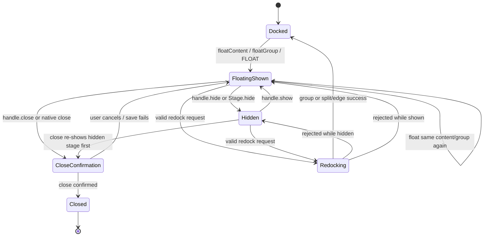

<!--

    Licensed to the Apache Software Foundation (ASF) under one
    or more contributor license agreements.  See the NOTICE file
    distributed with this work for additional information
    regarding copyright ownership.  The ASF licenses this file
    to you under the Apache License, Version 2.0 (the
    "License"); you may not use this file except in compliance
    with the License.  You may obtain a copy of the License at

      http://www.apache.org/licenses/LICENSE-2.0

    Unless required by applicable law or agreed to in writing,
    software distributed under the License is distributed on an
    "AS IS" BASIS, WITHOUT WARRANTIES OR CONDITIONS OF ANY
    KIND, either express or implied.  See the License for the
    specific language governing permissions and limitations
    under the License.

-->
# 12. Floating and redocking

**Baseline:** `f2e43e8b58` (C3-2r).
**Audience:** product code detaching content/groups and shell maintainers changing detached-window lifecycle.

## 12.1 Status at a glance

| Area | Status | Baseline behavior |
|---|---|---|
| `floatContent`, `floatGroup`, `FLOAT`, `redock`, `DockWindow` | **Implemented** | Public operations preserve tab/content identity and return managed floating handles. |
| `FloatingWindow` stage lifecycle | **Implemented** | Show, hide, normal close, empty-pane close, cleanup, and enumeration exist. |
| Split/edge redock of a whole pane | **Implemented** | `DockArea.detach`/`dockDetached` preserve pane identity and group id. |
| Options: owner, modality, title, size, resizable, decoration, icon | **Implemented** | Applied before the floating stage is shown. |
| Chrome profiles for floating windows | **Target only** | `WindowOptions.profile` is accepted but not used to build a floating shell frame. |
| `WindowOptions.rememberBounds` for floating windows | **Target only** | Ignored by `FloatingWindow`; legacy detached-pane layout persistence is separate. |
| `WindowClosePolicy` and `FocusController` | **Target only** | Neither type exists in this baseline. Normal close is not a selectable REDOCK/CLOSE_CONTENT/HIDE policy. |
| Complete multiwindow session restore | **Target only** | No `SessionState`/`WindowStateStore` restore recreates all windows. |

See [requests and policies](10-docking-requests-and-policies.md) for acceptance and [main/custom handles](13-main-custom-and-multiwindow-handles.md) for enumeration and persistence boundaries.

## 12.2 Public contracts

Sources: [`WindowManager.java`](../../../nbfx-platform/nbfx.api.shell/src/org/netbeans/api/nbfx/shell/WindowManager.java), [`DockWindow.java`](../../../nbfx-platform/nbfx.api.shell/src/org/netbeans/api/nbfx/shell/DockWindow.java), [`WindowOptions.java`](../../../nbfx-platform/nbfx.api.shell/src/org/netbeans/api/nbfx/shell/WindowOptions.java).

```java
DockWindow floatContent(ContentId content, WindowOptions options);
DockWindow floatGroup(DockGroupId group, WindowOptions options);
DockResult redock(DockWindow window, DockRequest request);

public interface DockWindow {
    WindowId id();
    WindowKind kind();
    Window window();
    LayoutNode layout();
    WindowContent content();
    void show();
    void hide();
    void close();
    WindowState state();
}

public record WindowOptions(
        WindowKind kind,
        ShellChromeProfile profile,
        String title,
        ResourceRef icon,
        Window owner,
        boolean modal,
        double width,
        double height,
        boolean resizable,
        boolean rememberBounds,
        WindowDecoration decoration) {}
```

`WindowOptions` requires a non-null kind and finite positive width/height. It performs no default filling: null profile/title/icon/owner/decoration and false booleans remain as supplied.

There is no public options accessor on `DockWindow`. Callers that need the effective options must retain what they supplied (and, for remembered custom bounds, read the handle state instead).

## 12.3 `floatContent`

Source: [`DefaultWindowManager.java`](../../../nbfx-platform/nbfx.platform.shell/src/org/netbeans/modules/nbfx/platform/shell/DefaultWindowManager.java).

Algorithm:

1. Require non-null content and options; options kind must be `FLOATING`.
2. Compute default x/y independently: use the explicit owner, else the current main-area window, else no owner; a finite coordinate gets `+40`, otherwise the fallback is `100`.
3. Resolve the content to an existing tab; failure throws `IllegalArgumentException("Content is not docked")`.
4. If the tab is already in a floating pane:
   - reuse the registered handle, or register the legacy floating pane if necessary;
   - show it and return it;
   - **do not reapply the newly supplied options**.
5. Otherwise call `NbfxTabPane.floatTab`:
   - create a new `DETACHED` `NbfxTabPane`, therefore a new `nbfx:detached.N` group;
   - choose editor kind when the tab has an `EditorDocument`, otherwise copy the source pane kind;
   - remove the same tab from its source and attach it to the new pane;
   - configure and show a new stage at the requested initial bounds.
6. Register and return a `FloatingWindow`.

The `Tab`, content node, editor document/view, and content-manager entry are preserved. The source pane's normal emptiness cleanup runs afterward. Floating the sole main tab leaves `MAIN` empty; it does not move the main pane.

## 12.4 `floatGroup`

Algorithm:

1. Require non-null group/options and `WindowKind.FLOATING`.
2. Resolve the group to an `NbfxTabPane`; unknown group throws `IllegalArgumentException`.
3. Reject `PaneRole.MAIN` with `IllegalArgumentException("The main pane cannot be floated")`.
4. If already floating, reuse/register/show the handle; new options are not reapplied.
5. Require the pane to be currently contained in the active `DockArea`. Hidden, minimized, set-aside, detached, or foreign panes fail with `IllegalArgumentException("Dock group is not in the dock area: ...")`.
6. Call `area.detach(pane)`, which rejects main, sole, non-contained, and set-aside panes and returns the former anchor.
7. Show the **same pane object** in a new stage and register a `FloatingWindow` with that anchor.

The pane role, kind, group id, tabs, and content are preserved. There is no explicit nonempty check in `floatGroup`; a temporarily retained empty docked pane can reach this path. The pointer context-menu float-group action does require a nonempty pane.

Although the handle stores the detach anchor, public `redock(window, request)` uses the request's target, not that remembered anchor. Legacy context-menu Dock uses a separate home resolver.

## 12.5 `DockPlacement.FLOAT`

A request with `placement=FLOAT` is accepted only after the normal structural/policy pipeline. It requires a resolvable tab but no target group/area. Execution calls:

```java
floatContent(request.content(), new WindowOptions(
        WindowKind.FLOATING, null, null, null, null,
        false, 600, 400, true, false, null));
```

The result group is the content's new/existing floating group. Policies may reject FLOAT or refine another placement to FLOAT. `DockModifier.FLOAT` alone does nothing. `NEW_WINDOW` remains unsupported.

## 12.6 Floating state machine



“Live” is not the same as “showing.” Hidden floating windows remain registered in `windows()` and retain their pane/tabs so they can be shown or redocked. Closed handles are invalidated and removed.

## 12.7 `FloatingWindow` handle behavior

Source: [`FloatingWindow.java`](../../../nbfx-platform/nbfx.platform.shell/src/org/netbeans/modules/nbfx/platform/shell/FloatingWindow.java).

| Member | Behavior |
|---|---|
| `id()` | `WindowId.of("nbfx:window." + pane.groupId().name())`; for `nbfx:detached.3`, the window id is `nbfx:window.detached.3`. |
| `kind()` | `WindowKind.FLOATING`. |
| `window()` | The backing JavaFX `Stage`. |
| `layout()` | `LayoutNode.group(pane.groupId())`; one group, no split. |
| `content().root()` | The floating `NbfxTabPane`. |
| `content().lookup()` | Selected editor document lookup, else selected view provider lookup, else `Lookup.EMPTY`. It does not check whether the stage is focused. |
| `content().saveState()` | `WindowContentState` with `selectedTab` = selected index, clamped to at least zero. |
| `show()` | Shows the stage; throws `IllegalStateException` after the handle is closed. |
| `hide()` | Hides without closing; no-op after closed. |
| `close()` | Delegates to the owner's normal floating close path; repeated close is a no-op. |
| `state()` | One detached `AreaState` plus window geometry. View ids are captured; editor tabs have no view id and are not represented in `AreaState.viewIds`. Profile id is null. |

`WindowContentState` defensively copies its opaque payload. The shell does not automatically invoke `saveState()` as part of a complete session store.

## 12.8 Stage construction and options

Sources: [`NbfxTabPane.java`](../../../nbfx-platform/nbfx.platform.shell/src/org/netbeans/modules/nbfx/platform/shell/NbfxTabPane.java), [`DefaultWindowManager.java`](../../../nbfx-platform/nbfx.platform.shell/src/org/netbeans/modules/nbfx/platform/shell/DefaultWindowManager.java).

A floating stage uses a `BorderPane` whose center is the pane. If a `WindowEnvironment` supplies detached bars, they are mounted at the top and owned/disposed with the window. The scene is created at the requested width/height. The stage tracks the selected tab title (file name for file-backed editor tabs) and installs navigator-reveal/project-switch shortcuts.

| Option | Floating behavior |
|---|---|
| `kind` | Must be `FLOATING`; otherwise `IllegalArgumentException`. |
| `profile` | **Ignored.** No profile-driven frame/regions are built. |
| `title` | Applied when nonblank before show; later tab selection changes update the stage title. |
| `icon` | Loaded through `Lookup.getDefault().lookup(ClassLoader.class)` using `ResourceRef.path()`. `ResourceRef.module()` is not used here. Missing resource logs a warning; invalid image logs a warning; the default icon remains. |
| `owner` | Applied with `Stage.initOwner` when non-null. Used for default placement even when no implicit owner is set. |
| `modal` | `WINDOW_MODAL` with an owner, otherwise `APPLICATION_MODAL`. |
| `width`/`height` | Initial scene size. |
| `resizable` | Applied with `Stage.setResizable`. |
| `rememberBounds` | **Ignored for floating windows.** Legacy detached-pane persistence is owned elsewhere. |
| `decoration` | Non-null `NATIVE`/`UNDECORATED` is applied before show. Null leaves the stage's default decorated style. |

Default x/y calculation does **not** call `initOwner` implicitly. Icon and decoration are applied before `stage.show()`.

## 12.9 Hide, normal close, and cleanup

### 12.9.1 Hide

`Stage.hide()` does not mark the handle closed. The pane remains in `NbfxTabPane` tracking, tabs/content remain, and `windows()` still lists it. A later `show()` uses the same stage and pane.

Hiding does not itself save `WindowOptions.rememberBounds`; that flag is not implemented for floating handles.

### 12.9.2 Normal close

`FloatingWindow.close()` calls `closeFloatingPane(pane, false)`:

1. If the stage is already hidden, it is synchronously re-shown so close-request and hidden cleanup run reliably.
2. The close handler confirms all editor documents in the pane. Cancel consumes the event, clears the closing marker, and leaves the window/handle live.
3. On confirmation, the stage closes and `WINDOW_HIDDEN` processing runs in this order:
   - the manager's `WINDOW_HIDDEN` **event filter** marks the handle closed and removes it from the floating map;
   - the pane's `setOnHidden` handler removes the non-primary pane from tracked panes and clears `lastFocusedPane`/`activePane` references;
   - scoped detached commands and disposable bars are disposed;
   - editor documents still present are unregistered.

Do not equate this path with calling `ContentManager.close` for every tab. Editor documents are explicitly unregistered, but the stage-hidden handler does not explicitly remove view tabs or invoke their view-close lifecycle. Products that need uniform content close should use the content/view lifecycle deliberately rather than relying on window chrome close alone.

### 12.9.3 Empty-pane close

Removing the last tab schedules a close on the next FX pulse. If a drag is active, close is deferred until drag teardown and one more pulse to avoid a macOS Cocoa drag-manager crash. A reorder that removes and re-adds a tab before the check keeps the window open.

### 12.9.4 Redock cleanup mode

`closeFloatingPane(pane, true)` is different:

- sets `PRESERVE_CONTENT_ON_HIDE`;
- removes the stage close-request handler, so dirty confirmation is bypassed for this internal transfer;
- re-shows a hidden stage and closes it;
- hidden cleanup releases stage resources but does not unregister the pane/documents because the caller has already moved the pane or tabs.

Redock is a placement operation, not a content-close operation.

## 12.10 Redock validation and algorithms

Source: [`DefaultWindowManager.redockWindow`](../../../nbfx-platform/nbfx.platform.shell/src/org/netbeans/modules/nbfx/platform/shell/DefaultWindowManager.java).

Validation order matters:

1. The handle must be a `FloatingWindow` owned by this manager; otherwise `dock.window.missing`.
2. Its stage must exist and its pane must still be registered; otherwise `dock.window.missing`.
3. Null request → `dock.request.invalid`.
4. `request.content()` must resolve to a tab in that exact floating pane; otherwise `dock.window.mismatch`.
5. The pane must not be empty; otherwise `dock.content.missing`.
6. Run `canDock(request)`, including policies and refined-placement revalidation.

The representative content id proves ownership of the request; for group placements, **all** tabs in the floating pane move.

### 12.10.1 Redock INTO_GROUP / TAB_STRIP / BEFORE / AFTER

1. Resolve/find the target group; missing → `dock.target.missing`.
2. Snapshot all floating tabs and remember the selected tab (or first tab).
3. For relative placement, find `targetContent` in the target pane and compute the insertion base.
4. Move each floating tab into the target group in source order:
   - non-relative placements append;
   - relative placements insert at `base + i`.
5. Close the floating stage with content preservation.
6. Mark the handle closed.
7. If the pane role is `DETACHED` or `DOCKED`, unregister the source pane. In the normal cross-group case it is empty after the transfer; see the self-group warning below.
8. Remove the handle from the manager's floating map.
9. Select/front the remembered tab and return the target group id.

**Unsupported baseline edge — self-group redock.** No validation rejects a target group equal to the floating source pane. `INTO_GROUP`/`TAB_STRIP`, or `BEFORE`/`AFTER` with a target tab in that same pane, can therefore take this path. The move loop reorders the tabs in place, then the stage is closed with preservation and a `DETACHED`/`DOCKED` pane is unregistered even though it still contains all its tabs. The result is accepted and the handle is closed. Do not issue self-group redocks; choose a different main-area group or use split/edge redock.

For a floating **permanent non-main** pane redocked to a different group, step 7 does not unregister the pane because its role is neither `DETACHED` nor `DOCKED`. Its old group id can therefore remain in `groups()` as an empty tracked permanent pane even though its tabs now live in the target group. Prefer a split/edge redock when preserving that permanent pane/group is intended.

### 12.10.2 Redock SPLIT / EDGE

1. Require the active area; missing → `dock.target.missing`.
2. For split, resolve and validate the target pane in the area.
3. Remember the selected tab (or first).
4. Close the floating stage with content preservation and mark the handle closed.
5. Call `area.dockDetached(samePane, target)`, re-establishing emptiness tracking and inserting the whole pane at the requested geometry.
6. Remove the handle from the floating map.
7. Select/front the remembered tab and return the pane's existing group id.

No tabs are extracted and no group id changes. The stored detach anchor is not consulted.

### 12.10.3 Unsupported effective placement

`canDock` may allow `FLOAT`, but `redockWindow` has no FLOAT branch and returns `dock.placement.unsupported`. `NEW_WINDOW` is normally rejected during validation. A policy refinement to FLOAT therefore does not mean “float again” during redock.

## 12.11 Errors and failure behavior

| Operation | Failure |
|---|---|
| `floatContent(null, ...)`, `floatGroup(null, ...)` | `NullPointerException`. |
| Null options | `NullPointerException`. |
| Options kind not `FLOATING` | `IllegalArgumentException`. |
| Content open but no resolvable tab, or not docked | `IllegalArgumentException` from `floatContent`. |
| Unknown group | `IllegalArgumentException`. |
| Main group | `IllegalArgumentException`. |
| Group not currently in active area | `IllegalArgumentException`; includes hidden/minimized/set-aside cases. |
| `show()` after close/redock | `IllegalStateException`. |
| Wrong manager/non-floating/stale handle | Rejected `dock.window.missing`. |
| Representative content not in window | Rejected `dock.window.mismatch`. |
| Missing target/area after policy acceptance | Rejected `dock.target.missing`. |
| Missing icon | Warning; window still opens with default icon. |
| Invalid icon image | Warning with exception; window still opens. |

There is no rollback if a low-level stage/dock operation throws after mutation. The manager prevalidates common target failures, but callers should treat the operation as synchronous FX code, not a transaction.

## 12.12 Examples

### Float one content and redock into a group

```java
WindowOptions options = new WindowOptions(
        WindowKind.FLOATING, null, "Inspector", null, null,
        false, 500, 350, true, false, WindowDecoration.UNDECORATED);

DockWindow floating = windows.floatContent(contentId, options);
floating.hide();                       // remains live and redockable
floating.show();

DockGroupId target = windows.primary(PaneRole.NAVIGATOR).orElseThrow();
DockRequest request = new DockRequest(
        contentId, windows.groupOf(contentId).orElse(null),
        null, target, null,
        DockPlacement.INTO_GROUP, TransferMode.MOVE, Set.of());

DockResult result = windows.redock(floating, request);
```

### Float and redock a whole group at an edge

```java
DockWindow floating = windows.floatGroup(groupId, options);
DockRequest request = new DockRequest(
        representativeContentId, groupId, PaneRole.MAIN, null, null,
        DockPlacement.EDGE_BOTTOM, TransferMode.MOVE, Set.of());

DockResult result = windows.redock(floating, request);
// On success the same pane/group is back in the main area.
```

`representativeContentId` must identify a tab in the floating window; the request still moves/reattaches the whole pane for split/edge.

## 12.13 Focus, ownership, and persistence limits

- Content ownership never changes during float/redock. The content manager remains the close/dispose owner.
- Redock remembers and reselects the previously selected tab; `NbfxTabPane.selectTabAndMoveToFront` fronts the destination stage and queues content focus.
- Floating a group does not explicitly request focus in the same way as redock. OS window activation and logical selection are not modeled separately.
- Detached bars/scoped commands are disposed on actual close, not on plain hide.
- `FloatingWindow.state()` is a snapshot, not a restored `SessionState`. It contains view ids/selection/geometry but not a complete editor/content order or opaque per-content payload.
- Legacy `AppState`/session layout persistence may remember detached panes, but `WindowOptions.rememberBounds` does not control it and there is no complete multiwindow restore.

## 12.14 Tests and source map

- [`WindowManagerTest.java`](../../../nbfx-platform/nbfx.platform.shell/test/unit/src/org/netbeans/modules/nbfx/platform/shell/WindowManagerTest.java) — FLOAT requests, content/group float, hide/show/close, group and edge redock, options/icon/decoration, main-first enumeration.
- [`NbfxTabPaneFloatTest.java`](../../../nbfx-platform/nbfx.platform.shell/test/unit/src/org/netbeans/modules/nbfx/platform/shell/NbfxTabPaneFloatTest.java) — source kind, preserved registration, double-show rejection, normal close unregister.
- [`DockAreaTest.java`](../../../nbfx-platform/nbfx.platform.workspace/test/unit/src/org/netbeans/modules/nbfx/platform/workspace/DockAreaTest.java) — detach/redock geometry and invalid pane/target rejection.
- [`FloatingWindow.java`](../../../nbfx-platform/nbfx.platform.shell/src/org/netbeans/modules/nbfx/platform/shell/FloatingWindow.java), [`CustomWindow.java`](../../../nbfx-platform/nbfx.platform.shell/src/org/netbeans/modules/nbfx/platform/shell/CustomWindow.java), [`AppState.java`](../../../nbfx-platform/nbfx.platform.shell/src/org/netbeans/modules/nbfx/platform/shell/AppState.java).

## 12.15 Current versus target

The target defines explicit `WindowClosePolicy.REDOCK`, `CLOSE_CONTENT`, and `HIDE`, applies owner-close policy to owned windows, and uses `FocusController` to distinguish OS activation, logical selection, and keyboard focus. It also expects per-window chrome/profile selection and complete session persistence. None of those complete contracts exists here; the baseline has a working default close path, managed handles, and request-driven redock.
