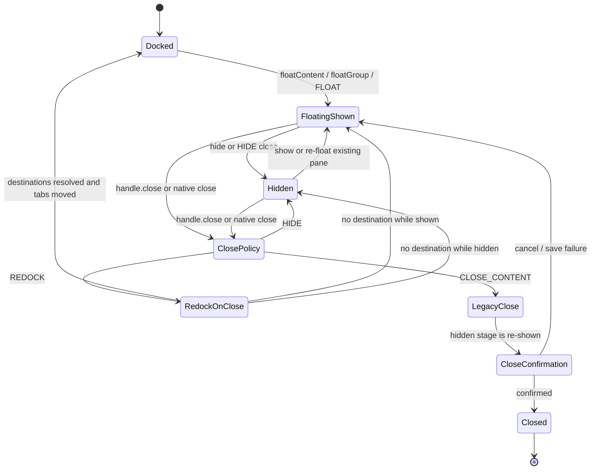
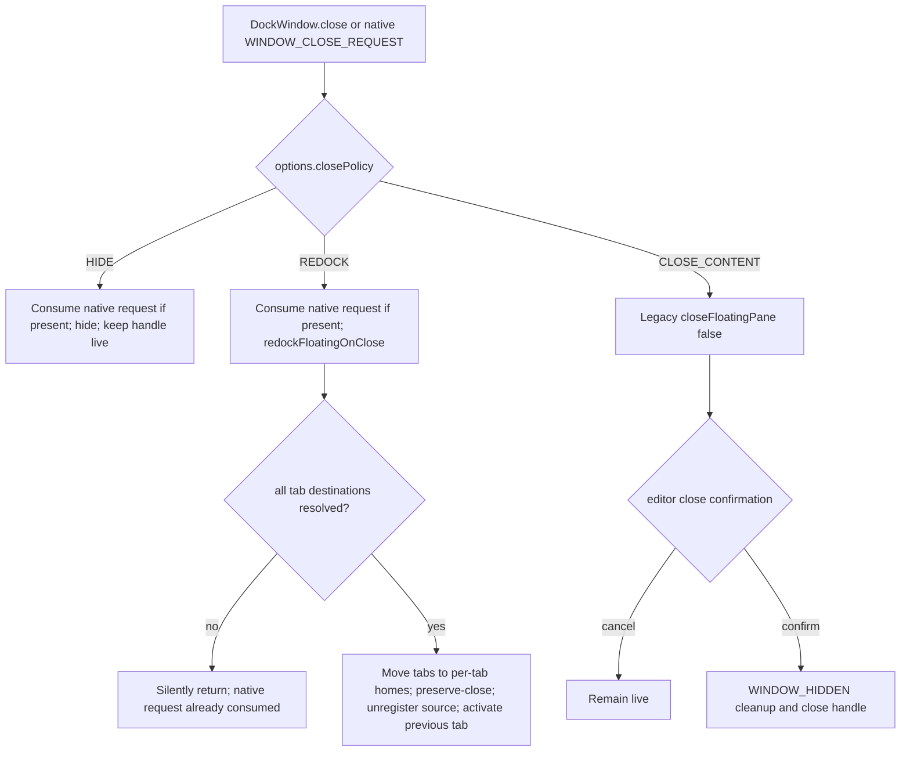

<!--

    Licensed to the Apache Software Foundation (ASF) under one
    or more contributor license agreements.  See the NOTICE file
    distributed with this work for additional information
    regarding copyright ownership.  The ASF licenses this file
    to you under the Apache License, Version 2.0 (the
    "License"); you may not use this file except in compliance
    with the License.  You may obtain a copy of the License at

      http://www.apache.org/licenses/LICENSE-2.0

    Unless required by applicable law or agreed to in writing,
    software distributed under the License is distributed on an
    "AS IS" BASIS, WITHOUT WARRANTIES OR CONDITIONS OF ANY
    KIND, either express or implied.  See the License for the
    specific language governing permissions and limitations
    under the License.

-->
# 12. Floating and redocking

**Baseline:** `60143d8f59` (C4-3e).

**Audience:** product code detaching content/groups and shell maintainers changing detached-window lifecycle.

## 12.1 Status at a glance

| Area | Status | Baseline behavior |
|---|---|---|
| `floatContent`, `floatGroup`, `FLOAT`, `redock`, `DockWindow` | **Implemented** | Public operations preserve tab/content identity and return managed floating handles. |
| `WindowClosePolicy.HIDE/REDOCK/CLOSE_CONTENT` for floating windows | **Implemented** | Native and direct close dispatch through the selected policy. |
| `FloatingWindow` stage lifecycle | **Implemented** | Show, hide, policy close, empty-pane close, cleanup, and enumeration exist. |
| `WindowActivation` for `DockWindow.show()` | **Implemented** | Main/floating/custom handles call `show`, `toFront`, and `requestFocus`; native focus remains best effort. |
| Split/edge redock of a whole pane | **Implemented** | `DockArea.detach`/`dockDetached` preserve pane identity and group id. |
| Options: owner, modality, title, size, resizable, decoration, icon | **Implemented** | Applied before the floating stage is shown. |
| Chrome profiles for floating windows | **Target only** | `WindowOptions.profile` is retained for state reporting but not used to build a floating shell frame. |
| `WindowOptions.rememberBounds` for floating windows | **Target only** | Ignored by `FloatingWindow`; legacy detached-pane layout persistence is separate. |
| Close-policy persistence, MAIN policy cascade, and `FocusController` | **Target only** | `closePolicy` is not persisted, MAIN does not dispatch/cascade, and no three-fact focus controller exists. |
| Complete multiwindow session restore | **Target only** | No `SessionState`/`WindowStateStore` restore recreates all windows. |

See [requests and policies](10-docking-requests-and-policies.md) for explicit request acceptance and [main/custom handles](13-main-custom-and-multiwindow-handles.md) for enumeration and custom-window policy behavior.

## 12.2 Public contracts

Sources: [`WindowManager.java`](../../../nbfx-platform/nbfx.api.shell/src/org/netbeans/api/nbfx/shell/WindowManager.java), [`DockWindow.java`](../../../nbfx-platform/nbfx.api.shell/src/org/netbeans/api/nbfx/shell/DockWindow.java), [`WindowOptions.java`](../../../nbfx-platform/nbfx.api.shell/src/org/netbeans/api/nbfx/shell/WindowOptions.java), [`WindowClosePolicy.java`](../../../nbfx-platform/nbfx.api.shell/src/org/netbeans/api/nbfx/shell/WindowClosePolicy.java).

```java
DockWindow floatContent(ContentId content, WindowOptions options);
DockWindow floatGroup(DockGroupId group, WindowOptions options);
DockResult redock(DockWindow window, DockRequest request);

public interface DockWindow {
    WindowId id();
    WindowKind kind();
    Window window();
    LayoutNode layout();
    WindowContent content();
    void show();
    void hide();
    void close();
    WindowState state();
}

public enum WindowClosePolicy {
    HIDE, REDOCK, CLOSE_CONTENT
}

public record WindowOptions(
        WindowKind kind,
        ShellChromeProfile profile,
        String title,
        ResourceRef icon,
        Window owner,
        boolean modal,
        double width,
        double height,
        boolean resizable,
        boolean rememberBounds,
        WindowDecoration decoration,
        WindowClosePolicy closePolicy) {

    public WindowOptions(WindowKind kind, ShellChromeProfile profile, String title,
            ResourceRef icon, Window owner, boolean modal, double width, double height,
            boolean resizable, boolean rememberBounds, WindowDecoration decoration) {
        this(kind, profile, title, icon, owner, modal, width, height, resizable,
                rememberBounds, decoration, WindowClosePolicy.CLOSE_CONTENT);
    }
}
```

`WindowOptions` requires non-null `kind` and `closePolicy`, plus finite positive width/height. The 11-argument compatibility constructor defaults to `CLOSE_CONTENT`; it does **not** choose the target's floating `REDOCK` default. There is no public options accessor on `DockWindow`, so callers must retain the options they supplied.

## 12.3 `floatContent`

Source: [`DefaultWindowManager.java`](../../../nbfx-platform/nbfx.platform.shell/src/org/netbeans/modules/nbfx/platform/shell/DefaultWindowManager.java).

Algorithm:

1. Require non-null content and options; options kind must be `FLOATING`.
2. Compute default x/y independently: use the explicit owner, else the current main-area window, else no owner; a finite coordinate gets `+40`, otherwise the fallback is `100`.
3. Resolve the content to an existing tab; failure throws `IllegalArgumentException("Content is not docked")`.
4. If the tab is already in a floating pane:
   - reuse the registered handle, or register the legacy floating pane with `defaultFloatingOptions()` if necessary;
   - call `existing.show()`, which now uses `WindowActivation`;
   - return it;
   - **do not reapply the newly supplied options or close policy**.
5. Otherwise call `NbfxTabPane.floatTab`:
   - create a new `DETACHED` `NbfxTabPane`, therefore a new `nbfx:detached.N` group;
   - choose editor kind when the tab has an `EditorDocument`, otherwise copy the source pane kind;
   - remove the same tab from its source and attach it to the new pane;
   - configure and show a new stage at the requested initial bounds.
6. Register and return a `FloatingWindow` with the checked options.

The `Tab`, content node, editor document/view, and content-manager entry are preserved. Initial floating creation still uses the legacy direct `stage.show()` path; the activation helper is used when the public handle is shown again. The source pane's normal emptiness cleanup runs afterward.

## 12.4 `floatGroup`

Algorithm:

1. Require non-null group/options and `WindowKind.FLOATING`.
2. Resolve the group to an `NbfxTabPane`; unknown group throws `IllegalArgumentException`.
3. Reject `PaneRole.MAIN` with `IllegalArgumentException("The main pane cannot be floated")`.
4. If already floating, reuse/register/show the handle through `WindowActivation`; new options/policy are not reapplied. An unregistered legacy floating pane is registered with default `CLOSE_CONTENT` options.
5. Require the pane to be currently contained in the active `DockArea`. Hidden, minimized, set-aside, detached, or foreign panes fail with `IllegalArgumentException("Dock group is not in the dock area: ...")`.
6. Call `area.detach(pane)`, which rejects main, sole, non-contained, and set-aside panes and returns the former anchor.
7. Show the **same pane object** in a new stage and register a `FloatingWindow` with that anchor and the checked options.

The pane role, kind, group id, tabs, content, and selected close policy are preserved. There is no explicit nonempty check in `floatGroup`; a temporarily retained empty docked pane can reach this path. The pointer context-menu float-group action does require a nonempty pane.

Although the handle stores the detach anchor, public `redock(window, request)` uses the request's target, not that remembered anchor. Legacy context-menu Dock uses a separate home resolver.

## 12.5 `DockPlacement.FLOAT`

A request with `placement=FLOAT` is accepted only after the normal structural/policy pipeline. It requires a resolvable tab but no target group/area. Execution calls `floatContent` with effective defaults:

```java
new WindowOptions(WindowKind.FLOATING, null, null, null, null,
                  false, 600, 400, true, false, null,
                  WindowClosePolicy.CLOSE_CONTENT);
```

The implementation uses the 11-argument constructor, whose new compatibility default is `CLOSE_CONTENT`. The result group is the content's new/existing floating group. Policies may reject FLOAT or refine another placement to FLOAT. `DockModifier.FLOAT` alone does nothing. `NEW_WINDOW` remains unsupported.

## 12.6 Floating state machine



“Live” is not the same as “showing.” Hidden floating windows remain registered in `windows()` and retain their pane/tabs. Closed handles are invalidated and removed. A rejected explicit `redock(...)` returns to the prior shown/hidden state; close-policy REDOCK has no rejection result and can leave the window live when no destinations exist.

## 12.7 `FloatingWindow` handle behavior

Source: [`FloatingWindow.java`](../../../nbfx-platform/nbfx.platform.shell/src/org/netbeans/modules/nbfx/platform/shell/FloatingWindow.java), [`WindowActivation.java`](../../../nbfx-platform/nbfx.platform.shell/src/org/netbeans/modules/nbfx/platform/shell/WindowActivation.java).

| Member | Behavior |
|---|---|
| `id()` | `WindowId.of("nbfx:window." + pane.groupId().name())`; for `nbfx:detached.3`, the window id is `nbfx:window.detached.3`. |
| `kind()` | `WindowKind.FLOATING`. |
| `window()` | The backing JavaFX `Stage`. |
| `layout()` | `LayoutNode.group(pane.groupId())`; one group, no split. |
| `content().root()` | The floating `NbfxTabPane`. |
| `content().lookup()` | Selected editor document lookup, else selected view provider lookup, else `Lookup.EMPTY`. It does not check whether the stage is focused. |
| `content().saveState()` | `WindowContentState` with `selectedTab` = selected index, clamped to at least zero. |
| `show()` | Calls `WindowActivation.show`: `stage.show()`, `stage.toFront()`, `stage.requestFocus()`. Throws `IllegalStateException` after the handle is closed. |
| `hide()` | Hides without closing; no-op after closed. |
| `close()` | Dispatches through the owner's `WindowClosePolicy` switch; repeated close after closure is a no-op. |
| `state()` | One detached `AreaState` plus geometry. View ids are captured; editor tabs are not represented in `AreaState.viewIds`. `profileId` is the explicit `options.profile().id()` when present, otherwise null. |

`WindowActivation` is a native stage activation helper, not a `FocusController`. It does not guarantee OS focus, logical active content, or action-context correctness.

## 12.8 Stage construction and options

Sources: [`NbfxTabPane.java`](../../../nbfx-platform/nbfx.platform.shell/src/org/netbeans/modules/nbfx/platform/shell/NbfxTabPane.java), [`DefaultWindowManager.java`](../../../nbfx-platform/nbfx.platform.shell/src/org/netbeans/modules/nbfx/platform/shell/DefaultWindowManager.java).

A floating stage uses a `BorderPane` whose center is the pane. If a `WindowEnvironment` supplies detached bars, they are mounted at the top and owned/disposed with the window. The scene is created at the requested width/height. The stage tracks the selected tab title (file name for file-backed editor tabs) and installs navigator-reveal/project-switch shortcuts.

| Option | Floating behavior |
|---|---|
| `kind` | Must be `FLOATING`; otherwise `IllegalArgumentException`. |
| `profile` | Not resolved into chrome; an explicit profile id is reported by `FloatingWindow.state()`. |
| `title` | Applied when nonblank before show; later tab selection changes update the stage title. |
| `icon` | Loaded through `Lookup.getDefault().lookup(ClassLoader.class)` using `ResourceRef.path()`. `ResourceRef.module()` is not used here. Missing resource logs a warning; invalid image logs a warning; the default icon remains. |
| `owner` | Applied with `Stage.initOwner` when non-null. Used for default placement even when no implicit owner is set. |
| `modal` | `WINDOW_MODAL` with an owner, otherwise `APPLICATION_MODAL`. |
| `width`/`height` | Initial scene size. |
| `resizable` | Applied with `Stage.setResizable`. |
| `rememberBounds` | **Ignored for floating windows.** Legacy detached-pane persistence is owned elsewhere. |
| `decoration` | Non-null `NATIVE`/`UNDECORATED` is applied before show. Null leaves the stage's default decorated style. |
| `closePolicy` | Stored on the handle and used for direct/native close dispatch; not persisted. |

Default x/y calculation does **not** call `initOwner` implicitly. Icon and decoration are applied before the initial direct `stage.show()`.

## 12.9 Close policies



### 12.9.1 HIDE

For `WindowClosePolicy.HIDE`:

- A native `WINDOW_CLOSE_REQUEST` is consumed and `hide()` is called.
- Direct `DockWindow.close()` calls the same hide path without firing a native request.
- There is no dirty-editor confirmation and no content close.
- The stage, pane, tabs, content-manager entries, and handle remain live, enumerated, and re-showable.
- A later explicit `redock(...)` still works.

### 12.9.2 REDOCK

For `WindowClosePolicy.REDOCK`:

- A native close request is consumed, then `owner.closeFloatingWindow(this)` invokes `redockFloatingOnClose`.
- Direct `DockWindow.close()` invokes the same helper directly.
- This path **bypasses `DockPolicy`, `canDock`, `DockRequest`, and dirty-editor confirmation**. It is not the same operation as explicit `redock(window, request)`.

Algorithm for a nonempty pane:

1. Snapshot tabs in source order and remember the selected tab.
2. Compute fallback: active `DockArea.mainPane()`, else the registered `MAIN`-role pane.
3. Resolve **every** destination before moving anything. For each tab, use `NbfxTabPane.homeOf(tab)` only when the result is registered and is not the source floating pane; otherwise use fallback.
4. Different tabs may therefore go to different homes. A registered home may be another managed pane; the helper does not require it to be the main area.
5. If any tab has no destination, return silently without closing or moving. A native close request has already been consumed, so it does not fall through to legacy close.
6. Move tabs to their destinations in source order, appending to each target.
7. Close the floating stage with content preservation, mark the handle closed, unregister the source pane when its role is `DETACHED` or `DOCKED`, and remove the handle from the manager map.
8. Select/front the previously selected tab; normal selection queues content focus.

For an empty pane, the helper preserve-closes the stage, marks the handle closed, and removes it from the map; it does not perform the nonempty-path unregister step.

This is not transactional. Destination resolution is preflighted, but a low-level move failure after earlier tabs have moved is not rolled back.

### 12.9.3 CLOSE_CONTENT

`CLOSE_CONTENT` retains the legacy close path:

1. Direct close calls `closeFloatingPane(pane, false)`. Native close reaches the pane's existing close-request handler.
2. If the stage is hidden, it is synchronously re-shown so confirmation and hidden cleanup run reliably.
3. The close handler confirms all editor documents in the pane. Cancel consumes the event, clears the closing marker, and leaves the window/handle live.
4. On confirmation, `WINDOW_HIDDEN` processing runs in this order:
   - the manager's `WINDOW_HIDDEN` **event filter** marks the handle closed and removes it from the floating map;
   - the pane's `setOnHidden` handler removes the non-primary pane from tracked panes and clears `lastFocusedPane`/`activePane` references;
   - scoped detached commands and disposable bars are disposed;
   - editor documents still present are unregistered.

This is not a uniform generic `ContentManager.close` for every tab. View tabs are not explicitly removed or view-closed by the stage-hidden handler. Products needing uniform content close must use the content/view lifecycle deliberately.

### 12.9.4 Empty-pane close

Removing the last tab schedules a close on the next FX pulse. If a drag is active, close is deferred until drag teardown and one more pulse to avoid a macOS Cocoa drag-manager crash. A reorder that removes and re-adds a tab before the check keeps the window open. This pane-empty lifecycle sets `CLOSING_WINDOW` before `Stage.close()`; it should not be treated as an explicit `DockWindow.close()` policy call.

### 12.9.5 Redock cleanup mode

`closeFloatingPane(pane, true)` is the internal transfer cleanup:

- sets `PRESERVE_CONTENT_ON_HIDE`;
- removes the stage close-request handler, bypassing dirty confirmation;
- re-shows a hidden stage and closes it;
- releases stage resources without unregistering the pane/documents because the caller has already moved the pane or tabs.

Both close-policy REDOCK and explicit `redock(...)` use this preservation mode after placement.

## 12.10 Explicit `redock` validation and algorithms

Source: [`DefaultWindowManager.redockWindow`](../../../nbfx-platform/nbfx.platform.shell/src/org/netbeans/modules/nbfx/platform/shell/DefaultWindowManager.java).

Explicit `redock` is request-based and **does** run `canDock`; close-policy REDOCK does not. Validation order:

1. Handle must be an owned `FloatingWindow`; otherwise `dock.window.missing`.
2. Stage must exist and pane remain registered; otherwise `dock.window.missing`.
3. Null request → `dock.request.invalid`.
4. `request.content()` must resolve to a tab in that exact floating pane; otherwise `dock.window.mismatch`.
5. Defensive empty-pane check → `dock.content.missing` (normally the representative check returns mismatch first for an empty pane).
6. Run `canDock`, including policies and refined-placement revalidation.

### 12.10.1 Redock INTO_GROUP / TAB_STRIP / BEFORE / AFTER

1. Resolve/find the target group; missing → `dock.target.missing`.
2. Snapshot all floating tabs and remember the selected tab (or first).
3. For relative placement, validate `targetContent` in the target pane and compute the insertion base.
4. Move tabs in source order: append for non-relative placements, or insert at `base + i`.
5. Preserve-close the stage, mark closed, unregister `DETACHED`/`DOCKED` source panes, remove the handle, select/front the remembered tab, and return the target group.

**Unsupported baseline edge — self-group redock.** No validation rejects a target group equal to the floating source pane. `INTO_GROUP`/`TAB_STRIP`, or `BEFORE`/`AFTER` with a target tab in that pane, reorder tabs in place, then preserve-close the stage and may unregister a still-nonempty `DETACHED`/`DOCKED` pane. The result is accepted and the handle closes. Do not issue self-group redocks; choose another group or split/edge.

For a permanent non-main pane redocked to a different group, the source pane is not unregistered; its old group can remain tracked and empty. Prefer split/edge when preserving that pane/group is intended.

### 12.10.2 Redock SPLIT / EDGE

1. Require the active area and valid split target.
2. Remember the selected tab.
3. Preserve-close the stage and mark the handle closed.
4. `area.dockDetached(samePane, target)` re-establishes emptiness tracking and inserts the whole pane.
5. Remove the handle, select/front the remembered tab, and return the pane's existing group id.

No tabs are extracted and no group id changes. The stored detach anchor is not consulted.

### 12.10.3 Unsupported effective placement

`canDock` may allow `FLOAT`, but explicit `redockWindow` has no FLOAT branch and returns `dock.placement.unsupported`. `NEW_WINDOW` is normally rejected during validation.

## 12.11 Errors and failure behavior

| Operation | Failure |
|---|---|
| Null content/group/options | `NullPointerException`. |
| Options kind not `FLOATING` | `IllegalArgumentException`. |
| Content open but not dockable | `IllegalArgumentException` from `floatContent`. |
| Unknown/main/non-area group | `IllegalArgumentException`. |
| Custom `REDOCK` policy | Rejected by `createCustomWindow`; see chapter 13. |
| `show()` after close/redock | `IllegalStateException`. |
| Wrong manager/non-floating/stale explicit-redock handle | Rejected `dock.window.missing`. |
| Representative content not in window | Rejected `dock.window.mismatch`. |
| Missing explicit-redock target/area | Rejected `dock.target.missing`. |
| Missing/invalid icon | Warning; window still opens with default icon. |
| Close-policy REDOCK with no destinations | Silent return; native request consumed, handle remains live. |

There is no rollback if a low-level stage/dock operation throws after mutation.

## 12.12 Examples

### Float with HIDE, then explicitly redock

```java
WindowOptions options = new WindowOptions(
        WindowKind.FLOATING, null, "Inspector", null, null,
        false, 500, 350, true, false, WindowDecoration.UNDECORATED,
        WindowClosePolicy.HIDE);

DockWindow floating = windows.floatContent(contentId, options);
floating.close();                     // hides; handle remains live
floating.show();                      // WindowActivation: show + front + focus request

DockGroupId target = windows.primary(PaneRole.NAVIGATOR).orElseThrow();
DockRequest request = new DockRequest(
        contentId, windows.groupOf(contentId).orElse(null),
        null, target, null,
        DockPlacement.INTO_GROUP, TransferMode.MOVE, Set.of());
DockResult result = windows.redock(floating, request);
```

### Close-policy REDOCK

```java
WindowOptions options = new WindowOptions(
        WindowKind.FLOATING, null, "Inspector", null, null,
        false, 500, 350, true, false, WindowDecoration.NATIVE,
        WindowClosePolicy.REDOCK);

DockWindow floating = windows.floatContent(contentId, options);
floating.close(); // per-tab homeOf/fallback redock; no DockPolicy/canDock/confirmation
```

## 12.13 Focus, ownership, and persistence limits

- Content ownership never changes during float/redock. The content manager remains the close/dispose owner.
- Public handle `show()` now requests native activation through `WindowActivation`; initial floating creation still directly shows the stage.
- Close-policy and explicit redock remember/reselect the previous tab. Normal selection fronts the destination stage and queues content focus.
- No `FocusController` separates OS activation, logical selection, and keyboard focus; native focus requests are best effort.
- Detached bars/scoped commands are disposed on actual close, not plain hide.
- `FloatingWindow.state()` is a snapshot, not a restored `SessionState`; it includes view ids/selection/geometry and an explicit profile id, but not complete editor/content order or opaque payloads.
- `WindowClosePolicy` is not persisted. Legacy `AppState`/session layout persistence may remember detached panes, but `WindowOptions.rememberBounds` does not control it and there is no complete multiwindow restore.

## 12.14 Tests and source map

- [`WindowManagerTest.java`](../../../nbfx-platform/nbfx.platform.shell/test/unit/src/org/netbeans/modules/nbfx/platform/shell/WindowManagerTest.java) — FLOAT requests, content/group float, hide/show/close, floating HIDE and REDOCK close behavior, group/edge explicit redock, options/icon/decoration, main-first enumeration.
- [`WindowActivationTest.java`](../../../nbfx-platform/nbfx.platform.shell/test/unit/src/org/netbeans/modules/nbfx/platform/shell/WindowActivationTest.java) — show and `toFront`; no native-focus/logical-context assertion.
- [`DockWindowContractTest.java`](../../../nbfx-platform/nbfx.api.shell/test/unit/src/org/netbeans/api/nbfx/shell/DockWindowContractTest.java) — 11-argument options default to `CLOSE_CONTENT`; null close policy is rejected.
- [`NbfxTabPaneFloatTest.java`](../../../nbfx-platform/nbfx.platform.shell/test/unit/src/org/netbeans/modules/nbfx/platform/shell/NbfxTabPaneFloatTest.java) — source kind, preserved registration, double-show rejection, normal close unregister.
- [`DockAreaTest.java`](../../../nbfx-platform/nbfx.platform.workspace/test/unit/src/org/netbeans/modules/nbfx/platform/workspace/DockAreaTest.java) — detach/redock geometry and invalid pane/target rejection.
- [`FloatingWindow.java`](../../../nbfx-platform/nbfx.platform.shell/src/org/netbeans/modules/nbfx/platform/shell/FloatingWindow.java), [`CustomWindow.java`](../../../nbfx-platform/nbfx.platform.shell/src/org/netbeans/modules/nbfx/platform/shell/CustomWindow.java), [`WindowActivation.java`](../../../nbfx-platform/nbfx.platform.shell/src/org/netbeans/modules/nbfx/platform/shell/WindowActivation.java), [`AppState.java`](../../../nbfx-platform/nbfx.platform.shell/src/org/netbeans/modules/nbfx/platform/shell/AppState.java).

## 12.15 Current versus target

`WindowClosePolicy` is now **Implemented** for floating windows, but internal FLOAT defaults to `CLOSE_CONTENT`, not the target's default `REDOCK`. Close-policy REDOCK is a direct home-based transfer, not the target's policy-aware `DockRequest` path, and it is not persisted. MAIN policy cascade and `FocusController` remain **Target only**, as do per-window profile-driven chrome and complete session persistence.
