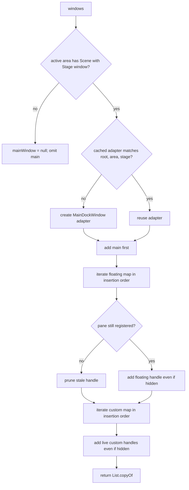
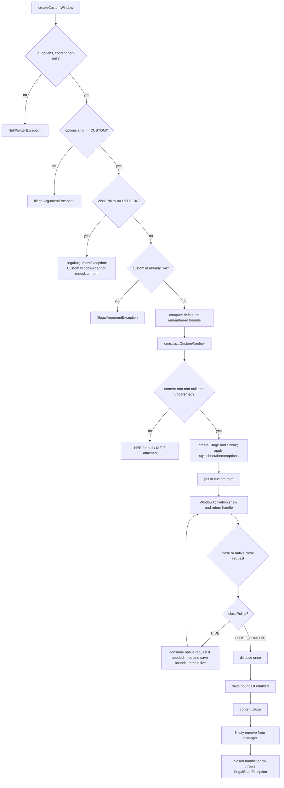

<!--

    Licensed to the Apache Software Foundation (ASF) under one
    or more contributor license agreements.  See the NOTICE file
    distributed with this work for additional information
    regarding copyright ownership.  The ASF licenses this file
    to you under the Apache License, Version 2.0 (the
    "License"); you may not use this file except in compliance
    with the License.  You may obtain a copy of the License at

      http://www.apache.org/licenses/LICENSE-2.0

    Unless required by applicable law or agreed to in writing,
    software distributed under the License is distributed on an
    "AS IS" BASIS, WITHOUT WARRANTIES OR CONDITIONS OF ANY
    KIND, either express or implied.  See the License for the
    specific language governing permissions and limitations
    under the License.

-->
# 13. Main, custom, and multiwindow handles

**Baseline:** `60143d8f59` (C4-3e).
**Audience:** product developers creating custom windows and maintainers working on enumeration, close, or persistence.

## 13.1 Status at a glance

| Area | Status | Baseline behavior |
|---|---|---|
| Main-window `DockWindow` adapter | **Implemented** | `windows()` exposes the live main stage first when the dock area is attached to a stage. |
| Floating-window handles and enumeration | **Implemented** | Hidden windows remain live; closed/stale handles are removed. |
| Custom `DockWindow` over `WindowContent` | **Implemented** | Arbitrary unparented JavaFX content can be hosted in a stage. |
| `windows()` order | **Implemented** | Main, then floating creation order, then custom creation order. |
| Exactly-once custom content host close | **Partial** | A closed guard and `finally` removal implement the intent, but the test covers one close and a boolean flag, not repeated/native/programmatic close races. |
| Duplicate custom ids and attached-root rejection | **Implemented** | Duplicate ids are checked within the custom-window map; roots with a scene or parent are rejected. |
| Remembered custom bounds (`AppState`, C3-2r) | **Implemented** | Opt-in bounds save on hide/close, restore by stable `WindowId`, and off-screen fallback. |
| Complete multiwindow persistence/chrome | **Partial** | No `SessionState` restore, per-window shell frame/profile composition, or full content-state round-trip. |
| `WindowClosePolicy` for custom windows | **Implemented** | HIDE keeps the window live; CLOSE_CONTENT uses dispose-once/stage close; REDOCK is rejected at creation. MAIN has no policy dispatch/cascade. |
| Close-policy persistence and owner-window cascade | **Target only** | `closePolicy` is not persisted and MAIN close does not apply it to owned windows. |
| `FocusController` | **Target only** | No controller separates OS activation, logical selection, and keyboard focus. |

See [floating and redocking](12-floating-and-redocking.md) for floating-specific lifecycle and [window state and persistence](07-window-state-and-persistence.md) for the legacy state system.

## 13.2 Handle and content contracts

Sources: [`DockWindow.java`](../../../nbfx-platform/nbfx.api.shell/src/org/netbeans/api/nbfx/shell/DockWindow.java), [`WindowContent.java`](../../../nbfx-platform/nbfx.api.shell/src/org/netbeans/api/nbfx/shell/WindowContent.java), [`WindowContentState.java`](../../../nbfx-platform/nbfx.api.shell/src/org/netbeans/api/nbfx/shell/WindowContentState.java), [`WindowId.java`](../../../nbfx-platform/nbfx.api.shell/src/org/netbeans/api/nbfx/shell/WindowId.java), [`WindowOptions.java`](../../../nbfx-platform/nbfx.api.shell/src/org/netbeans/api/nbfx/shell/WindowOptions.java), [`WindowClosePolicy.java`](../../../nbfx-platform/nbfx.api.shell/src/org/netbeans/api/nbfx/shell/WindowClosePolicy.java).

```java
public interface DockWindow {
    WindowId id();
    WindowKind kind();
    Window window();
    LayoutNode layout();
    WindowContent content();
    void show();
    void hide();
    void close();
    WindowState state();
}

public interface WindowContent extends AutoCloseable {
    Node root();
    Lookup lookup();
    WindowContentState saveState();
    @Override default void close();
}

public record WindowContentState(WindowId windowId, LayoutNode layout,
                                 Map<String, String> payload) {
    public static WindowContentState empty(WindowId windowId, LayoutNode layout);
}

public record WindowId(String namespace, String name) {
    public static WindowId of(String value);
    public String value();
}
```

- `WindowId` requires `namespace:name`; each part uses `[A-Za-z0-9][A-Za-z0-9._-]*`. Product ids are case-sensitive.
- `WindowContentState` requires a window id and payload, defensively copies the payload, and permits a null layout for custom content.
- `WindowContent.close()` is explicitly a **host-resource** release hook. It is not a replacement for `ContentManager.close`/`Content.dispose`.
- `layout()` is a snapshot. Custom windows return null; main/floating return live-derived group/split snapshots.
- `WindowKind` is `MAIN`, `FLOATING`, or `CUSTOM`.

`WindowManager.createCustomWindow` signature:

```java
DockWindow createCustomWindow(WindowId id, WindowOptions options,
                              WindowContent content);
```

## 13.3 Window enumeration model

Source: [`DefaultWindowManager.windows()`](../../../nbfx-platform/nbfx.platform.shell/src/org/netbeans/modules/nbfx/platform/shell/DefaultWindowManager.java).



Actual order:

```text
1. MainDockWindow          only when the active DockArea is in a Scene backed by a Stage
2. FloatingWindow(s)       LinkedHashMap insertion/creation order; hidden included
3. CustomWindow(s)         LinkedHashMap insertion/creation order; hidden included
```

Important limits:

- Enumeration is manager-local bookkeeping, not `Window.getWindows()` and not a global OS-window list.
- The main handle is omitted before the area is attached to a stage, or after the active runtime is disposed.
- A hidden main/floating/custom window remains “live” and enumerated.
- Closing a custom window removes it; recreating the same id later appends it at the end of custom order.
- Stale floating entries are pruned when their pane is no longer tracked.
- Custom ids are checked only against other **custom** ids. A custom id equal to the main or a floating window id is not rejected by this implementation, so global cross-kind id uniqueness is not guaranteed.

## 13.4 Main-window adapter

Source: [`MainDockWindow.java`](../../../nbfx-platform/nbfx.platform.shell/src/org/netbeans/modules/nbfx/platform/shell/MainDockWindow.java).

| Member | Behavior |
|---|---|
| `id()` | `nbfx:window.main`. |
| `kind()` | `MAIN`. |
| `window()` | The shell's `Stage`. |
| `content().root()` | The runtime `SlidingArea`, not the whole custom/default frame root. |
| `layout()` | Converts the **current** `DockArea.tree()` to `LayoutNode.Group`/`Split`, pairing depth-first leaves with each pane's unique group id. |
| `show()` / `hide()` | `show()` uses `WindowActivation` (`show`, `toFront`, `requestFocus`); `hide()` directly hides. A closed main stage can be shown again. |
| `close()` | Direct `Stage.close()`; the adapter itself has no `WindowClosePolicy` dispatch or owned-window cascade. |
| `state()` | Live visible pane/view snapshots merged with shell geometry/profile state. |
| `content().lookup()` | Empty unless the main stage is focused; then uses global `ActiveComponentContext` and its active component lookup. |
| `content().saveState()` | Empty payload with the main id and current layout. |

### 13.4.1 Layout/state limitations

- Only current `area.leaves()` are converted. Hidden empty permanent panes and minimized panes are not leaves; the slide pane is not part of the dock tree.
- While maximized, the area's current root is the maximized pane, so the adapter's layout snapshot reflects that shown shape, not the set-aside tree.
- `AreaState.viewIds` contains only tabs with nonblank view ids. Editor documents are not represented there.
- Geometry comes from finite values in the shell snapshot supplier, falling back to stage geometry. `ShellApplication.snapshot()` preserves normal restore bounds while maximized.
- `maximized`, `profileId`, and `viewState` come from that shell snapshot. The adapter does not create a `SessionState` or include floating/custom windows.

The main adapter is cached until its `SlidingArea`, `DockArea`, or `Stage` identity changes.

## 13.5 Custom-window lifecycle

Sources: [`CustomWindow.java`](../../../nbfx-platform/nbfx.platform.shell/src/org/netbeans/modules/nbfx/platform/shell/CustomWindow.java), [`DefaultWindowManager.createCustomWindow`](../../../nbfx-platform/nbfx.platform.shell/src/org/netbeans/modules/nbfx/platform/shell/DefaultWindowManager.java).



### 13.5.1 Creation rules

`createCustomWindow` checks, in order:

1. Non-null id, options, and content.
2. `options.kind() == WindowKind.CUSTOM`.
3. `options.closePolicy() != WindowClosePolicy.REDOCK`; otherwise `IllegalArgumentException("Custom windows cannot redock content")`.
4. No existing live custom entry with the same id.
5. Optional remembered bounds when `rememberBounds` is true and an `AppState` is present; the effective options retain `closePolicy`.
6. Construction of `CustomWindow`, which requires a non-null root with both `root.getScene() == null` and `root.getParent() == null`.

The root is mounted as follows:

- If it is already a `Parent`, it becomes the scene root directly.
- Otherwise it is wrapped in a `StackPane`.
- The scene gets the tab-pane stylesheet and legacy `NbfxTheme.apply(scene)`.
- The shared stage configurator applies owner, modality, title, decoration, icon, resizability, x, and y before show.
- The handle is inserted into the custom map, then shown.

A null root throws `NullPointerException`; an attached root throws `IllegalArgumentException`. Close does not detach the root from its old scene, so reusing the same `WindowContent` root after close may still fail the attached-root check unless the product detaches it.

### 13.5.2 Hide versus close

- `hide()` hides the stage, saves remembered bounds when enabled, and leaves the content/handle live.
- `show()` uses `WindowActivation.show` (`show`, `toFront`, `requestFocus`) on the same stage; after CLOSE_CONTENT disposal it throws `IllegalStateException`.
- With `WindowClosePolicy.HIDE`, direct `close()` simply hides. A native close request is consumed and hides as well—no confirmation or content close occurs, and the handle remains enumerated/re-showable.
- With `WindowClosePolicy.CLOSE_CONTENT`, direct `close()` clears the stage close-request handler, calls `dispose()`, then closes the stage. A native close request calls `dispose()` and JavaFX performs normal stage closing.
- `dispose()` sets `closed=true` before calling `content.close()`, saves bounds, and removes the handle in a `finally` block.
- Therefore CLOSE_CONTENT invokes `content.close()` at most once per handle even if close is repeated or native/programmatic paths race on the FX thread.
- If `content.close()` throws, the exception propagates, but manager removal still happens. In the programmatic CLOSE_CONTENT path, the subsequent `stage.close()` is not reached because `dispose()` threw.

Duplicate-id rejection applies to hidden windows too. Once close/dispose removes the entry, the id can be reused with a fresh unattached root.

## 13.6 `WindowContent` ownership rules

A product implementation should:

- return a stable root that is unparented at creation;
- return a current `Lookup` for its own actions/context;
- return an immutable/opaque `WindowContentState` from `saveState()`;
- use `close()` to release resources owned by the **window host integration** (subscriptions, renderers, adapters);
- separately arrange content-manager close/dispose for domain content.

The custom adapter does not call `saveState()` automatically. `CustomWindow.state()` reports shell geometry/profile only; it does not merge `content.saveState().payload()`. It also does not publish the custom content lookup into a shell-wide action/focus context.

`WindowOptions.profile` is stored but not resolved into a custom `ShellFrame`. `CustomWindow.state().profileId()` reports an explicit profile's `id()` (legacy profiles default to `main`), but no profile-specific regions/chrome are mounted.

## 13.7 Remembered custom bounds (C3-2r)

Sources: [`AppState.java`](../../../nbfx-platform/nbfx.platform.shell/src/org/netbeans/modules/nbfx/platform/shell/AppState.java), [`CustomWindowTest.java`](../../../nbfx-platform/nbfx.platform.shell/test/unit/src/org/netbeans/modules/nbfx/platform/shell/CustomWindowTest.java).

`AppState` is a **Legacy** implementation-owned preferences store, not the target `WindowStateStore`. Its default node is `org/netbeans/modules/nbfx/session`; tests can inject another `Preferences` node. `ShellApplication` passes its `AppState` to `DefaultWindowManager`.

Relevant current methods:

```java
public AppState();
public AppState(Preferences prefs);
public WindowBounds customWindowBounds(WindowId id);
public void saveCustomWindowBounds(WindowId id, double x, double y,
                                   double width, double height);
public record WindowBounds(double x, double y, double width, double height,
                           boolean maximized) {}
// Package-private helper used by the manager:
static double[] clampBounds(double x, double y, double width, double height);
```

### 13.7.1 Restore algorithm

When `options.rememberBounds()` is true and `appState != null`:

1. Look up bounds by the exact stable `WindowId`.
2. Stored width/height must both be finite and positive; otherwise ignore the record.
3. Stored x/y may be unknown (`NaN`).
4. Clamp/validate placement with `AppState.clampBounds`.
5. If x or y is NaN, or the rectangle does not intersect any screen's visual bounds, center the window on the primary screen.
6. Use the resulting x/y/width/height instead of constructor/default placement and size.
7. Preserve every other option; `rememberBounds` remains true.

The preferences key is:

```text
custom.window.<URL-safe Base64 without padding of UTF-8 WindowId.value()>
```

followed by `.x`, `.y`, `.width`, and `.height`.

`clampBounds` does not shrink an oversized window to fit a screen. It substitutes legacy detached defaults (`900 × 650`) only for non-positive sizes; valid remembered sizes are retained, and an off-screen position is centered. “Visible” means intersection with at least one screen's visual bounds, not full containment.

### 13.7.2 Save algorithm

Bounds save on:

- `CustomWindow.hide()`;
- `CustomWindow.dispose()` (native/programmatic close).

The manager writes current stage x/y/width/height only when `rememberBounds` is true and `AppState` exists. Width/height must be finite and positive. Preferences are flushed immediately; flush failures are logged rather than preventing close.

Not persisted by C3-2r:

- maximized/iconic state (`WindowBounds.maximized` is false for custom records);
- owner, modality, resizability, title, icon, decoration, chrome profile, or `closePolicy`;
- custom `WindowContent.saveState()` payload;
- open/closed window set, z-order, active window, or complete `SessionState`.

Floating editor/view windows continue to use the existing detached-pane layout persistence, not this custom-bounds mechanism.

## 13.8 `WindowState` snapshots in this baseline

Sources: [`WindowState.java`](../../../nbfx-platform/nbfx.api.shell/src/org/netbeans/api/nbfx/shell/WindowState.java), [`AreaState.java`](../../../nbfx-platform/nbfx.api.shell/src/org/netbeans/api/nbfx/shell/AreaState.java).

```java
public record WindowState(List<AreaState> areas, double x, double y,
                          double width, double height, boolean maximized,
                          Map<String, String> viewState, String profileId) {
    public WindowState(List<AreaState> areas, double x, double y,
                       double width, double height, boolean maximized,
                       Map<String, String> viewState); // profileId = null
    public static WindowState empty();
}

public record AreaState(String areaId, List<String> viewIds, String activeViewId,
                        double x, double y, double width, double height,
                        boolean detached) {
    public static AreaState docked(String areaId, List<String> viewIds,
                                   String activeViewId);
}
```

- Collections are defensively copied.
- Docked `AreaState` geometry is `NaN`; detached geometry is concrete.
- `WindowState.empty()` uses NaN geometry, no areas/payloads/profile, and `maximized=false`.
- Custom `state()` has no areas, current stage geometry, `maximized=false`, empty view state, and only the explicit profile id.
- Main/floating snapshots were described in chapters 12 and 13.4.
- This is still the legacy whole-window-system-style snapshot, not the target one-window `WindowState` plus all-window `SessionState` model. `WindowSystem.snapshot()` does not exist in this baseline; the shell exposes `ShellApplication.snapshot()` returning `WindowState`.

## 13.9 Options and chrome boundaries

The shared stage configurator applies `WindowOptions` to custom stages exactly as described for floating stages, with these important differences:

- `kind` must be `CUSTOM`, not `FLOATING`.
- `rememberBounds` is implemented through `AppState` for custom windows.
- `closePolicy` may be `HIDE` or `CLOSE_CONTENT`; `REDOCK` is rejected before construction.
- `WindowActivation.show` is best-effort native activation only. It does not establish logical content context or replace the target `FocusController`.

Still not implemented for custom windows:

- `ShellChromeProfile` resolution and per-window declarative regions;
- a runtime DOCK region or `ShellFrame` composition;
- profile-specific decoration defaults (only explicit `decoration` is applied);
- target `ChromeProfilePolicy` selection for custom windows;
- per-window `ShellContext`, theme scope, or `FocusController`.

A custom window with arbitrary content may legitimately have no dock area. That does not make it a profile-driven CJAP shell window yet.

## 13.10 Example: product-owned custom window

```java
import java.util.Map;
import javafx.scene.layout.StackPane;
import org.netbeans.api.nbfx.shell.*;
import org.openide.util.Lookup;
import org.openide.util.lookup.Lookups;

final class InspectorContent implements WindowContent {
    private final WindowId id;
    private final StackPane root = new StackPane();

    InspectorContent(WindowId id) { this.id = id; }

    @Override public StackPane root() { return root; }
    @Override public Lookup lookup() { return Lookups.singleton("inspector"); }

    @Override
    public WindowContentState saveState() {
        return new WindowContentState(id, null, Map.of("section", "details"));
    }

    @Override public void close() {
        // Release host subscriptions/renderers here.
        // Domain Content close/dispose remains a separate responsibility.
    }
}

// JavaFX Application Thread:
WindowId id = WindowId.of("product:window.inspector");
WindowOptions options = new WindowOptions(
        WindowKind.CUSTOM, null, "Inspector", null, null,
        false, 500, 350, true, true, WindowDecoration.NATIVE,
        WindowClosePolicy.CLOSE_CONTENT);

DockWindow window = windows.createCustomWindow(
        id, options, new InspectorContent(id));

window.hide();  // still enumerated, bounds saved when enabled
window.show();
window.close(); // content.close() once; removed from windows()
```

Use a fresh unparented root for each creation. If the content itself is a generic `Content` managed elsewhere, do not assume `WindowContent.close()` will close it.

## 13.11 Errors and invariants

| Case | Result |
|---|---|
| Null id/options/content | `NullPointerException`. |
| Non-CUSTOM kind | `IllegalArgumentException`. |
| Custom `REDOCK` close policy | `IllegalArgumentException("Custom windows cannot redock content")`. |
| Duplicate live custom id | `IllegalArgumentException`. |
| Null content root | `NullPointerException`. |
| Root already has scene or parent | `IllegalArgumentException`. |
| Invalid dimensions | `WindowOptions` constructor throws `IllegalArgumentException`. |
| `show()` after custom close | `IllegalStateException`. |
| Repeated custom close | No-op; content host close is not repeated. |
| Missing/invalid icon | Warning; creation/show continues with default icon. |
| Preferences flush failure | Logged; close/removal continues. |

Ownership invariants:

- The manager owns handle registration/enumeration, not domain content.
- The product owns `WindowContent` resources and must implement its host cleanup.
- `AppState` owns only the narrow custom geometry record described above.
- Main-window close does not dispatch `WindowClosePolicy` or cascade to floating/custom windows. Any broader shutdown behavior belongs to the shell shutdown lifecycle, not this adapter contract.

## 13.12 Tests and source map

- [`CustomWindowTest.java`](../../../nbfx-platform/nbfx.platform.shell/test/unit/src/org/netbeans/modules/nbfx/platform/shell/CustomWindowTest.java) — create/enumerate/hide/show, duplicate id, attached root, one close with a boolean closed flag, custom HIDE, custom REDOCK rejection, and remembered bounds across managers; it does not exercise an exactly-once race.
- [`WindowManagerTest.java`](../../../nbfx-platform/nbfx.platform.shell/test/unit/src/org/netbeans/modules/nbfx/platform/shell/WindowManagerTest.java) — main state merge, main-before-one-floating order, hidden-main retention, and floating HIDE/REDOCK close behavior; it does not prove multi-floating/custom ordering.
- [`DockWindowContractTest.java`](../../../nbfx-platform/nbfx.api.shell/test/unit/src/org/netbeans/api/nbfx/shell/DockWindowContractTest.java) — window-id grammar, opaque state copying, and the 11-argument `WindowOptions` default/null-policy contract.
- [`WindowActivationTest.java`](../../../nbfx-platform/nbfx.platform.shell/test/unit/src/org/netbeans/modules/nbfx/platform/shell/WindowActivationTest.java) — `WindowActivation.show` shows and requests `toFront`; it does not verify native focus or logical context.
- [`MainDockWindow.java`](../../../nbfx-platform/nbfx.platform.shell/src/org/netbeans/modules/nbfx/platform/shell/MainDockWindow.java), [`CustomWindow.java`](../../../nbfx-platform/nbfx.platform.shell/src/org/netbeans/modules/nbfx/platform/shell/CustomWindow.java), [`FloatingWindow.java`](../../../nbfx-platform/nbfx.platform.shell/src/org/netbeans/modules/nbfx/platform/shell/FloatingWindow.java), [`WindowActivation.java`](../../../nbfx-platform/nbfx.platform.shell/src/org/netbeans/modules/nbfx/platform/shell/WindowActivation.java).

## 13.13 Current versus target

The [target reference](../../reference/cjap-shell-ui.md#8-windows-and-chrome-profiles) expects one `DockRuntime` to coordinate MAIN/FLOATING/CUSTOM windows, per-window chrome profiles, explicit close policy, deterministic focus, and `WindowStateStore` ownership of `SessionState`. This baseline provides usable handles and a narrow custom-bounds preference, but not complete multiwindow restoration or chrome.

`WindowClosePolicy` is now **Implemented** for floating/custom stages: floating supports HIDE/REDOCK/CLOSE_CONTENT, while custom supports HIDE/CLOSE_CONTENT and rejects REDOCK. `FocusController`, MAIN policy cascade, and close-policy persistence remain **Target only**. Do not claim that remembered bounds, a profile id in `WindowState`, or `windows()` enumeration amounts to complete multiwindow persistence. See [current-to-target migration](27-current-to-target-migration.md).
