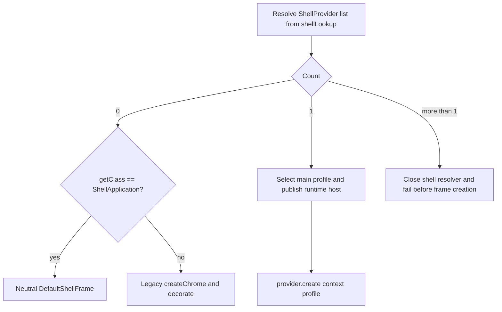

<!--

    Licensed to the Apache Software Foundation (ASF) under one
    or more contributor license agreements.  See the NOTICE file
    distributed with this work for additional information
    regarding copyright ownership.  The ASF licenses this file
    to you under the Apache License, Version 2.0 (the
    "License"); you may not use this file except in compliance
    with the License.  You may obtain a copy of the License at

      http://www.apache.org/licenses/LICENSE-2.0

    Unless required by applicable law or agreed to in writing,
    software distributed under the License is distributed on an
    "AS IS" BASIS, WITHOUT WARRANTIES OR CONDITIONS OF ANY
    KIND, either express or implied.  See the License for the
    specific language governing permissions and limitations
    under the License.

-->
# 14 — ShellProvider and the ShellFrame contract

**Baseline:** `f2e43e8b58`. This chapter describes the committed implementation, not the complete CJAP target.

| Area | Status |
|---|---|
| `ShellProvider`, `ShellFrame`, runtime `ShellRegionHost`, exact DOCK mounting and startup rollback | **Implemented** |
| Neutral default frame, shared toolbar persistence and View-menu toolbar controls | **Implemented** |
| Lookup-backed `ShellContext`; current `ShellWindow` facade | **Partial** relative to the target contracts |
| `ShellApplication` subclass hooks and `ShellChromeProvider` | **Legacy** |
| Target `ShellContext` record, target `ShellWindow`, `ShellRuntime`, `ShellFrame.overlays()` | **Target only** |

Related chapters: [shell regions and contributions](15-shell-regions-and-contributions.md),
[chrome profiles](16-chrome-profiles.md), [window handles](13-main-custom-and-multiwindow-handles.md),
and [branding, theming, status, and overlays](18-branding-theming-status-and-overlays.md).

## 14.1 What the contract owns

A `ShellProvider` creates one visual frame for the running shell. The platform still owns the stage,
docking runtime, window/content services, selected profile, declarative region lifecycle and command
resolver. The frame is a visual adapter, not a second shell runtime.

The non-negotiable main-window composition rules are:

1. `root()` is a stable, initially unparented `Node`.
2. `regions()` returns the **exact same** runtime `ShellRegionHost` published in
   `ShellContext.lookup()`.
3. `setDockRoot(Node)` mounts the **exact runtime DOCK node** through a region whose kind is
   `ShellRegionKind.DOCK`, and places that node beneath the frame root.
4. Adding the node directly to a parent, wrapping/copying it, or mounting it with an unrelated host is
   insufficient.
5. `close()` releases frame-owned resources on the JavaFX Application Thread. It does not dispose the
   dock root, canonical actions, window manager or content manager.

The runtime DOCK node in this baseline is the shell's `SlidingArea`, obtained from
`Docking.slides()`. It is not a new node supplied by the product and is not a target `DockRuntime.root()`
API.

## 14.2 Current public signatures

### Provider and frame

```java
@FunctionalInterface
public interface ShellProvider {
    ShellFrame create(ShellContext context, ShellChromeProfile profile);
}

public interface ShellFrame extends AutoCloseable {
    Node root();
    void setDockRoot(Node dockRoot);
    ShellRegionHost regions();
    @Override void close();
}
```

`ShellProvider.create` is called on the JavaFX Application Thread after runtime services and the
selected main profile have been published. It must return a nonnull frame. There is no priority,
fallback provider or “create several and choose one” hook.

### Region lifecycle received by the frame

```java
public interface ShellRegionHost {
    List<ShellRegionSpec> regions(ShellChromeProfile profile);
    Node mount(ShellRegionSpec region, ShellRegionContext context);
    void update(ShellRegionSpec region, Node mounted);
    void dispose(ShellRegionSpec region, Node mounted);
}
```

The runtime implementation also implements `AutoCloseable`, but the public frame contract exposes
`ShellRegionHost`. A custom frame normally disposes the mounts it created; the application also calls
`close()` on the runtime host as a safety net. Full mount/update/dispose behavior is in
[chapter 15](15-shell-regions-and-contributions.md).

### Actual `ShellContext`: a lookup-backed record

```java
public record ShellContext(Lookup lookup) {
    public ShellContext { Objects.requireNonNull(lookup, "lookup"); }

    public ActionRegistry actions();
    public ActionContext actionContext();
    public ShellWindow window();
    public ShellChromeProfile profile();
    public Command command(String id);
    @Deprecated public Command command(String id, ObservableValue<Boolean> preferFile);
    public Node icon(Command command, double size);
}
```

Important defaults and resolution rules:

| Member | Baseline behavior |
|---|---|
| `lookup()` | Required, nonnull. This is the authoritative service container. |
| `actions()` | `lookup.lookup(ActionRegistry.class)`; may be `null`. |
| `actionContext()` | `lookup.lookup(ActionContext.class)`; may be `null`. |
| `window()` | `lookup.lookup(ShellWindow.class)`; `null` when absent. The standard shell lookup contains the `ShellApplication` instance as `ShellWindow`. |
| `profile()` | Looked up `ShellChromeProfile`, or `ShellChromeProfile.ALL` when absent. |
| `command(String)` | A `ShellCommandResolver` result wins when nonnull; otherwise `actions().find(id)`. It does **not** automatically call `ActionRegistry.resolve(id, context)`. |
| `command(String, ObservableValue<Boolean>)` | Deprecated compatibility overload; ignores `preferFile` and delegates to `command(String)`. |
| `icon(Command, double)` | Command's own icon first, then `ShellIconProvider`, otherwise `null`. |

This is deliberately narrower than the target reference's proposed multi-service `ShellContext`
record. Product code should resolve optional services through `context.lookup()` and handle absence.

### Actual `ShellWindow`

```java
public interface ShellWindow {
    Stage stage();
    BorderPane root();
    TabPane mainPane();
    Node slidingArea();
    WindowManager windowManager();
}
```

`ShellApplication` itself implements this interface and publishes itself in the shell lookup. The
facade still exposes JavaFX `Stage`, `BorderPane` and `TabPane`; it does not yet expose the target
`Window window()`, `Parent root()` or `WindowSystem windowSystem()` surface.

## 14.3 Runtime lookup and identity

The base `ShellApplication.shellLookup()` is a `ProxyLookup` containing:

- the `ShellApplication` instance as `ShellWindow`;
- the per-shell `WindowManager`;
- the per-shell `ContentManager`;
- services from `Lookup.getDefault()`, including the global `ActionRegistry`, `ActionContext`,
  `WindowSystem`, icon providers, dynamic-menu factories and other NBM services.

On the declarative frame path, a second lookup layer is placed **before** that base lookup and adds:

| Lookup type | Identity/rule |
|---|---|
| `ShellChromeProfile` | The selected main-window profile object. |
| `ShellRegionHost` | The one `ShellRegionHostImpl` used by the frame and the application. |
| `ToolBarContainer` | The shared toolbar container consumed by the default frame and View menu. |

The provider receives both `context` and `profile`; `context.profile()` and
`context.lookup().lookup(ShellChromeProfile.class)` return that same selected object. A custom frame
must obtain the host from this lookup and return it unchanged:

```java
ShellRegionHost host = context.lookup().lookup(ShellRegionHost.class);
if (host == null) {
    throw new IllegalStateException("Runtime ShellRegionHost is missing");
}
```

There is no target `ThemeManager` in this lookup in the baseline. Product metadata is not automatically
inserted as a live service, and `Product.shellId()` does not select a provider; provider selection is
strictly lookup-based.

## 14.4 Zero, one and many `ShellProvider` rules

`ShellApplication.start` resolves `shellLookup.lookupAll(ShellProvider.class)` after the panes,
`DockRuntime` and `SlidingArea` have been created.

| Providers found | Path selected | Result |
|---:|---|---|
| `0` | Runtime class is exactly `ShellApplication` | Construct the neutral `DefaultShellFrame`. |
| `0` | Runtime class is a `ShellApplication` subclass | Use the legacy subclass chrome path; no `ShellFrame` is created. |
| `1` | Any runtime class | Call that provider; a provider takes precedence over subclass legacy chrome. |
| `>1` | Any runtime class | Throw `IllegalStateException("Exactly one ShellProvider is allowed; found N")`. No provider is called. |



Duplicate providers fail before profile/frame creation, but not before the earlier pane/dock setup.
There is no priority method on `ShellProvider` and no silent fallback to the default frame.

## 14.5 Main-frame startup algorithm

```mermaid
sequenceDiagram
    participant App as ShellApplication
    participant Profile as Profile selection
    participant Host as ShellRegionHostImpl
    participant Provider as ShellProvider
    participant Frame as ShellFrame
    participant Dock as SlidingArea

    App->>App: NbfxTheme.install(); prepare()
    App->>App: Resolve composition, panes, DockRuntime and SlidingArea
    App->>App: Build initial ShellContext and count providers
    App->>Profile: selectMainProfile(shellLookup)
    Profile-->>App: profile + effective decoration
    App->>App: Apply StageStyle before showing
    App->>App: Publish selected profile in frame lookup
    App->>Host: Create host with exact SlidingArea and default renderers
    App->>App: Publish host and shared ToolBarContainer
    App->>Provider: create(context, context.profile())
    Provider-->>App: frame with stable unparented root
    App->>App: Validate root and host identity
    App->>Frame: setDockRoot(slidingArea)
    Frame->>Host: mount(DOCK-kind region)
    Host-->>Frame: exact SlidingArea node
    Frame->>Frame: Attach exact node beneath frame root
    App->>App: Verify parent, ancestry and host DOCK registration
    App->>App: Initialize toolbar persistence; wrap frame in outer BorderPane
```

The verification after `setDockRoot` checks all three facts:

```java
slidingArea.getParent() != null
        && isWithin(slidingArea, frameRoot)
        && regionHost.isDockMounted(slidingArea)
```

Failure of any fact produces `IllegalStateException("ShellFrame did not mount the runtime DOCK root")`.

## 14.6 Frame composition contract

### Neutral default frame

```text
ShellApplication.root : BorderPane
└── DefaultShellFrame.root : StackPane  (accessibleText: Shell; no id set)
    ├── content : BorderPane
    │   ├── top : VBox [shell-top]
    │   │   ├── BRAND wrapper/contributions/actions
    │   │   ├── MENUBAR wrapper + ShellMenuBar
    │   │   ├── TOOLBAR wrapper + shared ToolBarContainer
    │   │   └── RIBBON/product top regions, if declared
    │   ├── center : exact runtime SlidingArea (DOCK-kind mount)
    │   └── bottom : STATUS wrapper + StatusBar
    └── overlays : StackPane [pickOnBounds=false]
        └── OVERLAY wrapper(s) and their children
```

The default frame requires **exactly one region whose kind is `DOCK`** after profile filtering. The
check is by kind, not by the literal `nbfx:dock` id. It mounts all non-DOCK regions in registry order,
then mounts DOCK when `setDockRoot` is called. `STATUS` is assigned to `content.bottom`, `OVERLAY` to
the overlay stack, and all other non-DOCK kinds to the top box. If several `STATUS` regions are
declared, each later assignment replaces the previous bottom child; products should declare one.

The default renderer set contains menu, toolbar and status renderers only. DOCK is handled directly by
the host. BRAND, RIBBON and OVERLAY have no dedicated renderer in this baseline; they can contain
`ShellContribution` nodes and direct action-reference Buttons.

### Custom frame

```text
ShellApplication.root : BorderPane
└── ProductShellFrame.root : product-chosen stable Node
    ├── product-owned brand/header/menu/ribbon/status layout
    └── exact runtime SlidingArea
        (mounted through the runtime ShellRegionHost as DOCK)
```

A custom frame controls placement, but not DOCK identity or region lifecycle ownership. The main
window always needs the runtime DOCK mount, even though the target permits an arbitrary custom
`WindowContent` window with no layout.

## 14.7 Method obligations, errors and disposal

| Method/check | Required behavior | Baseline failure |
|---|---|---|
| `root()` | Return one stable node, unparented when provider creation returns. | `null` causes `NullPointerException("ShellFrame root")`; a parented root causes `IllegalStateException("ShellFrame root must be unparented")`. |
| `regions()` | Return the exact runtime host from `context.lookup()`. | A different/null host causes `IllegalStateException("ShellFrame must use the runtime ShellRegionHost")`. |
| `setDockRoot(Node)` | Run on FX thread; mount the DOCK-kind region through that host and attach the returned exact node beneath `root()`. | `DefaultShellFrame` rejects null input, a closed frame, a mismatched runtime node and a duplicate mount. The application reports an omitted/raw/unrelated mount as `"ShellFrame did not mount the runtime DOCK root"`. |
| `close()` | FX-thread contract; dispose frame mounts/resources; be idempotent. | Only `DefaultShellFrame.close` explicitly checks the thread and throws `IllegalStateException` off FX. `ShellApplication` does not pre-check arbitrary custom `ShellFrame` implementations; a custom close failure during shutdown/rollback is logged, with cleanup continuing where possible. |
| Host `mount/update/dispose/close` | FX thread only. | Off-thread calls throw `IllegalStateException("Shell region lifecycle requires the JavaFX Application Thread")`. |

Ownership boundaries:

- **Application:** stage/scene, outer `BorderPane`, `DockRuntime`/`SlidingArea`, selected profile,
  runtime region host, `WindowManager`, `ContentManager`, `ShellCommandResolver`.
- **Frame:** its stable root/layout and any non-runtime resources it creates.
- **Region host:** wrappers, renderer nodes, contribution instances, action-scoped command views and
  the temporary styling/accessibility state applied to the DOCK node.
- **Product contributions:** fresh per-mount nodes and resources transferred to the host on successful
  `create`; `dispose()` is called by the host.
- **Canonical actions:** owned by `ActionRegistry`; a frame or region must not dispose them merely
  because a button is removed.

The application closes the frame first, then the runtime host, then the shell command resolver. A
custom frame should still dispose its own mounts so it is safe when used independently and so cleanup
is localized. The resolver is application-owned: a frame must not close it.

## 14.8 API-only custom frame example

This example uses only `api.shell`, JavaFX and NBM service registration. It deliberately mounts DOCK
through the runtime host and rolls back a mismatch before publishing the mount.

```java
package org.example.product.shell;

import java.util.ArrayList;
import java.util.List;
import javafx.scene.Node;
import javafx.scene.layout.BorderPane;
import org.netbeans.api.nbfx.shell.ShellChromeProfile;
import org.netbeans.api.nbfx.shell.ShellContext;
import org.netbeans.api.nbfx.shell.ShellFrame;
import org.netbeans.api.nbfx.shell.ShellProvider;
import org.netbeans.api.nbfx.shell.ShellRegionContext;
import org.netbeans.api.nbfx.shell.ShellRegionHost;
import org.netbeans.api.nbfx.shell.ShellRegionKind;
import org.netbeans.api.nbfx.shell.ShellRegionSpec;
import org.openide.util.lookup.ServiceProvider;

@ServiceProvider(service = ShellProvider.class)
public final class ProductShellProvider implements ShellProvider {

    public ProductShellProvider() {
    }

    @Override
    public ShellFrame create(ShellContext context, ShellChromeProfile profile) {
        return new ProductShellFrame(context);
    }
}

final class ProductShellFrame implements ShellFrame {

    private final ShellContext context;
    private final ShellRegionHost host;
    private final BorderPane root = new BorderPane();
    private final List<Mount> mounts = new ArrayList<>();
    private boolean closed;

    ProductShellFrame(ShellContext context) {
        this.context = context;
        this.host = context.lookup().lookup(ShellRegionHost.class);
        if (host == null) {
            throw new IllegalStateException("Runtime ShellRegionHost is missing");
        }
        root.setAccessibleText("Product shell");
        // Mount additional non-DOCK regions here if the product needs them:
        // Node node = host.mount(region, new ShellRegionContext(context));
        // root.setTop(node);
        // mounts.add(new Mount(region, node));
    }

    @Override
    public Node root() {
        return root;
    }

    @Override
    public void setDockRoot(Node dockRoot) {
        if (closed) {
            throw new IllegalStateException("Shell frame is closed");
        }
        if (dockRoot == null) {
            throw new NullPointerException("dockRoot");
        }
        if (root.getCenter() == dockRoot) {
            return;
        }
        ShellRegionSpec dock = host.regions(context.profile()).stream()
                .filter(region -> region.kind().equals(ShellRegionKind.DOCK))
                .findFirst()
                .orElseThrow(() -> new IllegalStateException("Profile has no DOCK region"));
        Node mounted = host.mount(dock, new ShellRegionContext(context));
        if (mounted != dockRoot) {
            host.dispose(dock, mounted); // local rollback before attaching anything
            throw new IllegalStateException("Runtime dock root mismatch");
        }
        root.setCenter(mounted);
        mounts.add(new Mount(dock, mounted));
    }

    @Override
    public ShellRegionHost regions() {
        return host;
    }

    @Override
    public void close() {
        if (closed) {
            return;
        }
        closed = true;
        for (Mount mount : List.copyOf(mounts)) {
            host.dispose(mount.spec(), mount.node());
        }
        mounts.clear();
        root.getChildren().clear();
    }

    private record Mount(ShellRegionSpec spec, Node node) {
    }
}
```

Registration makes the provider visible through normal NBM/global lookup. Registering more than one
`ShellProvider` in the composed application is an error, not a product-selection mechanism.

## 14.9 Startup rollback

The declarative path catches `RuntimeException` and `Error` around profile selection, host creation,
provider creation, validation and DOCK mounting. It then:

1. calls `frame.close()` when a frame was returned;
2. calls `regionHost.close()`;
3. calls `closeShellResolver()` (guarded so a resolver is closed once);
4. clears `shellFrame` and `regionHost`;
5. rethrows the original failure.

Covered cases include duplicate providers, null frame, null/parented root, wrong region-host identity,
provider exception, omitted DOCK mount, raw DOCK attachment without a host mount, and a DOCK node that
is not beneath the frame root. A frame-close `RuntimeException` is logged rather than replacing the
original failure. Cleanup is best effort: an exception from the host cleanup itself can still mask the
original failure.

`DefaultShellFrame.setDockRoot` has an additional local rollback: if DOCK lookup/mount/attachment
fails after a node was returned, it disposes that mount and restores the previous center node.

## 14.10 Legacy subclass path

**Legacy.** A subclass with no `ShellProvider` keeps the pre-frame composition path:

```text
BorderPane root
├── center: exact SlidingArea
├── top: ShellChrome.top(), when nonnull
└── bottom: ShellChrome.bottom(), when nonnull
```

`createChrome(ShellContext)` selects the highest-priority global `ShellChromeProvider` (default
priority `0`) or `ShellChrome.NONE`. Unlike `ShellProvider`, this legacy mechanism allows priority
selection. If the result implements `ToolBarHost`, its toolbar container is initialized for
persistence. The subclass's `decorate(BorderPane)` hook then runs.

The documented legacy startup hook order is:

```text
prepare()
→ createPane(...) as panes are instantiated
→ decorate(BorderPane)
→ sceneReady(Scene)
→ started()
→ restoreSession() (scheduled with Platform.runLater)
```

Shutdown captures/saves state, unsubscribes the title and disposes branding, then calls
`closeShellFrame()` (declarative frame/host/resolver cleanup, or legacy chrome/resolver cleanup).
It next disposes panes and calls `stopping()`; only afterward does it call `DockRuntime.dispose()`.
The current IDE's
[`JavaFXLaunchApp`](../../../nbfx-ide/nbfx.ide.workbench/src/org/netbeans/modules/nbfx/ide/workbench/JavaFXLaunchApp.java)
is an example of this path; it also supplies an IDE `ShellCommandResolver` and icon provider.

The legacy path does not select/publish a declarative main profile, create a `ShellRegionHost`, or
build a `ShellFrame`. New products should use the neutral default or a `ShellProvider` rather than
subclassing merely to obtain menus/toolbars/status.

## 14.11 Threading and accessibility

- `ShellProvider.create`, frame root inspection/attachment, `setDockRoot`, frame `close`, and all
  region lifecycle operations run on the JavaFX Application Thread.
- Stage style must be applied before the stage is shown. Main-profile decoration is applied in
  `start`; `NATIVE` maps to `StageStyle.DECORATED`, `UNDECORATED` to `StageStyle.UNDECORATED`.
- Do not block the FX thread with I/O or module installation while creating a frame.
- The default frame labels its root `"Shell"`, content `"Shell content"` and overlay stack
  `"Shell overlays"`. Region wrappers add semantic accessible text and menu-bar/toolbar roles; see
  [chapter 15](15-shell-regions-and-contributions.md).
- A custom frame remains responsible for meaningful accessible names/roles on its own layout nodes
  and for keyboard traversal through its chrome.

## 14.12 Current versus target

| Target reference | Baseline |
|---|---|
| `ShellContext` carries product/window/managers/actions/theme services directly | **Target only.** Actual context is `ShellContext(Lookup)` with nullable convenience accessors. |
| `ShellWindow` exposes `Window`, `Parent`, `WindowManager`, `WindowSystem` | **Partial.** Actual facade exposes `Stage`, `BorderPane`, `TabPane`, `Node`, `WindowManager`. |
| One `ShellRuntime` owns all runtime services | **Target only.** `ShellApplication` still coordinates the legacy runtime objects. |
| Custom arbitrary-content window may omit DOCK | **Target only** for the main-frame contract. Baseline main custom frames must mount the exact runtime DOCK. |
| `ShellFrame.overlays()` and `OverlayHost` | **Target only.** No such method/type exists; the visual OVERLAY region is not a HUD host. |
| Legacy subclass chrome deleted | **Legacy.** It remains until C8 migration. |

## 14.13 Sources and tests

### Implementation

- [`ShellProvider`](../../../nbfx-platform/nbfx.api.shell/src/org/netbeans/api/nbfx/shell/ShellProvider.java)
- [`ShellFrame`](../../../nbfx-platform/nbfx.api.shell/src/org/netbeans/api/nbfx/shell/ShellFrame.java)
- [`ShellContext`](../../../nbfx-platform/nbfx.api.shell/src/org/netbeans/api/nbfx/shell/ShellContext.java)
- [`ShellWindow`](../../../nbfx-platform/nbfx.api.shell/src/org/netbeans/api/nbfx/shell/ShellWindow.java)
- [`ShellApplication`](../../../nbfx-platform/nbfx.platform.shell/src/org/netbeans/modules/nbfx/platform/shell/ShellApplication.java)
- [`DefaultShellFrame`](../../../nbfx-platform/nbfx.platform.shell/src/org/netbeans/modules/nbfx/platform/shell/DefaultShellFrame.java)
- [`ShellRegionHostImpl`](../../../nbfx-platform/nbfx.platform.shell/src/org/netbeans/modules/nbfx/platform/shell/ShellRegionHostImpl.java)
- [`DockRuntime`](../../../nbfx-platform/nbfx.platform.shell/src/org/netbeans/modules/nbfx/platform/shell/DockRuntime.java)
- [`DefaultShellChrome`](../../../nbfx-platform/nbfx.platform.shell/src/org/netbeans/modules/nbfx/platform/shell/DefaultShellChrome.java)
- [`ShellChromeProvider`](../../../nbfx-platform/nbfx.api.shell/src/org/netbeans/api/nbfx/shell/ShellChromeProvider.java)
- [IDE legacy subclass example](../../../nbfx-ide/nbfx.ide.workbench/src/org/netbeans/modules/nbfx/ide/workbench/JavaFXLaunchApp.java)

### Tests

- [`ShellFrameApiTest`](../../../nbfx-platform/nbfx.api.shell/test/unit/src/org/netbeans/api/nbfx/shell/ShellFrameApiTest.java)
- [`CustomShellProviderTest`](../../../nbfx-platform/nbfx.platform.shell/test/unit/src/org/netbeans/modules/nbfx/platform/shell/CustomShellProviderTest.java)
- [`ShellRegionHostImplTest`](../../../nbfx-platform/nbfx.platform.shell/test/unit/src/org/netbeans/modules/nbfx/platform/shell/ShellRegionHostImplTest.java)
- [`ShellProfileStartupTest`](../../../nbfx-platform/nbfx.platform.shell/test/unit/src/org/netbeans/modules/nbfx/platform/shell/ShellProfileStartupTest.java)
- [`AppShellConformanceTest`](../../../nbfx-platform/nbfx.platform.shell/test/unit/src/org/netbeans/modules/nbfx/platform/shell/AppShellConformanceTest.java)

Architectural context: [ADR 0001](../../../docs/architecture/adr-0001-cjap-shell-ui.md) and the
[CJAP target reference](../../../docs/reference/cjap-shell-ui.md). Continue with
[chapter 15 — shell regions and contributions](15-shell-regions-and-contributions.md).
