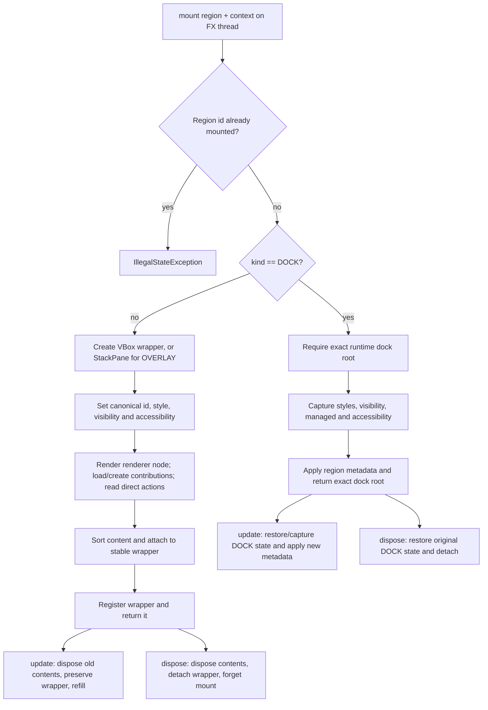
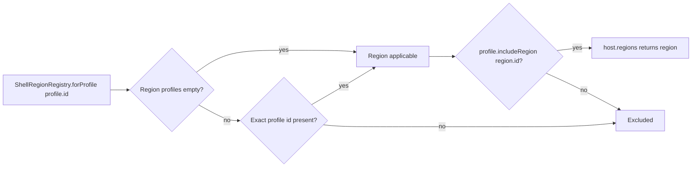

<!--

    Licensed to the Apache Software Foundation (ASF) under one
    or more contributor license agreements.  See the NOTICE file
    distributed with this work for additional information
    regarding copyright ownership.  The ASF licenses this file
    to you under the Apache License, Version 2.0 (the
    "License"); you may not use this file except in compliance
    with the License.  You may obtain a copy of the License at

      http://www.apache.org/licenses/LICENSE-2.0

    Unless required by applicable law or agreed to in writing,
    software distributed under the License is distributed on an
    "AS IS" BASIS, WITHOUT WARRANTIES OR CONDITIONS OF ANY
    KIND, either express or implied.  See the License for the
    specific language governing permissions and limitations
    under the License.

-->
# 15 — Shell regions and contributions

**Baseline:** `60143d8f59`.

| Area | Status |
|---|---|
| Region ids/kinds/specs, layer discovery, annotations and neutral declarations | **Implemented** |
| Stable mount/update/dispose wrappers, failure isolation, contributions and direct action Buttons | **Implemented** |
| Profile intersection and runtime-owned DOCK mounting | **Implemented** |
| Menu, toolbar and status renderers | **Implemented** |
| Dedicated brand/ribbon renderers and recursive menu/ribbon folders | **Target only** |
| Legacy `ShellChrome` top/bottom composition | **Legacy** |

A `ShellRegion` is **window chrome**. It is not a content `ViewArea`, `DockGroup` or split leaf. The
neutral slots are reusable metadata; products fill them with nodes/actions or declare their own
namespaced regions.

Related chapters: [frame contract](14-shell-provider-and-frame-contract.md),
[profiles](16-chrome-profiles.md), [actions and surfaces](17-actions-menus-toolbars-and-ribbons.md),
and [visual overlays versus `OverlayHost`](18-branding-theming-status-and-overlays.md).

## 15.1 Built-in identities and neutral declarations

`ShellRegionId` and `ShellRegionKind` are records with built-in constants and `of(String)` factories.
Built-ins accept case-insensitive short forms (`BRAND`, `brand`) and canonical forms (`nbfx:brand`).
Product values require `namespace:name`; each part must match
`[A-Za-z0-9][A-Za-z0-9._-]*`. Product namespace/name case is preserved.

| Canonical id | Kind | Neutral position | Neutral wrapper style class | Default frame placement |
|---|---|---:|---|---|
| `nbfx:brand` | `nbfx:brand` | 10 | `nbfx-shell-brand` | Top |
| `nbfx:menubar` | `nbfx:menubar` | 20 | `nbfx-shell-menubar` | Top |
| `nbfx:toolbar` | `nbfx:toolbar` | 30 | `nbfx-shell-toolbar` | Top |
| `nbfx:dock` | `nbfx:dock` | 40 | `nbfx-shell-dock` | Center, exact runtime DOCK node |
| `nbfx:status` | `nbfx:status` | 50 | `nbfx-shell-status` | Bottom |
| `nbfx:overlay` | `nbfx:overlay` | 60 | `nbfx-shell-overlay` | Overlay stack above content |
| `nbfx:ribbon` | `nbfx:ribbon` | Product-declared | Product-declared | Top if declared; no neutral declaration |

All neutral declarations have `profiles = {}` and `visibleByDefault = true`. Empty profile metadata
means “applicable to every profile”; neutral profiles narrow the slots with their own allow-lists.
`RIBBON` is a supported built-in identity/kind but is product opt-in. The style classes above are
metadata hooks; the baseline shell stylesheet does not define special rules for them.

The runtime DOCK rule is based on **kind**, not id. A product can declare another id with kind
`nbfx:dock`; it still mounts the one runtime DOCK node. The default frame rejects zero or multiple
DOCK-kind regions after profile filtering.

## 15.2 Metadata contracts

```java
public record ShellRegionSpec(
        ShellRegionId id,
        ShellRegionKind kind,
        int position,
        Set<String> profiles,
        AreaStyle style,
        boolean visibleByDefault) {}

public record ShellContributionSpec(
        String id,
        ShellRegionId region,
        int position,
        Set<String> profiles,
        Class<? extends ShellContribution> type) {}

public record ShellContributionEntry(
        ShellContributionSpec spec,
        ShellContribution contribution) {}
```

`ShellRegionSpec` defensively copies `profiles`; `ShellContributionSpec` does the same. Null ids,
kinds, styles, contribution types or entries are rejected. Profile entries must be nonblank atomic
tokens: no whitespace, ISO control character or comma. An empty profile set imposes no restriction.

`AreaStyle` contains style classes, stylesheets and theme overlays, but the shell-region layer reader
currently constructs it only from one `styleClass` token. The region host applies **style classes**
and visibility/managed state; it does not load `AreaStyle.stylesheets()` or `themeOverlays()`.

### Region annotation

```java
@ShellRegionRegistration(
        id = "BRAND",                 // built-in short/canonical or namespace:name
        kind = "BRAND",               // built-in short/canonical or namespace:name
        position = 10,
        profiles = {"main"},          // empty means all profiles
        styleClass = "acme-brand",    // one CSS class token
        visibleByDefault = true)
```

The annotation is source-retained, repeatable via `@ShellRegionRegistrations`, and emits metadata
only. Defaults are `position = Integer.MAX_VALUE`, empty profiles/style class, and visible `true`.
The processor canonicalizes ids/kinds and fails compilation for invalid values, non-atomic profiles,
an invalid style class, or duplicate canonical ids within one compilation.

A product-defined region uses a namespaced id and normally a product-defined kind:

```java
@ShellRegionRegistration(id = "acme:utility", kind = "acme:tool", position = 5,
        styleClass = "acme-utility")
public final class AcmeRegions {
}
```

There is no default renderer for `acme:tool`; its runtime wrapper is a `VBox` filled with direct
contributions and action Buttons unless the product renders the region through its own frame UI.

## 15.3 Declarative layer and discovery

Paths are under `NbFx/ShellRegions`:

```text
NbFx/ShellRegions/
  nbfx:brand/
    product-brand.instance
    save.ref
  nbfx:menubar/
  nbfx:toolbar/
  nbfx:ribbon/              # product opt-in
  nbfx:dock/
  nbfx:status/
  nbfx:overlay/
  acme:utility/             # product-defined region
```

A region folder may carry:

| Attribute | Type | Default | Meaning |
|---|---|---|---|
| `kind` | string | none; effectively required | Renderer classification. Missing/blank is malformed. |
| `position` | integer | `Integer.MAX_VALUE` | Region order. |
| `profiles` | comma/whitespace-separated string | empty/all | Exact, case-sensitive profile ids. |
| `styleClass` | string | empty | Intended as one CSS class token; validation enforces an atomic token (no whitespace/control/comma), not the full CSS identifier grammar. |
| `visibleByDefault` | boolean | `true` | Initial `visible` and `managed` state. |

```xml
<folder name="nbfx:brand">
    <attr name="kind" stringvalue="nbfx:brand"/>
    <attr name="position" intvalue="10"/>
    <attr name="profiles" stringvalue="main,product:main"/>
    <attr name="styleClass" stringvalue="acme-brand"/>
    <attr name="visibleByDefault" boolvalue="true"/>

    <file name="product-brand.instance"
          instanceClass="org.example.ProductBrandBar"
          position="10" profiles="main"/>
    <file name="save.ref" actionId="save" position="20" profiles="main"/>
</folder>
```

`ShellRegionRegistry` is stateless:

```java
public static List<ShellRegionSpec> discover();
public static Optional<ShellRegionSpec> find(ShellRegionId id);
public static List<ShellRegionSpec> forProfile(String profileId);
```

Discovery rules:

- only direct child **folders** are regions; nested contribution/menu/action folders are not regions;
- a missing `NbFx/ShellRegions` folder yields an immutable empty list;
- direct folders are read by name, then results are sorted by `position` and canonical id;
- duplicate canonical ids (for example `brand` and `nbfx:brand`) are logged and later duplicates are
  skipped deterministically;
- wrong-typed attributes, invalid ids/kinds/tokens and invalid visibility make only that region
  malformed; it is logged and skipped;
- `forProfile(null)` and `forProfile("")`/blank return all valid regions; a nonblank id matches exact
  case-sensitive tokens, unless the region's own profile set is empty;
- returned lists/spec collections are immutable snapshots, not live change notifications.

## 15.4 Node contributions

```java
public interface ShellContribution {
    Node create(ShellContext context);
    default void dispose() {}
}

@ShellContributionRegistration(
        region = "BRAND",
        position = 10,
        profiles = {"main"})
```

The annotation is repeatable via `@ShellContributionRegistrations`. The annotated class must be a
public, concrete, non-abstract class implementing `ShellContribution`, with an **explicitly declared
public no-argument constructor**; nested classes must be static. The processor inspects enclosed
constructors and rejects reliance on Java's implicit default constructor. It writes a direct
`.instance` child with `instanceClass`, `position` and optional `profiles`. The generated registration
id is the class-name-derived file base name.

The processor rejects `region = "DOCK"`/`nbfx:dock` because DOCK is runtime-owned. It also rejects
invalid region ids, invalid profile tokens, invalid constructors/types, and duplicate registrations
of the same class in the same canonical region within one compilation.

```java
@ShellContributionRegistration(region = "BRAND", position = 10, profiles = {"main"})
public final class ProductBrandBar implements ShellContribution {

    private Label label;

    public ProductBrandBar() {
    }

    @Override
    public Node create(ShellContext context) {
        label = new Label("Example Product");
        label.getStyleClass().add("product-brand-label");
        return label;
    }

    @Override
    public void dispose() {
        label = null;
    }
}
```

`create` must return a **fresh, unparented** node on the JavaFX Application Thread. Instances and nodes
must not be shared between windows or mounts. Ownership transfers to the host only after a valid node
is returned.

### Contribution registry

```java
public static List<ShellContributionSpec> discover();
public static List<ShellContributionSpec> discover(ShellRegionId region, String profileId);
public static List<ShellContributionEntry> load(ShellRegionId region, String profileId);
```

- Discovery reads direct class-based `.instance` children and never constructs classes or nodes.
- Wrong-typed `position`/`profiles`, wrong implementation types, nested instances and malformed
  entries are logged/skipped.
- The canonical `nbfx:dock` region is skipped entirely.
- Results are ordered by region id, position and registration id.
- Filtering happens before construction. Null/blank profile queries and empty contribution profile
  sets mean all profiles; otherwise matching is exact and case-sensitive.
- Every `load` call creates fresh instances; nothing is cached or shared.
- `LayerInstances` logs and returns `null` when a class cannot be loaded or constructed; the registry
  omits that entry.
- The caller owns returned `ShellContributionEntry` instances and must call `dispose()` when releasing
  them. The runtime region host does this automatically.

## 15.5 Renderers and actual built-in coverage

```java
public interface ShellRegionRenderer {
    ShellRegionKind kind();
    Node render(ShellRegionSpec region, ShellRegionContext context);
    default void dispose(ShellRegionSpec region, Node mounted) {}
}
```

`ShellRegionContext` is `record ShellRegionContext(ShellContext shell)`; `shell` is nonnull and
`profile()` delegates to `shell.profile()`.

| Kind | Baseline renderer | Source of visual content |
|---|---|---|
| `MENUBAR` | `ShellMenuBar` | Global `NbFx/Menus`, plus direct shell-region contributions/actions |
| `TOOLBAR` | `ShellToolBars` | Global `NbFx/Toolbars`, one shared `ToolBarContainer` |
| `STATUS` | `StatusBar` | Fresh `StatusElementRegistry.load(shellLookup)` elements |
| `DOCK` | Runtime special case | Exact `SlidingArea`; no renderer/contributions/actions |
| `BRAND` | **None** | `ShellContribution` nodes and direct action-reference Buttons |
| `RIBBON` | **None** | `ShellContribution` nodes and direct action-reference Buttons |
| `OVERLAY` | **None** | Contributions/actions in a non-picking-bounds `StackPane` wrapper |
| Product kind | **None by default** | Contributions/actions, or product-owned rendering outside the runtime host |

The public renderer SPI exists, but `ShellApplication` constructs the runtime host with the default
renderer list. There is no baseline public renderer-registration hook that adds a product brand or
ribbon renderer to that host. A custom frame can render its own product UI, but must still return the
runtime host and mount DOCK through it.

The default toolbar renderer permits only one active TOOLBAR region. A second region with a different
id fails in `render`; the host logs/isolates that renderer failure and leaves its wrapper empty rather
than moving the shared container out of the first wrapper.

## 15.6 Runtime mount/update/dispose algorithm

All public lifecycle operations require the JavaFX Application Thread. The host tracks mounts by node
identity and region id.



### Mount

1. Reject a duplicate mounted region id with `IllegalStateException`.
2. For DOCK kind, require a nonnull runtime dock root and ensure that exact node is not already
   mounted. Do not create a wrapper and do not consult renderers, contributions or action folders.
3. For every other kind, create a `VBox`, except OVERLAY uses a `StackPane` with
   `pickOnBounds = false`.
4. Set the wrapper id to the canonical region id, add style classes, set `visible` and `managed` from
   `visibleByDefault`, and apply accessibility metadata.
5. Fill the wrapper:
   - renderer node first (ordering position `Integer.MIN_VALUE`);
   - contribution nodes in registry order;
   - direct action-reference Buttons in action-reader order;
   - merge all non-renderer nodes by `position`, then creation/read sequence for ties.
6. Register and return the stable wrapper. If filling throws `RuntimeException` or `Error`, dispose
   already-created contents and rethrow.

### Update

- The node must be a registered mount for the same region id, and the kind cannot change.
- The wrapper identity, parent and canonical id remain stable.
- Old renderer/contribution/action contents are disposed and detached; new contents are created and
  filled. “Update” therefore refreshes content rather than mutating existing contribution nodes.
- Old style classes are removed and new style/visibility/accessibility metadata is applied.
- DOCK keeps its exact node and child graph. The host restores captured state, captures it again,
  stores the new spec and reapplies metadata. No ordinary contents are loaded.
- A failure during refill can leave the registered wrapper empty or partially filled; there is no
  automatic restoration of the previous content set.

### Dispose and close

- `dispose` is idempotent for an already-disposed matching mount.
- A null node throws `NullPointerException`; an unknown node or mismatched region id is a no-op.
- Ordinary mounts dispose renderer resources, clear children, dispose contributions and dispose
  noncanonical scoped command views. The wrapper is removed only when its parent is a `Pane`.
- DOCK disposal restores its pre-mount style classes, visibility, managed state, accessible text and
  accessible role, then detaches it. Its children and ownership are untouched.
- `close()` disposes a snapshot of all current mounts on the FX thread. The host has no permanent
  “closed” flag; it can be reused for new mounts after close.

## 15.7 DOCK is not an ordinary contribution region

The runtime rule is enforced by kind:

```java
if (region.kind().equals(ShellRegionKind.DOCK)) {
    // mount the exact dockRoot; never call the contribution supplier
}
```

Consequences:

- any DOCK-kind region mounts the same runtime `SlidingArea`;
- zero/multiple DOCK-kind regions are rejected by the default frame;
- a second DOCK-kind mount is rejected because the runtime root is already mounted;
- style/visibility/accessibility changes are temporary and restored on disposal;
- direct action refs and `.instance` contributions beneath DOCK are not read by the host;
- the annotation processor and contribution registry explicitly reject/skip the canonical
  `nbfx:dock` id. A product-defined id with DOCK kind can appear in metadata, but the host still
  ignores ordinary contents for it; products should not author such contributions.

This is stronger than “DOCK is one more chrome slot”: it is an ownership boundary.

## 15.8 Direct action references become generic Buttons

For a non-DOCK region, the host reads direct `.ref` children from `NbFx/ShellRegions/<region-id>`.
It merges an `ActionContextMetadata` value carrying the selected profile into the shell lookup, reads
with `ActionLayerReader.readForContext`, resolves through `ShellContext.command`, and calls
`Command.forContext(actionLookup)`.

Each successful reference creates a JavaFX `Button` with:

- text from `ActionRef.displayName()` when nonblank, otherwise `command.getText()`;
- accessible text equal to that button text;
- a 16-pixel icon from `ShellContext.icon(command, 16)`;
- `disable` bound to `command.disabledProperty()`;
- `setOnAction(_ -> command.run())`.

The generic region Button path does **not** consume `ActionRef.iconName`, `separatorBefore`,
`presentationHints` or the command accelerator. Noncanonical scoped command views are retained by the
mount and disposed on update/dispose. Canonical registry commands are never disposed by the host.

Because this path runs for every non-DOCK kind, direct refs under `nbfx:menubar`, `nbfx:toolbar` or
`nbfx:status` appear as generic Buttons alongside that kind's renderer output. Use the dedicated
`NbFx/Menus` and `NbFx/Toolbars` folders for normal menu/toolbar presentation.

## 15.9 Failure isolation and diagnostics

| Failure | Runtime behavior |
|---|---|
| Invalid region/contribution/reference metadata | Logged and skipped; other entries remain usable. |
| Renderer throws `RuntimeException` | Logged; region can still receive contributions/actions. |
| Renderer returns `null` | Treated as no renderer node. |
| Renderer/contribution returns an already-parented node | Rejected; renderer failure is logged, contribution instance is disposed and skipped. |
| Contribution supplier throws `RuntimeException` | Logged; contribution list treated as empty. |
| Contribution `create` throws `RuntimeException` or returns null | Logged; that contribution is disposed and skipped. |
| Action command is missing | Reference silently contributes no Button. |
| Scoped action binding/button creation throws `RuntimeException` | Logged; any newly owned scoped view is disposed and removed; other refs continue. |
| `Error` during fill | Propagates after mount cleanup; it is not converted into per-entry isolation. |
| Disposal hook throws `RuntimeException` | Logged; remaining disposal continues. |
| Duplicate renderer kind in host constructor | `IllegalArgumentException("Duplicate renderer for ...")`. |
| Duplicate region id / duplicate DOCK root | `IllegalStateException`. |
| Kind change during update | `IllegalArgumentException("shell region kind cannot change during update")`. |
| Lifecycle called off FX thread | `IllegalStateException`. |

Malformed action references are handled by `ActionLayerReader`; filter and resolution details are in
[chapter 17](17-actions-menus-toolbars-and-ribbons.md).

## 15.10 Accessibility and overlay wrapper behavior

The host sets the wrapper id to the canonical region id and assigns semantic accessible text:

| Kind | Accessible text | Accessible role |
|---|---|---|
| BRAND | `Brand` | unchanged/default |
| MENUBAR | `Menu bar` | `MENU_BAR` |
| TOOLBAR | `Tool bar` | `TOOL_BAR` |
| RIBBON | `Ribbon` | unchanged/default |
| DOCK | `Docking area` | unchanged/default; previous role restored on dispose |
| STATUS | `Status bar` | unchanged/default |
| OVERLAY | `Overlay` | unchanged/default |
| Other | `Shell region` | unchanged/default |

The OVERLAY wrapper is a `StackPane` with `pickOnBounds = false`, so its empty bounds do not intercept
pointer input. Actual child nodes can still be interactive. This is a visual window-level slot, not
an anchored HUD/input-mode model; see [chapter 18](18-branding-theming-status-and-overlays.md).

## 15.11 Nested menu/ribbon folder limitation

**Target only.** The target layer example places refs below paths such as:

```text
ShellRegions/nbfx:ribbon/Home/Clipboard/paste.ref
ShellRegions/nbfx:menubar/File/save.ref
```

The baseline runtime does not recursively render those folders:

- `ShellContributionRegistry` reads only direct `.instance` children of a region folder;
- the host's action path calls `ActionLayerReader.readForContext(regionFolder, ...)`, which reads only
  direct `.ref` files;
- the host does not call `ActionLayerReader.readSubmenus` for shell-region folders;
- the MENUBAR renderer builds real menus from the separate global `NbFx/Menus` tree, not from nested
  `ShellRegions/nbfx:menubar` folders;
- there is no RIBBON renderer to interpret Home/Clipboard hierarchy;
- `.dynamic` sections are a menu-builder feature and are not consumed by the generic region host.

Place ordinary menus under `NbFx/Menus/<menu>/...` and toolbars under `NbFx/Toolbars/<bar>`.
Until a ribbon renderer exists, a RIBBON region can show direct contributions and direct refs as a
vertical generic wrapper, or a product can provide its own visual composition.

## 15.12 Region/profile intersection

The effective list is an intersection, not a union:



An empty region profile set and an empty `ShellProfileSpec.regions()` allow-list are both inclusive.
The host requires a nonnull profile object. See [chapter 16](16-chrome-profiles.md) for selection,
precedence and neutral profiles.

## 15.13 Current versus target

| Target reference | Baseline |
|---|---|
| Built-in brand/ribbon renderers | **Target only.** Generic contributions/Buttons are available instead. |
| Recursive nested menu/ribbon folders in `NbFx/ShellRegions` | **Target only.** Runtime shell-region reads are direct-only. |
| Rich region stylesheet/theme-overlay metadata | **Partial.** `AreaStyle` exists, but shell-region discovery/host apply only one style class. |
| Live registry invalidation/change notifications | **Target only.** Discovery returns fresh stateless snapshots. |
| Runtime-owned DOCK with no ordinary contributions | **Implemented.** |
| Stable wrapper, isolated failures and idempotent disposal | **Implemented.** |
| Anchored `OverlayHost` | **Target only.** OVERLAY is only a visual `ShellRegionKind`. |

## 15.14 Sources and tests

### Implementation

- [`ShellRegionId`](../../../nbfx-platform/nbfx.api.shell/src/org/netbeans/api/nbfx/shell/ShellRegionId.java)
- [`ShellRegionKind`](../../../nbfx-platform/nbfx.api.shell/src/org/netbeans/api/nbfx/shell/ShellRegionKind.java)
- [`ShellRegionSpec`](../../../nbfx-platform/nbfx.api.shell/src/org/netbeans/api/nbfx/shell/ShellRegionSpec.java)
- [`ShellRegionRegistry`](../../../nbfx-platform/nbfx.api.shell/src/org/netbeans/api/nbfx/shell/ShellRegionRegistry.java)
- [`ShellRegionRegistration`](../../../nbfx-platform/nbfx.api.shell/src/org/netbeans/api/nbfx/shell/ShellRegionRegistration.java)
- [`ShellContribution`](../../../nbfx-platform/nbfx.api.shell/src/org/netbeans/api/nbfx/shell/ShellContribution.java)
- [`ShellContributionRegistry`](../../../nbfx-platform/nbfx.api.shell/src/org/netbeans/api/nbfx/shell/ShellContributionRegistry.java)
- [`ShellContributionRegistrationProcessor`](../../../nbfx-platform/nbfx.api.shell/src/org/netbeans/modules/nbfx/api/shell/processors/ShellContributionRegistrationProcessor.java)
- [`ShellRegionRenderer`](../../../nbfx-platform/nbfx.api.shell/src/org/netbeans/api/nbfx/shell/ShellRegionRenderer.java)
- [`ShellRegionHostImpl`](../../../nbfx-platform/nbfx.platform.shell/src/org/netbeans/modules/nbfx/platform/shell/ShellRegionHostImpl.java)
- [`DefaultShellFrame`](../../../nbfx-platform/nbfx.platform.shell/src/org/netbeans/modules/nbfx/platform/shell/DefaultShellFrame.java)
- [`PlatformShellRegions`](../../../nbfx-platform/nbfx.platform.shell/src/org/netbeans/modules/nbfx/platform/shell/PlatformShellRegions.java)
- [`LayerInstances`](../../../nbfx-platform/nbfx.api.layer/src/org/netbeans/api/nbfx/layer/LayerInstances.java)
- [`AreaStyle`](../../../nbfx-platform/nbfx.api.layout/src/org/netbeans/api/nbfx/layout/AreaStyle.java)

### Tests

- [`ShellRegionTest`](../../../nbfx-platform/nbfx.api.shell/test/unit/src/org/netbeans/api/nbfx/shell/ShellRegionTest.java)
- [`ShellRegionRegistryTest`](../../../nbfx-platform/nbfx.api.shell/test/unit/src/org/netbeans/api/nbfx/shell/ShellRegionRegistryTest.java)
- [`ShellContributionRegistryTest`](../../../nbfx-platform/nbfx.api.shell/test/unit/src/org/netbeans/api/nbfx/shell/ShellContributionRegistryTest.java)
- [`ShellRegionRegistrationProcessorTest`](../../../nbfx-platform/nbfx.api.shell/test/unit/src/org/netbeans/api/nbfx/shell/ShellRegionRegistrationProcessorTest.java)
- [`ShellContributionRegistrationProcessorTest`](../../../nbfx-platform/nbfx.api.shell/test/unit/src/org/netbeans/api/nbfx/shell/ShellContributionRegistrationProcessorTest.java)
- [`ShellRegionHostImplTest`](../../../nbfx-platform/nbfx.platform.shell/test/unit/src/org/netbeans/modules/nbfx/platform/shell/ShellRegionHostImplTest.java)
- [`PlatformShellRegionsTest`](../../../nbfx-platform/nbfx.platform.shell/test/unit/src/org/netbeans/modules/nbfx/platform/shell/PlatformShellRegionsTest.java)

Continue with [chapter 16 — chrome profiles](16-chrome-profiles.md) or
[chapter 17 — actions, menus, toolbars, and ribbons](17-actions-menus-toolbars-and-ribbons.md).
