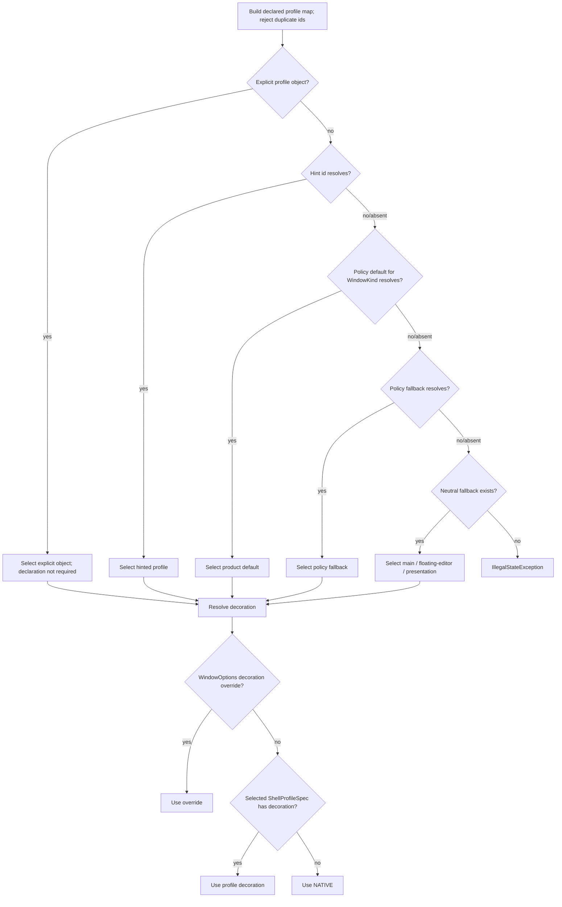
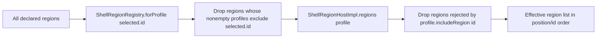

<!--

    Licensed to the Apache Software Foundation (ASF) under one
    or more contributor license agreements.  See the NOTICE file
    distributed with this work for additional information
    regarding copyright ownership.  The ASF licenses this file
    to you under the Apache License, Version 2.0 (the
    "License"); you may not use this file except in compliance
    with the License.  You may obtain a copy of the License at

      http://www.apache.org/licenses/LICENSE-2.0

    Unless required by applicable law or agreed to in writing,
    software distributed under the License is distributed on an
    "AS IS" BASIS, WITHOUT WARRANTIES OR CONDITIONS OF ANY
    KIND, either express or implied.  See the License for the
    specific language governing permissions and limitations
    under the License.

-->
# 16 — Chrome profiles

**Baseline:** `60143d8f59`.

| Area | Status |
|---|---|
| Legacy predicate `ShellChromeProfile` and inclusive defaults | **Legacy**, still supported |
| Declarative `ShellProfileSpec`, registry, annotations and neutral profiles | **Implemented** |
| Pure explicit → hint → product default → policy fallback → neutral resolver | **Implemented** |
| Main-window publication, decoration and profile-aware action reads | **Implemented** |
| Product policy discovery through `Product`/`ChromeProfilePolicyProvider` | **Implemented** for main-window startup |
| Optional `WindowState.profileId` persistence | **Implemented** |
| `WindowOptions.closePolicy` values for floating/custom stages | **Implemented**; lifecycle is covered in [chapter 12](12-floating-and-redocking.md) and [chapter 13](13-main-custom-and-multiwindow-handles.md) |
| Per-window profile-driven frames for floating/custom windows and restore-time frame selection | **Target only** |

Related chapters: [frame contract](14-shell-provider-and-frame-contract.md),
[region/profile intersection](15-shell-regions-and-contributions.md),
[action filtering](17-actions-menus-toolbars-and-ribbons.md), and
[window state](07-window-state-and-persistence.md).

## 16.1 Two profile models share one interface

### Legacy predicate profile

```java
public interface ShellChromeProfile {
    ShellChromeProfile ALL = ...;
    boolean includeMenu(String menuId);
    boolean includeMenuItem(String menuId, String itemId);
    boolean includeToolBar(String toolBarId);

    default boolean includeToolBarItem(String toolBarId, String itemId) { return true; }
    default boolean movableToolBars() { return true; }
    default boolean useSystemMenuBar() { return true; }
    default String id() { return "main"; }
    default boolean includeRegion(ShellRegionId regionId) { return true; }

    static ShellChromeProfile all() { return ALL; }
}
```

The first three methods are abstract. Every added default is inclusive, so existing implementations
remain source-compatible. `ALL` includes every registered menu, item, toolbar and region. A legacy
profile that wants declarative filtering under its own identity should override `id()` with a stable,
nonblank atomic token; the interface itself does not validate a custom implementation's return value.

Legacy predicates still affect menu/toolbar builders directly. Declarative profile metadata adds a
second filter based on the selected profile id.

### Declarative profile

```java
public record ShellProfileSpec(
        String id,
        WindowKind windowKind,
        Set<ShellRegionId> regions,
        WindowDecoration decoration,
        boolean systemMenuBar) implements ShellChromeProfile {}
```

- `id` is required and must be a nonblank atomic token.
- `windowKind` and `decoration` are optional (`null` when absent).
- `regions` is defensively copied; empty means no additional region restriction.
- `includeMenu`, `includeMenuItem` and `includeToolBar` always return `true`.
- `includeToolBarItem` inherits `true`; `movableToolBars()` inherits `true`.
- `useSystemMenuBar()` returns the record's boolean value.

`ShellProfileSpec.windowKind()` is metadata. The resolver does **not** scan profiles by `windowKind`;
it uses an explicit product policy map or its fixed neutral fallback map.

## 16.2 Declarative profile schema and registry

```java
@ShellProfileRegistration(
        id = "product:main",
        windowKind = "MAIN",
        regions = {"BRAND", "MENUBAR", "TOOLBAR", "DOCK", "STATUS"},
        decoration = "NATIVE",
        systemMenuBar = true)
```

The annotation is source-retained and repeatable through `@ShellProfileRegistrations`. Defaults are:
empty/absent `windowKind`, empty `regions`, empty/absent `decoration`, and `systemMenuBar = true`.
The processor canonicalizes region ids, uppercases valid enum values and writes:

```text
NbFx/ShellProfiles/<id>/
  windowKind      = "MAIN"          # optional string
  regions         = "nbfx:brand,..." # optional comma-separated string
  decoration      = "NATIVE"        # optional string
  systemMenuBar   = true            # boolean
```

Annotation ids must be file-safe atomic tokens. `/`, `\`, the exact ids `.` and `..`, whitespace,
commas and control characters are rejected. Other punctuation, including dots inside a longer id, is
not rejected by the token check. Duplicate ids within one compilation are errors. Across modules,
normal layer merging applies; the resolver rejects duplicate ids in the discovered list rather than
choosing one silently.

```java
public final class ShellProfileRegistry {
    public static List<ShellProfileSpec> discover();
    public static Optional<ShellProfileSpec> find(String id);
}
```

Discovery behavior:

- only direct folders below `NbFx/ShellProfiles` are profiles;
- the folder name is the profile id; there is no separate `id` attribute;
- valid profiles are returned in stable-id order;
- `windowKind` accepts `MAIN`, `FLOATING`, `CUSTOM` case-insensitively;
- `decoration` accepts `NATIVE`, `UNDECORATED` case-insensitively;
- `regions` accepts comma/whitespace-separated built-in short/canonical or namespaced ids;
- absent `regions` means no restriction; absent `systemMenuBar` means `true`;
- absent `windowKind`/`decoration` means `null`;
- wrong-typed attributes, invalid enum values, invalid region ids and invalid profile tokens make only
  that folder malformed; it is logged and skipped;
- `find(null)` or `find("")`/blank returns `Optional.empty()`;
- a missing profiles folder yields an empty list.

The registry itself does not select a profile or instantiate profile classes.

## 16.3 Neutral profiles

The platform generates exactly these neutral profiles:

| Id | `windowKind` | Region allow-list | Decoration | System menu bar |
|---|---|---|---|---|
| `main` | `MAIN` | BRAND, MENUBAR, TOOLBAR, DOCK, STATUS, OVERLAY | `NATIVE` | `true` |
| `floating-editor` | `FLOATING` | TOOLBAR, DOCK, STATUS, OVERLAY | `NATIVE` | `false` |
| `floating-tool` | `FLOATING` | TOOLBAR, DOCK, STATUS, OVERLAY | `NATIVE` | `false` |
| `presentation` | `CUSTOM` | DOCK, OVERLAY | `UNDECORATED` | `false` |

The neutral region declarations themselves have empty profile sets, so product-defined profiles can
reuse them. Neutral profiles narrow those reusable slots. `floating-tool` exists as metadata but is
not the resolver's neutral fallback for `FLOATING`; that fallback is `floating-editor`.

All declarative profiles inherit `movableToolBars() == true`. The detached IDE window uses a separate
legacy predicate profile that disables drag handles; see
[chapter 17](17-actions-menus-toolbars-and-ribbons.md).

## 16.4 Product policy and provider

```java
public record ChromeProfilePolicy(
        String id,
        Map<WindowKind, String> defaultProfiles,
        String fallbackProfile) {
    // id/fallback are required atomic tokens; map is defensively copied;
    // every supplied key/value is nonnull and every profile value is an atomic token.
}

@FunctionalInterface
public interface ChromeProfilePolicyProvider {
    ChromeProfilePolicy policy();

    static Optional<ChromeProfilePolicy> resolve(String policyId, Lookup lookup);
}
```

A product registers one public no-argument provider, normally with
`@ServiceProvider(service = ChromeProfilePolicyProvider.class)`. `Product.chromeProfilePolicyId()`
carries the stable policy id; it does not carry a live policy or shell object.

`ChromeProfilePolicyProvider.resolve` rules:

1. `policyId` must be a nonblank atomic token; `lookup` must be nonnull.
2. Every provider is inspected. A null provider or a provider returning null policy is an
   `IllegalStateException`, even if that provider would not match the requested id.
3. Valid providers whose policy id does not match are ignored.
4. Zero matching providers returns `Optional.empty()`.
5. More than one matching provider throws `IllegalStateException`; priority/superseding is unsupported.

### Product presence at main startup

`ShellApplication.selectMainProfile` permits a neutral application with **zero** `ProductProvider`
services. If a product is present:

- more than one `ProductProvider` fails with `IllegalStateException`;
- exactly one is resolved with `ProductProvider.resolve`, which also rejects a null product;
- the product's `chromeProfilePolicyId` must resolve to exactly one matching policy provider;
- a missing matching policy fails startup rather than silently using neutral defaults.

Policy resolution happens before explicit/hint precedence is evaluated. Therefore an explicit profile
does not bypass a missing or duplicate product policy. Calling `ProductProvider.resolve(Lookup.EMPTY)`
directly still fails because that API requires exactly one product; it is the shell's optional-product
startup logic that permits zero.

`Product.shellId()`, `layoutId()`, `themePolicyId()`, icons and style are not used to select the
`ShellProvider` in this baseline.

## 16.5 Selection precedence and decoration

```java
public static ShellProfileSelection resolve(
        WindowOptions options, ShellProfileHint hint,
        ChromeProfilePolicy policy, List<ShellProfileSpec> profiles);

public static ShellProfileSelection resolve(
        WindowKind kind, ShellProfileHint hint,
        ChromeProfilePolicy policy, List<ShellProfileSpec> profiles);

public static ShellProfileSelection resolve(
        WindowKind kind, ShellChromeProfile explicitProfile,
        ShellProfileHint hint, ChromeProfilePolicy policy,
        List<ShellProfileSpec> profiles);
```

`ShellProfileHint` is `record ShellProfileHint(String profileId)` and requires an atomic token.
`ShellProfileSelection` is `record ShellProfileSelection(ShellChromeProfile profile,
WindowDecoration decoration)` with both components nonnull.



The neutral fallback map is:

```text
MAIN     -> main
FLOATING -> floating-editor
CUSTOM   -> presentation
```

Unknown hint ids, unknown product-default ids and unknown policy-fallback ids fall through to the
next source. An explicit profile object is authoritative and need not appear in the layer. Duplicate
ids in the supplied declared list are rejected before selection. A missing neutral fallback fails only
when selection reaches that fallback.

Decoration precedence is:

1. explicit `WindowOptions.decoration()`;
2. selected `ShellProfileSpec.decoration()`;
3. `NATIVE` (including legacy predicate profiles).

### `WindowOptions`

```java
public enum WindowClosePolicy {
    HIDE, REDOCK, CLOSE_CONTENT
}

public record WindowOptions(
        WindowKind kind,
        ShellChromeProfile profile,
        String title,
        ResourceRef icon,
        Window owner,
        boolean modal,
        double width,
        double height,
        boolean resizable,
        boolean rememberBounds,
        WindowDecoration decoration,
        WindowClosePolicy closePolicy) {

    // Source-compatible 11-argument constructor:
    public WindowOptions(WindowKind kind, ShellChromeProfile profile, String title,
            ResourceRef icon, Window owner, boolean modal, double width, double height,
            boolean resizable, boolean rememberBounds, WindowDecoration decoration) {
        this(kind, profile, title, icon, owner, modal, width, height, resizable,
                rememberBounds, decoration, WindowClosePolicy.CLOSE_CONTENT);
    }
}
```

`kind` and `closePolicy` are nonnull; a null policy throws `NullPointerException`. Width/height must be
finite and strictly positive. The compatibility constructor defaults to `CLOSE_CONTENT`, not the
target's floating `REDOCK` default. `closePolicy` controls stage close behavior, not chrome selection,
and is not persisted in `WindowState` or custom bounds.

For `DockPlacement.FLOAT`, `DefaultWindowManager` currently uses the 11-argument constructor, so its
effective options are:

```java
new WindowOptions(WindowKind.FLOATING, null, null, null, null,
        false, 600, 400, true, false, null,
        WindowClosePolicy.CLOSE_CONTENT);
```

That default supplies geometry/options and the legacy close behavior, but the window manager does not
run `ShellProfileResolver` for it. Re-floating an already floating pane activates the existing handle
without reapplying newly supplied options or close policy.

## 16.6 Region/profile intersection

There are two independent filters:



- A null/blank registry query means all profiles, but the runtime host requires an actual profile
  object.
- Empty region profile metadata means all profiles.
- Nonempty region profile ids match exact, case-sensitive atomic tokens.
- Empty `ShellProfileSpec.regions()` means all profile-applicable regions.
- A nonempty spec allow-list intersects with, rather than replaces, region metadata.
- Legacy `includeRegion` defaults to `true`; a legacy profile can override it.
- DOCK remains runtime-owned but must survive both filters for the main frame to start.

## 16.7 Main-window application algorithm

**Implemented for MAIN only.** The declarative default/custom frame path does the following:

1. Resolve at most one explicit `ShellChromeProfile` and at most one `ShellProfileHint` from the
   startup shell lookup. More than one of either type fails. Having one of each is allowed; explicit
   wins.
2. Resolve optional product/policy as described above.
3. Call `ShellProfileResolver.resolve(WindowKind.MAIN, explicit, hint, policy,
   ShellProfileRegistry.discover())`.
4. Save `selection.profile().id()` as the main shell's `profileId`.
5. Apply `selection.decoration()` to the stage before it is shown.
6. Publish the selected profile in the frame lookup before creating the runtime host or calling the
   provider.
7. Construct the host, publish it and the shared toolbar container, then create the frame.
8. Build menu/toolbar content with `ActionLayerReader.readForProfile(..., profile.id())` plus legacy
   predicates.
9. Merge the selected profile id into `ActionContextMetadata` for direct shell-region action refs.

`NATIVE` maps to `StageStyle.DECORATED`; `UNDECORATED` maps to `StageStyle.UNDECORATED`. The helper
calls `Stage.initStyle` only when the current style differs. JavaFX requires this before the stage is
shown. Main startup has no `WindowOptions` object, so its decoration comes from the selected spec or
`NATIVE`, not a main-window `WindowOptions.decoration()` override.

### Main-only limits

The pure resolver accepts `WindowKind.FLOATING` and `CUSTOM`, but the live window manager does not
use it to build those windows:

- `floatContent`/`floatGroup` apply explicit window options and decoration, but do not select a
  declarative profile or create a profile-driven `ShellFrame`;
- `createCustomWindow` hosts arbitrary `WindowContent` directly; `options.profile()` is not resolved
  into chrome;
- content/group `ShellProfileHint` values are not automatically harvested during float/custom window
  creation;
- `FloatingWindow.state()` records `options.profile().id()` only when an explicit profile object was supplied; it does not resolve a hint/policy/default;
- `CustomWindow.state()` records `options.profile().id()` only when an explicit profile object was
  supplied; it does not resolve a hint/policy/default;
- the current detached IDE chrome is a separate legacy predicate path whose inherited `id()` is
  `"main"`, so action refs restricted to `floating-editor` do not match it merely because the window is
  floating.

Thus the resolver's multi-kind API is **Implemented**, while per-window runtime profile application
is **Target only** beyond MAIN.

## 16.8 Action filtering by profile

The selected profile id affects action placement independently of command enablement:

- menu and toolbar builders use `ActionLayerReader.readForProfile` and then apply legacy
  `includeMenu`/`includeMenuItem`/`includeToolBar`/`includeToolBarItem` predicates;
- direct shell-region refs use `readForContext` with the selected profile merged into
  `ActionContextMetadata`;
- null/blank profile queries mean all profiles;
- nonblank ids are exact and case-sensitive;
- an action ref with an empty profile set applies to every profile;
- for `readForContext` consumers (direct shell regions and owned context-menu builds), missing
  MIME/language/context metadata excludes refs restricted on those dimensions; menu/toolbar builders
  use profile-only reads and do not evaluate those dimensions;
- malformed nonblank profile query tokens are rejected, while malformed layer refs are logged/skipped.

Command resolution and scoped disposal are separate steps; see
[chapter 17](17-actions-menus-toolbars-and-ribbons.md).

## 16.9 `profileId` persistence and its limits

`WindowState` now has:

```java
public record WindowState(
        List<AreaState> areas, double x, double y, double width, double height,
        boolean maximized, Map<String, String> viewState, String profileId) {

    public WindowState(List<AreaState> areas, double x, double y, double width, double height,
            boolean maximized, Map<String, String> viewState) {
        this(areas, x, y, width, height, maximized, viewState, null);
    }
}
```

A nonnull `profileId` must be an atomic token; null means not recorded. The older constructor remains
source-compatible and writes no profile.

`ViewStateStore` persists the value under the `profile` preference key at
`org/netbeans/modules/nbfx/window`:

- saving a nonnull id writes it; saving null removes the key;
- a missing or blank key loads as null (pre-profile format);
- `DefaultWindowSystem.merge` keeps a nonnull persisted id, otherwise takes the id from defaults;
- the main shell snapshot includes the selected declarative profile id; the legacy subclass path
  leaves it null;
- `MainDockWindow.state()` exposes the shell snapshot, including `profileId`.

**Limit:** this is state round-trip only. Startup selects the main profile before `WindowSystem.load`
and does not feed the loaded `WindowState.profileId()` back into frame selection. There is no complete
`SessionState`/multi-window restore in this baseline. Persisting an id must not be read as “the next
window was created with that profile.”

## 16.10 Examples

### Declarative product profiles

```java
@ShellProfileRegistrations({
    @ShellProfileRegistration(
            id = "product:main", windowKind = "MAIN",
            regions = {"BRAND", "MENUBAR", "TOOLBAR", "DOCK", "STATUS"},
            decoration = "NATIVE", systemMenuBar = true),
    @ShellProfileRegistration(
            id = "product:presentation", windowKind = "CUSTOM",
            regions = {"DOCK", "OVERLAY"},
            decoration = "UNDECORATED", systemMenuBar = false)
})
public final class ProductProfiles {
}
```

If the MAIN allow-list omits DOCK, the default frame cannot start. If it includes a product region,
that region must also pass its own `profiles` metadata.

### Product policy provider

```java
package org.example.product.shell;

import java.util.Map;
import org.netbeans.api.nbfx.shell.ChromeProfilePolicy;
import org.netbeans.api.nbfx.shell.ChromeProfilePolicyProvider;
import org.netbeans.api.nbfx.shell.WindowKind;
import org.openide.util.lookup.ServiceProvider;

@ServiceProvider(service = ChromeProfilePolicyProvider.class)
public final class ProductChromePolicyProvider implements ChromeProfilePolicyProvider {

    private final ChromeProfilePolicy policy = new ChromeProfilePolicy(
            "product:chrome",
            Map.of(
                    WindowKind.MAIN, "product:main",
                    WindowKind.FLOATING, "floating-editor",
                    WindowKind.CUSTOM, "product:presentation"),
            "main");

    public ProductChromePolicyProvider() {
    }

    @Override
    public ChromeProfilePolicy policy() {
        return policy;
    }
}
```

The product descriptor's `chromeProfilePolicyId()` must be `"product:chrome"`. Unknown default/fallback
ids are permitted by the value object but fall through during resolution.

### Legacy predicate profile

```java
ShellChromeProfile compact = new ShellChromeProfile() {
    @Override public boolean includeMenu(String menuId) {
        return !"Help".equals(menuId);
    }
    @Override public boolean includeMenuItem(String menuId, String itemId) {
        return true;
    }
    @Override public boolean includeToolBar(String toolBarId) {
        return !"debug".equals(toolBarId);
    }
    @Override public String id() {
        return "compact";
    }
};
```

This remains a **Legacy** profile. It can be supplied as the one explicit startup profile and can
participate in declarative region/action filtering under id `compact`.

## 16.11 Errors and validation summary

| Condition | Result |
|---|---|
| Null `WindowOptions`, null kind, null `closePolicy`, or null profile list | `NullPointerException` |
| Nonpositive/nonfinite width or height | `IllegalArgumentException` |
| Null element in declared profile list | `NullPointerException` |
| Duplicate declared profile id | `IllegalArgumentException("Duplicate shell profile id: ...")` |
| Neutral fallback needed but absent | `IllegalStateException("No neutral shell profile for ...")` |
| Invalid `ShellProfileSpec.id`, hint id, policy id/value/fallback | `IllegalArgumentException` |
| Null policy provider or null policy result | `IllegalStateException` |
| Duplicate matching policy providers | `IllegalStateException` |
| Product present but named policy absent | `IllegalStateException` |
| Multiple product providers | `IllegalStateException` |
| Multiple explicit profiles or hints in startup lookup | `IllegalStateException("At most one ... is allowed")` |
| Unknown hint/default/fallback id | Falls through; not an error by itself |
| Malformed profile folder | Logged and skipped; other profiles still load |
| Main profile filters out all DOCK-kind regions | Default frame fails its exactly-one-DOCK check |

## 16.12 Threading and ownership

- Profile records are immutable snapshots and may be shared read-only.
- `ShellProfileResolver` is pure: no global lookup, filesystem or JavaFX window operations.
- `ShellProfileRegistry` reads the configuration filesystem and does not require the JavaFX toolkit,
  but it performs no live subscription/change notification.
- Main profile publication, stage decoration, frame creation and menu/toolbar construction occur on
  the JavaFX Application Thread.
- `WindowState`/preferences persistence is outside the scene graph; see
  [chapter 7](07-window-state-and-persistence.md). Do not mutate stage style after showing.

## 16.13 Current versus target

| Target reference | Baseline |
|---|---|
| Neutral and declarative profiles with region allow-lists | **Implemented.** |
| Explicit → hint → product default → policy fallback → neutral precedence | **Implemented** in the pure resolver and MAIN startup. |
| Mandatory named product policy for a present product | **Implemented.** No product uses neutral defaults. |
| Selected profile published before provider/frame creation | **Implemented** for MAIN. |
| Native/undecorated applied before showing | **Implemented** for MAIN; explicit options decoration works for floating/custom stages. |
| `WindowClosePolicy` on floating/custom stages | **Implemented.** MAIN has no policy dispatch/cascade, and close policy is not persisted. |
| MAIN/FLOATING/CUSTOM each select different chrome | **Target only.** Runtime selection/frame composition is MAIN-only. |
| Content/group hints automatically choose floating/custom chrome | **Target only.** The hint capability and startup lookup input exist. |
| Restored `WindowState.profileId` selects the next frame before creation | **Target only.** Only state round-trip exists. |
| Legacy predicate profiles | **Legacy**, intentionally still valid in this baseline. |

## 16.14 Sources and tests

### Implementation

- [`ShellChromeProfile`](../../../nbfx-platform/nbfx.api.shell/src/org/netbeans/api/nbfx/shell/ShellChromeProfile.java)
- [`ShellProfileSpec`](../../../nbfx-platform/nbfx.api.shell/src/org/netbeans/api/nbfx/shell/ShellProfileSpec.java)
- [`ShellProfileRegistry`](../../../nbfx-platform/nbfx.api.shell/src/org/netbeans/api/nbfx/shell/ShellProfileRegistry.java)
- [`ShellProfileRegistrationProcessor`](../../../nbfx-platform/nbfx.api.shell/src/org/netbeans/modules/nbfx/api/shell/processors/ShellProfileRegistrationProcessor.java)
- [`PlatformShellProfiles`](../../../nbfx-platform/nbfx.platform.shell/src/org/netbeans/modules/nbfx/platform/shell/PlatformShellProfiles.java)
- [`ShellProfileHint`](../../../nbfx-platform/nbfx.api.shell/src/org/netbeans/api/nbfx/shell/ShellProfileHint.java)
- [`ChromeProfilePolicy`](../../../nbfx-platform/nbfx.api.shell/src/org/netbeans/api/nbfx/shell/ChromeProfilePolicy.java)
- [`ChromeProfilePolicyProvider`](../../../nbfx-platform/nbfx.api.shell/src/org/netbeans/api/nbfx/shell/ChromeProfilePolicyProvider.java)
- [`ShellProfileResolver`](../../../nbfx-platform/nbfx.api.shell/src/org/netbeans/api/nbfx/shell/ShellProfileResolver.java)
- [`ShellProfileSelection`](../../../nbfx-platform/nbfx.api.shell/src/org/netbeans/api/nbfx/shell/ShellProfileSelection.java)
- [`WindowOptions`](../../../nbfx-platform/nbfx.api.shell/src/org/netbeans/api/nbfx/shell/WindowOptions.java)
- [`WindowClosePolicy`](../../../nbfx-platform/nbfx.api.shell/src/org/netbeans/api/nbfx/shell/WindowClosePolicy.java)
- [`WindowState`](../../../nbfx-platform/nbfx.api.shell/src/org/netbeans/api/nbfx/shell/WindowState.java)
- [`ShellApplication`](../../../nbfx-platform/nbfx.platform.shell/src/org/netbeans/modules/nbfx/platform/shell/ShellApplication.java)
- [`DefaultWindowManager`](../../../nbfx-platform/nbfx.platform.shell/src/org/netbeans/modules/nbfx/platform/shell/DefaultWindowManager.java)
- [`ViewStateStore`](../../../nbfx-platform/nbfx.platform.workspace/src/org/netbeans/modules/nbfx/platform/workspace/ViewStateStore.java)
- [`DefaultWindowSystem`](../../../nbfx-platform/nbfx.platform.workspace/src/org/netbeans/modules/nbfx/platform/workspace/DefaultWindowSystem.java)
- [`ProductProvider`](../../../nbfx-platform/nbfx.api.product/src/org/netbeans/api/nbfx/product/ProductProvider.java)

### Tests

- [`ShellProfileApiTest`](../../../nbfx-platform/nbfx.api.shell/test/unit/src/org/netbeans/api/nbfx/shell/ShellProfileApiTest.java)
- [`ShellProfileRegistryTest`](../../../nbfx-platform/nbfx.api.shell/test/unit/src/org/netbeans/api/nbfx/shell/ShellProfileRegistryTest.java)
- [`ShellProfileResolverTest`](../../../nbfx-platform/nbfx.api.shell/test/unit/src/org/netbeans/api/nbfx/shell/ShellProfileResolverTest.java)
- [`ShellProfileRegistrationProcessorTest`](../../../nbfx-platform/nbfx.api.shell/test/unit/src/org/netbeans/api/nbfx/shell/ShellProfileRegistrationProcessorTest.java)
- [`ChromeProfilePolicyProviderTest`](../../../nbfx-platform/nbfx.api.shell/test/unit/src/org/netbeans/api/nbfx/shell/ChromeProfilePolicyProviderTest.java)
- [`ShellProfileSelectionTest`](../../../nbfx-platform/nbfx.platform.shell/test/unit/src/org/netbeans/modules/nbfx/platform/shell/ShellProfileSelectionTest.java)
- [`ShellProfileStartupTest`](../../../nbfx-platform/nbfx.platform.shell/test/unit/src/org/netbeans/modules/nbfx/platform/shell/ShellProfileStartupTest.java)
- [`FxWindowSystemTest`](../../../nbfx-platform/nbfx.platform.workspace/test/unit/src/org/netbeans/modules/nbfx/platform/workspace/FxWindowSystemTest.java)
- [`CustomWindowTest`](../../../nbfx-platform/nbfx.platform.shell/test/unit/src/org/netbeans/modules/nbfx/platform/shell/CustomWindowTest.java)
- [`DockWindowContractTest`](../../../nbfx-platform/nbfx.api.shell/test/unit/src/org/netbeans/api/nbfx/shell/DockWindowContractTest.java) — 11-argument `WindowOptions` defaults to `CLOSE_CONTENT`; null close policy is rejected.

Continue with [chapter 17 — actions, menus, toolbars, and ribbons](17-actions-menus-toolbars-and-ribbons.md).
