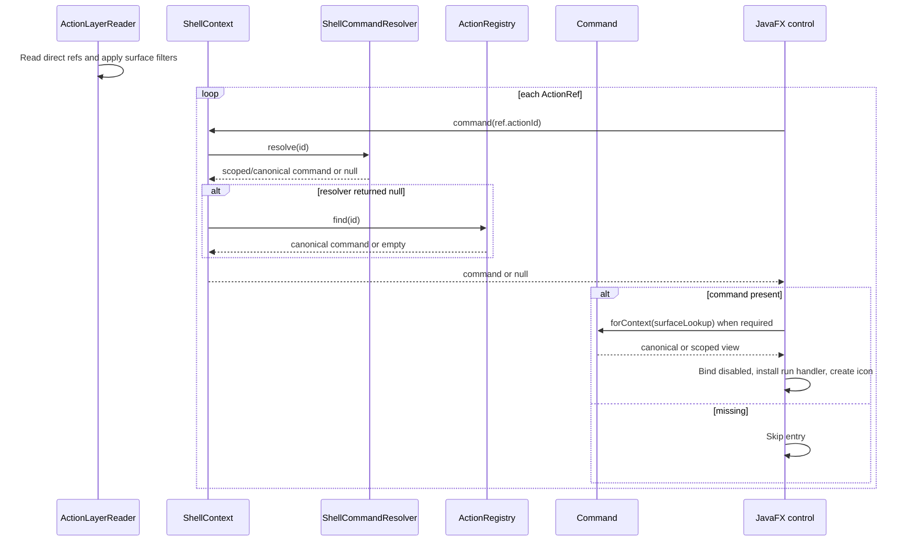

<!--

    Licensed to the Apache Software Foundation (ASF) under one
    or more contributor license agreements.  See the NOTICE file
    distributed with this work for additional information
    regarding copyright ownership.  The ASF licenses this file
    to you under the Apache License, Version 2.0 (the
    "License"); you may not use this file except in compliance
    with the License.  You may obtain a copy of the License at

      http://www.apache.org/licenses/LICENSE-2.0

    Unless required by applicable law or agreed to in writing,
    software distributed under the License is distributed on an
    "AS IS" BASIS, WITHOUT WARRANTIES OR CONDITIONS OF ANY
    KIND, either express or implied.  See the License for the
    specific language governing permissions and limitations
    under the License.

-->
# 17 — Actions, menus, toolbars, and ribbons

**Baseline:** `f2e43e8b58`.

| Area | Status |
|---|---|
| Register a `Command` once and place action refs on several surfaces | **Implemented** |
| Layer-backed registry, provider fallback, context resolution and scoped views | **Implemented** |
| Profile/context/MIME/language filtering of action references | **Implemented**, with surface-specific readers |
| Generic menu/toolbar/status renderers and dynamic menus | **Implemented** |
| Generic shell-region action Buttons | **Implemented** |
| Dedicated brand/ribbon renderers, recursive shell-region ribbon folders, command palette/keyboard-map surfaces | **Target only** |
| Window-scoped editor resolver and detached IDE bars | **Legacy** |

Related chapters: [shell regions](15-shell-regions-and-contributions.md),
[chrome profiles](16-chrome-profiles.md), [frame/context lookup](14-shell-provider-and-frame-contract.md),
and [status bars](18-branding-theming-status-and-overlays.md).

## 17.1 Registration is behavior; reference is placement

```mermaid
flowchart LR
    A[@ActionRegistration Command class] --> B[NbFx/Actions/id.instance]
    C[@ActionReference path profiles filters] --> D[NbFx/path/id.ref]
    E[CommandsProvider services] --> F[ActionRegistryImpl]
    B --> G[LayerInstances]
    G --> F
    F --> H[Canonical Command by id]
    D --> I[ActionLayerReader]
    I --> J[Filtered ActionRef list]
    J --> K[ShellContext.command / ActionRegistry.resolve]
    H --> K
    K --> L[Command.forContext surface Lookup]
    L --> M[Menu item / toolbar Button / generic region Button]
```

A command's behavior, text, enabled state and optional accelerator/icon live in the `Command`. A ref
supplies placement, ordering, optional display/filter/presentation metadata. Multiple refs can reuse
one canonical command; surfaces must not register a second copy of the behavior.

## 17.2 `Command` and registry signatures

### Command

```java
public interface Command {
    String getId();
    String getText();
    default KeyCombination getAccelerator() { return null; }
    default Node getIcon() { return null; }
    boolean isDisabled();
    ReadOnlyBooleanProperty disabledProperty();
    void run();
    default Command forContext(Lookup context) { return this; }
    default void dispose() {}
}
```

`getIcon()` must return a **new** unparented node on each call. `run()` is invoked on the JavaFX
Application Thread and must surface failures rather than silently swallowing them. UI controls bind
`disable` to `disabledProperty()`; `RunnableCommand` also refuses to run while disabled.

`AbstractCommand` manages id/text/accelerator/disabled state and starts disabled by default.
`RunnableCommand(id, text, accelerator, action)` starts enabled; its observable overload binds disabled
state. `ContextSensitiveCommand` observes the global `ActionContext`; `forContext` creates a scoped view
that observes the supplied lookup and is initially disabled until evaluated. Scoped views dispose their
listeners idempotently.

### Registry

```java
public interface ActionRegistry {
    void register(Command command);
    Optional<Command> find(String id);
    default Optional<Command> resolve(String id, Lookup context) {
        return find(id).map(command -> command.forContext(context));
    }
    Collection<Command> getCommands();
    Optional<Command> createScoped(String id, ObservableValue<EditorDocument> activeDocument);
}
```

`ActionRegistryImpl` is a global NBM service. On construction it:

1. loads every `CommandsProvider` and registers `createCommands()`;
2. loads class-based `NbFx/Actions` entries through `LayerInstances`;
3. verifies `entry.id().equals(command.getId())`; a mismatch is logged and the command is disposed;
4. registers valid layer commands, overriding provider commands with the same id;
5. records layer-backed ids for `createScoped`.

`find` is a map lookup. `getCommands` is an unmodifiable collection view. `register` replaces an existing
id but does not dispose the replaced command. `resolve` performs `forContext`; if that returns null,
`Optional.map` yields empty. Exceptions are not caught by the default method.

`createScoped` is the older editor-document window-scoping API. For a layer-backed id it returns a
`ScopedLayerCommand`; otherwise it asks providers in lookup order. `ScopedLayerCommand` follows the
observable active document, disposes the previous noncanonical context view on rebind, stays disabled
while no document is available, catches/logs binding failures and removes listeners on disposal.

### Shell resolver precedence

```java
public interface ShellCommandResolver {
    Command resolve(String id);
    @Deprecated default Command resolve(String id, ObservableValue<Boolean> preferFile) {
        return resolve(id);
    }
    default void close() {}
}
```

`ShellContext.command(id)` uses this order:

1. `ShellCommandResolver.resolve(id)`;
2. if that returns null, `ActionRegistry.find(id)`;
3. otherwise null.

It does **not** automatically call `ActionRegistry.resolve(id, actionLookup)`. The generic shell-region
Button path explicitly calls `forContext` after obtaining the command. Menu/toolbar builders use the
resolver's returned command directly, so a product resolver is the current way to scope those surfaces
to a window.

The application owns and closes the resolver. Surfaces must not close it or dispose a canonical
registry command.

## 17.3 Registration annotation and generated action entry

```java
@ActionRegistration(
        id = "save",
        displayName = "#Save",
        iconName = "save.png",
        accelerator = "Shortcut+S",
        position = 10)
```

Defaults are empty display name/icon/accelerator and `position = Integer.MAX_VALUE`. The annotated type
must be a public, concrete, non-abstract class implementing `Command`, with an **explicitly declared
public no-argument constructor**; nested classes must be static. The processor rejects reliance on
Java's implicit default constructor.

The processor writes:

```text
NbFx/Actions/save.instance
  instanceClass = org.example.SaveCommand
  displayName   = "#Save"
  iconName      = "save.png"
  accelerator   = "Shortcut+S"
  position      = 10
```

Compilation rejects an invalid id, wrong/abstract/nonpublic type, missing public no-argument
constructor, or duplicate registration id within one compilation. Id validation rejects blank,
leading/trailing whitespace, `/`, `\`, `.`, `..` and ISO controls; it does not apply the stricter
atomic-token grammar used by profile/context filters.

**Baseline limitation:** `ActionRegistryImpl` loads the command instance and checks its id, but does not
apply the generated `displayName`, `iconName` or `accelerator` attributes to it. At runtime the
`Command` implementation's own `getText`, `getIcon` and `getAccelerator` are authoritative. Annotation
metadata alone does not replace those methods.

## 17.4 Reference annotation and `ActionRef`

```java
@ActionReference(
        id = "save",
        path = "Menus/File",
        position = 10,
        separatorBefore = false,
        displayName = "#Save",
        iconName = "save.png",
        contextType = "editor",
        languageId = "java",
        mimeType = "text/x-java",
        profiles = {"main"},
        presentationHints = {"iconOnly=true", "slot=primary"})
```

`@ActionReference` targets types and methods and is repeatable via `@ActionReferences`. Defaults are
`position = Integer.MAX_VALUE`, `separatorBefore = false`, and empty display/icon/context/language/
MIME/profiles/hints.

The processor writes `NbFx/<path>/<id>.ref` with `actionId = id`, position, separator, bundle-aware
display name and optional metadata. `path` must be a relative NbFx surface path: no leading/trailing
slash, backslash, empty segment, `.`/`..` or control character. Context/language/MIME/profile values
must be atomic tokens when present. Hints must be unique `key=value` entries with a key matching
`[A-Za-z0-9._-]+` and a nonblank value without control characters.

**Runtime reader gap:** generated layers normally satisfy that processor grammar, but
`ActionLayerReader` itself only requires a nonempty suffix after `hint.` and a string-typed attribute
value. It does not revalidate the processor's key regex, nonblank-value rule or control-character
rule, so hand-authored hint keys/values that violate those rules can still be retained at runtime.

```java
public record ActionRef(
        String actionId,
        int position,
        boolean separatorBefore,
        String displayName,
        String iconName,
        String contextType,
        String languageId,
        String mimeType,
        Set<String> profiles,
        Map<String, String> presentationHints) {

    public ActionRef(String actionId, int position, boolean separatorBefore) { ... }
}
```

The record defensively copies profiles/hints. `actionId` must be nonblank; profile ids must be atomic
tokens. Display name and icon name are optional strings. `ActionContextMetadata` is:

```java
public record ActionContextMetadata(
        String contextType, String mimeType, String languageId, String profileId) {}
```

Each metadata value is an exact, case-sensitive atomic token; null/blank becomes null (dimension
unavailable).

## 17.5 Reading and filtering references

```java
public static List<ActionRef> read(FileObject folder);
public static List<ActionRef> read(String layerPath);
public static List<ActionRef> readForMime(FileObject folder, String mimeType);
public static List<ActionRef> readForMime(String layerPath, String mimeType);
public static List<ActionRef> readForProfile(FileObject folder, String profileId);
public static List<ActionRef> readForProfile(String layerPath, String profileId);
public static List<ActionRef> readForContext(FileObject folder, Lookup context);
public static List<ActionRef> readForContext(String layerPath, Lookup context);
public static List<Submenu> readSubmenus(FileObject folder);
```

`ActionLayerReader` reads direct `.ref` data files only and sorts by `position`, then `actionId`. A
null folder or null layer path yields an empty list. `readForContext` requires a nonnull lookup; absent
metadata is treated as four unavailable dimensions.

| Reader | Filters applied |
|---|---|
| `read` | None. |
| `readForMime` | MIME, plus exclusion of context/language-restricted refs because those query dimensions are unavailable; profile is unrestricted. |
| `readForProfile` | Profile only; it deliberately does not broaden or evaluate MIME/language/context attributes. |
| `readForContext` | Context type **AND** MIME **AND** language **AND** profile. Profile ids within one ref are ORed. |

Matching rules:

- an empty declared filter accepts every value of that dimension;
- a restricted context/MIME/language ref is excluded when the corresponding query value is absent;
- values match exact, case-sensitive tokens;
- empty ref profile set means all profiles;
- null/blank profile query means all profiles;
- a nonblank profile query must be an atomic token or `readForProfile` throws `IllegalArgumentException`;
- malformed refs (missing action id, wrong-typed attribute, invalid filter/profile token, empty hint
  suffix or wrong-typed hint value) are logged and skipped, never broadened;
- unrelated files and `.instance`/`.dynamic` entries are ignored by `read`.

`readSubmenus` recursively detects nested folders containing refs or dynamic sections and returns
folder display name (attribute or folder name), position and separator metadata. The generic menu
builders use this; the shell-region host does not.

## 17.6 Action resolution pipeline



Different surfaces bind context differently:

- `ShellMenuBar` and `ShellToolBars` call `context.command(id)` and use the result directly.
- The generic shell-region host calls `context.command(id)`, then `canonical.forContext(actionLookup)`.
- `LayerMenuBuilder.buildOwned` uses `ActionRegistry.resolve(id, context)` and owns noncanonical views.
- `LayerMenuBuilder.build` uses canonical `registry.find(id)` and `ActionLayerReader.read`, so it applies
  neither context nor profile filters.

## 17.7 Icons and presentation metadata

`ShellIconProvider` defines `MENU_SIZE = 16` and `TOOLBAR_SIZE = 24`:

```java
Node icon(String commandId, double size);

static Node icon(ShellContext context, Command command, double size) {
    Node own = command.getIcon();
    if (own != null || context == null) {
        return own;
    }
    ShellIconProvider provider = context.lookup().lookup(ShellIconProvider.class);
    return provider == null ? null : provider.icon(command.getId(), size);
}
```

The command's own icon wins; the provider is a fallback. Each call must produce a fresh node.

Baseline consumers differ:

| Surface | Uses `ActionRef.displayName`? | Uses `ActionRef.iconName`? | Uses hints/separator? |
|---|---|---|---|
| `ShellMenuBar` static item | No; command text | No | Separator yes; hints no |
| `ShellToolBars` button | No; command text/icon-only | No | Neither |
| Generic shell-region Button | Yes | No; command/provider icon at 16px | Neither |
| `LayerMenuBuilder` item | Yes | No icon is installed | Separator yes; hints no |
| Dedicated ribbon | **Target only** | **Target only** | **Target only** |

`ActionRegistration.iconName` and `ActionReference.iconName` are retained metadata, but baseline
renderers do not resolve them. Implement `Command.getIcon()` or register a `ShellIconProvider` for
actual icons.

## 17.8 Menu bar behavior

`ShellMenuBar` builds from global `NbFx/Menus`, not from `ShellRegions/nbfx:menubar`.

1. Read direct top-level folders accepted by `profile.includeMenu(folder.getName())`.
2. Sort by integer `position` (default `Integer.MAX_VALUE`), then folder name.
3. Build each menu and omit it when it has no visible items.
4. Set `MenuBar.useSystemMenuBar(profile.useSystemMenuBar())`.

Within a menu:

- direct refs are read with `readForProfile(folder, profile.id())`;
- refs also pass `profile.includeMenuItem(menuFolderName, actionId)`;
- command resolution uses `context.command(actionId)`;
- a missing command produces no item;
- the `MenuItem` uses command text, a 16px shell icon, bound disabled state and the command's own
  accelerator;
- nested folders accepted by `includeMenu` become submenus; empty submenus are omitted;
- static refs, dynamic sections and submenus merge by position, then entry id;
- separators are inserted only before nonempty content and never doubled at the layout pass.

`ShellMenuBar` does not use `ActionRef.displayName`, `ActionRef.iconName`, MIME/language/context
filters, `KeyMap` accelerator overrides or presentation hints. `LayerMenuBuilder` is the separate API
that honors ref display names and `KeyMap` overrides for its own menu items.

### Dynamic menu sections

A `.dynamic` file supplies `factory`, optional `position`, `separatorBefore` and `displayName`.
`ShellMenuBar`:

1. applies `includeMenuItem(parentMenuName, dynamicFileBaseName)`;
2. finds a `DynamicMenu.Factory` in the shell lookup by exact `factoryId()` (default: runtime class
   name);
3. calls `factory.create(context.lookup())`;
4. inserts the section's observable `MenuItem` list, or a submenu when `displayName` is nonempty;
5. on list changes, re-renders the changed section into its saved `EntryState.rendered` value, then
   calls `layout()`, which clears and rebuilds the whole `Menu.getItems()` list in model order and
   normalizes separators; unrelated entries reuse their cached `MenuItem` instances rather than being
   recreated;
6. omits an empty dynamic section/submenu without leaving a stale separator;
7. disposes every created `DynamicMenu` when the bar is disposed.

```java
public interface DynamicMenu {
    interface Factory {
        DynamicMenu create(Lookup context);
        default String factoryId() { return getClass().getName(); }
    }
    ObservableList<MenuItem> items();
    default void dispose() {}
}
```

Factories should be stateless; returned sections own their listeners. Missing factories and factory
`RuntimeException`s are reported and the section is omitted. Dynamic sections do not create scoped
`Command` views automatically; any commands/listeners they create remain the section's responsibility.

## 17.9 Toolbar behavior and persistence

`ShellToolBars` builds from global `NbFx/Toolbars`:

1. read direct folders accepted by `profile.includeToolBar(id)`;
2. sort by position then folder name;
3. read direct refs with `readForProfile`;
4. apply `profile.includeToolBarItem(toolbarId, actionId)`;
5. resolve through `context.command` and omit missing commands;
6. omit a bar with no buttons;
7. add a leading drag-handle `Label` only when `profile.movableToolBars()` is true.

The containing `ToolBar`—not each Button—receives `id = folder.getName()` and accessible text from the
folder's `displayName` (falling back to the folder name). The builder does not assign an explicit id or
accessible text to each action Button.

A toolbar button:

- has style class `toolbar-button` and `focusTraversable = false`;
- uses a 24px icon when available, otherwise command text;
- binds disabled state and runs the command;
- has a tooltip containing command text and accelerator display text when present.

Toolbar builders do not apply action-ref MIME/language/context filters, display-name/icon overrides,
separators or presentation hints. There are no hardcoded fallback toolbars.

`ToolBarContainer` arranges bars in rows, supports drag reordering/new rows, tracks visibility and
serializes:

```text
arrangement: "file,clipboard;edit"
hidden ids: "debug,history"
```

`AppState.initToolbars` restores arrangement and hidden ids, then tracks changes into the persisted
snapshot. A stored arrangement must reference every current toolbar exactly once; otherwise it is
rejected and the current arrangement remains. Reset makes all bars visible in their original order on
one row. `ViewMenuFactory` adds toolbar check items and a reset action to the View menu by looking up
the shared `ToolBarContainer` from the shell context.

The default/custom declarative frame paths share this container and persistence. A custom frame can
look it up but is not required to display it.

## 17.10 Generic shell-region Buttons

For every non-DOCK region, direct `.ref` children of `NbFx/ShellRegions/<region-id>` are rendered as
generic `Button`s by `ShellRegionHostImpl`. The wrapper is a `VBox` for ordinary regions (vertical
layout), but an `OVERLAY` region uses a `StackPane` (layered layout):

- full `readForContext` filtering is used, with the selected profile id merged into the lookup;
- `ShellContext.command` resolves the command, then `forContext` creates the surface view;
- button text is ref display name when nonblank, otherwise command text;
- icon comes from command/provider at 16px;
- disabled state binds to the scoped command;
- noncanonical scoped views are disposed on update/dispose;
- missing commands and per-ref `RuntimeException`s are isolated;
- renderer output, contribution nodes and Buttons are ordered by position (renderer first).

This is the baseline “brand bar”/“ribbon” action surface: useful, but not a dedicated brand or ribbon
renderer. Nested folders beneath a shell region are not traversed.

## 17.11 Status actions versus status elements

The default STATUS region renderer creates a `StatusBar` from `StatusElementRegistry`, not from action
refs. Status elements are a separate contribution model with `init`, `getNode` and `dispose`; details
are in [chapter 18](18-branding-theming-status-and-overlays.md).

Direct action refs under `ShellRegions/nbfx:status` still become generic Buttons in the region wrapper,
alongside the rendered `StatusBar`. There is no baseline action-aware status renderer and no
`StatusScope`/area/group/content targeting.

## 17.12 Ribbon and brand limitations

**Target only:** dedicated ribbon hierarchy, ribbon tabs/groups/commands and a brand renderer.

What exists:

- `ShellRegionId.RIBBON`, `ShellRegionKind.RIBBON` and `ShellRegionRenderer` SPI;
- product-declared RIBBON/BRAND regions;
- direct `ShellContribution` nodes;
- direct action refs rendered as generic Buttons;
- arbitrary product-owned JavaFX layout inside a custom frame.

What does not exist:

- a neutral RIBBON declaration;
- a runtime RIBBON or BRAND renderer;
- recursive rendering of `ShellRegions/nbfx:ribbon/Home/Clipboard`;
- conversion of action refs into ribbon controls;
- a public hook that adds another renderer to the application-created runtime host.

The acceptance test that reads one ref from a nested ribbon folder proves reader/registry reuse, not a
working ribbon UI. Author nested ribbon metadata only with that limitation in mind.

## 17.13 Detached-window legacy path

**Legacy.** Floating windows do not construct declarative profile-driven frames. `NbfxTabPane` creates a
`BorderPane` containing the detached pane and asks `WindowEnvironment` for optional top bars. The first
nonnull `DetachedBarsProvider` wins; deprecated `WindowEnvironmentContribution` is the fallback.

The IDE's `DetachedBars`:

- creates a legacy `DetachedChromeProfile` (its inherited `id()` is therefore `"main"`, so refs
  restricted to `floating-editor` do not match this floating window);
- builds `ShellMenuBar` and `ShellToolBars` with generic builders;
- uses `IdeShellCommandResolver` bound to that window's selected document;
- collects window-scoped commands in `DetachedBarsContext.scopedCommands`;
- mirrors main toolbar visibility and disables drag handles;
- implements `DisposableChrome` to unbind visibility and dispose dynamic menus.

On a closing detached stage, the shell disposes collected scoped commands and calls
`DisposableChrome.dispose()`. There is no default detached StatusBar in this path and
`WindowOptions.profile` is not used to choose this chrome.

The main IDE resolver also honors layer ownership before provider-scoped variants, follows the main
pane's active document, and can dispatch Cut/Copy/Paste/Undo/Redo/Find to file or editor commands based
on navigator focus. The application closes its resolver; detached windows own their supplied command
sink.

## 17.14 Ownership and disposal matrix

| Resource | Owner | Release rule |
|---|---|---|
| Canonical layer/provider command | `ActionRegistry` | Not disposed by menu/toolbar/region removal. Registry has no public close in the baseline. |
| `ShellCommandResolver` and resolver-created main scoped commands | `ShellApplication` | Resolver closed once after frame/host cleanup; also on failed frame startup. |
| `ContextSensitiveCommand` global listeners | Canonical command | `Command.dispose()` by its owner. |
| `Command.forContext` view | Surface/build | Dispose when surface closes; host and `LayerMenuBuilder.Build` do this automatically. |
| `ScopedLayerCommand` | Window/resolver | Disposes current context view, removes active-document listener, disables itself; idempotent. |
| Detached-window scoped commands | Detached stage via command sink | Disposed on closing stage, including redock cleanup. |
| `DynamicMenu` section | `ShellMenuBar` | Disposed with the bar; factory itself is a service. |
| Toolbar arrangement/visibility snapshot | `AppState` | Saved on shell stop/shutdown hook; callbacks update its volatile snapshot. |
| Generic region Button | Region host wrapper | Removed with wrapper; scoped command view separately disposed. |

`LayerMenuBuilder.Build` is `AutoCloseable`: closing it disposes each distinct noncanonical command view
once by identity. Canonical commands are never disposed. A failed owned build closes already-created
views before rethrowing.

## 17.15 Examples

### One command, several placements

```java
package org.example.product.actions;

import org.netbeans.api.nbfx.actions.ActionReference;
import org.netbeans.api.nbfx.actions.ActionReferences;
import org.netbeans.api.nbfx.actions.ActionRegistration;
import org.netbeans.api.nbfx.actions.RunnableCommand;
import org.openide.util.NbBundle;

@ActionRegistration(id = "product.save", displayName = "#Save",
        iconName = "save.png", accelerator = "Shortcut+S", position = 10)
public final class ProductSaveCommand extends RunnableCommand {

    public ProductSaveCommand() {
        super("product.save", NbBundle.getMessage(ProductSaveCommand.class, "Save"),
                new javafx.scene.input.KeyCombination(
                        javafx.scene.input.KeyCode.S,
                        javafx.scene.input.KeyCombination.SHORTCUT_DOWN),
                () -> {
                    // Product save behavior. Runs only while enabled.
                });
    }
}

@ActionReferences({
    @ActionReference(id = "product.save", path = "Menus/File", position = 10),
    @ActionReference(id = "product.save", path = "Toolbars/main", position = 10),
    @ActionReference(id = "product.save", path = "ShellRegions/nbfx:brand",
            position = 20, profiles = {"main"})
})
public final class ProductSavePlacements {
}
```

The command id must match `Command.getId()`. To get an icon at runtime, override `getIcon()` or supply
a `ShellIconProvider`; the annotation's `iconName` alone is not consumed by these renderers.

### Owned context menu build

```java
ActionRegistry registry = context.lookup().lookup(ActionRegistry.class);
LayerMenuBuilder builder = new LayerMenuBuilder(registry);
Lookup surfaceContext = new ProxyLookup(
        Lookups.singleton(new ActionContextMetadata(
                "editor", "text/x-java", "java", context.profile().id())),
        context.lookup());

try (LayerMenuBuilder.Build build = builder.buildOwned("Menus/File", surfaceContext)) {
    menu.getItems().setAll(build.items());
}
```

Call this on the JavaFX Application Thread. Keep the menu detached/no longer in use before closing the
build, because closing disposes the command views that its items observe.

### Dynamic section factory

```java
@ServiceProvider(service = DynamicMenu.Factory.class)
@DynamicMenuRegistration(path = "Menus/View", id = "product-recent",
        position = 20, separatorBefore = true)
public final class ProductRecentFactory implements DynamicMenu.Factory {

    @Override
    public DynamicMenu create(Lookup context) {
        javafx.collections.ObservableList<javafx.scene.control.MenuItem> items =
                javafx.collections.FXCollections.observableArrayList();
        // Populate and observe product state here.
        return new DynamicMenu() {
            @Override public javafx.collections.ObservableList<javafx.scene.control.MenuItem> items() {
                return items;
            }
            @Override public void dispose() {
                // Remove product listeners.
            }
        };
    }
}
```

The parent menu must exist under `NbFx/Menus`; dynamic registration supplies a section of that menu,
not a new menu root.

## 17.16 Errors, isolation and threading

| Condition | Result |
|---|---|
| Invalid registration/ref annotation values or duplicate registration ids in one compilation | Compilation error from the annotation processor. |
| Malformed `.ref` attribute/token/hint | Logged and skipped by `ActionLayerReader`. |
| Missing command | Entry omitted; `LayerMenuBuilder` logs a warning, shell-region host skips silently. |
| Resolver throws | Propagates to its caller; generic region host catches per ref, menu/toolbar construction can fail. |
| `forContext` returns null | Registry resolve yields empty; shell-region host logs/isolates the ref. |
| Scoped view creation throws | Host disposes any owned view; owned menu build rolls back created views and rethrows. |
| Layer action id differs from `Command.getId()` | Logged, command disposed, entry ignored. |
| Wrong layer implementation type or constructor failure | Logged/skipped by `LayerInstances`. |
| Provider/layer duplicate id | Layer command overrides provider command. |
| Invalid nonblank `readForProfile` query | `IllegalArgumentException`. |
| JavaFX control/node creation or command execution off FX thread | Contract violation; callers must use the FX thread. |

Metadata reads do not require the JavaFX toolkit. Menu/toolbar/status/region node creation, icon
creation, `DynamicMenu` list-to-control updates and command execution belong on the JavaFX Application
Thread. Do not perform blocking I/O there.

## 17.17 Current versus target

| Target reference | Baseline |
|---|---|
| Register once, reference from menu/toolbar/ribbon/brand/context/palette/keyboard map | **Partial.** Registration/ref reuse works; palette/keyboard-map placement and ribbon/brand renderers are not implemented. |
| `ActionRegistry.resolve(id, Lookup)` | **Implemented.** |
| Layer commands override provider fallback | **Implemented.** |
| Context/MIME/language/profile filters | **Implemented** in `readForContext`; menu/toolbar builders intentionally use profile-only reads. |
| Context-aware `buildOwned` with scoped disposal | **Implemented.** |
| Icon/display/presentation overrides on every surface | **Partial.** Metadata is retained, but consumption varies and icon overrides are not resolved. |
| Dedicated ribbon/brand renderers | **Target only.** |
| MAIN/FLOATING/CUSTOM declarative chrome | **Target only** beyond the main frame; detached IDE bars remain **Legacy**. |

## 17.18 Sources and tests

### Implementation

- [`Command`](../../../nbfx-platform/nbfx.api.actions/src/org/netbeans/api/nbfx/actions/Command.java)
- [`AbstractCommand`](../../../nbfx-platform/nbfx.api.actions/src/org/netbeans/api/nbfx/actions/AbstractCommand.java)
- [`RunnableCommand`](../../../nbfx-platform/nbfx.api.actions/src/org/netbeans/api/nbfx/actions/RunnableCommand.java)
- [`ContextSensitiveCommand`](../../../nbfx-platform/nbfx.api.actions/src/org/netbeans/api/nbfx/actions/ContextSensitiveCommand.java)
- [`ActionRegistry`](../../../nbfx-platform/nbfx.api.actions/src/org/netbeans/api/nbfx/actions/ActionRegistry.java)
- [`ActionRegistryImpl`](../../../nbfx-platform/nbfx.platform.actions/src/org/netbeans/modules/nbfx/platform/actions/ActionRegistryImpl.java)
- [`ScopedLayerCommand`](../../../nbfx-platform/nbfx.platform.actions/src/org/netbeans/modules/nbfx/platform/actions/ScopedLayerCommand.java)
- [`ActionRegistrationProcessor`](../../../nbfx-platform/nbfx.api.actions/src/org/netbeans/modules/nbfx/api/actions/processors/ActionRegistrationProcessor.java)
- [`ActionRef`](../../../nbfx-platform/nbfx.api.actions/src/org/netbeans/api/nbfx/actions/ActionRef.java)
- [`ActionReference`](../../../nbfx-platform/nbfx.api.actions/src/org/netbeans/api/nbfx/actions/ActionReference.java)
- [`ActionLayerReader`](../../../nbfx-platform/nbfx.api.actions/src/org/netbeans/api/nbfx/actions/ActionLayerReader.java)
- [`ActionContextMetadata`](../../../nbfx-platform/nbfx.api.actions/src/org/netbeans/api/nbfx/actions/ActionContextMetadata.java)
- [`LayerMenuBuilder`](../../../nbfx-platform/nbfx.api.actions/src/org/netbeans/api/nbfx/actions/LayerMenuBuilder.java)
- [`ShellCommandResolver`](../../../nbfx-platform/nbfx.api.shell/src/org/netbeans/api/nbfx/shell/ShellCommandResolver.java)
- [`ShellIconProvider`](../../../nbfx-platform/nbfx.api.shell/src/org/netbeans/api/nbfx/shell/ShellIconProvider.java)
- [`ShellMenuBar`](../../../nbfx-platform/nbfx.platform.shell/src/org/netbeans/modules/nbfx/platform/shell/ShellMenuBar.java)
- [`ShellToolBars`](../../../nbfx-platform/nbfx.platform.shell/src/org/netbeans/modules/nbfx/platform/shell/ShellToolBars.java)
- [`ToolBarContainer`](../../../nbfx-platform/nbfx.platform.shell/src/org/netbeans/modules/nbfx/platform/shell/ToolBarContainer.java)
- [`ViewMenuFactory`](../../../nbfx-platform/nbfx.platform.shell/src/org/netbeans/modules/nbfx/platform/shell/ViewMenuFactory.java)
- [`ShellRegionHostImpl`](../../../nbfx-platform/nbfx.platform.shell/src/org/netbeans/modules/nbfx/platform/shell/ShellRegionHostImpl.java)
- [`DynamicMenu`](../../../nbfx-platform/nbfx.api.views/src/org/netbeans/api/nbfx/views/DynamicMenu.java)
- [`DetachedBars`](../../../nbfx-ide/nbfx.ide.workbench/src/org/netbeans/modules/nbfx/ide/workbench/DetachedBars.java)
- [`IdeShellCommandResolver`](../../../nbfx-ide/nbfx.ide.workbench/src/org/netbeans/modules/nbfx/ide/workbench/IdeShellCommandResolver.java)
- [`NbfxTabPane`](../../../nbfx-platform/nbfx.platform.shell/src/org/netbeans/modules/nbfx/platform/shell/NbfxTabPane.java)

### Tests

- [`ActionRegistrationProcessorTest`](../../../nbfx-platform/nbfx.api.actions/test/unit/src/org/netbeans/api/nbfx/actions/ActionRegistrationProcessorTest.java)
- [`ActionLayerReaderTest`](../../../nbfx-platform/nbfx.api.actions/test/unit/src/org/netbeans/api/nbfx/actions/ActionLayerReaderTest.java)
- [`LayerMenuBuilderTest`](../../../nbfx-platform/nbfx.api.actions/test/unit/src/org/netbeans/api/nbfx/actions/LayerMenuBuilderTest.java)
- [`ContextSensitiveCommandTest`](../../../nbfx-platform/nbfx.api.actions/test/unit/src/org/netbeans/api/nbfx/actions/ContextSensitiveCommandTest.java)
- [`ActionRegistryImplTest`](../../../nbfx-platform/nbfx.platform.actions/test/unit/src/org/netbeans/modules/nbfx/platform/actions/ActionRegistryImplTest.java)
- [`ActionSurfaceAcceptanceTest`](../../../nbfx-platform/nbfx.platform.actions/test/unit/src/org/netbeans/modules/nbfx/platform/actions/ActionSurfaceAcceptanceTest.java)
- [`ShellMenuBarTest`](../../../nbfx-platform/nbfx.platform.shell/test/unit/src/org/netbeans/modules/nbfx/platform/shell/ShellMenuBarTest.java)
- [`ShellToolBarsTest`](../../../nbfx-platform/nbfx.platform.shell/test/unit/src/org/netbeans/modules/nbfx/platform/shell/ShellToolBarsTest.java)
- [`ShellRegionHostImplTest`](../../../nbfx-platform/nbfx.platform.shell/test/unit/src/org/netbeans/modules/nbfx/platform/shell/ShellRegionHostImplTest.java)
- [`DetachedBarsTest`](../../../nbfx-ide/nbfx.ide.workbench/test/unit/src/org/netbeans/modules/nbfx/ide/workbench/DetachedBarsTest.java)

Continue with [chapter 18 — branding, theming, status, and overlays](18-branding-theming-status-and-overlays.md).
