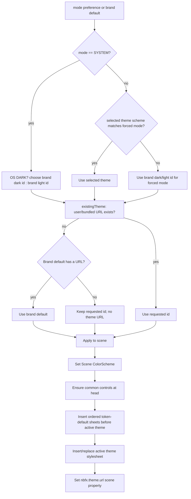
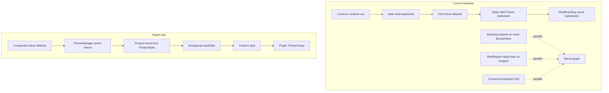

<!--

    Licensed to the Apache Software Foundation (ASF) under one
    or more contributor license agreements.  See the NOTICE file
    distributed with this work for additional information
    regarding copyright ownership.  The ASF licenses this file
    to you under the Apache License, Version 2.0 (the
    "License"); you may not use this file except in compliance
    with the License.  You may obtain a copy of the License at

      http://www.apache.org/licenses/LICENSE-2.0

    Unless required by applicable law or agreed to in writing,
    software distributed under the License is distributed on an
    "AS IS" BASIS, WITHOUT WARRANTIES OR CONDITIONS OF ANY
    KIND, either express or implied.  See the License for the
    specific language governing permissions and limitations
    under the License.

-->
# 18 — Branding, theming, status, and overlays

**Baseline:** `f2e43e8b58`.

| Area | Status |
|---|---|
| Legacy `ShellBranding`, deterministic selection, title/icons/styles/minimum geometry | **Legacy** |
| Static `NbfxTheme`, bundled/user themes, OS mode and CSS token defaults | **Legacy** |
| Registry-driven window status bar and transient status message | **Implemented** |
| Visual shell `OVERLAY` region and non-picking empty bounds | **Implemented**, but not the target HUD model |
| `ProductStyle`/product icon metadata records | **Implemented** as immutable metadata; shell application is **Partial** |
| `ThemeManager`, `ThemeTokens`, `ThemeScope`, `HostTheme`, product theme policy application | **Target only** |
| `StatusScope` and area/group/content-local status hosts | **Target only** |
| `OverlayHost`, `OverlaySpec`, anchors/input modes and `ShellFrame.overlays()` | **Target only** |

Related chapters: [frame composition](14-shell-provider-and-frame-contract.md),
[region styling and visual OVERLAY](15-shell-regions-and-contributions.md),
[profiles](16-chrome-profiles.md), and [actions/status actions](17-actions-menus-toolbars-and-ribbons.md).

## 18.1 Legacy application branding

```java
public interface ShellBranding {
    String DEFAULT_APPLICATION_NAME = "NetBeansFX";

    default int priority() { return 0; }
    String applicationName();
    default String title(ShellContext context) { return applicationName(); }
    default ObservableValue<String> titleProperty(ShellContext context) { return null; }
    default List<Image> icons() { return List.of(); }
    default double minimumWidth() { return 0.0d; }
    default double minimumHeight() { return 0.0d; }
    default List<String> rootStyleClasses() { return List.of(); }
    default List<String> sceneStylesheets() { return List.of(); }
    default String emptyEditorText() { return null; }
    default void dispose() {}

    static Optional<ShellBranding> select(Lookup lookup);
}
```

`ShellBranding.select` chooses the highest priority; equal priorities are resolved deterministically by
runtime class name (the lexicographically greatest name wins with the current `max` comparator). The
neutral `DefaultShellBranding` service has priority `0` and application name `"NetBeansFX"`. A product
branding normally uses a higher priority, as the IDE's `ProjectBranding` does with `100`.

This priority/superseding model is **Legacy** and differs from the target's exactly-one `ProductProvider`
rule.

### What `ShellApplication` actually applies

After constructing the default/custom frame or legacy chrome, the shell selects branding from its
`ShellContext.lookup()` and applies:

| Branding member | Application behavior |
|---|---|
| `applicationName()` | Fallback source for default title; not otherwise injected into chrome. |
| `title(context)` | Initial stage title; when no branding exists, title is `"NetBeansFX"`. |
| `titleProperty(context)` | Subscribed after the initial title; each emission calls `stage.setTitle`. |
| `icons()` | Replaces stage icons when the list is nonempty. |
| `minimumWidth()` / `minimumHeight()` | Applied only when greater than `0`. |
| `rootStyleClasses()` | Added to the **outer `BorderPane root`**, not directly to `ShellFrame.root()`. |
| `sceneStylesheets()` | Appended after `NbfxTheme.apply(scene)`, so they follow the active theme. |
| `emptyEditorText()` | Used for the initial main editor placeholder when nonblank. |
| `dispose()` | Called during shell stop after unsubscribing the title property. |

The empty-editor placeholder is created in `NbfxTabPane` and independently calls
`ShellBranding.select(Lookup.getDefault())`. A branding visible only through a custom `shellLookup()`
is therefore not guaranteed to customize that placeholder.

## 18.2 Product metadata is not yet the branding runtime

`Product`, `ProductIdentity`, `ProductIcons`, `ProductStyle` and `ProductProvider` exist as immutable
API metadata. In particular:

```java
public record ProductStyle(
        List<ResourceRef> stylesheets,
        List<ResourceRef> tokenResources,
        List<String> rootStyleClasses) {}
```

Collections are defensively copied. However, `ShellApplication` does not read `Product.style()`,
`Product.icons()`, `Product.themePolicyId()`, `Product.shellId()` or `Product.layoutId()` to configure
the visible shell. The only product field consumed by main chrome selection is
`chromeProfilePolicyId()` (see [chapter 16](16-chrome-profiles.md)).

Consequences:

- declaring product stylesheets/token resources does not automatically attach them;
- product window icons do not automatically replace `ShellBranding.icons()`/`WindowOptions.icon()`;
- a product theme policy id does not select an `NbfxTheme` theme;
- `ProductStyle.rootStyleClasses()` does not automatically style the root.

Use the current `ShellBranding`, explicit frame CSS and theme-token registration paths until the
target product/theme integration is implemented.

## 18.3 Static `NbfxTheme` API

`org.netbeans.modules.nbfx.platform.theme.NbfxTheme` is a public **static** theme facade. It is not a
per-application `ThemeManager`.

| API | Baseline behavior |
|---|---|
| `String FOLDER` | `"nbfx-themes"` directory under the user directory. |
| `String THEME_URL_KEY` | Scene property key `"nbfx.theme.url"` for the active theme URL. |
| `static void install()` | Idempotently subscribes to OS color-scheme changes and shown windows. |
| `static void dispose()` | Unsubscribes, removes the window listener and clears tracked scenes. |
| `static ThemeMode mode()` | Reads preference `themeMode`; default comes from brand properties. |
| `static void setMode(ThemeMode)` | Persists mode and reapplies to all known scenes. |
| `static String selectedTheme()` | Reads preference `theme`, or brand default. |
| `static String current()` | Returns the effective id after trying the brand default when available; it may still name an id with no user/bundled stylesheet. |
| `static ColorScheme colorScheme(String id)` | Brand mapping, then user sidecar, then id-name heuristic. |
| `static String defaultTheme()` | Brand `theme.default`, default `"light"`. |
| `static Path folder()` | Resolves/creates the user theme folder; may return null. |
| `static List<String> themes()` | Bundled plus user ids, excluding `template`; the default is first only when present, otherwise natural id order applies. |
| `static String displayName(String id)` | Hyphen-separated title-cased display text. |
| `static void setTheme(String id)` | Stores id, sets mode from its scheme and reapplies. |
| `static void apply(Scene)` | Installs common/token/theme styles and scene color scheme. |
| `static void apply(DialogPane)` | Applies when the dialog pane receives a scene, and immediately if already attached. |

`ThemeMode` is `SYSTEM`, `LIGHT`, `DARK`.

### Brandable defaults

`theme.properties` is module branding metadata:

```properties
theme.followSystem=true
theme.default=light
theme.light=light
theme.dark=dark
theme.scheme.light=LIGHT
theme.scheme.dark=DARK
theme.scheme.solarized-dark=DARK
theme.scheme.high-contrast=DARK
theme.bundled=light.css,dark.css,solarized-dark.css,high-contrast.css,template.css
```

The bundled theme files and `template.css` live in `nbfx.platform.theme`. A user file with the same id
under `<userdir>/nbfx-themes` overlays the bundled resource. A user `<id>.properties` file may declare
`scheme=LIGHT` or `scheme=DARK`.

## 18.4 Theme selection and application algorithm



Additional rules:

- `SYSTEM` follows JavaFX's platform color-scheme property while installed.
- `setTheme(id)` stores the selected id and forces `LIGHT`/`DARK` from `colorScheme(id)`.
- `setMode` does not rewrite the selected id; a mismatched selected id is replaced at effective-theme
  selection time by the brand's mode-specific theme.
- `colorScheme` checks brand properties, then a user sidecar, then treats ids containing `dark` or
  `high-contrast` as dark and all others as light.
- A missing chosen theme falls back to the brand default when that default has a stylesheet; if
  neither exists, the requested id remains and no theme URL is installed.
- No determinable user directory logs a warning once and leaves bundled themes available. Failure to
  create the theme folder logs on each `folder()` attempt; the folder path is still returned and
  bundled-theme lookup continues.
- `install` applies to existing windows and listens for newly shown windows. Off-FX installation
  schedules the window pass with `Platform.runLater`.
- `applyToAll` includes all current window scenes plus weakly tracked scenes and marshals to FX when
  necessary.
- Reapplying removes previously recognized token/theme URLs while preserving unrelated scene
  stylesheets and the relative position of brand sheets after the theme.

`ShellApplication.start` calls `NbfxTheme.install()`, adds `NbfxTabPane.stylesheet()`, calls
`NbfxTheme.apply(scene)`, then appends branding stylesheets. Custom windows similarly add the tab
stylesheet and apply `NbfxTheme`. Shell stop calls `NbfxTheme.dispose()`.

## 18.5 Theme token defaults are CSS, not target `ThemeTokens`

```java
@ThemeTokenRegistration(id = "product", resource = "product-tokens.css", order = 100)
```

The annotation is repeatable and writes `NbFx/ThemeTokens/<id>`. Its processor requires an id matching
`\w+` and a nonblank resource. A layer entry supplies string `owner` and `resource` attributes plus
optional integer `order` (default `0`). Resources resolve relative to the owner class without
initializing it.

`ThemeTokenProvider` is an alternative service:

```java
public interface ThemeTokenProvider {
    List<String> stylesheets();                 // relative to provider class
    default List<ThemeToken> descriptors() { return List.of(); }
    default int order() { return 0; }
}

public record ThemeToken(
        String id, ThemeTokenType type, String description, String owner) {}
```

`ThemeTokenType` is `COLOR`, `LENGTH`, `FONT`, `NUMBER`, `OTHER`. The descriptor is validation/tooling
metadata; the actual default value lives in CSS on `.root`.

`ThemeTokenRegistry.stylesheets()`:

1. inserts platform `impl/defaults.css` at `Integer.MIN_VALUE`;
2. reads valid layer entries and provider services;
3. logs/skips missing owners/resources and provider `RuntimeException`s;
4. de-duplicates by stylesheet URL, keeping the lowest order;
5. sorts by order then registration id;
6. caches the result until the `NbFx/ThemeTokens` folder (or fallback `NbFx`) changes.

Layer changes invalidate the cache; they do not by themselves reapply every scene. The next theme
application picks up the new list.

This is **not** the target typed `ThemeTokens` object model, and there is no `ThemeManager` or
`ThemeScope` in the baseline.

## 18.6 Current versus target styling layers



The current main-scene stylesheet order is the concrete sequence shown above. Region styling is
limited to `ShellRegionSpec.style().styleClasses()` plus visibility/managed state. Although
`AreaStyle` also carries `stylesheets` and `themeOverlays`, `ShellRegionHostImpl` does not apply those
resource lists. Layout XML can preserve them, but that is not a live scoped styling pipeline.

There is no public static `ThemeManager`, no `ThemeScope.createScope(Parent)`, no `HostTheme`, no
accent-scheme API and no scoped stylesheet removal in this baseline. Static `NbfxTheme` remains
**Legacy** despite having useful live mode/theme behavior.

## 18.7 Status element and registry contracts

```java
public interface StatusElement {
    String getId();
    default StatusAlignment alignment() { return StatusAlignment.LEFT; }
    default int position() { return 0; }
    default void init(Lookup services) {}
    Node getNode();
    default void dispose() {}
}

@StatusRegistration(
        id = "product.health",
        alignment = StatusAlignment.RIGHT,
        position = 100)
```

`StatusRegistration` defaults to `alignment = LEFT`, `position = 0`. The annotated class must be public
with a public no-argument constructor and implement `StatusElement`. The processor writes
`NbFx/Status/<id>.instance` with alignment and position metadata.

```java
public final class StatusElementRegistry {
    public static List<StatusElementSpec> discover();
    public static List<StatusElementEntry> load();
    public static List<StatusElementEntry> load(Lookup services);
    public static List<StatusElementEntry> load(
            List<StatusElement> additional, Lookup services);
}
```

Discovery reads metadata only and does not touch JavaFX. `load` creates fresh **registered** instances
for one status bar and calls `init(services)` on each. The default frame passes its per-shell lookup,
so status elements can resolve shell services. Programmatic `additional` elements are caller-supplied,
not constructed by the registry; they are initialized and merged with registered elements and must not
share nodes between simultaneously visible bars.

Ordering is by alignment enum ordinal, then position, then id. The layer is authoritative for
alignment/position when present; an unknown alignment logs and falls back to `LEFT`, and a noninteger
position falls back to `0`. Wrong implementation types and construction failures are logged/skipped.
`init` or `getNode` failures are not isolated by the registry and can fail status-bar construction.

There is no profile/scope filter: every loaded status bar receives every valid registration. Profile
selection controls only whether the STATUS **region** is mounted.

## 18.8 `StatusBar` rendering and lifecycle

`StatusBar` is a JavaFX `BorderPane` with style class `status-bar` and three slots:

| Alignment | Slot/style behavior |
|---|---|
| `LEFT` | Left `HBox`, start aligned, preferred width. |
| `CENTER` | Deprecated; treated as `FILL`. |
| `FILL` | Center growing `HBox`; each node gets horizontal grow and, for `Region`, maximum width `Double.MAX_VALUE`. |
| `RIGHT` | Right `HBox`, end aligned, preferred width. |

Slot style classes are `status-bar-left`, `status-bar-fill` and `status-bar-right`. CSS gives the bar a
26px preferred/minimum height and styles message/progress/caret elements. A null node is skipped.

The constructor calls each element's `getNode()` once. `dispose()` calls each element's `dispose()` in
order; it has no idempotence guard and does not catch per-element exceptions. The region host catches a
renderer disposal `RuntimeException` and logs it, but `StatusBar` itself does not continue to later
elements after one throws.

The default STATUS renderer creates a new `StatusBar` on every render, so an update/dispose cycle owns
a fresh set of status element instances. Multiple declared STATUS regions each load all elements;
the default frame's bottom slot can display only the last assigned one, so products should declare a
single STATUS region.

## 18.9 Transient status messages

```java
public interface StatusMessageService {
    void setMessage(String message);          // null clears
    String getMessage();                      // never null
    void addListener(Consumer<String> listener);
    void removeListener(Consumer<String> listener);
}
```

`StatusMessage` is a global service with a volatile empty initial message and a `CopyOnWriteArrayList`
of listeners. `setMessage` normalizes null to `""` and invokes a snapshot of listeners synchronously
on the calling thread.

`StatusMessageElement` is registered as id `message`, alignment `FILL`, position `0`. It creates a
`Label` with style class `status-bar-message`, ellipsis overrun and horizontal grow. It resolves
`StatusMessageService` from the global lookup, subscribes, and marshals label updates to the JavaFX
Application Thread when necessary. Disposal removes its listener and drops the node reference.

This is one window-level status message, not a scoped status model. Multiple status bars can each
create their own message element/listener to the same global service.

## 18.10 Visual OVERLAY is not `OverlayHost`

The baseline has all of the following:

- `ShellRegionId.OVERLAY` and `ShellRegionKind.OVERLAY`;
- a neutral `nbfx:overlay` declaration at position `60` with class `nbfx-shell-overlay`;
- OVERLAY included in all four neutral profiles;
- an OVERLAY wrapper implemented as `StackPane` with `pickOnBounds = false`;
- a default-frame overlay `StackPane` above the content `BorderPane`, also with
  `pickOnBounds = false`;
- ordinary `ShellContribution` nodes and direct action Buttons mounted into that wrapper;
- normal region visibility/managed metadata and host disposal.

It does **not** have:

- `ShellFrame.overlays()`;
- `OverlayHost`, `OverlayContent`, `OverlaySpec`, `OverlayId`;
- `OverlayAnchor` or `OverlayInputMode`;
- `PASS_THROUGH`/`HUD`/`INTERACTIVE` input and focus enforcement;
- layer/order/focusable validation;
- overlay `Lookup`/action-context switching;
- anchoring to content/group/area/window across move/float/redock;
- owner-coupled state persistence or automatic reattachment;
- scoped theme application through `ThemeScope`.

`PresentationId.OVERLAY` also exists as a pure layout presentation identity, but it is distinct from
the shell OVERLAY slot and does not provide anchored HUD behavior. `ProgressOverlay` is a progress
service adapter, not an `OverlayHost` implementation.

Empty overlay bounds do not pick pointer input, but real child nodes can be transparent, informational
or interactive according to how the product builds them. The platform does not enforce the target's
input-mode invariants.

## 18.11 Target-only APIs (not available in this baseline)

For orientation only; do not compile against these in this baseline:

```java
// Target only
public interface ThemeManager {
    ObservableValue<Theme> theme();
    List<Theme> themes();
    void setTheme(String id);
    void setMode(ThemeMode mode);
    void setAccentScheme(String id);
    void attach(Window window);
    void attach(Scene scene);
    ThemeScope createScope(Parent root);
}

public interface ThemeScope extends AutoCloseable {
    ThemeTokens tokens();
    void setTheme(Theme theme);
}

public enum StatusScope { WINDOW, AREA, GROUP, CONTENT }

public interface OverlayHost {
    void add(OverlaySpec spec, Node node, Lookup lookup);
    void remove(OverlayId id);
    void setVisible(OverlayId id, boolean visible);
}
```

The target also calls for product-driven theme/brand policy, `StyledContent.applyStyle` on attach/move/
theme change, multiple scoped status hosts, and overlays that follow their anchors. None of those live
contracts is present here.

## 18.12 Examples

### Current branding

```java
package org.example.product.shell;

import java.util.List;
import java.util.Objects;
import javafx.scene.image.Image;
import org.netbeans.api.nbfx.shell.ShellBranding;
import org.netbeans.api.nbfx.shell.ShellContext;
import org.openide.util.lookup.ServiceProvider;

@ServiceProvider(service = ShellBranding.class)
public final class ExampleBranding implements ShellBranding {

    @Override public int priority() { return 100; }
    @Override public String applicationName() { return "Example Product"; }
    @Override public String title(ShellContext context) { return applicationName(); }
    @Override public List<Image> icons() {
        return List.of(new Image(Objects.requireNonNull(
                ExampleBranding.class.getResource("product.png")).toExternalForm()));
    }
    @Override public List<String> rootStyleClasses() { return List.of("example-product"); }
    @Override public List<String> sceneStylesheets() {
        return List.of(Objects.requireNonNull(
                ExampleBranding.class.getResource("branding.css")).toExternalForm());
    }
}
```

Brand stylesheets are appended after the active theme. Root classes land on the outer shell
`BorderPane`, so selectors must account for that ancestor. To customize `ShellFrame.root()` directly,
have the custom frame add its own classes.

### Current status element

```java
@StatusRegistration(id = "product.health", alignment = StatusAlignment.RIGHT, position = 100)
public final class HealthElement implements StatusElement {

    private Label node;

    @Override public String getId() { return "product.health"; }

    @Override public Node getNode() {
        if (node == null) {
            node = new Label("Healthy");
            node.getStyleClass().add("product-health");
        }
        return node;
    }

    @Override public void dispose() {
        node = null;
    }
}
```

Construct/get the node on the JavaFX Application Thread. Each status bar load creates a fresh element;
do not cache/share the node globally.

### Current CSS token defaults

```java
@ThemeTokenRegistration(id = "product_tokens", resource = "product-tokens.css", order = 100)
public final class ProductThemeTokens {
}
```

```css
.root {
    -nbfx-product-accent: #356AC3;
}
```

This contributes a CSS default ahead of the active theme. It does not create a typed token runtime or
a scoped `ThemeScope`.

### Current visual overlay contribution

```java
@ShellContributionRegistration(region = "OVERLAY", position = 10, profiles = {"main"})
public final class ProductHud implements ShellContribution {

    @Override public Node create(ShellContext context) {
        Label label = new Label("Read only HUD");
        label.setMouseTransparent(true);
        label.getStyleClass().add("product-hud");
        return label;
    }
}
```

This is only a node in the window-level visual overlay slot. It has no anchor lifecycle or input-mode
enforcement.

## 18.13 Errors, ownership and threading

| Area | Rules and failures |
|---|---|
| Branding selection | Multiple brandings are allowed; highest priority/class-name tie-break wins. No exactly-one error. |
| Branding lifecycle | Title subscription is removed before `branding.dispose()` on shell stop. A branding `dispose` failure is not caught in `stop`. |
| Theme id/mode | Null mode/id to setters throws `NullPointerException`; invalid stored mode falls back to brand default; unknown selected id falls back when its URL is missing. |
| Theme resources | Missing user directory/theme/sidecar is logged or falls back; unreadable brand properties retain code defaults. |
| Token registration | Missing owner/resource, class/resource lookup failure and provider `RuntimeException`s are logged/skipped. |
| Status metadata | Invalid alignment falls back to LEFT; wrong position type falls back to 0; instantiation failure is logged/skipped. |
| Status lifecycle | `init`/`getNode` exceptions can fail bar construction; `StatusBar.dispose` has no per-element isolation or idempotence guard. |
| Overlay | Empty wrapper bounds do not pick, but product children can. Invalid target focus/input combinations are not validated because the target API is absent. |

Threading rules:

- scene/window mutations, stage icons/minimum size/title updates, node creation and visual overlay
  lifecycle belong on the JavaFX Application Thread;
- `NbfxTheme.apply(Scene)` has no explicit FX-thread guard but mutates scene properties/stylesheets and
  must be called on FX;
- theme preference setters may be called from other threads; reapplication is marshaled to FX;
- `StatusMessageService` callbacks run on the caller's thread, while `StatusMessageElement` marshals
  its label update;
- `StatusElement.init/getNode/dispose`, branding title subscription callbacks and branding disposal
  should be treated as FX-thread work in shell use;
- configuration discovery and immutable metadata construction do not require JavaFX.

## 18.14 Current versus target summary

| Target reference | Baseline |
|---|---|
| Product metadata drives identity/icons/style/theme defaults | **Partial.** Metadata exists; shell consumes branding/policy only through legacy/current APIs. |
| `ThemeManager` with attach/set mode/accent | **Target only.** Static `NbfxTheme` is **Legacy**. |
| Typed `ThemeTokens` and `ThemeScope` | **Target only.** CSS token defaults are **Implemented**, but not typed/scoped runtime tokens. |
| Layer order: component → theme → product → area/group → content → plugin | **Target only.** Current order/application is static scene CSS plus branding/region classes. |
| `StatusScope.WINDOW/AREA/GROUP/CONTENT` and multiple hosts | **Target only.** Current registry/bar is window-level. |
| Transient window status message | **Implemented.** |
| Visual shell OVERLAY slot | **Implemented.** |
| Anchored `OverlayHost` with input/focus/anchor lifecycle | **Target only.** |
| `ShellFrame.overlays()` | **Target only.** |

## 18.15 Sources and tests

### Implementation

- [`ShellBranding`](../../../nbfx-platform/nbfx.api.shell/src/org/netbeans/api/nbfx/shell/ShellBranding.java)
- [`DefaultShellBranding`](../../../nbfx-platform/nbfx.platform.shell/src/org/netbeans/modules/nbfx/platform/shell/DefaultShellBranding.java)
- [`ShellApplication`](../../../nbfx-platform/nbfx.platform.shell/src/org/netbeans/modules/nbfx/platform/shell/ShellApplication.java)
- [`NbfxTabPane`](../../../nbfx-platform/nbfx.platform.shell/src/org/netbeans/modules/nbfx/platform/shell/NbfxTabPane.java)
- [`ProjectBranding`](../../../nbfx-ide/nbfx.ide.workbench/src/org/netbeans/modules/nbfx/ide/workbench/ProjectBranding.java)
- [`ProductStyle`](../../../nbfx-platform/nbfx.api.product/src/org/netbeans/api/nbfx/product/ProductStyle.java)
- [`Product`](../../../nbfx-platform/nbfx.api.product/src/org/netbeans/api/nbfx/product/Product.java)
- [`NbfxTheme`](../../../nbfx-platform/nbfx.platform.theme/src/org/netbeans/modules/nbfx/platform/theme/NbfxTheme.java)
- [`ThemeTokenRegistry`](../../../nbfx-platform/nbfx.platform.theme/src/org/netbeans/modules/nbfx/platform/theme/ThemeTokenRegistry.java)
- [`ThemeTokenRegistration`](../../../nbfx-platform/nbfx.platform.theme/src/org/netbeans/api/nbfx/theme/ThemeTokenRegistration.java)
- [`ThemeTokenProvider`](../../../nbfx-platform/nbfx.platform.theme/src/org/netbeans/api/nbfx/theme/ThemeTokenProvider.java)
- [`ThemeToken`](../../../nbfx-platform/nbfx.platform.theme/src/org/netbeans/api/nbfx/theme/ThemeToken.java)
- [`theme.properties`](../../../nbfx-platform/nbfx.platform.theme/src/org/netbeans/modules/nbfx/platform/theme/theme.properties)
- [`shell styles.css`](../../../nbfx-platform/nbfx.platform.shell/src/org/netbeans/modules/nbfx/platform/shell/styles.css)
- [`AreaStyle`](../../../nbfx-platform/nbfx.api.layout/src/org/netbeans/api/nbfx/layout/AreaStyle.java)
- [`StatusElement`](../../../nbfx-platform/nbfx.api.status/src/org/netbeans/api/nbfx/status/StatusElement.java)
- [`StatusRegistration`](../../../nbfx-platform/nbfx.api.status/src/org/netbeans/api/nbfx/status/StatusRegistration.java)
- [`StatusElementRegistry`](../../../nbfx-platform/nbfx.api.status/src/org/netbeans/api/nbfx/status/StatusElementRegistry.java)
- [`StatusBar`](../../../nbfx-platform/nbfx.platform.status/src/org/netbeans/modules/nbfx/platform/status/StatusBar.java)
- [`StatusMessageService`](../../../nbfx-platform/nbfx.api.status/src/org/netbeans/api/nbfx/status/StatusMessageService.java)
- [`StatusMessage`](../../../nbfx-platform/nbfx.platform.status/src/org/netbeans/modules/nbfx/platform/status/StatusMessage.java)
- [`StatusMessageElement`](../../../nbfx-platform/nbfx.platform.status/src/org/netbeans/modules/nbfx/platform/status/StatusMessageElement.java)
- [`ShellRegionHostImpl`](../../../nbfx-platform/nbfx.platform.shell/src/org/netbeans/modules/nbfx/platform/shell/ShellRegionHostImpl.java)
- [`DefaultShellFrame`](../../../nbfx-platform/nbfx.platform.shell/src/org/netbeans/modules/nbfx/platform/shell/DefaultShellFrame.java)

### Tests

- [`ShellBrandingTest`](../../../nbfx-platform/nbfx.platform.shell/test/unit/src/org/netbeans/modules/nbfx/platform/shell/ShellBrandingTest.java)
- [`NbfxThemeTest`](../../../nbfx-platform/nbfx.platform.theme/test/unit/src/org/netbeans/modules/nbfx/platform/theme/NbfxThemeTest.java)
- [`StatusElementRegistryTest`](../../../nbfx-platform/nbfx.api.status/test/unit/src/org/netbeans/api/nbfx/status/StatusElementRegistryTest.java)
- [`StatusRegistrationProcessorTest`](../../../nbfx-platform/nbfx.api.status/test/unit/src/org/netbeans/api/nbfx/status/StatusRegistrationProcessorTest.java)
- [`StatusMessageTest`](../../../nbfx-platform/nbfx.platform.status/test/unit/src/org/netbeans/modules/nbfx/platform/status/StatusMessageTest.java)
- [`ShellRegionHostImplTest`](../../../nbfx-platform/nbfx.platform.shell/test/unit/src/org/netbeans/modules/nbfx/platform/shell/ShellRegionHostImplTest.java)
- [`PlatformShellRegionsTest`](../../../nbfx-platform/nbfx.platform.shell/test/unit/src/org/netbeans/modules/nbfx/platform/shell/PlatformShellRegionsTest.java)

Architectural context: [ADR 0001](../../../docs/architecture/adr-0001-cjap-shell-ui.md) and the
[CJAP target reference](../../../docs/reference/cjap-shell-ui.md).
