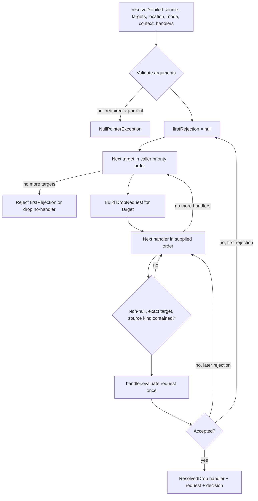
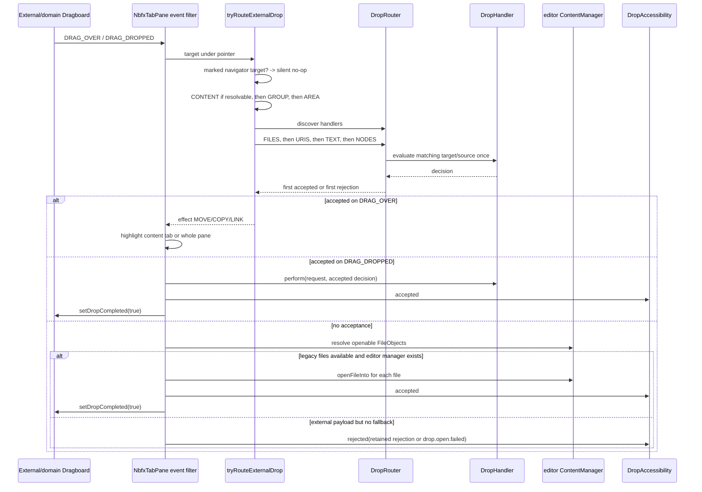

<!--

    Licensed to the Apache Software Foundation (ASF) under one
    or more contributor license agreements.  See the NOTICE file
    distributed with this work for additional information
    regarding copyright ownership.  The ASF licenses this file
    to you under the Apache License, Version 2.0 (the
    "License"); you may not use this file except in compliance
    with the License.  You may obtain a copy of the License at

      http://www.apache.org/licenses/LICENSE-2.0

    Unless required by applicable law or agreed to in writing,
    software distributed under the License is distributed on an
    "AS IS" BASIS, WITHOUT WARRANTIES OR CONDITIONS OF ANY
    KIND, either express or implied.  See the License for the
    specific language governing permissions and limitations
    under the License.

-->
# 20. Drag and drop

This chapter separates three mechanisms that share the word “drop” but are not one pipeline:

1. internal tab gestures reorder, split, or float JavaFX `Tab` objects;
2. external/domain gestures over `NbfxTabPane` may route through `DropHandler`;
3. navigator-owned file targets keep their own behavior and are explicitly excluded from pane routing.

Navigation: [previous: content, view, and editor lifecycle](19-content-view-and-editor-lifecycle.md) ·
[next: threading, focus, and accessibility](21-threading-focus-and-accessibility.md) · [manual home](README.md)

## 20.1 Current status

| Area | Status | Baseline behavior |
|---|---|---|
| Neutral transfer/target/request/decision/handler API | **Implemented** | Public `api.content` contracts with validation. |
| `DropRouter` discovery and deterministic first-accept routing | **Implemented** | Global services first, then layer handlers; target order is caller-supplied. |
| `@DropRegistration` layer generation | **Implemented** | Compile-time validation and `NbFx/DropHandlers` entries. |
| External drag routing over shell tab panes | **Implemented** | Files/URIs/text/node gestures are tried before legacy file-open fallback. |
| Internal tab reorder/split/float | **Legacy** | Direct `Tab`/`DockArea` implementation, not generic `Content` transfer. |
| File-open fallback | **Legacy** | Opens files through the editor-specific `ContentManager`. |
| Keyboard move alternative | **Implemented** | `TabMover` supports join/split/area candidates with arrows, Enter, Escape. |
| Drop result accessible announcements | **Implemented** | Accepted/rejected external results update accessible text/help. |
| Pointer tab drags using `DockPolicy` | **Target only** | Pointer tab drags bypass `DropRouter` and `DefaultWindowManager.canDock`. |
| Overlay/window/global target integration in the shell | **Target only** | Vocabulary exists; pane routing supplies only CONTENT/GROUP/AREA. |
| Rich node adaptation, keyboard drop-handler invocation, Escape cancellation for external drops | **Target only** | Current node adaptation is a conservative JavaFX-node payload; external Escape semantics are not implemented. |
| Full RTL/high-contrast/reduced-motion drop feedback | **Target only** | Current feedback is CSS/pseudo-class based; see [chapter 21](21-threading-focus-and-accessibility.md). |

## 20.2 Public transfer and drop contracts

All types below are in `org.netbeans.api.nbfx.content` unless noted.

### Source vocabulary

```java
public interface TransferSource {
    TransferKind kind();
    Lookup data();
}
```

`data()` must be non-null, but may be `Lookup.EMPTY`.

[`TransferKind`](../../../nbfx-platform/nbfx.api.content/src/org/netbeans/api/nbfx/content/TransferKind.java)
has built-ins `CONTENT`, `FILES`, `URIS`, `TEXT`, and `NODES`, with canonical values such as
`nbfx:files`. `TransferKind.of` accepts case-insensitive built-in short/canonical forms and namespaced
product kinds. Files and URIs are sources, not content kinds.

[`TransferMode`](../../../nbfx-platform/nbfx.api.content/src/org/netbeans/api/nbfx/content/TransferMode.java)
is the closed enum `MOVE`, `COPY`, `LINK`.

### Targets

```java
public record DropTarget(DropTargetKind kind, String id) {
    public static DropTarget global();
}
```

[`DropTargetKind`](../../../nbfx-platform/nbfx.api.content/src/org/netbeans/api/nbfx/content/DropTargetKind.java)
has `CONTENT`, `OVERLAY`, `GROUP`, `AREA`, `WINDOW`, and `GLOBAL`, plus namespaced product kinds.
The id is stable within its kind. `DropTarget.global()` is `GLOBAL` with an empty id. The record
rejects null kind/id but does not require a nonblank id for other target kinds.

Do not confuse this API record with
`org.netbeans.modules.nbfx.platform.workspace.DropTarget<N>`, the internal pointer-docking record
`(pane, side)` used by `DockArea` and `TabMover`.

### Request

[`DropRequest`](../../../nbfx-platform/nbfx.api.content/src/org/netbeans/api/nbfx/content/DropRequest.java)
is:

```java
public record DropRequest(
        TransferSource source,
        DropTarget target,
        Point2D location,
        TransferMode requestedMode,
        Lookup context) {}
```

- `source`, `target`, `requestedMode`, and `context` are required and non-null.
- `location` may be null for a keyboard-driven transfer that names its target/placement directly.
- For pointer drops the documented coordinate space is local to the target root.

### Decision and handler

[`DropDecision`](../../../nbfx-platform/nbfx.api.content/src/org/netbeans/api/nbfx/content/DropDecision.java)
is:

```java
public record DropDecision(
        boolean allowed,
        TransferMode effect,
        String reasonKey,
        DockPlacement placement) {}
```

Validation:

- Accepted decisions require a non-null effect; null `reasonKey` becomes `""`.
- Rejected decisions require a nonblank reason key. The static `reject` factories set effect to null.
- `placement` is optional for an accepted decision and may be supplied on a rejection to explain the
  intended destination. The record constructor does not clear a non-null effect on rejection or force
  a placement on acceptance; the static factories express the normal shapes.

Helpers:

```java
DropDecision.allow(TransferMode.COPY, DockPlacement.INTO_GROUP);
DropDecision.reject("drop.file.unsupported");
DropDecision.reject("drop.area.readonly", DockPlacement.INTO_GROUP);
```

[`DockPlacement`](../../../nbfx-platform/nbfx.api.content/src/org/netbeans/api/nbfx/content/DockPlacement.java)
is shared with docking: `INTO_GROUP`, `BEFORE`, `AFTER`, `TAB_STRIP`, split/edge placements, `FLOAT`,
and `NEW_WINDOW`.

[`DropHandler`](../../../nbfx-platform/nbfx.api.content/src/org/netbeans/api/nbfx/content/DropHandler.java)
is:

```java
public interface DropHandler {
    DropTarget target();
    Set<TransferKind> sourceKinds();
    DropDecision evaluate(DropRequest request);
    void perform(DropRequest request, DropDecision accepted);
}
```

`evaluate` must be pure and may run repeatedly during hover. `perform` runs once for an accepted
decision and must use that decision's effect and placement unchanged. Empty `sourceKinds()` means the
handler accepts no source; it is not a wildcard. There is no handler disposal method.

## 20.3 `@DropRegistration`: actual schema

The current annotation is **not** the shorter target sketch `@DropRegistration(target = ..., sources =
...)`.

```java
@DropRegistration(
        targetKind = "group",
        targetId = "nbfx:main",
        sources = {"files", "uris"},
        position = 42)
public final class DemoDropHandler implements DropHandler {
    public DemoDropHandler() { }
    // target(), sourceKinds(), evaluate(), perform()
}
```

[`DropRegistration`](../../../nbfx-platform/nbfx.api.content/src/org/netbeans/api/nbfx/content/DropRegistration.java)
is source-retained, type-targeted, and repeatable through `@DropRegistrations`.

Processor requirements in
[`DropRegistrationProcessor`](../../../nbfx-platform/nbfx.api.content/src/org/netbeans/modules/nbfx/api/content/processors/DropRegistrationProcessor.java):

- Annotated element must be a public, concrete, non-abstract class implementing `DropHandler`.
- A nested class must be static. An explicit constructor, if any, must be public and no-argument; an
  implicit default constructor is accepted.
- `targetKind` is canonicalized through `DropTargetKind.of`; invalid values fail compilation.
- `targetId` must be nonblank and is trimmed.
- Every `sources` entry is canonicalized through `TransferKind.of`, deduplicated, and sorted. Empty or
  invalid sources fail compilation.
- Duplicate registrations of the same class/target-kind/target-id in one compilation fail. Different
  source lists do not make that key distinct.
- `position` defaults to `Integer.MAX_VALUE`.

Each registration emits an instance file under `NbFx/DropHandlers` with this logical schema:

```xml
<file name="demo-DemoDropHandler-nbfx-group-nbfx-main.instance"
      instanceClass="demo.DemoDropHandler">
    <attr name="position" intvalue="42"/>
    <attr name="targetKind" stringvalue="nbfx:group"/>
    <attr name="targetId" stringvalue="nbfx:main"/>
    <attr name="sources" stringvalue="nbfx:files,nbfx:uris"/>
</file>
```

The filename is sanitized; the significant routing metadata is the attributes and the instance class.
The processor does not verify that the handler's runtime `target()`/`sourceKinds()` methods agree
with the annotation. `DropRouter` uses the runtime methods.

**Registration limitation:** the processor rejects blank `targetId`, so an annotation cannot directly
declare `DropTarget.global()` (whose id is empty). A global fallback can be supplied by a global
`DropHandler` service or hand-authored layer metadata.

## 20.4 `DropRouter` discovery and routing algorithm

[`DropRouter`](../../../nbfx-platform/nbfx.platform.content/src/org/netbeans/modules/nbfx/platform/content/DropRouter.java)
is an implementation-package utility, not public product API.

### Discovery

```text
discover()
  LinkedHashSet handlers
  add Lookup.getDefault().lookupAll(DropHandler.class)
  add Lookups.forPath("NbFx/DropHandlers").lookupAll(DropHandler.class)
  return immutable snapshot
```

Global services therefore precede layer handlers, and identity/equality duplicates are removed while
preserving first occurrence. Discovery happens on each shell routing attempt; there is no router
cache, invalidation model, or disposal pass.

### Resolution



`resolve(...)` returns only the accepted `Optional<ResolvedDrop>`. `resolveDetailed(...)` returns a
`Resolution` containing exactly one of:

- `resolved`: accepted handler/request/decision; or
- `rejection`: the **first** rejected decision in target-then-handler order, or
  `DropDecision.reject("drop.no-handler")` if no matching handler rejected.

Handlers with a null target/source-kind result can throw; the router does not isolate handler
exceptions. Null handlers, null targets in the target list, and null decisions are skipped. A handler
with the wrong target or source kind is not evaluated.

`ResolvedDrop` itself rejects a non-allowed decision, and `Resolution` rejects missing/double outcomes
or an allowed “rejection.”

**Coordinate limitation:** `resolveDetailed` requires non-null `location`, even though `DropRequest`
allows null for keyboard transfers. It also reuses the same point for every target without converting
between target roots. A custom caller must perform target-specific coordinate conversion itself.

## 20.5 Internal tab drags: separate legacy pipeline

An internal drag starts only from a tab header whose graphic is a `Label`:

1. `NbfxTabPane` generates a UUID, stores the `Tab` in a process-wide drag registry, and sets
   `tabDragInProgress`.
2. It shows one near-transparent `Stage` per screen to catch drops outside the application and prevent
   click-through.
3. It starts a JavaFX `MOVE` drag with private data format `application/x-nbfx-tab-id` and a string
   title; a snapshot is used as the drag view when available.
4. Pane event filters recognize the private format before content controls can consume it.
5. Over a pane tab strip, `TabDropIndicator` computes an insertion index and shows a placeholder tab.
6. Near a dock edge, `DockArea.dropTargetAt` chooses a split/edge target and draws a drop line.
7. Drop reorders within the same pane, moves the same `Tab` to another pane, splits a pane, or
   relocates a single-tab pane. It does not close/dispose/recreate content.
8. Drop on a screen overlay floats the tab into a detached pane whose top-left is the drop point
   minus `(450, 20)`, with default size `900 x 650`.
9. Drag done hides overlays/indicators, clears the tab's registry entries, and closes emptied
   detached windows. Window close is deferred while dragging because closing a native view mid-drag
   can crash Cocoa.

A same-pane no-op reorder is suppressed when the computed index is the current index or immediately
after it. A detached pane is not split by pointer drag. A pane's only tab dragged within itself has
no split target.

This path uses internal `Tab` and workspace `DropTarget` objects. It does **not** create a neutral
`TransferSource.CONTENT`, call `DropRouter`, or consult `DockPolicy`. Programmatic
`WindowManager.canDock/dock` policy behavior is documented in
[chapter 10](10-docking-requests-and-policies.md); pointer tab dragging does not inherit it in this
baseline.

## 20.6 External DropRouter pipeline over a tab pane

`NbfxTabPane.addFileDropHandlers` installs event filters for non-slide panes. The sliding panel has no
pane drop handlers because a dropped tab/file would be lost when the panel hides.



### Target order

For an `NbfxTabPane`, `dropTargetsFor` supplies at most:

1. `CONTENT` — only when the pick result is a real tab header and a content id can be resolved;
2. `GROUP` — always, using `NbfxTabPane.groupId().value()`;
3. `AREA` — always, using `NbfxTabPane.role().name()` such as `MAIN`.

There is no `OVERLAY`, `WINDOW`, or `GLOBAL` target in this shell-produced list. A plain JavaFX
`TabPane` produces an empty list and therefore no external routing.

Content ids are derived as follows:

- View tabs: `ContentId.of("nbfx:view." + viewId)` directly from the tab's view id.
- Editor tabs: look up `org.netbeans.api.nbfx.content.ContentManager` in `Lookup.getDefault()`, scan
  its open content for an `EditorContent` wrapping the same document, and use that adapter's id.

**Standard-shell editor CONTENT gap:** `ShellApplication` publishes its per-shell generic
`ContentManager` only in the shell lookup, not in global lookup. The global service normally used for
legacy file opening is the different `org.netbeans.api.nbfx.editor.ContentManager`
(`ContentManagerService`); it does not satisfy the fully qualified generic lookup above. Consequently,
standard editor tabs normally resolve no editor content id and contribute only GROUP/AREA targets,
not CONTENT. View tabs can still contribute CONTENT without a manager lookup. A product that publishes
the same generic manager globally can enable editor CONTENT targets, but that introduces global,
cross-shell ownership and is not the standard composition.

The view path does not use `ViewContent`'s sanitization helper. A view id containing characters that
are invalid in a content id can make `ContentId.of` throw while constructing targets.

### Source order and payload adaptation

The shell tries sources in this exact order, stopping at the first accepted handler:

| Order | `TransferKind` | Detection | `TransferSource.data()` | Requested mode/context |
|---:|---|---|---|---|
| 1 | `FILES` | `FileDragAndDrop.hasFiles(db)` and nonempty `db.getFiles()` | `Lookups.fixed` of the dragboard's `File` objects | `COPY`, `Lookup.EMPTY` |
| 2 | `URIS` | `db.hasUrl()` and nonblank `db.getUrl()` | Lookup containing the URL string | `COPY`, `Lookup.EMPTY` |
| 3 | `TEXT` | `db.hasString()` and nonempty string | Lookup containing the text | `COPY`, `Lookup.EMPTY` |
| 4 | `NODES` | gesture source is a JavaFX `Node` and this is not an internal tab drag | Lookup containing the source node, then URL/text if present | `COPY`, `Lookup.EMPTY` |

The location is `tabPane.sceneToLocal(event.getSceneX(), event.getSceneY())`, with event-local
coordinates as a fallback. The router receives one tab-pane-local point for all targets.

Important limitations:

- The shell always requests `COPY`; it does not translate JavaFX modifier keys into neutral MOVE/LINK.
- `context` is always `Lookup.EMPTY`; selected content, shell services, and action metadata are not
  supplied to the handler.
- Internal navigator file drags use private format `application/x-nbfx-files`. `hasFiles` sees them,
  but `db.getFiles()` is empty, so they do not become a neutral FILES source. They can still use the
  legacy file-open fallback.
- NODES is not a `NodeModel`/selection adapter. It exposes the JavaFX gesture-source node plus any
  URL/text. Multi-selection order and domain-node semantics are not reconstructed.
- A drag carrying files and text can evaluate FILES handlers first, then URIS/TEXT/NODES handlers if
  all FILES handlers reject. The earliest non-null resolution rejection is retained. Because
  `resolveDetailed` always returns a rejection, including synthetic `drop.no-handler` when no handler
  matches, a FILES attempt with no matching handler can mask a later real URIS/TEXT/NODES rejection.

### Navigator-owned targets

`FileDragAndDrop.markDropTarget(node)` marks a node/ancestor as owning file drops. If the event target
is within such a node, `tryRouteExternalDrop` and `openableFilesOf` both leave the gesture alone. This
lets navigator trees import files into their own folders instead of the editor pane opening them.

The private internal file format deliberately prevents dropping nbfx navigator files into another
application. External Finder/Explorer files use the standard JavaFX file list.

## 20.7 Acceptance, rejection, and legacy fallback

### Handler acceptance

On DRAG_OVER, an accepted decision:

- maps neutral MOVE/COPY/LINK to the corresponding single JavaFX transfer mode;
- highlights the matching tab for CONTENT or the whole pane for GROUP/AREA;
- consumes the event so content controls do not swallow it.

On DRAG_DROPPED, routing runs again. The shell calls:

```java
drop.handler().perform(drop.request(), drop.decision());
```

then announces acceptance and sets drop completed. The decision from the drop-time evaluation is
authoritative; a hover decision is not cached. Because `perform` returns void, the shell announces
acceptance even if the handler's implementation does nothing. An exception from `evaluate` or
`perform` is not caught by this pipeline, so announcement/completion may not occur.

### Rejection

A handler rejection does not immediately terminate the gesture. The router continues to other
handlers/targets/source kinds. If none accepts, the shell tries the legacy file fallback. Thus an
openable file may still open even though a FILES handler rejected it; the handler rejection is only
announced if there is no successful fallback.

If no handler matches or all reject, `resolveDetailed` supplies a rejection for that source attempt.
Across source attempts, the shell retains the earliest non-null result; this may be a synthetic
`drop.no-handler` from an earlier FILES/URI/TEXT attempt even when a later source has a more specific
real rejection. There is no visual rejection reason on hover; feedback is primarily the absence of an
accepted highlight plus the post-drop announcement.

### Legacy file-open fallback

`openableFilesOf`:

1. requires a file payload;
2. excludes navigator-owned targets;
3. resolves/caches `FileObject`s on the pane;
4. keeps only `FileTypes.isOpenable` files.

Folders, binary/unopenable files, and unresolved paths are omitted. If at least one file remains and
the global editor `ContentManager` exists, each is opened through `openFileInto`:

- an already-open file is revealed/selected and is not moved by `openFileInto`;
- for a new file, the editor manager chooses its initial pane with
  `NbfxTabPane.editorHome(mainPane, editorContext)`: the active document's eligible showing pane when
  available, otherwise a fallback docked editor pane when the main pane is not in the dock area, and
  finally the main pane;
- `openFileInto` queues a later FX pulse and moves/selects the new tab in the drop pane only if the
  created tab is not already there;
- the pane announces acceptance and sets drop completed when the manager exists.

If the editor manager is missing, the reason is `drop.open.failed`. If it exists but cannot create a
particular editor (for example no `EditorService`), `openFile` logs and returns; the drop pipeline has
no per-file success result and may still announce acceptance. Unopenable members of a mixed file list
are silently skipped.

## 20.8 Highlighting and accessible announcements

### Visual feedback

[`TabDropIndicator`](../../../nbfx-platform/nbfx.platform.shell/src/org/netbeans/modules/nbfx/platform/shell/TabDropIndicator.java)
provides:

| Gesture/target | Feedback |
|---|---|
| Internal tab joining a pane | `:drop-target` pane pseudo-class and temporary non-closable `nbfx-placeholder-tab` at the insertion index |
| Internal split/edge | Pane highlight is cleared; `DockArea` draws the split/edge line |
| Accepted CONTENT handler | Adds `nbfx-drop-content-target` to the exact tab header |
| Accepted GROUP/AREA handler or legacy file | `:drop-target` on the pane, no placeholder |
| Exit/drag done/drop | Hides line/header class and removes placeholder |

CONTENT highlighting is available for view headers and for editor headers only when the generic
manager is globally published as described in the target-order gap above; standard editor headers
normally use the whole-pane GROUP/AREA highlight.

The placeholder uses a scaled transparent snapshot of the dragged tab label when available. Header
lookup is based on JavaFX skin style classes (`tab`, `tab-container`, `headers-region`) and excludes
placeholder tabs. Skin changes can therefore affect hit-testing.

### Screen-reader result announcements

[`DropAccessibility`](../../../nbfx-platform/nbfx.platform.shell/src/org/netbeans/modules/nbfx/platform/shell/DropAccessibility.java)
uses JavaFX accessible-attribute notifications, not a dedicated ARIA live region:

- If the pane has no accessible text, the result becomes `accessibleText` and `TEXT` is notified.
- Otherwise the existing accessible text is preserved, the result becomes `accessibleHelp`, and `HELP`
  is notified.
- Accepted: `Drop accepted.`
- Rejected: `Drop rejected: <reason>.`
- `drop.no-handler` becomes `no handler accepts this item`.
- `drop.open.failed` becomes `no content host is available`.
- Any other reason key is inserted verbatim; there is no bundle lookup for product reason keys.

Internal tab drags and navigator-owned drop targets are intentionally silent. A no-handler external
gesture is announced only when it has a recognized external payload/attempt. The implementation test
is [`DropAccessibilityTest`](../../../nbfx-platform/nbfx.platform.shell/test/unit/src/org/netbeans/modules/nbfx/platform/shell/DropAccessibilityTest.java).

## 20.9 Keyboard move alternative

[`TabMover`](../../../nbfx-platform/nbfx.platform.shell/src/org/netbeans/modules/nbfx/platform/shell/TabMover.java)
is launched by the tab context menu's Move/Move Group commands. It is a move UI, not an external
`DropHandler` keyboard protocol.

```text
Start: install scene key/mouse filters, focus window, show first candidate
Arrow keys: choose nearest candidate in that direction
Enter: perform join/move/split and clear filters/line
Escape or mouse press: cancel without moving
```

Candidates include joining each other pane, splitting beside eligible panes, and docking along the
four area edges when more than one leaf exists. Moving a single-tab pane avoids a meaningless
self-split. Moving a detached group either joins its tabs into another pane or creates a new main-area
pane and closes the detached window.

## 20.10 Copyable handler example

This handler matches the runtime GROUP id for the standard main pane. It uses the actual annotation
schema and preserves the accepted decision.

```java
package example.drop;

import java.io.File;
import java.util.List;
import java.util.Set;
import javafx.scene.control.Label;
import org.netbeans.api.nbfx.content.*;
import org.openide.util.Lookup;

@DropRegistration(
        targetKind = "group",
        targetId = "nbfx:main",
        sources = {"files", "uris"},
        position = 100)
public final class ImportDropHandler implements DropHandler {

    private static final DropTarget TARGET =
            new DropTarget(DropTargetKind.GROUP, "nbfx:main");

    @Override public DropTarget target() { return TARGET; }

    @Override public Set<TransferKind> sourceKinds() {
        return Set.of(TransferKind.FILES, TransferKind.URIS);
    }

    @Override public DropDecision evaluate(DropRequest request) {
        if (request.source().kind() == TransferKind.FILES) {
            List<File> files = request.source().data().lookupAll(File.class);
            if (files.isEmpty()) {
                return DropDecision.reject("example.drop.noFiles",
                        DockPlacement.INTO_GROUP);
            }
        } else if (request.source().data().lookup(String.class) == null) {
            return DropDecision.reject("example.drop.noUri",
                    DockPlacement.INTO_GROUP);
        }
        return DropDecision.allow(request.requestedMode(), DockPlacement.INTO_GROUP);
    }

    @Override public void perform(DropRequest request, DropDecision accepted) {
        // Use accepted.effect() and accepted.placement(); do not recompute another effect.
        // UI mutation belongs on the FX thread. Blocking import work belongs off it.
        String summary = accepted.effect() + " into " + accepted.placement();
        System.out.println(summary + ": " + request.source().data().lookupAll(Object.class));
    }
}
```

The shell will display `example.drop.noFiles`/`example.drop.noUri` verbatim in a rejection
announcement. `DropAccessibility` is package-private and `final`, with static package-private methods,
so products cannot extend or call it. Only `drop.no-handler` and `drop.open.failed` receive platform
bundle localization; products can use those recognized keys for standard localized copy. Localizing
arbitrary product reason keys requires a platform change and is **Target only**.

A custom host can call `DropRouter` directly, but must supply a non-null point even for a keyboard
transfer and must convert coordinates for each target root. `DropRouter` and `DefaultContentManager`
are implementation types, so this is an internal/custom-host technique rather than an API-only
product recipe.

## 20.11 Errors and ownership checklist

- **Compile time:** invalid handler type/constructor, invalid target/source token, empty sources, blank
  target id, or duplicate class/target registration fails annotation processing.
- **Routing time:** null required router arguments throw `NullPointerException`; no matching handler
  yields `drop.no-handler`; handler exceptions are not isolated.
- **Construction time:** a view tab with an unsafe id can throw while the shell derives its CONTENT
  target id.
- **Drop time:** a handler's `perform` owns its mutation and error reporting. The shell does not roll
  back partial work or verify completion.
- **Ownership:** internal tab moves preserve the same `Tab`/node. External handlers own their source
  data interpretation and must honor MOVE/COPY/LINK. The shell does not remove a source after a
  handler accepts.
- **Disposal:** discovered handlers have no lifecycle/disposal hook. Per-target caches for resolved
  files live in node properties; drag registry entries are cleared on drag done. Screen-overlay
  stages are created lazily per screen and hidden after a drag, not disposed, and the static overlay
  drop handler remains installed for the process lifetime.

## 20.12 Source and test map

### Implementing source

- [`TransferKind`](../../../nbfx-platform/nbfx.api.content/src/org/netbeans/api/nbfx/content/TransferKind.java),
  [`TransferMode`](../../../nbfx-platform/nbfx.api.content/src/org/netbeans/api/nbfx/content/TransferMode.java),
  [`TransferSource`](../../../nbfx-platform/nbfx.api.content/src/org/netbeans/api/nbfx/content/TransferSource.java)
- [`DropTargetKind`](../../../nbfx-platform/nbfx.api.content/src/org/netbeans/api/nbfx/content/DropTargetKind.java),
  [`DropTarget`](../../../nbfx-platform/nbfx.api.content/src/org/netbeans/api/nbfx/content/DropTarget.java),
  [`DropRequest`](../../../nbfx-platform/nbfx.api.content/src/org/netbeans/api/nbfx/content/DropRequest.java),
  [`DropDecision`](../../../nbfx-platform/nbfx.api.content/src/org/netbeans/api/nbfx/content/DropDecision.java),
  [`DropHandler`](../../../nbfx-platform/nbfx.api.content/src/org/netbeans/api/nbfx/content/DropHandler.java)
- [`DropRegistration`](../../../nbfx-platform/nbfx.api.content/src/org/netbeans/api/nbfx/content/DropRegistration.java),
  [`DropRegistrationProcessor`](../../../nbfx-platform/nbfx.api.content/src/org/netbeans/modules/nbfx/api/content/processors/DropRegistrationProcessor.java)
- [`DropRouter`](../../../nbfx-platform/nbfx.platform.content/src/org/netbeans/modules/nbfx/platform/content/DropRouter.java)
- [`NbfxTabPane`](../../../nbfx-platform/nbfx.platform.shell/src/org/netbeans/modules/nbfx/platform/shell/NbfxTabPane.java)
  (internal drag handlers and `tryRouteExternalDrop`),
  [`FileDragAndDrop`](../../../nbfx-platform/nbfx.platform.shell/src/org/netbeans/modules/nbfx/platform/shell/FileDragAndDrop.java)
- [`TabDropIndicator`](../../../nbfx-platform/nbfx.platform.shell/src/org/netbeans/modules/nbfx/platform/shell/TabDropIndicator.java),
  [`TabDragOverlays`](../../../nbfx-platform/nbfx.platform.shell/src/org/netbeans/modules/nbfx/platform/shell/TabDragOverlays.java),
  [`TabMover`](../../../nbfx-platform/nbfx.platform.shell/src/org/netbeans/modules/nbfx/platform/shell/TabMover.java)
- [`DropAccessibility`](../../../nbfx-platform/nbfx.platform.shell/src/org/netbeans/modules/nbfx/platform/shell/DropAccessibility.java)

### Tests

- [`DropRouterTest`](../../../nbfx-platform/nbfx.platform.content/test/unit/src/org/netbeans/modules/nbfx/platform/content/DropRouterTest.java)
  covers priority, all source kinds, authoritative effect, first rejection, no-handler reason, and
  wrong-kind skipping.
- [`DropRegistrationProcessorTest`](../../../nbfx-platform/nbfx.api.content/test/unit/src/org/netbeans/api/nbfx/content/DropRegistrationProcessorTest.java)
  covers generated attributes, invalid sources, duplicate registration, and processor discovery.
- [`DropAccessibilityTest`](../../../nbfx-platform/nbfx.platform.shell/test/unit/src/org/netbeans/modules/nbfx/platform/shell/DropAccessibilityTest.java)
  covers accepted/rejected messages and preservation of existing accessible text.

There is no dedicated end-to-end JavaFX dragboard integration test for `tryRouteExternalDrop`, the
legacy fallback, placeholder highlighting, or screen-overlay floating in this baseline.

## 20.13 Current vs target

The [target drag-and-drop reference](../../reference/cjap-shell-ui.md#18-drag-and-drop) requires
internal content/group drags to use docking policy, external/domain drags to route through
content/overlay/group/area/global handlers, Escape cancellation, ordered multi-selection, non-color
rejection reasons, and keyboard/command equivalents for every operation.

The baseline has the neutral contracts, deterministic handler routing, pane integration, file fallback,
visual feedback, announcements, and a keyboard move UI. It does not unify internal tab drags with
`DockPolicy`, does not integrate the full target chain, and does not implement the complete node,
Escape, keyboard-drop, localization, or accessibility semantics. The shell-local generic manager also
leaves standard editor headers without CONTENT targets unless a product publishes that manager
globally.

Next: [21. Threading, focus, and accessibility](21-threading-focus-and-accessibility.md).
