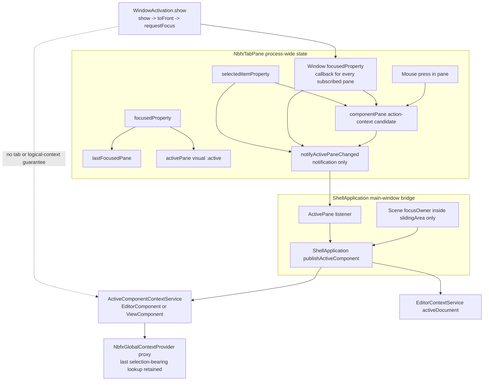

<!--

    Licensed to the Apache Software Foundation (ASF) under one
    or more contributor license agreements.  See the NOTICE file
    distributed with this work for additional information
    regarding copyright ownership.  The ASF licenses this file
    to you under the Apache License, Version 2.0 (the
    "License"); you may not use this file except in compliance
    with the License.  You may obtain a copy of the License at

      http://www.apache.org/licenses/LICENSE-2.0

    Unless required by applicable law or agreed to in writing,
    software distributed under the License is distributed on an
    "AS IS" BASIS, WITHOUT WARRANTIES OR CONDITIONS OF ANY
    KIND, either express or implied.  See the License for the
    specific language governing permissions and limitations
    under the License.

-->
# 21. Threading, focus, and accessibility

The baseline has a clear FX-thread rule, a few deliberate headless/persistence exceptions, and a
process-wide active-component bridge. It does not yet have the target `FocusController` or its
three-fact focus model.

Navigation: [previous: drag and drop](20-drag-and-drop.md) ·
[next: product integration recipes](22-product-integration-recipes.md) · [manual home](README.md)

## 21.1 Current status

| Area | Status | Baseline behavior |
|---|---|---|
| JavaFX scene/window mutation on the FX Application Thread | **Implemented** | Shell startup, frame/region lifecycle, docking, view, contribution, and focus paths are FX-owned. |
| `DefaultContentManager` usable headlessly from any thread | **Implemented** | Public methods are synchronized; live-shell callers still must use FX. |
| `ContentStateStore` persistence independent of JavaFX nodes | **Implemented** | Synchronized preferences access; not wired into shell persistence. |
| `AppState.save()` from a JVM shutdown hook | **Implemented** | Uses volatile snapshots, an atomic once guard, and preferences flush. |
| Normal shutdown cleanup off the FX thread | **Implemented** | `requestQuit` runs coordinator cleanup asynchronously with a 30-second timeout. |
| Last-resort shutdown cleanup | **Legacy** | `stop()` invokes it synchronously on FX when normal quit was bypassed. |
| Active view/editor action-context bridge | **Implemented** | `ShellApplication` publishes to global `ActiveComponentContext` from `NbfxTabPane` notifications; a proxy feeds global action lookup. |
| `DockWindow.show` best-effort activation | **Implemented** | Main/floating/custom handles call `WindowActivation.show`: `show`, `toFront`, `requestFocus`; no logical-context guarantee. |
| Separate OS activation, logical selection, and keyboard focus | **Target only** | No `FocusController`; current state is split among static pane fields and JavaFX properties. |
| Per-window focus scope and deterministic multiwindow restoration | **Target only** | Shell and several tab registries are one-per-JVM; restoration is heuristic. |
| Shell region roles/names and external drop announcements | **Implemented** | Hard-coded English region labels; menu/toolbar roles; accessible text/help notifications. |
| Complete tab/split/float/empty-state accessibility | **Partial** | JavaFX control defaults exist, but there is no comprehensive shell a11y contract or audit. |
| RTL mirroring of logical placement/drop affordances | **Target only** | Logical `START`/`END` values exist; no shell code reads node orientation or mirrors sides. |
| High-contrast support | **Partial** | A selectable bundled `high-contrast` theme exists; no automatic OS high-contrast policy or validated fallback. |
| Reduced-motion support | **Target only** | No reduced-motion setting; slide fade/delays remain, although tab open/close animations are disabled. |

## 21.2 FX-thread rule and enforcement points

The practical rule is: **create or mutate JavaFX nodes, scenes, windows, controls, focus, or FX
properties on the JavaFX Application Thread.** Background work may prepare immutable data and must
hand results back with `Platform.runLater`.

| Operation | Current rule/enforcement |
|---|---|
| `ShellApplication.start`/`stop` | JavaFX `Application` lifecycle; FX thread. |
| `ShellProvider.create(ShellContext, ShellChromeProfile)` | Called on FX after runtime services are published. |
| `ShellFrame.setDockRoot` / `DefaultShellFrame.close` | Explicit `Platform.isFxApplicationThread()` check; throws `IllegalStateException` off FX. |
| `ShellRegionHost.mount/update/dispose/close` | Explicit FX check with message `Shell region lifecycle requires the JavaFX Application Thread`. |
| `ShellContribution.create/dispose` | Contract requires FX; host calls them on FX. |
| `WindowManager` operations that change the scene graph | API documents FX requirement; implementation does not marshal or consistently pre-check. |
| `DockWindow.show` | Calls `WindowActivation.show` on FX: `Stage.show`, `toFront`, then `requestFocus`. OS activation remains best effort. |
| `ViewManager.show/hide` | FX requirement; tab creation/removal and focus are immediate or `Platform.runLater` deferred. |
| `Command.run` | API contract says FX. Long work must be moved to a worker by the command. |
| Tab drag/drop, `TabMover`, accessible announcements | JavaFX event/filter paths; FX. |
| `EditorDocument.requestFocus` and view-node focus | Deferred with `Platform.runLater` by `NbfxTabPane.focusDocument`. |
| Programmatic status elements | `StatusElementSupport.runOnFxThread` executes immediately on FX, otherwise queues. |

There is no universal shell dispatcher. Calling a scene-mutating API from a worker is not made safe by
the API's existence; products must dispatch explicitly.

## 21.3 Headless and persistence exceptions

### `DefaultContentManager`

The implementation synchronizes `open`, `close`, `find`, and `openContent`, so a headless unit test can
use one manager from any thread without starting JavaFX. `activeContent()` exposes a JavaFX
`ReadOnlyObjectWrapper`; the manager does not ensure property listeners run on FX.

Use the exception for headless model tests, not as permission to mutate live content nodes or observe
FX properties from workers. In a running shell, call the manager on FX.

### `ContentStateStore`

`ContentStateStore` synchronizes save/load/loadAll/remove/clear and contains no scene-graph access. It
uses `java.util.prefs.Preferences`, SHA-256, and Base64. It can run off FX, but it is an implementation
type and is not currently constructed by the shell. Corrupt Base64 can throw
`IllegalArgumentException`; callers need their own containment if they use the store directly.

### `AppState`

[`AppState`](../../../nbfx-platform/nbfx.platform.shell/src/org/netbeans/modules/nbfx/platform/shell/AppState.java)
keeps toolbar/view settings in volatile snapshots updated by FX listeners. `save()`:

1. uses `AtomicBoolean.compareAndSet(false, true)` so it saves at most once;
2. reads only the snapshot, not live nodes;
3. writes preferences and calls `flush`;
4. logs runtime persistence failures.

A JVM shutdown hook named `nbfx-state-save` calls this method as a safety net. Custom-window bounds
are flushed immediately when hide/close requests them. The once guard also means a later `save()`
does not write subsequent changes; products should not treat `AppState` as a general repeated-save
API.

### Pure model and resolver APIs

Content ids/kinds/state/requirements, layout values, profile metadata, and `ShellProfileResolver` are
safe to construct/evaluate without touching a scene. `ShellProfileResolver` performs no global lookup
or window operation. `WindowOptions` can carry a JavaFX `Window` owner, so passing it around does not
make window access thread-safe.

### Annotation processors

Registration processors run in `javac`, not on the FX thread:

| Processor | Output/validation |
|---|---|
| `ActionRegistrationProcessor` | `NbFx/Actions`, menu/toolbar/context/shell-region references; file-safe ids, public no-arg `Command`, profile/hint validation. |
| `ShellRegionRegistrationProcessor` | Region metadata under `NbFx/ShellRegions`; declaration classes are not instantiated. |
| `ShellContributionRegistrationProcessor` | Per-mount contribution instances and placement/profile metadata. |
| `ShellProfileRegistrationProcessor` | Profile metadata under `NbFx/ShellProfiles`. |
| `ViewRegistrationProcessor` | View metadata under `NbFx/Views`. |
| `DropRegistrationProcessor` | Handler instances under `NbFx/DropHandlers`; target/source metadata. |

Compilation failures are deterministic configuration errors. At runtime, region/contribution/action
instantiation that creates nodes occurs through the FX-owned mount path. Layer discovery itself does
not create nodes. See [chapter 24](24-annotations-and-layer-schema.md) for the complete schema.

## 21.4 Background shutdown

The normal close path deliberately separates UI confirmation from potentially blocking cleanup.

```mermaid
sequenceDiagram
    participant UI as FX thread / ShellApplication
    participant User
    participant Coord as ShutdownCoordinatorService
    participant Worker as CompletableFuture worker
    participant Part as ShutdownParticipants

    UI->>UI: confirmClose()
    UI->>Coord: impact()
    Coord->>Part: contributeImpact in position order (must not block remotely)
    Coord-->>UI: ShutdownImpact
    UI->>User: confirm(impact) when nonempty
    User-->>UI: selection or cancel
    alt cancel
        UI-->>UI: consume close request; keep window open
    else proceed
        UI->>UI: captureSession(); if shown, windowSystem.save()
        UI->>UI: root.setDisable(true); shutdownStarted = true
        UI->>Worker: runAsync(coordinator.shutdown(selection))
        Worker->>Part: shutdown in position order (blocking allowed)
        Worker-->>UI: completion, failure, or 30-second timeout
        UI->>UI: log failure/timeout
        UI->>UI: Platform.runLater(shutdownCompleted = true; Platform.exit())
    end
```

Current details:

- `impact()` and `confirm(...)` run on FX and may show UI.
- `contributeImpact` must not block on remote work. Participant runtime exceptions are logged and do
  not prevent other impact descriptions.
- `shutdown(selection)` normally runs on the default asynchronous worker. Participants are sorted by
  ascending `position()`; one participant's exception is logged and the rest continue.
- The service has an `AtomicBoolean completed` guard, so repeated shutdown calls are no-ops.
- The shell bounds the asynchronous stage with `orTimeout(30, TimeUnit.SECONDS)`. Timeout does not
  forcibly stop a blocked participant thread; it allows the completion callback to schedule exit.
- After cleanup starts, the shell root is disabled to prevent edits during the save/exit gap.
- Close confirmation, impact/selection, `captureSession()`, and (when shown) `windowSystem.save()`
  execute on FX before the asynchronous participant phase. The baseline does not move all persistence
  I/O off FX.
- `appState.save()` is not part of that pre-participant `requestQuit` sequence. It runs later in
  `stop()` and from the installed JVM shutdown hook.
- With no coordinator, `requestQuit` calls `Platform.exit()` directly after confirmation and session/
  window-system save.
- `stop()` is the last-resort path. If normal shutdown did not complete, it calls
  `shutdownWithoutConfirmation()` synchronously on FX with default or previously selected cleanup.
  This can block and contradicts the normal off-FX participant expectation; the API documents the
  exception.

A participant should not assume JavaFX is available in normal `shutdown`. If it must update a still
visible UI, it can queue `Platform.runLater`, but that work may not run before exit. Durable cleanup
should be thread-safe and independent of the scene graph.

## 21.5 Current focus and active-component bridge

### Current ownership diagram



`NbfxTabPane` maintains three related but different pane references:

- `lastFocusedPane`: last pane whose focus was entered; used to restore focus when its window becomes
  focused again.
- `activePane`: visual `:active` pane styling.
- `componentPane`: selected-tab candidate for action context; follows selection and mouse presses,
  which can happen before focus enters the new pane. `ShellApplication`, not `NbfxTabPane`, performs
  the actual `ActiveComponentContext` publication.

Selection changes, mouse presses that change `componentPane`, and window-focus callbacks notify
active-pane listeners. A pane's `focusedProperty` callback updates `componentPane` and requests
content focus; the shell's main-scene focus-owner bridge handles publication for that path. On window
focus, every subscribed pane callback sets `componentPane` and notifies the shell, so final
active-component publication depends on callback registration order rather than being guaranteed to
use `lastFocusedPane`. Only document-focus restoration is gated by `isLastFocused`, avoiding every
pane stealing focus on activation.

### Shell bridge algorithm

After the main scene is shown, `ShellApplication.installActiveComponentBridge`:

1. looks up global `ActiveComponentContext`; if absent, installs nothing;
2. registers an active-pane listener;
3. subscribes to the main scene's `focusOwnerProperty`;
4. on a non-null focus owner inside the main `slidingArea`, republishes
   `NbfxTabPane.focusedPane()`;
5. publishes the current `componentPane` initially.

`publishActiveComponent` examines the pane's selected tab:

- focused half of a split editor -> `ActiveComponent.EditorComponent(document)` and
  `EditorContext.setActiveDocument(document)`;
- otherwise a view -> `ActiveComponent.ViewComponent(view)`;
- otherwise null -> clears active component and editor active document.

The view branch does **not** explicitly clear `EditorContext.activeDocument`. Consumers should use
`ActiveComponentContext` for the current view/editor, not assume the editor active-document property
is null whenever a view is active.

### Global action context

[`NbfxGlobalContextProvider`](../../../nbfx-platform/nbfx.platform.shell/src/org/netbeans/modules/nbfx/platform/shell/NbfxGlobalContextProvider.java)
creates a stable proxy lookup over the active component:

- editor component -> document lookup, also remembered as last selection;
- view component with a nonempty lookup -> view lookup, also remembered;
- view with empty lookup -> keep the last selection-bearing lookup;
- no remembered selection -> `Lookup.EMPTY`.

“Nonempty” means `lookup.lookup(Object.class) != null`. This prevents a follower view from blanking
selection, but it also means a view carrying only objects not visible through that query may be
treated as empty.

### What is missing: the target three-fact model

No source or test defines a `FocusController`. The
[target reference](../../reference/cjap-shell-ui.md#focus-and-action-context) requires three separate
facts:

```text
1. OS-window activation
2. Logical selection: active window -> group -> content
3. Keyboard focus owner
```

with precedence:

```text
interactive transient UI
  > keyboard-focused content/overlay
  > selected content in active group
  > active group/window
  > application-global context
```

The baseline approximates these with JavaFX window/focus properties, static pane references, and one
global active-component property. It does not publish a per-window/group/content focus scope, does not
model temporary menu/palette/overlay lookup precedence, and does not guarantee deterministic focus
restoration after every float/redock/close/overlay dismissal.

The shell, `NbfxTabPane` registries, `ActiveComponentContextService`, and `EditorContextService` are
one-per-JVM/global-service designs. Running two independent shells in one JVM is not a supported
focus-isolation scenario.

## 21.6 Focus behavior and product responsibilities

- Selecting a tab focuses an editor through `EditorDocument.requestFocus`; other content is focused
  directly if traversable, otherwise the pane is focused only when focus is outside it.
- Requests are queued with `Platform.runLater` and rechecked to reduce focus stealing.
- `MainDockWindow.show`, `FloatingWindow.show`, and `CustomWindow.show` delegate to
  `WindowActivation.show(stage)`, which calls `show()`, `toFront()`, then `requestFocus()`. This is
  best-effort OS/window activation only; it does not select a tab, publish logical group/content
  context, or provide a `FocusController` guarantee.
- Initial floating creation uses `NbfxTabPane.showDetachedPane`, which calls `stage.show()` directly.
  Repeating `floatContent`/`floatGroup` for an already-floating pane returns the existing handle and
  calls its `show()` helper instead.
- `TabMover` cancels on Escape, mouse press, or window focus loss. Cancellation removes the scene
  key/mouse filters and window-focus listener, hides the drop line/frame, and clears the active mover.
- Clicking a different pane causes the `ShellApplication` bridge to publish its selected tab even
  when that tab's selection does not change; clicking the already-current `componentPane` does not
  emit another active-pane notification.
- Reactivating a window notifies every subscribed pane; the final `ActiveComponentContext` therefore
  depends on callback registration order. Document-focus restoration is attempted only for
  `lastFocusedPane`.
- Sliding-pane selection deliberately does not activate/focus content; a click/reveal is required.
- Internal tab move/float paths select/front the destination where appropriate, but there is no
  central focus controller recording a full restoration stack.
- Custom frames still use the shell's main-scene/dock bridge. A custom shell must not install a second
  competing global active-component publisher without coordinating ownership.
- Product nodes must implement sensible focus traversal, accessible names/roles, and selection state.
  The shell cannot infer these from an arbitrary `Content.node()`.

## 21.7 Current accessibility semantics

### Shell frame and regions

[`DefaultShellFrame`](../../../nbfx-platform/nbfx.platform.shell/src/org/netbeans/modules/nbfx/platform/shell/DefaultShellFrame.java)
assigns accessible text `Shell`, `Shell content`, `Shell overlays`, and `Shell top`. Its overlay
`StackPane` has `pickOnBounds == false` so an empty overlay does not intercept pointer input.

[`ShellRegionHostImpl`](../../../nbfx-platform/nbfx.platform.shell/src/org/netbeans/modules/nbfx/platform/shell/ShellRegionHostImpl.java)
assigns the following hard-coded English accessible names:

| Region kind | Accessible name | Explicit accessible role |
|---|---|---|
| `BRAND` | `Brand` | none |
| `MENUBAR` | `Menu bar` | `MENU_BAR` |
| `TOOLBAR` | `Tool bar` | `TOOL_BAR` |
| `RIBBON` | `Ribbon` | none |
| `DOCK` | `Docking area` | none |
| `STATUS` | `Status bar` | none |
| `OVERLAY` | `Overlay` | none |
| Product kind | `Shell region` | none |

Names are not bundle keys and `ShellRegionSpec` has no accessible-name field. A custom frame using
the runtime host inherits these names; it may adjust the mounted node only if it preserves host
ownership and update/dispose behavior.

Shell-region action buttons receive their visible text as accessible text. Toolbar bars receive the
folder's `displayName` or id as accessible text. Menu/toolbar JavaFX controls supply their standard
control semantics.

### Tabs, splitters, floating controls, and drop feedback

- Tabs use JavaFX `Tab`/`TabPane` semantics. The shell does not explicitly assign accessible roles or
  names to tab headers, split panes, minimize/maximize/dock buttons, or placeholder tabs.
- Internal placeholder tabs are non-closable visual feedback, not a documented accessible drop target.
- CONTENT/GROUP/AREA acceptance is shown with CSS classes/pseudo-classes. There is no equivalent
  accessible hover-target description.
- External drop completion has accessible text/help announcements as described in
  [chapter 20](20-drag-and-drop.md). Rejection reason keys other than the two built-ins are not
  localized.
- Keyboard Move/Move Group exists and consumes arrows/Enter/Escape, but there is no complete
  keyboard equivalent for every external drop, float/redock, split, and target-selection operation.
- Empty editor content has a visual mouse-transparent placeholder; target product-owned empty/recovery
  states with accessible actions do not exist.

### RTL, high contrast, and reduced motion

**RTL — Target only.** `DockLocation` and `DockSide` expose logical `START`/`END`, but the shell does
not query `Node.getNodeOrientation()` or map start/end to visual left/right. Pointer split indicators
use `javafx.geometry.Side.LEFT/RIGHT` directly. The target requirement to mirror docking/drop
affordances is not implemented.

**High contrast — Partial.** The bundled theme list includes `high-contrast.css`, and `NbfxTheme`
treats that id as a dark color scheme. It is a user/product-selected theme, not an automatic response
to an OS high-contrast setting. There is no shell conformance test proving non-color state cues or
product/CSS fallback contrast.

**Reduced motion — Target only.** There is no platform preference or media query integration that
disables shell animation. `SlidingArea` uses 200 ms slide-in and 400 ms slide-out delays and a 120 ms
fade. Standard nbfx tab panes disable JavaFX tab open/close animations to prevent empty-tab bugs, but
that limited setting does not implement the target reduced-motion policy.

## 21.8 Copyable threading examples

### Hand background work back to FX

```java
import java.util.concurrent.CompletableFuture;
import java.util.function.Function;
import java.util.logging.Level;
import java.util.logging.Logger;
import javafx.application.Platform;
import javafx.scene.control.Label;
import javafx.scene.control.TextField;

static void analyzeAsync(TextField input, Label status,
        Function<String, String> analysis, Logger log) {
    String snapshot = input.getText(); // Capture UI-owned state on FX first.
    CompletableFuture.supplyAsync(() -> analysis.apply(snapshot))
            .whenComplete((result, error) -> Platform.runLater(() -> {
                if (error != null) {
                    status.setText("Analysis failed");
                    log.log(Level.WARNING, "Analysis failed", error);
                } else {
                    status.setText(result);
                }
            }));
}
```

Do not call `analyze` inline on FX if it may block. Do not touch `textField`/`statusLabel` in the
worker. `whenComplete` itself may run on the worker; only its queued UI lambda is FX-owned.

### Headless manager use

```java
// No toolkit is required for this model-only test.
DefaultContentManager manager = new DefaultContentManager();
manager.open(content);
manager.close(content);
```

This uses an implementation type and is appropriate for tests. A live product resolves the generic
`ContentManager` from the shell lookup and calls it on FX.

### Persist an immutable snapshot off FX

```java
ContentState snapshot = content.saveState(); // FX thread if content is UI-backed
CompletableFuture.runAsync(() -> contentStore.save(snapshot));
```

`ContentStateStore` is implementation-only and not wired into the shell. A product should use its own
API-level persistence service until that integration exists, and must contain corrupt-store errors if
it uses this class directly.

### Shutdown participant

```java
import java.util.prefs.Preferences;
import org.netbeans.api.nbfx.shell.shutdown.ShutdownImpact;
import org.netbeans.api.nbfx.shell.shutdown.ShutdownParticipant;
import org.netbeans.api.nbfx.shell.shutdown.ShutdownSelection;
import org.openide.util.NbPreferences;
import org.openide.util.lookup.ServiceProvider;

@ServiceProvider(service = ShutdownParticipant.class)
public final class FlushParticipant implements ShutdownParticipant {

    private final Preferences prefs = NbPreferences.root().node("example/shutdown");

    @Override public int position() { return 100; }

    @Override public void contributeImpact(ShutdownImpact.Builder impact) {
        // Describe impact only; do not perform remote or blocking work here.
    }

    @Override public void shutdown(ShutdownSelection selection) throws Exception {
        // Normal quit calls this off FX. Preferences flushes are durable and thread-safe.
        prefs.flush();
    }
}
```

The same method may be called synchronously on FX by the last-resort `stop()` path, so an
implementation must not unconditionally block for a long time.

## 21.9 Source and test map

### Implementing source

- [`ShellApplication`](../../../nbfx-platform/nbfx.platform.shell/src/org/netbeans/modules/nbfx/platform/shell/ShellApplication.java)
  (start/stop, `requestQuit`, active-component bridge),
  [`ShutdownCoordinatorService`](../../../nbfx-platform/nbfx.platform.shell/src/org/netbeans/modules/nbfx/platform/shell/ShutdownCoordinatorService.java)
- [`ShutdownCoordinator`](../../../nbfx-platform/nbfx.api.shell/src/org/netbeans/api/nbfx/shell/shutdown/ShutdownCoordinator.java),
  [`ShutdownParticipant`](../../../nbfx-platform/nbfx.api.shell/src/org/netbeans/api/nbfx/shell/shutdown/ShutdownParticipant.java)
- [`NbfxTabPane`](../../../nbfx-platform/nbfx.platform.shell/src/org/netbeans/modules/nbfx/platform/shell/NbfxTabPane.java),
  [`ActiveComponentContextService`](../../../nbfx-platform/nbfx.platform.shell/src/org/netbeans/modules/nbfx/platform/shell/ActiveComponentContextService.java),
  [`NbfxGlobalContextProvider`](../../../nbfx-platform/nbfx.platform.shell/src/org/netbeans/modules/nbfx/platform/shell/NbfxGlobalContextProvider.java),
  [`EditorContextService`](../../../nbfx-platform/nbfx.platform.shell/src/org/netbeans/modules/nbfx/platform/shell/EditorContextService.java)
- [`ActiveComponentContext`](../../../nbfx-platform/nbfx.api.views/src/org/netbeans/api/nbfx/view/ActiveComponentContext.java),
  [`ActiveComponent`](../../../nbfx-platform/nbfx.api.views/src/org/netbeans/api/nbfx/view/ActiveComponent.java)
- [`DefaultShellFrame`](../../../nbfx-platform/nbfx.platform.shell/src/org/netbeans/modules/nbfx/platform/shell/DefaultShellFrame.java),
  [`ShellRegionHostImpl`](../../../nbfx-platform/nbfx.platform.shell/src/org/netbeans/modules/nbfx/platform/shell/ShellRegionHostImpl.java),
  [`ShellToolBars`](../../../nbfx-platform/nbfx.platform.shell/src/org/netbeans/modules/nbfx/platform/shell/ShellToolBars.java)
- [`DefaultContentManager`](../../../nbfx-platform/nbfx.platform.content/src/org/netbeans/modules/nbfx/platform/content/DefaultContentManager.java),
  [`ContentStateStore`](../../../nbfx-platform/nbfx.platform.content/src/org/netbeans/modules/nbfx/platform/content/ContentStateStore.java),
  [`AppState`](../../../nbfx-platform/nbfx.platform.shell/src/org/netbeans/modules/nbfx/platform/shell/AppState.java)
- [`SlidingArea`](../../../nbfx-platform/nbfx.platform.shell/src/org/netbeans/modules/nbfx/platform/shell/SlidingArea.java),
  [`NbfxTheme`](../../../nbfx-platform/nbfx.platform.theme/src/org/netbeans/modules/nbfx/platform/theme/NbfxTheme.java)
- [`WindowActivation`](../../../nbfx-platform/nbfx.platform.shell/src/org/netbeans/modules/nbfx/platform/shell/WindowActivation.java),
  [`MainDockWindow`](../../../nbfx-platform/nbfx.platform.shell/src/org/netbeans/modules/nbfx/platform/shell/MainDockWindow.java),
  [`FloatingWindow`](../../../nbfx-platform/nbfx.platform.shell/src/org/netbeans/modules/nbfx/platform/shell/FloatingWindow.java),
  [`CustomWindow`](../../../nbfx-platform/nbfx.platform.shell/src/org/netbeans/modules/nbfx/platform/shell/CustomWindow.java),
  [`TabMover`](../../../nbfx-platform/nbfx.platform.shell/src/org/netbeans/modules/nbfx/platform/shell/TabMover.java)

### Tests

- [`DefaultContentManagerTest`](../../../nbfx-platform/nbfx.platform.content/test/unit/src/org/netbeans/modules/nbfx/platform/content/DefaultContentManagerTest.java),
  [`ContentStateStoreTest`](../../../nbfx-platform/nbfx.platform.content/test/unit/src/org/netbeans/modules/nbfx/platform/content/ContentStateStoreTest.java)
- [`NbfxGlobalContextProviderTest`](../../../nbfx-platform/nbfx.platform.shell/test/unit/src/org/netbeans/modules/nbfx/platform/shell/NbfxGlobalContextProviderTest.java)
  covers editor/view selection and retention of the last selection-bearing lookup.
- [`TabPaneActivationTest`](../../../nbfx-platform/nbfx.api.views/test/unit/src/org/netbeans/api/nbfx/views/TabPaneActivationTest.java)
  covers focus-driven active view behavior.
- [`ShellRegionHostImplTest`](../../../nbfx-platform/nbfx.platform.shell/test/unit/src/org/netbeans/modules/nbfx/platform/shell/ShellRegionHostImplTest.java)
  covers region FX-thread enforcement, accessibility labels/roles, and frame lifecycle.
- [`DropAccessibilityTest`](../../../nbfx-platform/nbfx.platform.shell/test/unit/src/org/netbeans/modules/nbfx/platform/shell/DropAccessibilityTest.java)
  covers result announcements.
- [`NbfxThemeTest`](../../../nbfx-platform/nbfx.platform.theme/test/unit/src/org/netbeans/modules/nbfx/platform/theme/NbfxThemeTest.java)
  covers the bundled high-contrast theme/color scheme.
- [`WindowActivationTest`](../../../nbfx-platform/nbfx.platform.shell/test/unit/src/org/netbeans/modules/nbfx/platform/shell/WindowActivationTest.java)
  verifies `show()` and a `toFront()` request; it does not assert `requestFocus()` or actual OS
  activation.
- [`TabMoverTest`](../../../nbfx-platform/nbfx.platform.shell/test/unit/src/org/netbeans/modules/nbfx/platform/shell/TabMoverTest.java)
  verifies Escape/explicit cancellation, not window-focus-loss cancellation.

There is no dedicated shutdown timeout/participant-order test, no `FocusController` test, and no shell
RTL/reduced-motion conformance suite in the baseline.

## 21.10 Current vs target

The [target threading/lifecycle reference](../../reference/cjap-shell-ui.md#22-threading-and-lifecycle)
requires thread-safe model/persistence APIs, FX-only UI mutation, per-window shell contexts/focus
scopes, background source/task work, and disposal on close/unload. Much of the FX/background split is
present, including explicit region checks and asynchronous normal shutdown.

The [target accessibility reference](../../reference/cjap-shell-ui.md#accessibility-motion-rtl-and-localization)
goes further: distinct selected/focus state, complete chrome/drop/split semantics, keyboard
alternatives, reduced motion, high contrast, and RTL mirroring. Those remain **Partial** or
**Target only** as listed above. `WindowActivation` improves best-effort window raising but does not
supply logical selection or keyboard-focus ownership. The absent `FocusController` and three-fact
model remain the largest architectural gap.

Next: [22. Product integration recipes](22-product-integration-recipes.md).
