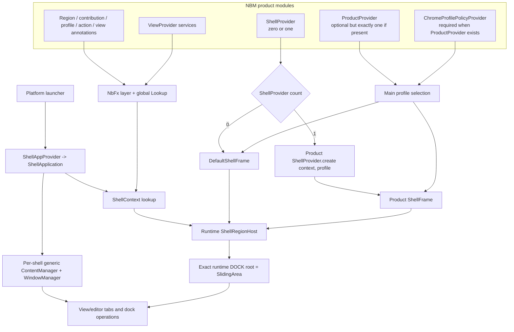

<!--

    Licensed to the Apache Software Foundation (ASF) under one
    or more contributor license agreements.  See the NOTICE file
    distributed with this work for additional information
    regarding copyright ownership.  The ASF licenses this file
    to you under the Apache License, Version 2.0 (the
    "License"); you may not use this file except in compliance
    with the License.  You may obtain a copy of the License at

      http://www.apache.org/licenses/LICENSE-2.0

    Unless required by applicable law or agreed to in writing,
    software distributed under the License is distributed on an
    "AS IS" BASIS, WITHOUT WARRANTIES OR CONDITIONS OF ANY
    KIND, either express or implied.  See the License for the
    specific language governing permissions and limitations
    under the License.

-->
# 22. Product integration recipes

These recipes use APIs available at baseline `f2e43e8b58`. They deliberately call out where a recipe
is a current integration technique rather than the completed CJAP product model. Product code should
import public API/SPI and JavaFX types, not `org.netbeans.modules.nbfx.platform.*` implementation
types.

Navigation: [previous: threading, focus, and accessibility](21-threading-focus-and-accessibility.md) ·
[next: public API catalog](23-public-api-catalog.md) · [manual home](README.md)

## 22.1 Recipe status matrix

| Recipe | Status | What works now |
|---|---|---|
| Neutral default shell with no application subclass | **Implemented** | `ShellAppProvider` selects `ShellApplication`; zero `ShellProvider`s select `DefaultShellFrame`. |
| Product metadata through one `ProductProvider` | **Implemented** | Immutable validated metadata; duplicate/null/zero resolution rules. |
| Product-driven main chrome profile through `ChromeProfilePolicyProvider` | **Implemented** | Selected before frame creation; mandatory matching policy when a product exists. |
| Product identity/icons/style/theme/layout/shell ids driving the whole runtime | **Target only** | Generic shell startup consumes only `chromeProfilePolicyId`; the other ids are metadata in this baseline. |
| Declarative region/contribution/profile/action registration | **Implemented** | Annotation processors emit layer metadata; default frame mounts applicable main-window regions. |
| Startup views through `@ViewRegistration` + `ViewProvider` service | **Legacy** | Existing view-area/window-system defaults and one-time introduction behavior. |
| API-only custom `ShellProvider`/`ShellFrame` | **Implemented** | Exactly one provider; runtime host and exact DOCK root required; rollback on invalid composition. |
| Profile-driven frames for floating/custom windows | **Target only** | Profiles are selected for the main frame; custom `WindowContent` does not invoke `ShellProvider`. |
| Custom `WindowContent` window with bounds persistence | **Implemented** | Main/floating/custom enumeration, hide/show/close, stable id, remembered bounds. |
| Full custom-window content/session restore | **Target only** | Shell does not call `WindowContent.saveState()` or recreate custom windows. |
| Save/reset main window state through `WindowSystem` | **Implemented** | `save` and `resetLayout` after load; reset clears workspace state and offers computed defaults to the sink, whose shell adapter applies geometry only. |
| Generic content persistence/source routing | **Target only** | `ContentStateStore` is not wired; generic manager accepts ready-made content only. |

## 22.2 Default and custom composition at a glance



Important composition rules:

- Zero product providers is valid for the shell's neutral path. Calling `ProductProvider.resolve()`
  itself with zero providers is an error; the shell special-cases zero before calling it.
- One product provider requires exactly one matching chrome policy. There is no priority or fallback
  policy provider.
- With the neutral `ShellApplication` class, zero shell-frame providers select the neutral frame; one
  selects the product frame; more than one fails before frame creation. A subclass with zero providers
  uses the **Legacy** chrome path instead.
- A custom frame is a visual adapter. Runtime services, region lifecycle, and dock ownership remain
  shell-owned.
- Custom `WindowContent` is a separate window recipe, not a custom main `ShellFrame`.

## 22.3 Recipe: neutral default shell

For a platform-only product that accepts the neutral appearance:

1. depend on the platform shell/content/views/actions API modules needed by the product;
2. include the platform shell implementation in the product cluster;
3. register views, actions, contributions, and other services through NBM lookup/annotations;
4. do not register a `ShellProvider` unless a custom frame is intended;
5. do not register a `ProductProvider` merely to obtain default chrome. Zero providers is the neutral
   path.

No product `Application` subclass is required: [`ShellAppProvider`](../../../nbfx-platform/nbfx.platform.shell/src/org/netbeans/modules/nbfx/platform/shell/ShellAppProvider.java)
returns `ShellApplication.class`. A product may supply a higher-priority `AppProvider` only when it
needs a different JavaFX application composition root; that is not required for a custom frame.

Minimal startup view:

```java
package example.views;

import javafx.scene.control.Label;
import javafx.scene.layout.StackPane;
import org.netbeans.api.nbfx.view.ViewProvider;
import org.netbeans.api.nbfx.views.DockLocation;
import org.netbeans.api.nbfx.views.ViewRegistration;
import org.openide.util.NbBundle;
import org.openide.util.lookup.ServiceProvider;

@ViewRegistration(
        id = "example.welcome",
        displayName = "#example.welcome",
        location = DockLocation.LEFT,
        position = 100,
        openAtStartup = true)
@ServiceProvider(service = ViewProvider.class)
public final class WelcomeView implements ViewProvider {

    private StackPane view;

    @Override public String getId() { return "example.welcome"; }

    @Override public String getTitle() {
        return NbBundle.getMessage(WelcomeView.class, "example.welcome");
    }

    @Override public StackPane getView() {
        // ViewProvider services may be constructed before a tab is shown;
        // create the JavaFX node lazily when the FX-owned view path asks for it.
        if (view == null) {
            view = new StackPane(new Label(getTitle()));
        }
        return view;
    }
}
```

Add `example/views/Bundle.properties` in that package:

```properties
example.welcome=Welcome
```

`ViewProvider` is in `org.netbeans.api.nbfx.view`; `ViewRegistration` is in
`org.netbeans.api.nbfx.views`. The provider must be a public no-argument service so restored view ids
can resolve it.

Startup behavior is **Legacy**, with an important sink gap:

- `DefaultWindowSystem.defaultAreas()` computes attached view ids for `openAtStartup == true` or
  `navigator == true`, except `PersistenceType.NEVER`;
- the current `ShellApplication` `WindowSink.apply` consumes only geometry/maximized state and ignores
  those computed areas/view payloads, so the live neutral shell does not attach navigator-only views
  through that path;
- live neutral startup instead opens `openAtStartup` views through
  `SessionRestorer.openStartupViews` when the legacy layout is empty, when a persisted layout cannot be
  restored because no global editor `ContentManager` exists, and after a persisted layout is applied
  when an `openAtStartup` default is newly introduced;
- `SessionRestorer.openStartupViews` does not open navigator-only registrations;
- an introduced id omitted from persisted state is treated as user-closed and stays closed;
- `ViewManager.show` logs and does nothing if no pane can host the view.

For deterministic on-demand opening, resolve `ViewManager` from global lookup on FX and call
`show(provider)` or `show(provider, area, position)`. `@OnUiReady` runs before the shell's deferred
session restore, so a view shown only there may subsequently be removed by a persisted layout that
omits it. Prefer startup registration or a user action for a persistent default.

## 22.4 Recipe: `ProductProvider` + `ChromeProfilePolicyProvider`

A product provider is optional, but once registered it changes startup validation: its
`chromeProfilePolicyId` must resolve to exactly one policy. The following is a complete metadata/policy
pair using current constructors. Put the two public service classes in separate compilation units
(`ExampleProductProvider.java` and `ExampleChromePolicyProvider.java`).

```java
package example.product;

import java.net.URI;
import java.util.List;
import java.util.Map;
import org.netbeans.api.nbfx.product.*;
import org.netbeans.api.nbfx.shell.ChromeProfilePolicy;
import org.netbeans.api.nbfx.shell.ChromeProfilePolicyProvider;
import org.netbeans.api.nbfx.shell.WindowKind;
import org.openide.util.lookup.ServiceProvider;

@ServiceProvider(service = ProductProvider.class)
public final class ExampleProductProvider implements ProductProvider {

    private static final Product PRODUCT = new Product(
            new ProductIdentity("example", "Example", "1.0", null, null, null, null),
            new ProductIcons(List.of(), null, List.of()),
            new ProductStyle(List.of(), List.of(), List.of()),
            "theme.default",       // metadata; not selected by generic shell startup
            "example.default",     // metadata; live dock still uses legacy composition/layout
            "shell.default",       // metadata; ShellProvider count selects the actual frame
            "example.chrome",      // consumed by ShellApplication.selectMainProfile
            List.of(),
            new AboutInfo("", List.of(), List.of(), null));

    @Override public Product product() { return PRODUCT; }
}

@ServiceProvider(service = ChromeProfilePolicyProvider.class)
public final class ExampleChromePolicyProvider implements ChromeProfilePolicyProvider {

    private static final ChromeProfilePolicy POLICY = new ChromeProfilePolicy(
            "example.chrome",
            Map.of(WindowKind.MAIN, "example.main",
                   WindowKind.FLOATING, "floating-editor",
                   WindowKind.CUSTOM, "presentation"),
            "main");

    @Override public ChromeProfilePolicy policy() { return POLICY; }
}
```

Current validation/selection facts:

- `ProductIdentity.id/name/version` and all four `Product` policy/layout/shell/profile ids are required.
  Ids must be nonblank and have no surrounding whitespace; product ids are not all required to use
  typed-id grammar.
- Optional blank text becomes null. Website/support URIs must be absolute. Lists are defensively
  copied. `AboutInfo.description` is required but may be empty.
- Exactly one `ProductProvider` is required by `ProductProvider.resolve`; duplicate providers or a
  null product throw `IllegalStateException`. The shell allows zero for neutral operation but rejects
  more than one.
- `ChromeProfilePolicyProvider.resolve` returns empty when no id matches, but the shell turns that
  into startup failure. Null provider results or multiple matching providers fail.
- Selection precedence is explicit `ShellChromeProfile`, `ShellProfileHint`, product default for the
  window kind, policy fallback, neutral fallback. Unknown declared ids fall through; duplicate
  declared profile ids and a missing neutral fallback fail.
- Main profile is published in `ShellContext.lookup()` before `ShellProvider.create`, and effective
  `NATIVE`/`UNDECORATED` style is applied before the stage is shown.

**Target only limitation:** `Product.identity`, `icons`, `style`, `themePolicyId`, `layoutId`, and
`shellId` are not consumed by `ShellApplication` in this baseline. Legacy `ShellBranding` still
controls title/icons/styles when present. Do not expect this metadata alone to brand the neutral
frame or select a `LayoutSpec`/theme/shell.

## 22.5 Recipe: region, contribution, profile, and action registration

The following declaration adds a product brand region and a main profile that also selects neutral
menu/toolbar/dock/status slots. Declaration classes emit metadata only and are not instantiated.

```java
package example.chrome;

import org.netbeans.api.nbfx.shell.ShellProfileRegistration;
import org.netbeans.api.nbfx.shell.ShellRegionRegistration;

@ShellRegionRegistration(
        id = "example:brand",
        kind = "brand",
        position = 5,
        profiles = {"example.main"},
        styleClass = "example-brand")
@ShellProfileRegistration(
        id = "example.main",
        windowKind = "MAIN",
        regions = {"example:brand", "nbfx:menubar", "nbfx:toolbar",
                   "nbfx:dock", "nbfx:status"},
        decoration = "NATIVE",
        systemMenuBar = true)
public final class ExampleChromeDeclaration {
    private ExampleChromeDeclaration() { }
}
```

Region applicability is intersected: the region's `profiles` must include the selected profile, and
the profile's region allow-list must include the region. An empty allow-list means no additional
restriction. `DOCK` remains runtime-owned.

Add a fresh per-mount contribution:

```java
package example.chrome;

import javafx.scene.Node;
import javafx.scene.control.Label;
import org.netbeans.api.nbfx.shell.ShellContext;
import org.netbeans.api.nbfx.shell.ShellContribution;
import org.netbeans.api.nbfx.shell.ShellContributionRegistration;
import org.openide.util.NbBundle;

@ShellContributionRegistration(
        region = "example:brand",
        position = 10,
        profiles = {"example.main"})
public final class BrandContribution implements ShellContribution {

    @Override public Node create(ShellContext context) {
        Label label = new Label(NbBundle.getMessage(BrandContribution.class, "example.brand"));
        label.getStyleClass().add("example-brand-label");
        return label; // fresh and unparented for this mount
    }

    @Override public void dispose() {
        // Release resources owned by this contribution instance.
    }
}
```

Register one action and place references to it in several surfaces:

```java
package example.actions;

import org.netbeans.api.nbfx.actions.ActionReference;
import org.netbeans.api.nbfx.actions.ActionRegistration;
import org.netbeans.api.nbfx.actions.RunnableCommand;
import org.netbeans.api.nbfx.views.MenuRegistration;
import org.netbeans.api.nbfx.views.ToolbarRegistration;
import org.openide.util.NbBundle;

@MenuRegistration(id = "Example", position = 500)
@ToolbarRegistration(id = "example", displayName = "#example.toolbar", position = 500)
@ActionRegistration(id = "example.hello", displayName = "#example.hello")
@ActionReference(id = "example.hello", path = "Menus/Example", position = 10,
        profiles = {"example.main"})
@ActionReference(id = "example.hello", path = "Toolbars/example", position = 10,
        profiles = {"example.main"})
@ActionReference(id = "example.hello", path = "ShellRegions/example:brand", position = 20,
        profiles = {"example.main"})
public final class HelloCommand extends RunnableCommand {

    public HelloCommand() {
        super("example.hello", NbBundle.getMessage(HelloCommand.class, "example.hello"),
                null, () -> System.out.println("Hello"));
    }
}
```

`example/chrome/Bundle.properties`:

```properties
example.brand=Example
```

`example/actions/Bundle.properties`:

```properties
example.toolbar=Example
example.hello=Hello
```

The action processor emits one `NbFx/Actions/example.hello.instance` and separate `.ref` entries.
References use paths relative to `NbFx`; do not prepend `NbFx/` in the annotation. Menu/toolbar folders
must also be declared, as above, for the default renderers to discover them.

Lifecycle/error behavior:

- Region/contribution/profile metadata is validated at compile time. Missing bundle keys or invalid
  profile/region tokens are processor errors where applicable.
- The runtime host creates contribution nodes and action buttons on FX. Null or already-parented
  contribution results are rejected; renderer/contribution failures are logged and isolated.
- Contribution instances and scoped command views are disposed when the mount is updated/disposed.
  Hiding a region does not itself imply disposal.
- `DOCK` rejects ordinary contributions and mounts the exact runtime dock node.
- The default frame requires exactly one applicable DOCK region. It arranges top regions in
  position/id order, status at the bottom, and overlay in a non-pick-on-bounds layer.

See [chapter 15](15-shell-regions-and-contributions.md),
[chapter 16](16-chrome-profiles.md), [chapter 17](17-actions-menus-toolbars-and-ribbons.md), and
[chapter 24](24-annotations-and-layer-schema.md) for details.

## 22.6 Recipe: API-only custom `ShellProvider` and `ShellFrame`

Use this instead of subclassing `ShellApplication` to obtain chrome. The provider is a public
no-argument NBM service; exactly one may be present.

```java
package example.shell;

import org.netbeans.api.nbfx.shell.ShellChromeProfile;
import org.netbeans.api.nbfx.shell.ShellContext;
import org.netbeans.api.nbfx.shell.ShellFrame;
import org.netbeans.api.nbfx.shell.ShellProvider;
import org.openide.util.lookup.ServiceProvider;

@ServiceProvider(service = ShellProvider.class)
public final class ExampleShellProvider implements ShellProvider {

    @Override public ShellFrame create(ShellContext context, ShellChromeProfile profile) {
        return new ExampleFrame(context, profile);
    }
}
```

The frame below uses only public shell API and JavaFX. It obtains the **runtime host from context**,
mounts applicable non-DOCK regions, and mounts the **exact node passed to `setDockRoot`** through the
DOCK region.

```java
package example.shell;

import java.util.ArrayList;
import java.util.List;
import java.util.Objects;
import javafx.scene.Node;
import javafx.scene.layout.BorderPane;
import javafx.scene.layout.StackPane;
import javafx.scene.layout.VBox;
import org.netbeans.api.nbfx.shell.*;

public final class ExampleFrame implements ShellFrame {

    private final ShellContext context;
    private final ShellRegionHost host;
    private final StackPane root = new StackPane();
    private final BorderPane body = new BorderPane();
    private final VBox top = new VBox();
    private final StackPane overlays = new StackPane();
    private final List<Mounted> mounted = new ArrayList<>();

    private ShellRegionSpec dock;
    private Node dockNode;
    private boolean closed;

    public ExampleFrame(ShellContext context, ShellChromeProfile profile) {
        this.context = Objects.requireNonNull(context, "context");
        this.host = Objects.requireNonNull(
                context.lookup().lookup(ShellRegionHost.class), "runtime ShellRegionHost");
        overlays.setPickOnBounds(false);
        body.setTop(top);
        root.getChildren().addAll(body, overlays);

        ShellRegionContext regionContext = new ShellRegionContext(context);
        for (ShellRegionSpec region : host.regions(profile)) {
            if (region.kind().equals(ShellRegionKind.DOCK)) {
                continue;
            }
            Node node = host.mount(region, regionContext);
            mounted.add(new Mounted(region, node));
            if (region.kind().equals(ShellRegionKind.STATUS)) {
                body.setBottom(node);
            } else if (region.kind().equals(ShellRegionKind.OVERLAY)) {
                overlays.getChildren().add(node);
            } else {
                top.getChildren().add(node);
            }
        }
    }

    @Override public Node root() {
        return root; // stable and initially unparented
    }

    @Override public void setDockRoot(Node dockRoot) {
        if (closed) {
            throw new IllegalStateException("Shell frame is closed");
        }
        Objects.requireNonNull(dockRoot, "dockRoot");
        if (dockNode == dockRoot) {
            return;
        }
        ShellRegionSpec region = host.regions(context.profile()).stream()
                .filter(spec -> spec.kind().equals(ShellRegionKind.DOCK))
                .findFirst()
                .orElseThrow(() -> new IllegalStateException("Custom shell requires DOCK"));
        Node node = host.mount(region, new ShellRegionContext(context));
        if (node != dockRoot) {
            host.dispose(region, node);
            throw new IllegalStateException("Runtime DOCK root mismatch");
        }
        dock = region;
        dockNode = node;
        mounted.add(new Mounted(region, node));
        body.setCenter(node);
    }

    @Override public ShellRegionHost regions() {
        return host; // must be the same runtime host, not a product-created replacement
    }

    @Override public void close() {
        if (closed) {
            return;
        }
        closed = true;
        for (Mounted entry : mounted) {
            host.dispose(entry.region(), entry.node());
        }
        mounted.clear();
        top.getChildren().clear();
        overlays.getChildren().clear();
        body.setCenter(null);
        body.setBottom(null);
        dock = null;
        dockNode = null;
    }

    private record Mounted(ShellRegionSpec region, Node node) { }
}
```

Runtime acceptance checks are strict:

| Failure | Result |
|---|---|
| More than one `ShellProvider` | `IllegalStateException` before any provider is called. |
| Provider returns null | `IllegalStateException("ShellProvider returned null")`. |
| `frame.root()` null | `NullPointerException` from `Objects.requireNonNull`. |
| Root already has a parent | `IllegalStateException("ShellFrame root must be unparented")`. |
| `frame.regions()` is not the runtime host | `IllegalStateException`; rollback closes frame/host/resolver. |
| Runtime dock not beneath frame root, or not mounted as DOCK | `IllegalStateException("ShellFrame did not mount the runtime DOCK root")`. |
| Raw dock attached without host DOCK mount | Rejected even though the node is in the scene graph. |

`setDockRoot` is called once by the shell after provider creation. The frame must not retain or
replace the dock root as owned content. On failure, startup closes the created frame and runtime
region host and closes the shell command resolver. On normal stop, the shell closes the frame, then
the runtime host; frame `close()` should therefore dispose mounts but not call `host.close()`.

A custom frame is still composed by `ShellApplication`; `ShellProvider` does not replace startup,
content management, window management, shutdown, or focus bridging.

## 22.7 Recipe: custom `WindowContent` window

A custom window hosts arbitrary product content. It does **not** use the main `ShellProvider` or build
a profile-driven frame.

```java
package example.windows;

import java.util.Map;
import javafx.scene.control.Label;
import javafx.scene.layout.StackPane;
import org.netbeans.api.nbfx.shell.*;
import org.openide.util.Lookup;

public final class InspectorContent implements WindowContent {

    private final WindowId id;
    private final StackPane root = new StackPane(new Label("Inspector"));
    private final Lookup lookup = Lookup.EMPTY;

    public InspectorContent(WindowId id) { this.id = id; }

    @Override public StackPane root() { return root; }
    @Override public Lookup lookup() { return lookup; }

    @Override public WindowContentState saveState() {
        // The shell does not currently call this or persist the result.
        return new WindowContentState(id, null, Map.of());
    }

    @Override public void close() {
        // Release host resources only. Generic Content close/dispose, if any,
        // remains owned by the generic ContentManager.
        root.getChildren().clear();
    }
}
```

Create it on FX through the running shell's `WindowManager`:

```java
WindowManager windows = shellWindow.windowManager();
WindowId id = WindowId.of("example:window.inspector");
WindowOptions options = new WindowOptions(
        WindowKind.CUSTOM,
        null,           // profile: recorded in state id only; no custom frame is built
        "Inspector",
        null,           // optional ResourceRef icon
        shellWindow.stage(),
        false,
        500, 350,
        true,           // resizable
        true,           // remember bounds by stable WindowId
        null);          // default native stage decoration

DockWindow window = windows.createCustomWindow(id, options, new InspectorContent(id));
```

Current behavior:

- `kind` must be `CUSTOM`; wrong kind, duplicate live id, null arguments, or an already-attached root
  throw `IllegalArgumentException`/`NullPointerException`.
- A non-`Parent` root is wrapped in a `StackPane`. A root with a scene or parent is rejected.
- Owner, modality, title, icon, decoration, resizability, position, and dimensions are applied before
  show. Missing/invalid icon resources log and keep the default icon.
- `layout()` is null. `state()` contains geometry and the explicit profile id, but no custom content
  payload.
- Hide keeps the window live and enumerated; close disposes `WindowContent` once, removes the window,
  and prevents re-showing. A closed `show()` throws `IllegalStateException`.
- `rememberBounds` saves on hide/close and restores by `WindowId`, overriding constructor dimensions
  and clamping to visible screens.
- `WindowContent.saveState()` is not called by `CustomWindow`; products must persist their own opaque
  content state and recreate custom windows after restart.
- `WindowOptions.profile` does not select chrome or invoke `ShellProvider` for this window. Explicit
  decoration still applies.

## 22.8 Recipe: startup and on-demand views

Use `@ViewRegistration` for default/restorable tabs and `ViewManager` for user actions:

```java
ViewManager views = Lookup.getDefault().lookup(ViewManager.class);
ViewProvider provider = ViewRegistry.provider("example.welcome");
if (views != null && provider != null) {
    views.show(provider); // FX thread; selects/focuses and fronts its window
}
```

For explicit placement:

```java
ViewArea area = ViewAreaRegistry.find("explorer").orElse(null);
views.show(provider, area, 0);
```

Current contracts and caveats:

- `ViewManager.show` is global, not per-shell. It finds an existing tab by provider id across panes.
- A view with several live instances must use distinct provider ids; `ViewContent` and tab lookup both
  key by id.
- `ViewContent.close()` calls `view.viewClosed()`; `dispose()` is a no-op. The provider owns its node
  and resources.
- `openAtStartup`/`navigator` and persistence are the legacy view-area model, not a `LayoutSpec`
  startup contract. See [chapter 19](19-content-view-and-editor-lifecycle.md).
- `@OnUiReady` tasks run on FX after the main window is shown but before deferred session restore.
  They are suitable for UI initialization, not for forcing a view to survive a contradictory saved
  layout.

## 22.9 Recipe: save and reset layout

Resolve `WindowSystem` from global lookup and call it on FX after the shell has loaded:

```java
WindowSystem windowSystem = Lookup.getDefault().lookup(WindowSystem.class);
if (windowSystem != null) {
    windowSystem.save();       // Legal in LOADED or SHOWN; may be repeated.
    windowSystem.resetLayout(); // Legal in LOADED or SHOWN; clears workspace window state.
}
```

Current `DefaultWindowSystem` behavior:

- `init` discovers view registrations once; `load` merges persisted state over defaults; `show` makes
  the main window visible.
- `save` snapshots through `WindowSink` and writes the workspace `ViewStateStore`; listeners surround
  the operation.
- `resetLayout` clears that workspace store and passes a newly computed default `WindowState`
  (layer-derived areas/startup view ids and view payloads) to `WindowSink.apply`. It does not rerun
  `init`.
- the current `ShellApplication` sink applies only geometry/maximized state, with legacy bounds as a
  fallback; it ignores `WindowState.areas()` and view payloads. Therefore this call does not reset the
  live pane/tab layout, and it does not clear the separate legacy `AppState`/`SessionRestorer` layout.
- Calls before `load`, duplicate `init`, and duplicate `load` throw `IllegalStateException`.

Reset scope is limited:

- it does not clear toolbar arrangement/hidden state, editor view settings, introduced-view markers,
  custom-window bounds, or product-owned content payloads;
- it does not restore a complete `SessionState` or all custom/floating windows;
- generic `ContentStateStore` is not involved;
- the neutral platform menu contains a `resetWindows` reference, but the platform-only shell does not
  provide the IDE's reset command implementation. A product must wire an action to the API above if
  it wants a neutral Reset command.

For a product-owned save/reset command, implement `Command`, resolve `WindowSystem` at execution time,
and report errors to the user rather than failing silently. Keep UI work on FX.

## 22.10 Recipe: testing a product integration

### Pure API tests

Use explicit lookups to test product/profile validation without JavaFX:

```java
ProductProvider provider = new ExampleProductProvider();
Product resolved = ProductProvider.resolve(Lookups.fixed(provider));
assertEquals("example.chrome", resolved.chromeProfilePolicyId());

ChromeProfilePolicy policy = ChromeProfilePolicyProvider.resolve(
        resolved.chromeProfilePolicyId(),
        Lookups.fixed(new ExampleChromePolicyProvider())).orElseThrow();
assertEquals("example.main", policy.defaultProfiles().get(WindowKind.MAIN));
```

`ProductProviderTest`, `ProductTest`, and `ShellProfileResolverTest` show the validation/precedence
patterns. Registration processor tests compile sample sources and inspect the generated layer; they
are the right place to verify annotation schema.

### Headless content tests

`DefaultContentManagerTest` demonstrates manager lifecycle without a toolkit. Do not start a shell
just to test duplicate identity, veto, active fallback, or close/dispose ordering.

### JavaFX integration tests

The existing fixture style is:

1. initialize/use `JavaFxTestSupport.onFx`;
2. start `ShellApplication` (or a test-only lookup fixture) on FX with a `Stage`;
3. assert runtime host/frame/view/window behavior;
4. hide remaining windows in `@After` rather than exiting the shared toolkit.

A test-only subclass may inject services because the public product path is NBM service lookup:

```java
private static final class Fixture extends ShellApplication {
    private final Lookup extra;

    Fixture(Lookup extra) { this.extra = extra; }

    @Override protected Lookup shellLookup() {
        return new ProxyLookup(extra, super.shellLookup());
    }

    ShellFrame frame() { return getShellFrame(); }
    Lookup lookup() { return shellLookup(); }
}
```

```java
JavaFxTestSupport.onFx(() -> {
    Lookup services = Lookups.fixed(
            new ExampleShellProvider(),
            new ExampleProductProvider(),
            new ExampleChromePolicyProvider());
    Fixture application = new Fixture(services);
    application.start(new Stage());

    assertNotNull(application.frame());
    assertSame(application.windowManager(),
            application.lookup().lookup(WindowManager.class));
    return null;
});
```

This subclass is a **Legacy test seam**, not the recommended product architecture. Product classes
register the same services with `@ServiceProvider` and run the neutral `ShellApplication`.

Test checklist:

- zero/one/many `ShellProvider`; null/parented root; wrong host; omitted/raw DOCK; rollback;
- profile published before provider creation and decoration applied before show;
- contribution fresh-node/unparented rules, update/dispose, per-reference action failure isolation;
- startup view first run, persisted omission, newly introduced default, and missing host pane;
- custom window duplicate id, attached root, hide/show/close, one-time content close, remembered bounds;
- `WindowSystem` lifecycle guards and reset scope;
- FX-thread rejection for frame/region lifecycle and no worker-thread scene mutation;
- generic content veto/dispose and tab close deferred past a same-pulse move;
- external drop target/source order, legacy fallback, first rejection, and announcements.

## 22.11 Integration errors and recovery

| Error | Current outcome | Product response |
|---|---|---|
| Zero product providers | Neutral main profile/frame | Valid; do not call `ProductProvider.resolve()` expecting a default. |
| Multiple product providers | Startup `IllegalStateException` | Ship exactly one product metadata provider. |
| Product returns null | `ProductProvider.resolve`/startup error | Fix provider; no silent neutral fallback. |
| Product policy id has no match | Startup `IllegalStateException` | Register exactly one matching policy provider. |
| Multiple matching policy providers | Startup `IllegalStateException` | Remove duplicate/superseding registrations; priority is unsupported. |
| Duplicate declared profile id / missing neutral fallback | Resolver failure | Use unique profile ids and retain neutral profiles in the distribution. |
| Multiple shell providers | Failure before frame creation | Register one custom provider or none. |
| Invalid frame/root/host/DOCK | Rollback closes created frame/host/resolver | Correct composition; do not attach a raw dock node. |
| Missing view host pane | `ViewManager` logs and returns | Register the pane/area or choose an available default location. |
| Invalid view/action/drop registration | Compile-time processor error | Fix annotation/type/token/constructor; do not work around with runtime reflection. |
| Duplicate custom window id / attached root / wrong kind | `IllegalArgumentException` | Use a fresh stable id/root and `WindowKind.CUSTOM`. |
| Save/reset before load | `IllegalStateException` | Run after shell startup/load on FX. |
| Background shutdown timeout/failure | Logged; FX callback still schedules exit | Make cleanup bounded/idempotent; do not rely on UI work during shutdown. |

## 22.12 Source and test map

### Composition and metadata

- [`ShellAppProvider`](../../../nbfx-platform/nbfx.platform.shell/src/org/netbeans/modules/nbfx/platform/shell/ShellAppProvider.java),
  [`ShellApplication`](../../../nbfx-platform/nbfx.platform.shell/src/org/netbeans/modules/nbfx/platform/shell/ShellApplication.java)
- [`ProductProvider`](../../../nbfx-platform/nbfx.api.product/src/org/netbeans/api/nbfx/product/ProductProvider.java),
  [`Product`](../../../nbfx-platform/nbfx.api.product/src/org/netbeans/api/nbfx/product/Product.java),
  [`ProductIdentity`](../../../nbfx-platform/nbfx.api.product/src/org/netbeans/api/nbfx/product/ProductIdentity.java)
- [`ChromeProfilePolicyProvider`](../../../nbfx-platform/nbfx.api.shell/src/org/netbeans/api/nbfx/shell/ChromeProfilePolicyProvider.java),
  [`ChromeProfilePolicy`](../../../nbfx-platform/nbfx.api.shell/src/org/netbeans/api/nbfx/shell/ChromeProfilePolicy.java),
  [`ShellProfileResolver`](../../../nbfx-platform/nbfx.api.shell/src/org/netbeans/api/nbfx/shell/ShellProfileResolver.java)

### Frame, chrome, actions, and views

- [`ShellProvider`](../../../nbfx-platform/nbfx.api.shell/src/org/netbeans/api/nbfx/shell/ShellProvider.java),
  [`ShellFrame`](../../../nbfx-platform/nbfx.api.shell/src/org/netbeans/api/nbfx/shell/ShellFrame.java),
  [`ShellContext`](../../../nbfx-platform/nbfx.api.shell/src/org/netbeans/api/nbfx/shell/ShellContext.java),
  [`ShellRegionHost`](../../../nbfx-platform/nbfx.api.shell/src/org/netbeans/api/nbfx/shell/ShellRegionHost.java)
- [`DefaultShellFrame`](../../../nbfx-platform/nbfx.platform.shell/src/org/netbeans/modules/nbfx/platform/shell/DefaultShellFrame.java),
  [`ShellRegionHostImpl`](../../../nbfx-platform/nbfx.platform.shell/src/org/netbeans/modules/nbfx/platform/shell/ShellRegionHostImpl.java)
- [`ShellRegionRegistration`](../../../nbfx-platform/nbfx.api.shell/src/org/netbeans/api/nbfx/shell/ShellRegionRegistration.java),
  [`ShellContributionRegistration`](../../../nbfx-platform/nbfx.api.shell/src/org/netbeans/api/nbfx/shell/ShellContributionRegistration.java),
  [`ShellProfileRegistration`](../../../nbfx-platform/nbfx.api.shell/src/org/netbeans/api/nbfx/shell/ShellProfileRegistration.java)
- [`ActionRegistration`](../../../nbfx-platform/nbfx.api.actions/src/org/netbeans/api/nbfx/actions/ActionRegistration.java),
  [`ActionReference`](../../../nbfx-platform/nbfx.api.actions/src/org/netbeans/api/nbfx/actions/ActionReference.java),
  [`RunnableCommand`](../../../nbfx-platform/nbfx.api.actions/src/org/netbeans/api/nbfx/actions/RunnableCommand.java)
- [`ViewRegistration`](../../../nbfx-platform/nbfx.api.views/src/org/netbeans/api/nbfx/views/ViewRegistration.java),
  [`ViewProvider`](../../../nbfx-platform/nbfx.api.views/src/org/netbeans/api/nbfx/view/ViewProvider.java),
  [`ViewManager`](../../../nbfx-platform/nbfx.api.views/src/org/netbeans/api/nbfx/view/ViewManager.java),
  [`ViewManagerService`](../../../nbfx-platform/nbfx.platform.shell/src/org/netbeans/modules/nbfx/platform/shell/ViewManagerService.java)

### Windows and persistence

- [`WindowManager`](../../../nbfx-platform/nbfx.api.shell/src/org/netbeans/api/nbfx/shell/WindowManager.java),
  [`WindowOptions`](../../../nbfx-platform/nbfx.api.shell/src/org/netbeans/api/nbfx/shell/WindowOptions.java),
  [`WindowContent`](../../../nbfx-platform/nbfx.api.shell/src/org/netbeans/api/nbfx/shell/WindowContent.java),
  [`WindowContentState`](../../../nbfx-platform/nbfx.api.shell/src/org/netbeans/api/nbfx/shell/WindowContentState.java),
  [`DockWindow`](../../../nbfx-platform/nbfx.api.shell/src/org/netbeans/api/nbfx/shell/DockWindow.java)
- [`CustomWindow`](../../../nbfx-platform/nbfx.platform.shell/src/org/netbeans/modules/nbfx/platform/shell/CustomWindow.java),
  [`DefaultWindowManager`](../../../nbfx-platform/nbfx.platform.shell/src/org/netbeans/modules/nbfx/platform/shell/DefaultWindowManager.java)
- [`WindowSystem`](../../../nbfx-platform/nbfx.api.shell/src/org/netbeans/api/nbfx/shell/WindowSystem.java),
  [`DefaultWindowSystem`](../../../nbfx-platform/nbfx.platform.workspace/src/org/netbeans/modules/nbfx/platform/workspace/DefaultWindowSystem.java)

### Tests

- [`AppShellConformanceTest`](../../../nbfx-platform/nbfx.platform.shell/test/unit/src/org/netbeans/modules/nbfx/platform/shell/AppShellConformanceTest.java)
  proves the default shell starts without IDE modules or an application subclass.
- [`PlatformChromeFixtureTest`](../../../nbfx-platform/nbfx.platform.shell/test/unit/src/org/netbeans/modules/nbfx/platform/shell/PlatformChromeFixtureTest.java)
  and [`PlatformChromeFixture`](../../../nbfx-platform/nbfx.platform.shell/test/unit/src/org/netbeans/modules/nbfx/platform/shell/PlatformChromeFixture.java)
  cover annotated menu/toolbar/action/status integration.
- [`CustomShellProviderTest`](../../../nbfx-platform/nbfx.platform.shell/test/unit/src/org/netbeans/modules/nbfx/platform/shell/CustomShellProviderTest.java)
  covers API-only frame composition and rollback.
- [`ShellProfileStartupTest`](../../../nbfx-platform/nbfx.platform.shell/test/unit/src/org/netbeans/modules/nbfx/platform/shell/ShellProfileStartupTest.java)
  and [`ShellProfileSelectionTest`](../../../nbfx-platform/nbfx.platform.shell/test/unit/src/org/netbeans/modules/nbfx/platform/shell/ShellProfileSelectionTest.java)
  cover product policy, publication, precedence, and decoration.
- [`ProductTest`](../../../nbfx-platform/nbfx.api.product/test/unit/src/org/netbeans/api/nbfx/product/ProductTest.java)
  and [`ProductProviderTest`](../../../nbfx-platform/nbfx.api.product/test/unit/src/org/netbeans/api/nbfx/product/ProductProviderTest.java)
  cover metadata validation and exactly-one resolution.
- [`CustomWindowTest`](../../../nbfx-platform/nbfx.platform.shell/test/unit/src/org/netbeans/modules/nbfx/platform/shell/CustomWindowTest.java)
  covers enumeration, close/hide, duplicate/attached roots, and remembered bounds.
- [`FxWindowSystemTest`](../../../nbfx-platform/nbfx.platform.workspace/test/unit/src/org/netbeans/modules/nbfx/platform/workspace/FxWindowSystemTest.java)
  covers save/reset/lifecycle guards and default fallback.

## 22.13 Current vs target

The [target product reference](../../reference/cjap-shell-ui.md#5-product-metadata) expects one product
metadata source to drive identity, theme, layout, shell, profiles, packaging, and associations. The
baseline implements the immutable metadata and chrome-policy resolution, but generic shell startup
does not yet consume most of those ids.

The [target frame reference](../../reference/cjap-shell-ui.md#9-shell-frame-and-declarative-chrome)
expects a custom shell to use the runtime region host and exact DOCK root; that part is implemented and
covered. Per-window profile-driven frames, complete multiwindow/session restore, anchored overlays,
generic content/source persistence, and full product-owned layout/theming remain **Target only** or
**Partial** as shown in the matrix.

Next: [23. Public API catalog](23-public-api-catalog.md).
