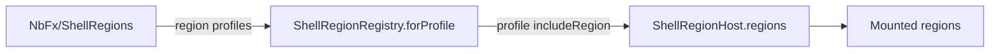

<!--

    Licensed to the Apache Software Foundation (ASF) under one
    or more contributor license agreements.  See the NOTICE file
    distributed with this work for additional information
    regarding copyright ownership.  The ASF licenses this file
    to you under the Apache License, Version 2.0 (the
    "License"); you may not use this file except in compliance
    with the License.  You may obtain a copy of the License at

      http://www.apache.org/licenses/LICENSE-2.0

    Unless required by applicable law or agreed to in writing,
    software distributed under the License is distributed on an
    "AS IS" BASIS, WITHOUT WARRANTIES OR CONDITIONS OF ANY
    KIND, either express or implied.  See the License for the
    specific language governing permissions and limitations
    under the License.

-->
# 24. Annotations and layer schema

**Baseline:** `f2e43e8b58`.
This chapter describes what processors generate and what runtime readers actually accept. It does not substitute the target reference's intended schema for the baseline implementation.

## 24.1 Complete `NbFx` path inventory

The single public path owner is [`LayerPaths`](../../../nbfx-platform/nbfx.api.layer/src/org/netbeans/api/nbfx/layer/LayerPaths.java).

| Constant | Path | Baseline reader/use | Status |
|---|---|---|---|
| `ACTIONS` | `NbFx/Actions` | `ActionRegistryImpl`, `LayerInstances` | Implemented |
| `MENUS` | `NbFx/Menus` | `ShellMenuBar`, `ActionLayerReader` | Implemented |
| `TOOLBARS` | `NbFx/Toolbars` | `ShellToolBars`, `ActionLayerReader` | Implemented |
| `CONTEXT_MENUS` | `NbFx/ContextMenus` | editor/navigator context menus | Implemented |
| `VIEWS` | `NbFx/Views` | `ViewRegistry` | Legacy/Implemented |
| `VIEW_AREAS` | `NbFx/ViewAreas` | `ViewAreaRegistry` | Legacy/Implemented |
| `LAYOUTS` | `NbFx/Layouts` | `LayoutRegistry` | Implemented model; not live-dock input |
| `LAYOUT_AREAS` | `NbFx/LayoutAreas` | `LayoutRegistry` | Implemented model; not live-dock input |
| `DOCK_GROUPS` | `NbFx/DockGroups` | `LayoutRegistry` | Implemented model; not live-dock input |
| `SHELL_REGIONS` | `NbFx/ShellRegions` | region/contribution/action readers and host | Implemented |
| `SHELL_PROFILES` | `NbFx/ShellProfiles` | `ShellProfileRegistry` | Implemented |
| `WINDOW_LAYOUTS` | `NbFx/WindowLayouts` | `WindowLayoutRegistry`, `WindowCompositionResolver` | Legacy live-dock input |
| `WINDOW_PANES` | `NbFx/WindowPanes` | `WindowPaneRegistry` | Legacy live-dock input |
| `DROP_HANDLERS` | `NbFx/DropHandlers` | `DropRouter.discover()` | Implemented/Partial |
| `STATUS` | `NbFx/Status` | `StatusElementRegistry` | Implemented |
| `THEME_TOKENS` | `NbFx/ThemeTokens` | `ThemeTokenRegistry` | Legacy/Implemented |
| `PROPERTY_EDITORS` | `NbFx/PropertyEditors` | property editor registry | Adjacent platform API |
| `OPTIONS` | `NbFx/Options` | options registry | Adjacent platform API |
| `PROJECTS` | `NbFx/Projects` | project type registry | Adjacent IDE/platform API |
| `WIZARDS` | `NbFx/Wizards` | `WizardRegistry` | Adjacent platform API |

Additional paths not represented by `LayerPaths` constants:

- `NbFx/UIReady` — named-service lookup used by `@OnUiReady`; generated under `META-INF/namedservices/NbFx/UIReady`, not the configuration filesystem.
- `dummy/layout-bundle-validation` — a validation-only `LayerBuilder.File` used by `LayoutRegistrationProcessor`; it is never written.

There is no baseline `NbFx/Overlays`, `NbFx/DockPolicies`, or target `api.docking` registration path.

## 24.2 Common layer rules

### File kinds and ordering

- Class registrations are data files with the `.instance` suffix. `LayerInstances` reads `instanceClass`, not `instanceCreate`, `InstanceCookie`, serialized `.ser` files, or `DataObject`.
- Action references use `.ref`; dynamic menu sections use `.dynamic`.
- `LayerInstances` uses `FileUtil.getOrder(..., false)`, so the numeric `position` attribute controls order. Readers that add their own sort use position then id/name as specified below.
- Folder attributes are read through `FileObject.getAttribute`. XML examples use `stringvalue`, `intvalue`, `doublevalue`, `boolvalue`, `bundlevalue`, or `classvalue` as appropriate.
- A `#key` passed to `LayerBuilder.bundlevalue` is checked against the annotated package's `Bundle.properties` and generated as `bundlevalue="package.Bundle#key"`.

### `LayerInstances` behavior

```java
public static <T> List<LayerRegistration<T>> registrations(String path, Class<T> type);
public static <T> List<LayerRegistration<T>> registrations(FileObject folder, Class<T> type);
public static <T> T instantiate(LayerRegistration<T> registration);
public static <T> List<LayerEntry<T>> load(String path, Class<T> type);
public static <T> List<LayerEntry<T>> load(FileObject folder, Class<T> type);
```

- Registration discovery does not instantiate.
- `instanceClass` may be a `Class` value or class-name string. The class must be assignable to the requested type.
- Factory entries and wrong types are skipped.
- Missing classes, linkage/security failures, absent public no-arg constructors, and constructor failures log once per file and produce no instance.
- Class loading uses global-lookup `ClassLoader`, then context class loader, then `LayerInstances`' loader.

Source: [`LayerInstances.java`](../../../nbfx-platform/nbfx.api.layer/src/org/netbeans/api/nbfx/layer/LayerInstances.java).

## 24.3 Shell region schema

Generated path: `NbFx/ShellRegions/<canonical-region-id>/`.

### `@ShellRegionRegistration`

Source-retained, repeatable through `@ShellRegionRegistrations`, target `TYPE`.

| Attribute | Required | Type | Default | Processor validation |
|---|---:|---|---|---|
| `id` | yes | String | — | Built-in short/canonical or namespaced product id |
| `kind` | yes | String | — | Built-in short/canonical or namespaced product kind |
| `position` | no | int | `Integer.MAX_VALUE` | Written as integer |
| `profiles` | no | String[] | `{}` | Each value atomic; sorted/deduplicated |
| `styleClass` | no | String | `""` | Blank omitted; otherwise one CSS token |
| `visibleByDefault` | no | boolean | `true` | Written as boolean |

Generated folder attributes: `kind`, `position`, optional `profiles`, optional `styleClass`, `visibleByDefault`.

### Runtime metadata reading

| Attribute | Runtime default | Wrong-typed/malformed behavior |
|---|---|---|
| folder name | canonical `ShellRegionId` | Invalid id skips the region |
| `kind` | none (empty is invalid) | Missing/non-string/empty/invalid kind skips the region |
| `position` | `Integer.MAX_VALUE` | Non-integer skips the region |
| `profiles` | empty = all | Non-string, whitespace/comma-empty tokens, or control characters skip the region |
| `styleClass` | empty | Non-string or more than one token skips the region |
| `visibleByDefault` | `true` | Non-Boolean skips the region |

Only direct child folders are regions. Nested menu/contribution folders are not regions. Children are read in name order; duplicate canonical ids keep the first and log a warning. Results sort by position then canonical id.

### Neutral declarations

The platform generates six regions, not seven:

| Id | Kind | Position | Style class |
|---|---|---:|---|
| `nbfx:brand` | `nbfx:brand` | 10 | `nbfx-shell-brand` |
| `nbfx:menubar` | `nbfx:menubar` | 20 | `nbfx-shell-menubar` |
| `nbfx:toolbar` | `nbfx:toolbar` | 30 | `nbfx-shell-toolbar` |
| `nbfx:dock` | `nbfx:dock` | 40 | `nbfx-shell-dock` |
| `nbfx:status` | `nbfx:status` | 50 | `nbfx-shell-status` |
| `nbfx:overlay` | `nbfx:overlay` | 60 | `nbfx-shell-overlay` |

`RIBBON` is supported as an id/kind but is product opt-in. Neutral region profile sets are empty, so product profiles may reuse them.

Sources: [`ShellRegionRegistration.java`](../../../nbfx-platform/nbfx.api.shell/src/org/netbeans/api/nbfx/shell/ShellRegionRegistration.java), [`ShellRegionRegistrationProcessor.java`](../../../nbfx-platform/nbfx.api.shell/src/org/netbeans/modules/nbfx/api/shell/processors/ShellRegionRegistrationProcessor.java), [`ShellRegionRegistry.java`](../../../nbfx-platform/nbfx.api.shell/src/org/netbeans/api/nbfx/shell/ShellRegionRegistry.java), [`PlatformShellRegions.java`](../../../nbfx-platform/nbfx.platform.shell/src/org/netbeans/modules/nbfx/platform/shell/PlatformShellRegions.java).

## 24.4 Shell contribution schema

Generated path: `NbFx/ShellRegions/<region-id>/<sanitized-class-name>.instance`.

### `@ShellContributionRegistration`

Source-retained, repeatable, target `TYPE`.

| Attribute | Required | Type | Default | Processor validation |
|---|---:|---|---|---|
| `region` | yes | String | — | Canonical region id; `DOCK` rejected |
| `position` | no | int | `Integer.MAX_VALUE` | Written as integer |
| `profiles` | no | String[] | `{}` | Atomic tokens; sorted/deduplicated |

The annotated type must be a public, concrete, nonabstract class implementing `ShellContribution`; nested classes must be static; a public no-arg constructor is required.

Generated attributes: `instanceClass`, `position`, optional `profiles`.

### Runtime reading

- Direct `.instance` children only; nested entries are ignored.
- `position` defaults to `Integer.MAX_VALUE`; a non-integer skips the entry.
- `profiles` defaults to empty/all; a non-string or invalid token list skips the entry.
- `DOCK` is skipped before contribution loading.
- Discovery reads metadata only. `load` filters by exact region/profile before construction.
- Results sort by region id, position, registration id.

### Generated example

```java
@ShellContributionRegistration(region = "BRAND", position = 10,
        profiles = {"main", "compact"})
public final class ProductBrandBar implements ShellContribution {
    public ProductBrandBar() {}
    @Override public Node create(ShellContext context) { return new BrandBar(); }
    @Override public void dispose() { /* release per-shell resources */ }
}
```

```xml
<folder name="nbfx:brand">
  <file name="demo-ProductBrandBar.instance">
    <attr name="instanceClass" stringvalue="demo.ProductBrandBar"/>
    <attr name="position" intvalue="10"/>
    <attr name="profiles" stringvalue="compact,main"/>
  </file>
</folder>
```

Sources: [`ShellContributionRegistration.java`](../../../nbfx-platform/nbfx.api.shell/src/org/netbeans/api/nbfx/shell/ShellContributionRegistration.java), [`ShellContributionRegistrationProcessor.java`](../../../nbfx-platform/nbfx.api.shell/src/org/netbeans/modules/nbfx/api/shell/processors/ShellContributionRegistrationProcessor.java), [`ShellContributionRegistry.java`](../../../nbfx-platform/nbfx.api.shell/src/org/netbeans/api/nbfx/shell/ShellContributionRegistry.java).

## 24.5 Shell profile schema

Generated path: `NbFx/ShellProfiles/<profile-id>/`.

### `@ShellProfileRegistration`

Source-retained, repeatable, target `TYPE`.

| Attribute | Required | Type | Default | Processor validation |
|---|---:|---|---|---|
| `id` | yes | String | — | File-safe atomic token; not `.`/`..`; no slash/backslash |
| `windowKind` | no | String | `""` | Case-insensitive `WindowKind`; blank omitted |
| `regions` | no | String[] | `{}` | Region ids canonicalized; sorted/deduplicated |
| `decoration` | no | String | `""` | Case-insensitive `WindowDecoration`; blank omitted |
| `systemMenuBar` | no | boolean | `true` | Always written |

Generated attributes: optional `windowKind`, optional `regions`, optional `decoration`, `systemMenuBar`.

### Runtime reading and malformed isolation

| Attribute | Runtime default | Wrong-typed/malformed behavior |
|---|---|---|
| folder name | exact profile id | Must be nonblank atomic token; invalid folder skipped |
| `windowKind` | absent | Non-string or unknown enum skips only this profile |
| `regions` | empty = no added restriction | Non-string, invalid atomic token, or invalid region id skips only this profile |
| `decoration` | absent | Non-string or unknown enum skips only this profile |
| `systemMenuBar` | `true` | Non-Boolean skips only this profile |

Valid profiles sort by exact id. Runtime discovery does not deduplicate a supplied list; `ShellProfileResolver` rejects duplicate ids.

### Neutral profiles

| Id | Window kind | Regions | Decoration | System menu bar |
|---|---|---|---|---|
| `main` | `MAIN` | brand, menubar, toolbar, dock, status, overlay | `NATIVE` | true |
| `floating-editor` | `FLOATING` | toolbar, dock, status, overlay | `NATIVE` | false |
| `floating-tool` | `FLOATING` | toolbar, dock, status, overlay | `NATIVE` | false |
| `presentation` | `CUSTOM` | dock, overlay | `UNDECORATED` | false |

### Applicability intersection



Empty profile sets are inclusive at both levels. Exact profile ids are case-sensitive. `DOCK` remains runtime-owned.

Sources: [`ShellProfileRegistration.java`](../../../nbfx-platform/nbfx.api.shell/src/org/netbeans/api/nbfx/shell/ShellProfileRegistration.java), [`ShellProfileRegistrationProcessor.java`](../../../nbfx-platform/nbfx.api.shell/src/org/netbeans/modules/nbfx/api/shell/processors/ShellProfileRegistrationProcessor.java), [`ShellProfileRegistry.java`](../../../nbfx-platform/nbfx.api.shell/src/org/netbeans/api/nbfx/shell/ShellProfileRegistry.java), [`PlatformShellProfiles.java`](../../../nbfx-platform/nbfx.platform.shell/src/org/netbeans/modules/nbfx/platform/shell/PlatformShellProfiles.java).

## 24.6 Action registration and reference schema

### `@ActionRegistration`

Source-retained, target `TYPE`; not repeatable.

| Attribute | Required | Type | Default | Generated attribute |
|---|---:|---|---|---|
| `id` | yes | String | — | file base name |
| `displayName` | no | String | `""` | `displayName` via `stringvalue` |
| `iconName` | no | String | `""` | `iconName` |
| `accelerator` | no | String | `""` | `accelerator` |
| `position` | no | int | `Integer.MAX_VALUE` | `position` |

The processor requires a file-safe id, a public concrete nonabstract `Command` class, static nested classes, and a public no-arg constructor. Duplicate ids in one compilation fail.

**Baseline detail:** although the annotation Javadoc permits `#key`, `ActionRegistrationProcessor` writes `displayName` with `stringvalue`, not `bundlevalue`; it does not perform the bundle-key check used by references.

Generated path: `NbFx/Actions/<id>.instance` with `instanceClass`, `displayName`, `iconName`, `accelerator`, `position`.

### `@ActionReference`

Source-retained, repeatable through `@ActionReferences`, targets `TYPE` and `METHOD`.

| Attribute | Required | Type | Default | Generated attribute |
|---|---:|---|---|---|
| `id` | yes | String | — | file base name and `actionId` |
| `path` | yes | String | — | relative surface below `NbFx` |
| `position` | no | int | `Integer.MAX_VALUE` | `position` |
| `separatorBefore` | no | boolean | `false` | `separatorBefore` |
| `displayName` | no | String | `""` | `displayName` via `bundlevalue` |
| `iconName` | no | String | `""` | optional `iconName` |
| `contextType` | no | String | `""` | optional `contextType` |
| `languageId` | no | String | `""` | optional `languageId` |
| `mimeType` | no | String | `""` | optional `mimeType` |
| `profiles` | no | String[] | `{}` | optional comma-joined `profiles` |
| `presentationHints` | no | String[] | `{}` | `hint.<key>=value` attributes |

Validation:

- `id` must be file-safe.
- `path` must be a trimmed relative path with no empty, `.`, or `..` segments and no backslash/control characters.
- Context/language/MIME values, when present, must be atomic tokens.
- Profiles must be atomic and are sorted/deduplicated.
- Hints must be `key=value`; key matches `[A-Za-z0-9._-]+`, value is nonblank without control characters, and duplicate keys fail.

Generated path: `NbFx/<path>/<id>.ref`.

### Runtime reference reading

- Direct `.ref` children only for a surface. Nested folders are exposed separately by `readSubmenus`.
- `actionId` is required and nonblank.
- `position` defaults to `Integer.MAX_VALUE`; `separatorBefore` defaults false.
- String metadata defaults empty; wrong-typed known attributes make the reference malformed and it is logged/skipped.
- Profiles parse comma/whitespace-separated atomic tokens.
- Any `hint.*` attribute is copied to `presentationHints`; an empty suffix is malformed.
- Results sort by position then action id.
- Different context dimensions are ANDed; profile ids are ORed. Null/blank profile means all. Missing MIME/language/context excludes restricted references.

### Menu and toolbar container registrations

| Annotation | Generated path | Attributes and defaults |
|---|---|---|
| `@MenuRegistration(id, path="Menus", displayName="", position=MAX, separatorBefore=false)` | `NbFx/<path>/<id>/` | `position`; optional bundle `displayName`; optional true `separatorBefore` |
| `@ToolbarRegistration(id, displayName="", position=MAX)` | `NbFx/Toolbars/<id>/` | `position`; optional string `displayName` |
| `@DynamicMenuRegistration(path, id, position, displayName="", separatorBefore=false)` | `NbFx/<path>/<id>.dynamic` | `factory`, `position`, `separatorBefore`, optional bundle `displayName` |

The dynamic factory must implement `DynamicMenu.Factory`. The parent menu should already be declared. These processors do not apply the action-reference path validator to menu/toolbar ids.

### Generated example

```java
@ActionRegistration(id = "save", displayName = "Save", iconName = "save.png",
        accelerator = "Shortcut+S", position = 10)
public final class SaveCommand extends RunnableCommand {
    public SaveCommand() { super("save", "Save", null, () -> {}); }
}

@ActionReference(id = "save", path = "Menus/File", position = 10)
@ActionReference(id = "save", path = "Toolbars/Main", position = 20)
@ActionReference(id = "save", path = "ShellRegions/nbfx:toolbar/main", position = 30,
        profiles = {"main"}, mimeType = "text/x-java")
public final class SaveReferences {}
```

```xml
<folder name="Actions">
  <file name="save.instance">
    <attr name="instanceClass" stringvalue="demo.SaveCommand"/>
    <attr name="displayName" stringvalue="Save"/>
    <attr name="iconName" stringvalue="save.png"/>
    <attr name="accelerator" stringvalue="Shortcut+S"/>
    <attr name="position" intvalue="10"/>
  </file>
</folder>
<folder name="Menus">
  <folder name="File">
    <file name="save.ref">
      <attr name="actionId" stringvalue="save"/>
      <attr name="position" intvalue="10"/>
      <attr name="separatorBefore" boolvalue="false"/>
      <attr name="displayName" bundlevalue="demo.Bundle#save"/>
    </file>
  </folder>
</folder>
```

Sources: [`ActionRegistration.java`](../../../nbfx-platform/nbfx.api.actions/src/org/netbeans/api/nbfx/actions/ActionRegistration.java), [`ActionReference.java`](../../../nbfx-platform/nbfx.api.actions/src/org/netbeans/api/nbfx/actions/ActionReference.java), [`ActionRegistrationProcessor.java`](../../../nbfx-platform/nbfx.api.actions/src/org/netbeans/modules/nbfx/api/actions/processors/ActionRegistrationProcessor.java), [`ActionLayerReader.java`](../../../nbfx-platform/nbfx.api.actions/src/org/netbeans/api/nbfx/actions/ActionLayerReader.java), [`ActionRegistryImpl.java`](../../../nbfx-platform/nbfx.platform.actions/src/org/netbeans/modules/nbfx/platform/actions/ActionRegistryImpl.java).

## 24.7 CJAP layout XML schema

Generated path: `NbFx/Layouts/<layout-id>.xml`.
This is a complete standalone document, not a folder-style registration. Only XML format version `1` is supported.

### Root and containers

| Element | Required attributes | Optional attributes/children | Defaults/result |
|---|---|---|---|
| `layout` | `id`, `version`, `tree` | `areas`, `groups`, `metadata` | Unknown version rejected |
| `areas` | none | `area`, `include` | May be omitted |
| `groups` | none | `group`, `include` | May be omitted |
| `tree` | exactly one node | `split` or `group` | A `slot` root is rejected |
| `metadata` | none | `entry` | May be omitted |

### `area`

| Attribute | Required | Default | Validation |
|---|---:|---|---|
| `id` | yes | — | `PaneRole` |
| `displayName` | yes | — | Nonblank; `#key` checked only by annotation processor |
| `kind` | no | `MAIN` | `ViewAreaKind` |
| `location` | no | `CENTER` | `DockLocation` |
| `weight` | no | `1.0` | Finite by model validation, range `[0,1]` |
| `presentation` | no | `tabbed` | `PresentationId` |
| `capabilities` | no | empty | Comma/whitespace enum list |
| `policyId` | no | `default` | Nonblank |
| `visibility` | no | `STARTUP` | `ViewAreaVisibility` |
| `emptyPolicy` | no | `KEEP` | `EmptyAreaPolicy` |
| `order` | no | flattened declaration index | Integer |
| `style` child | no | `AreaStyle.EMPTY` | See style schema |

### `group`

| Attribute | Required | Default | Validation |
|---|---:|---|---|
| `id` | yes | — | `DockGroupId` |
| `area` | yes | — | Must resolve to a declared area |
| `kind` | no | `VIEW` | `PaneKind` (`EDITOR`/`VIEW`) |
| `presentation` | no | owning area's presentation | `PresentationId` |
| `capacity` | no | `MANY` | `NONE`/`ONE`/`MANY` |
| `policyId` | no | owning area's policy | Nonblank |
| `lifetime` | no | `PERSISTENT` | `PERSISTENT`/`TRANSIENT`/`PINNED` |
| `style` child | no | `AreaStyle.EMPTY` | See style schema |

### Tree nodes

| Element | Required attributes | Defaults | Rules |
|---|---|---|---|
| `group` | `ref` | none | Must resolve; each group reference occurs once |
| `slot` | `id`, `area` | `side=CENTER` | Area must resolve; slot ids unique; not root |
| `split` | `dividers`, at least two children | `orientation=HORIZONTAL` | N children require N−1 dividers |
| `metadata/entry` | `key`, `value` | none | Duplicate keys rejected; `value` may be empty but must be present |

Dividers must be strictly increasing fractions in `[0,1]`. Signed zero is accepted and normalized to positive zero by `normalized()`. Invalid geometry is rejected, never silently clamped.

### `style`

| Child | Required attributes | Result |
|---|---|---|
| `class` | `name` | Added to style-class set |
| `stylesheet` | `module`, `path` | `ResourceRef` in stylesheets |
| `themeOverlay` | `module`, `path` | `ResourceRef` in theme overlays |

Unknown attributes/elements, duplicate ids/references/keys, unexpected text, and nested leaves are rejected.

### Includes and stream ownership

- `<include path="..."/>` is allowed only inside `areas` and `groups`.
- The included root must be `areas` or `groups`, respectively.
- `LayoutXml.read(InputStream)` rejects includes.
- `LayoutXml.read(InputStream, IncludeResolver)` uses only the supplied resolver; there is no implicit filesystem/classpath/network lookup.
- Resolver streams are closed by `LayoutXml`; the caller owns/closes the main stream.
- Include cycles and nesting beyond 64 are rejected.
- DTDs, external entities, external DTD/schema, XInclude, and external stylesheets are disabled.

### Errors

- Malformed XML/parser configuration/include I/O: `IOException`.
- Grammar/model violations: `IllegalArgumentException` beginning with an XPath-like path such as `/layout/areas/area[1]/@weight`.
- Writer accepts only `formatVersion == 1`.

### Canonical XML example

```xml
<?xml version="1.0" encoding="UTF-8"?>
<layout id="product.default" version="1">
  <areas>
    <area id="product:side" kind="nbfx:side" displayName="Side"
          location="START" weight="0.25" presentation="nbfx:tabbed"
          capabilities="MINIMIZABLE MOVABLE" policyId="default"
          visibility="STARTUP" emptyPolicy="KEEP" order="0">
      <style>
        <class name="explorer"/>
        <stylesheet module="org.example.product" path="styles/explorer.css"/>
        <themeOverlay module="org.example.theme" path="overlays/dark.css"/>
      </style>
    </area>
    <area id="product:editor" kind="nbfx:main" displayName="Editor"
          location="CENTER" weight="1.0" presentation="nbfx:tabbed"
          capabilities="DETACHABLE MAXIMIZABLE REORDERABLE SPLITTABLE"
          policyId="default" visibility="STARTUP" emptyPolicy="KEEP" order="1"/>
  </areas>
  <groups>
    <group id="product:side.main" area="product:side" kind="VIEW"
           presentation="nbfx:tabbed" capacity="MANY" policyId="default"
           lifetime="PERSISTENT"/>
    <group id="product:editor.main" area="product:editor" kind="VIEW"
           presentation="nbfx:tabbed" capacity="MANY" policyId="default"
           lifetime="PERSISTENT"/>
  </groups>
  <tree>
    <split orientation="HORIZONTAL" dividers="0.25">
      <group ref="product:side.main"/>
      <group ref="product:editor.main"/>
    </split>
  </tree>
  <metadata>
    <entry key="owner" value="product"/>
  </metadata>
</layout>
```

Sources: [`LayoutXml.java`](../../../nbfx-platform/nbfx.api.layout/src/org/netbeans/api/nbfx/layout/LayoutXml.java), [`LayoutSpec.java`](../../../nbfx-platform/nbfx.api.layout/src/org/netbeans/api/nbfx/layout/LayoutSpec.java), [`LayoutNode.java`](../../../nbfx-platform/nbfx.api.layout/src/org/netbeans/api/nbfx/layout/LayoutNode.java).

## 24.8 Layout annotation and standalone area/group registrations

### `@LayoutRegistration`

Source-retained, repeatable, target `TYPE`; required `id` and `xml`.

Processor checks:

1. id is nonblank, trimmed, file-safe, not `.`/`..`, and has no slash/backslash/control character;
2. XML is nonblank and any encoding declaration is UTF-8;
3. XML parses and validates through `LayoutXml`;
4. XML layout id equals annotation id;
5. `#key` area display names exist in the annotated package's bundle;
6. duplicate ids in one compilation fail.

The processor writes canonical UTF-8 XML to `NbFx/Layouts/<id>.xml`. It never instantiates the declaration class. Includes fail because the no-resolver `LayoutXml.read` overload is used.

### `@ViewAreaRegistration`

Generated path: `NbFx/LayoutAreas/<canonical-role>/`.

| Attribute | Required | Default |
|---|---:|---|
| `id` | yes | — |
| `kind` | no | `MAIN` |
| `displayName` | yes | — |
| `location` | no | `CENTER` |
| `weight` | no | `1.0` |
| `presentation` | no | `tabbed` |
| `capabilities` | no | `{}` |
| `policyId` | no | `default` |
| `visibility` | no | `STARTUP` |
| `emptyPolicy` | no | `KEEP` |
| `order` | no | `0` |

Generated attributes: bundle/string `displayName`, `kind`, `location`, `weight`, `presentation`, space-joined sorted `capabilities`, `policyId`, `visibility`, `emptyPolicy`, `order`.

### `@DockGroupRegistration`

Generated path: `NbFx/DockGroups/<canonical-group-id>` (no extension).

| Attribute | Required | Default |
|---|---:|---|
| `id` | yes | — |
| `area` | yes | — |
| `kind` | no | `VIEW` |
| `presentation` | no | `""` = inherit |
| `capacity` | no | `MANY` |
| `policyId` | no | `""` = inherit |
| `lifetime` | no | `PERSISTENT` |

Generated attributes: `area`, `kind`, optional `presentation`, `capacity`, optional `policyId`, `lifetime`.

### Runtime standalone metadata behavior

`LayoutRegistry` reads these three catalogs independently; it does not implicitly merge a standalone area/group catalog into a complete layout.

| Catalog | Defaults | Malformed behavior |
|---|---|---|
| Areas | kind `MAIN`, location `CENTER`, weight `1.0`, presentation `tabbed`, empty capabilities, policy `default`, visibility `STARTUP`, empty policy `KEEP`, order `0` | Missing/blank display name or invalid enum/id/weight logs and skips. Wrong-typed string/int/number attributes generally use the fallback rather than skipping. |
| Groups | kind `VIEW`, capacity `MANY`, lifetime `PERSISTENT`; presentation/policy inherit area | Missing/unknown area, invalid id/enum logs and skips. Wrong-typed attributes generally fall back. |
| Layouts | XML rules above | Malformed XML/model or file-name/id mismatch logs and skips. |

Catalogs sort areas by order/id, groups by id, layouts by id.

### Generated example

```java
@ViewAreaRegistration(id = "product:side", kind = "SIDE", displayName = "#side",
        location = DockLocation.START, weight = 0.25,
        capabilities = {ViewAreaCapability.MOVABLE, ViewAreaCapability.MINIMIZABLE},
        policyId = "restricted", visibility = ViewAreaVisibility.ON_DEMAND,
        emptyPolicy = EmptyAreaPolicy.COLLAPSE, order = 5)
@DockGroupRegistration(id = "product:side.main", area = "product:side",
        capacity = ContentCapacity.MANY, lifetime = GroupLifetime.PERSISTENT)
public final class ProductLayoutMetadata {}
```

```xml
<folder name="LayoutAreas">
  <folder name="product:side">
    <attr name="displayName" bundlevalue="demo.Bundle#side"/>
    <attr name="kind" stringvalue="nbfx:side"/>
    <attr name="location" stringvalue="START"/>
    <attr name="weight" doublevalue="0.25"/>
    <attr name="presentation" stringvalue="nbfx:tabbed"/>
    <attr name="capabilities" stringvalue="MINIMIZABLE MOVABLE"/>
    <attr name="policyId" stringvalue="restricted"/>
    <attr name="visibility" stringvalue="ON_DEMAND"/>
    <attr name="emptyPolicy" stringvalue="COLLAPSE"/>
    <attr name="order" intvalue="5"/>
  </folder>
</folder>
<folder name="DockGroups">
  <file name="product:side.main">
    <attr name="area" stringvalue="product:side"/>
    <attr name="kind" stringvalue="VIEW"/>
    <attr name="capacity" stringvalue="MANY"/>
    <attr name="lifetime" stringvalue="PERSISTENT"/>
  </file>
</folder>
```

Sources: [`LayoutRegistrationProcessor.java`](../../../nbfx-platform/nbfx.api.layout/src/org/netbeans/modules/nbfx/api/layout/processors/LayoutRegistrationProcessor.java), [`ViewAreaRegistrationProcessor.java`](../../../nbfx-platform/nbfx.api.layout/src/org/netbeans/modules/nbfx/api/layout/processors/ViewAreaRegistrationProcessor.java), [`DockGroupRegistrationProcessor.java`](../../../nbfx-platform/nbfx.api.layout/src/org/netbeans/modules/nbfx/api/layout/processors/DockGroupRegistrationProcessor.java), [`LayoutRegistry.java`](../../../nbfx-platform/nbfx.api.layout/src/org/netbeans/api/nbfx/layout/LayoutRegistry.java).

## 24.9 Legacy view, view-area, pane, and window-layout schemas

These paths still drive the live dock. They are not aliases for `Layouts`/`LayoutAreas`/`DockGroups`.

### `NbFx/Views/<id>.instance`

`@ViewRegistration` defaults:

| Attribute | Default | Runtime behavior |
|---|---|---|
| file id | annotated binary class name when empty | Authoritative view id |
| `displayName` | required annotation value; runtime fallback id | Bundle value generated; blank/wrong type falls back to id |
| `iconName` | `""` | Wrong type falls back empty |
| `kind` | `tool` | Any nonblank string becomes a built-in or product-defined `ViewKind`; wrong type falls back `tool` |
| `location` | `LEFT` | Unknown string logs and falls back `LEFT`; wrong type falls back |
| `position` | `Integer.MAX_VALUE` | Wrong type falls back |
| `navigator` | `false` | Only Boolean true is true |
| `area` | omitted/empty | Resolve declared legacy area, else location default |
| `openAtStartup` | `false` | Only Boolean true is true |
| `persistenceType` | `ALWAYS` | Unknown string logs and falls back `ALWAYS` |

Processor writes `instanceClass` plus all metadata except an empty `area`. Discovery does not create the view; `ViewProvider` is resolved from global lookup by id.

### `NbFx/ViewAreas/<id>/`

`@AreaRegistration` requires `id`, `displayName`, and `location`; `weight=0.3`, `position=MAX`.

Runtime attributes:

| Attribute | Default | Malformed behavior |
|---|---|---|
| folder id | area id | Used as supplied |
| `location` | none | Missing/non-string or unknown enum logs and skips |
| `displayName` | folder id | Blank/non-string falls back |
| `weight` | `0.3` | Non-number falls back; NaN/outside `[0,1]` logs and skips |
| `position` | `Integer.MAX_VALUE` | Non-integer falls back |

Declared default ids override `ViewArea.defaults()`. Areas sort by location ordinal, position, then id.

### `NbFx/WindowPanes/<id>`

`@PaneRegistration` requires `id` and `displayName`; `kind=VIEW`, `area=""`, `keepWhenEmpty=false`, `position=MAX`.

Runtime attributes:

| Attribute | Default | Malformed behavior |
|---|---|---|
| file id | — | Must match `\\w+`; reserved non-permanent roles skipped |
| `kind` | `VIEW` when absent/non-string | Unknown string skips; `MAIN` forced `EDITOR`; other editor panes skipped |
| `displayName` | id | Blank/non-string falls back |
| `area` | `""` | Non-string falls back empty |
| `keepWhenEmpty` | `false` | Non-Boolean falls back false |
| `position` | `Integer.MAX_VALUE` | Non-integer falls back |

Only data files are read. Results sort by position then id. The default view role is the first `VIEW` pane, never the editor pane, falling back to `NAVIGATOR`.

### `NbFx/WindowLayouts/<id>`

`@WindowLayoutRegistration(id="default", tree=...)` writes one data file with a string `tree` attribute. Runtime requires a nonblank string; malformed parse logs and returns empty.

Text grammar:

```text
leaf    := P:ROLE | L
split   := H[dividers](children) | V[dividers](children)
children:= leaf | split ("," children)*
```

Example: `H[0.2200](P:NAVIGATOR,V[0.6500](P:MAIN,L))`.

- `H` is horizontal; `V` is vertical.
- `P:ROLE` names a permanent pane; `L` is a docked pane.
- Empty brackets mean “derive dividers from registered area weights.”
- Parser checks syntax and split arity. It does not enforce the stricter `LayoutXml` divider range/order invariants.
- `DockArea.accepts` additionally requires distinct permanent roles that exist in the area; an incompatible declared tree is ignored with a warning and the area default is used.

### Generated legacy example

```java
@ViewRegistration(id = "metrics", displayName = "Metrics", iconName = "metrics.png",
        kind = "custom.metrics", location = DockLocation.RIGHT, position = 10,
        area = "right-sidebar", openAtStartup = true,
        persistenceType = ViewRegistration.PersistenceType.ALWAYS)
@AreaRegistration(id = "right-sidebar", displayName = "Sidebar",
        location = DockLocation.RIGHT, weight = 0.3, position = 40)
@PaneRegistration(id = "RIGHT_SIDEBAR", displayName = "Sidebar",
        area = "right-sidebar", keepWhenEmpty = true, position = 40)
@WindowLayoutRegistration(id = "default",
        tree = "H[0.3000](P:NAVIGATOR,P:MAIN)")
public final class LegacyComposition {}
```

```xml
<folder name="Views">
  <file name="metrics.instance">
    <attr name="instanceClass" stringvalue="demo.MetricsView"/>
    <attr name="displayName" bundlevalue="demo.Bundle#Metrics"/>
    <attr name="iconName" stringvalue="metrics.png"/>
    <attr name="kind" stringvalue="custom.metrics"/>
    <attr name="location" stringvalue="RIGHT"/>
    <attr name="position" intvalue="10"/>
    <attr name="navigator" boolvalue="false"/>
    <attr name="area" stringvalue="right-sidebar"/>
    <attr name="openAtStartup" boolvalue="true"/>
    <attr name="persistenceType" stringvalue="ALWAYS"/>
  </file>
</folder>
<folder name="WindowLayouts">
  <file name="default">
    <attr name="tree" stringvalue="H[0.3000](P:NAVIGATOR,P:MAIN)"/>
  </file>
</folder>
```

Sources: [`ViewRegistrationProcessor.java`](../../../nbfx-platform/nbfx.api.views/src/org/netbeans/modules/nbfx/api/views/processors/ViewRegistrationProcessor.java), [`ViewRegistry.java`](../../../nbfx-platform/nbfx.api.views/src/org/netbeans/api/nbfx/views/ViewRegistry.java), [`ViewAreaRegistry.java`](../../../nbfx-platform/nbfx.api.views/src/org/netbeans/api/nbfx/views/ViewAreaRegistry.java), [`PaneRegistrationProcessor.java`](../../../nbfx-platform/nbfx.api.views/src/org/netbeans/modules/nbfx/api/views/processors/PaneRegistrationProcessor.java), [`WindowPaneRegistry.java`](../../../nbfx-platform/nbfx.platform.shell/src/org/netbeans/modules/nbfx/platform/shell/WindowPaneRegistry.java), [`WindowLayoutRegistry.java`](../../../nbfx-platform/nbfx.platform.workspace/src/org/netbeans/modules/nbfx/platform/workspace/WindowLayoutRegistry.java), [`DockTrees.java`](../../../nbfx-platform/nbfx.platform.workspace/src/org/netbeans/modules/nbfx/platform/workspace/DockTrees.java).

## 24.10 Status schema

Generated path: `NbFx/Status/<id>.instance`.

### `@StatusRegistration`

| Attribute | Required | Type | Default |
|---|---:|---|---|
| `id` | yes | String | — |
| `alignment` | no | `StatusAlignment` | `LEFT` |
| `position` | no | int | `0` |

Generated attributes: `instanceClass`, `alignment`, `position`.

The processor verifies assignability to `StatusElement` through generated layer machinery, but unlike shell contributions it does not explicitly validate public/no-arg construction. Runtime reflection failures are logged and the element is skipped.

Runtime defaults are alignment `LEFT`, position `0`. Unknown alignment strings log and fall back; wrong-typed position falls back. Elements sort by alignment ordinal, position, id. `CENTER` is deprecated and rendered as `FILL`.

There are no baseline `scope` or `target` attributes. `StatusScope.WINDOW/AREA/GROUP/CONTENT` is **Target only**.

Sources: [`StatusRegistration.java`](../../../nbfx-platform/nbfx.api.status/src/org/netbeans/api/nbfx/status/StatusRegistration.java), [`StatusRegistrationProcessor.java`](../../../nbfx-platform/nbfx.api.status/src/org/netbeans/modules/nbfx/api/status/processors/StatusRegistrationProcessor.java), [`StatusElementRegistry.java`](../../../nbfx-platform/nbfx.api.status/src/org/netbeans/api/nbfx/status/StatusElementRegistry.java), [`StatusBar.java`](../../../nbfx-platform/nbfx.platform.status/src/org/netbeans/modules/nbfx/platform/status/StatusBar.java).

## 24.11 Theme-token schema

Generated path: `NbFx/ThemeTokens/<id>`.

### `@ThemeTokenRegistration`

| Attribute | Required | Type | Default | Processor validation |
|---|---:|---|---|---|
| `id` | yes | String | — | Must match `\\w+` |
| `resource` | yes | String | — | Nonblank; resolved relative to annotated class |
| `order` | no | int | `0` | Lower loads first |

Generated attributes: `owner` (annotated binary class name), `resource`, `order`.

Runtime behavior:

- Platform `impl/defaults.css` is inserted first at `Integer.MIN_VALUE`.
- Missing owner/resource logs and skips.
- Unknown owner class or unresolved resource logs/skips.
- Wrong-typed order defaults to `0`.
- `ThemeTokenProvider` services are merged with layer entries; duplicate stylesheet URLs keep the lowest-order entry.
- Provider exceptions, null lists, blank resources, and missing resources are isolated and logged.
- The cached list is invalidated by changes under the token folder (or `NbFx` before that folder exists).

This schema registers CSS resources, not target `Theme`/`ThemeManager`/`ThemeScope` objects.

Sources: [`ThemeTokenRegistration.java`](../../../nbfx-platform/nbfx.platform.theme/src/org/netbeans/api/nbfx/theme/ThemeTokenRegistration.java), [`ThemeTokenRegistrationProcessor.java`](../../../nbfx-platform/nbfx.platform.theme/src/org/netbeans/modules/nbfx/platform/theme/processors/ThemeTokenRegistrationProcessor.java), [`ThemeTokenRegistry.java`](../../../nbfx-platform/nbfx.platform.theme/src/org/netbeans/modules/nbfx/platform/theme/ThemeTokenRegistry.java).

## 24.12 Drop-handler schema

Generated path: `NbFx/DropHandlers/<sanitized-class-target-id>.instance`.

### `@DropRegistration`

| Attribute | Required | Type | Default | Processor validation |
|---|---:|---|---|---|
| `targetKind` | yes | String | — | `DropTargetKind.of` |
| `targetId` | yes | String | — | Nonblank, then trimmed |
| `sources` | yes | String[] | — | Each `TransferKind.of`; sorted/deduplicated; must not be empty |
| `position` | no | int | `Integer.MAX_VALUE` | Written as integer |

The type must be a public concrete nonabstract `DropHandler`; nested classes must be static; public no-arg construction is required (an implicit default constructor is accepted).

Generated attributes: `instanceClass`, `position`, `targetKind`, `targetId`, comma-joined `sources`.

### Runtime behavior and limitations

- `DropRouter.discover()` loads global `DropHandler` services and layer instances, deduplicating by object identity/equality in a `LinkedHashSet`.
- Layer `position` affects instance order through `LayerInstances`.
- The router does **not** validate `targetKind`, `targetId`, or `sources` attributes against `DropHandler.target()`/`sourceKinds()`. The handler methods are authoritative.
- A processor-declared global fallback is not possible through this annotation because `targetId` must be nonblank; programmatic handlers can return `DropTarget.global()` with an empty id.
- Null handler decisions are ignored by the router. If no handler accepts, it returns the first matching rejection when one exists; `drop.no-handler` is used only when no matching rejection was recorded.

### Generated example

```java
@DropRegistration(targetKind = "group", targetId = "nbfx:main",
        sources = {"files", "uris"}, position = 42)
public final class ProjectDropHandler implements DropHandler {
    @Override public DropTarget target() {
        return new DropTarget(DropTargetKind.GROUP, "nbfx:main");
    }
    @Override public Set<TransferKind> sourceKinds() {
        return Set.of(TransferKind.FILES, TransferKind.URIS);
    }
    @Override public DropDecision evaluate(DropRequest request) {
        return DropDecision.reject("drop.project.denied");
    }
    @Override public void perform(DropRequest request, DropDecision accepted) {}
}
```

```xml
<folder name="DropHandlers">
  <file name="demo-ProjectDropHandler-nbfx-group-nbfx-main.instance">
    <attr name="instanceClass" stringvalue="demo.ProjectDropHandler"/>
    <attr name="position" intvalue="42"/>
    <attr name="targetKind" stringvalue="nbfx:group"/>
    <attr name="targetId" stringvalue="nbfx:main"/>
    <attr name="sources" stringvalue="nbfx:files,nbfx:uris"/>
  </file>
</folder>
```

Sources: [`DropRegistration.java`](../../../nbfx-platform/nbfx.api.content/src/org/netbeans/api/nbfx/content/DropRegistration.java), [`DropRegistrationProcessor.java`](../../../nbfx-platform/nbfx.api.content/src/org/netbeans/modules/nbfx/api/content/processors/DropRegistrationProcessor.java), [`DropRouter.java`](../../../nbfx-platform/nbfx.platform.content/src/org/netbeans/modules/nbfx/platform/content/DropRouter.java).

## 24.13 Combined generated layer shape

A product using the baseline schemas can produce this shape:

```text
NbFx/
  Actions/
    save.instance
  Menus/
    File/
      save.ref
  Toolbars/
    Main/
      save.ref
  ShellRegions/
    nbfx:brand/
      demo-ProductBrandBar.instance
    nbfx:menubar/
    nbfx:toolbar/
      main/
        save.ref
    nbfx:dock/
    nbfx:status/
    nbfx:overlay/
  ShellProfiles/
    main/
    floating-editor/
    presentation/
  Layouts/
    product.default.xml
  LayoutAreas/
    product:side/
  DockGroups/
    product:side.main
  Views/
    metrics.instance
  ViewAreas/
    right-sidebar/
  WindowPanes/
    RIGHT_SIDEBAR
  WindowLayouts/
    default
  DropHandlers/
    demo-ProjectDropHandler-nbfx-group-nbfx-main.instance
  Status/
    progress.instance
  ThemeTokens/
    product-tokens
```

The pure `Layouts` catalogs and the legacy `WindowLayouts` composition coexist in this baseline. Adding a `LayoutRegistration` does not change the live dock. See [layout composition](08-layout-and-window-composition.md) and [migration](27-current-to-target-migration.md).

## 24.14 Processor failure versus runtime skip

| Stage | Failure behavior |
|---|---|
| Annotation processing | Invalid ids, duplicates, wrong contribution/action/drop types, missing constructors, invalid layout XML/bundle keys, unsafe file ids fail compilation with `LayerGenerationException`. |
| Region/profile/contribution/action reference discovery | Malformed entry is logged and skipped; other entries continue. |
| Layout registry | Malformed layout/area/group is logged and skipped; other catalog entries continue. |
| Legacy view/pane/layout discovery | Usually logs and skips or falls back to the documented default; behavior varies by reader as tabled above. |
| Layer instantiation | Broken class/constructor logs once and yields no instance. |
| Region mount | Renderer/contribution/action failures are isolated per entry and logged; structural DOCK/root/thread errors abort the mount. |

For exact messages and diagnosis, see [errors and troubleshooting](25-errors-and-troubleshooting.md). For tests that prove these schemas, see [testing, build, and conformance](26-testing-build-and-conformance.md).
