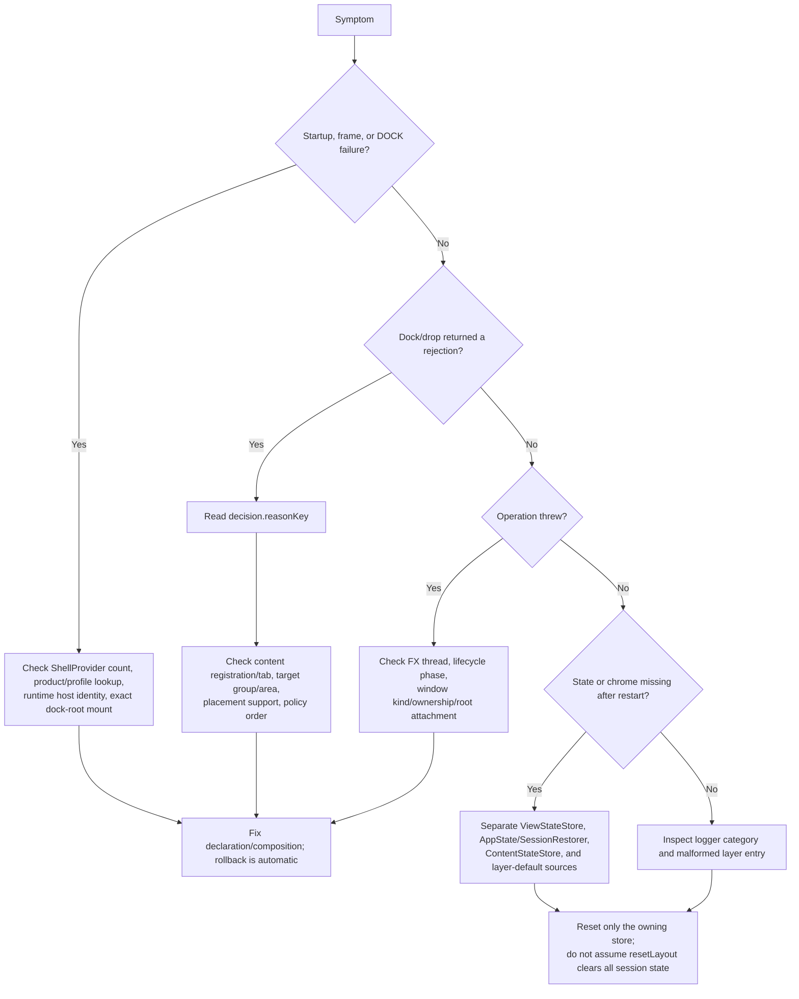
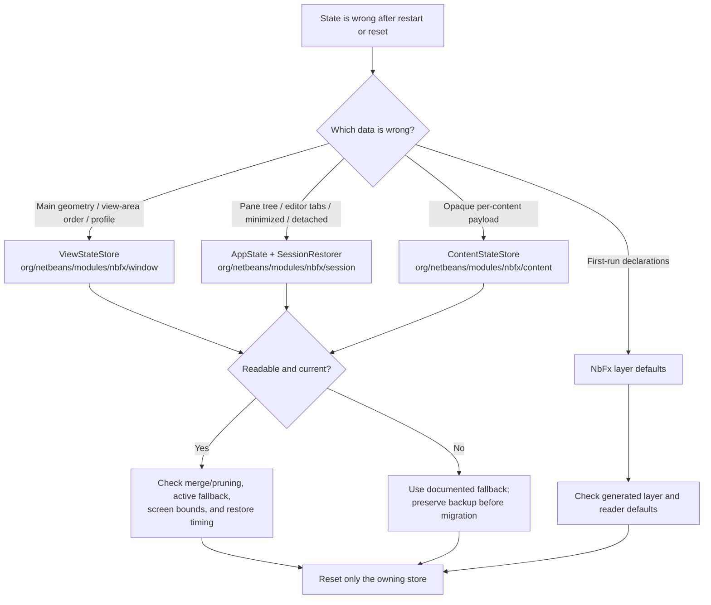

<!--

    Licensed to the Apache Software Foundation (ASF) under one
    or more contributor license agreements.  See the NOTICE file
    distributed with this work for additional information
    regarding copyright ownership.  The ASF licenses this file
    to you under the Apache License, Version 2.0 (the
    "License"); you may not use this file except in compliance
    with the License.  You may obtain a copy of the License at

      http://www.apache.org/licenses/LICENSE-2.0

    Unless required by applicable law or agreed to in writing,
    software distributed under the License is distributed on an
    "AS IS" BASIS, WITHOUT WARRANTIES OR CONDITIONS OF ANY
    KIND, either express or implied.  See the License for the
    specific language governing permissions and limitations
    under the License.

-->
# 25. Errors and troubleshooting

**Baseline:** `60143d8f59`.
This chapter separates returned reason keys, thrown exceptions, logged-and-skipped metadata, and persistence fallback. Those are different failure contracts.

## 25.1 Diagnosis flow

There is no baseline public `DiagnosticsService`. Diagnostics are Java `java.util.logging` records, returned reason keys, layer paths, test XML, and the read-only `ant api-audit` report.

## 25.2 Docking reason keys

### Runtime-emitted keys

| Key | Emitted when | Typical check |
|---|---|---|
| `dock.request.invalid` | `canDock(null)`, null content, or null redock request | Construct a valid `DockRequest`; content/placement/mode are required by the record |
| `dock.content.missing` | Content is not open in `ContentManager`, has no resolvable tab, disappears before `dock`, or a floating pane is empty | Open/register the content and ensure it is a `ViewContent`, `EditorContent`, or `nbfx:view.<id>` tab |
| `dock.target.missing` | Target group/role/pane is absent; relative target is missing/foreign/self; split target is outside the dock area; no dock area exists | Check `groups()`, `primary(role)`, target group membership, and live `DockArea` |
| `dock.placement.unsupported` | Placement is `NEW_WINDOW` or otherwise not implemented for the operation, including `FLOAT` during `redock` | Use an implemented placement or `floatContent`/`createCustomWindow` |
| `dock.window.missing` | Redock handle is not a live `FloatingWindow` owned by this manager, or its stage/pane is gone | Use the exact handle from `windows()`; main/custom/foreign/stale handles cannot redock |
| `dock.window.mismatch` | `DockRequest.content` is not a tab in the supplied floating window | Supply a representative content id that belongs to that floating pane |

### Policy-composition key

| Key | Emitted when |
|---|---|
| `dock.policy.none` | `DockPolicy.anyOf()` is composed with zero policies |

### `DockPolicySpec` / `DockPolicy.fromSpec` keys

| Key | Emitted when |
|---|---|
| `dock.policy.kind` | `acceptedKinds` is nonempty and the resolved content kind is unknown or not accepted |
| `dock.policy.area` | The resolved target area is known and not in nonempty `acceptedAreas` |
| `dock.policy.placement` | The requested placement is not in nonempty `placements` |
| `dock.policy.mode` | The requested transfer mode is not in nonempty `modes` |
| `dock.policy.cross-area` | `allowCrossArea=false` and known source/target areas differ |
| `dock.policy.float` | `allowFloat=false` and placement is `FLOAT` or `NEW_WINDOW` |

Evaluation order is kind → area → placement → mode → cross-area → float → allow. Empty predicate sets are unrestricted. The explicit `targetArea` wins; otherwise `targetGroup` is resolved. Unknown content identity rejects only when a kind allow-list exists; unknown target area skips the area check; unknown source area skips the cross-area check. A null resolver `Optional` is treated as empty. Structural validation in `WindowManager` remains authoritative for missing identities.

`DockPolicySpec`/`fromSpec` are pure and unit-tested but not wired into production policy discovery or pointer drags in this baseline.

### Policy-supplied keys

`DockPolicy.evaluate` may return any nonblank reason key. The first rejecting policy wins. Keys such as `dock.policy.denied`, `dock.policy.first`, and `dock.policy.second` appear in tests as examples, not as a platform-defined enumeration.

### Important reason-key semantics

- `DockDecision.reject(null/blank)` throws `IllegalArgumentException("a rejected dock needs a reason key")`.
- `DockDecision.allow(...)` normalizes a null reason to `""`.
- `DockResult.accepted(...)` requires a nonnull target group.
- A policy can refine an allowed placement. Structural validation runs again after refinement.
- Null policies and null policy decisions are skipped by `DefaultWindowManager`, even though the public policy contract says decisions are nonnull.
- `DockModifier` is not interpreted. A modifier does not change a rejection or implement copy/new-window behavior.
- Reason keys are not automatically localized by `DefaultWindowManager`; callers must present them appropriately.

Sources: [`DefaultWindowManager.java`](../../../nbfx-platform/nbfx.platform.shell/src/org/netbeans/modules/nbfx/platform/shell/DefaultWindowManager.java), [`DockDecision.java`](../../../nbfx-platform/nbfx.api.shell/src/org/netbeans/api/nbfx/shell/DockDecision.java), [`DockPolicy.java`](../../../nbfx-platform/nbfx.api.shell/src/org/netbeans/api/nbfx/shell/DockPolicy.java), [`DockPolicySpec.java`](../../../nbfx-platform/nbfx.api.shell/src/org/netbeans/api/nbfx/shell/DockPolicySpec.java).

## 25.3 Drop reason keys and announcements

| Key | Origin | Meaning |
|---|---|---|
| `drop.no-handler` | `DropRouter` / tab-pane routing | Within one `resolveDetailed` attempt, used when no handler accepts and no real matching rejection was recorded, including no handlers/targets. Cross-source shell routing may retain an earlier synthetic `drop.no-handler`, masking a later real rejection. |
| `drop.open.failed` | `NbfxTabPane` legacy file-open fallback | Openable files were dropped, but no editor `ContentManager` was available |
| Handler-defined key | `DropHandler.evaluate` | First matching rejection is retained when no handler accepts |

`DropAccessibility` localizes `drop.no-handler` and `drop.open.failed`; other keys are announced verbatim. Accepted drops and legacy file-open success announce acceptance. Navigator-owned targets remain silent. Internal tab drags are silent only when their adapted payload is empty: `tabDrag` suppresses NODES and the gesture-source term, but not title TEXT, so a labeled tab drag can still be routed and announced.

### Drop failure containment gaps

- `DropRouter` does not catch exceptions from `handler.evaluate`; a throwing handler can abort routing.
- `NbfxTabPane` does not wrap `handler.perform`; acceptance announcement and drop-completed state occur only after it returns.
- The baseline tab-pane route supplies content/group/area targets only. Overlay/window/global routing is available to direct `DropRouter` callers but not wired here.
- There is no external-drop Escape-cancel/restore path equivalent to the target contract.

Sources: [`DropRouter.java`](../../../nbfx-platform/nbfx.platform.content/src/org/netbeans/modules/nbfx/platform/content/DropRouter.java), [`DropAccessibility.java`](../../../nbfx-platform/nbfx.platform.shell/src/org/netbeans/modules/nbfx/platform/shell/DropAccessibility.java), [`NbfxTabPane.java`](../../../nbfx-platform/nbfx.platform.shell/src/org/netbeans/modules/nbfx/platform/shell/NbfxTabPane.java).

## 25.4 WindowSystem phase errors

`DefaultWindowSystem` has phases `IDLE → INIT → LOADED → SHOWN`.

| Call | Illegal state message/rule |
|---|---|
| `init()` twice | `init() already called; phase=<phase>` |
| `load()` before `init()` | `load() requires phase INIT but is IDLE` |
| `show()` before `load()` | `show() requires phase LOADED but is INIT` |
| `show()` after shown | `show() requires phase LOADED but is SHOWN` |
| `save()` before loaded | `save() requires phase LOADED or SHOWN but is <phase>` |
| `resetLayout()` before loaded | `resetLayout() requires phase LOADED or SHOWN but is <phase>` |
| `hide()` in `IDLE`/`INIT` | No-op, not an exception |
| `setSink(null)` | `NullPointerException` from `Objects.requireNonNull` |
| `addWindowSystemListener(null)` | `NullPointerException` |

Additional behavior:

- `setSink` can replace the sink in any phase; the shell calls it before `init`.
- If no sink was set, the system tries global lookup, then a no-op sink.
- `loadCompleted` is not called if applying the state throws; phase remains `INIT`.
- `saveCompleted` is not called if snapshot/store throws; phase is unchanged.
- Listener exceptions propagate because callbacks are not isolated.
- `resetLayout` emits no load/save callbacks.

Source: [`DefaultWindowSystem.java`](../../../nbfx-platform/nbfx.platform.workspace/src/org/netbeans/modules/nbfx/platform/workspace/DefaultWindowSystem.java).

## 25.5 Provider, product, and profile errors

| Failure | Exception/message | Consequence |
|---|---|---|
| More than one `ShellProvider` | `IllegalStateException: Exactly one ShellProvider is allowed; found N` | Fails before provider/frame creation |
| Provider returns null | `IllegalStateException: ShellProvider returned null` | Frame rollback |
| More than one `ProductProvider` at shell selection | `IllegalStateException: Exactly one ProductProvider is allowed; found N` | Main profile selection fails |
| Product provider returns null | `IllegalStateException: ProductProvider <class> returned null` | Product resolution fails |
| Product policy id has no matching provider | `IllegalStateException: No ChromeProfilePolicyProvider for product policy <id>` | Main profile selection fails |
| Null policy provider/result | `IllegalStateException` naming null provider/result | Policy resolution fails |
| Multiple matching policy providers | `IllegalStateException: Exactly one ChromeProfilePolicyProvider is allowed for <id>; found N` | Policy resolution fails |
| More than one explicit `ShellChromeProfile` | `IllegalStateException: At most one ShellChromeProfile is allowed; found N` | Ambiguous startup lookup fails |
| More than one `ShellProfileHint` | `IllegalStateException: At most one ShellProfileHint is allowed; found N` | Ambiguous startup lookup fails |
| Duplicate declared profile ids | `IllegalArgumentException: Duplicate shell profile id: <id>` | Resolver fails even if another source would be selected |
| Required neutral profile absent | `IllegalStateException: No neutral shell profile for <kind>` | Fallback fails |
| Invalid policy id/lookup | Null/blank policy id or null lookup | `IllegalArgumentException`/`NullPointerException` |

`ProductProvider.resolve(Lookup)` itself requires exactly one provider. Shell startup permits zero product providers and uses neutral defaults; it does not call `resolve` in that case.

Sources: [`ShellApplication.java`](../../../nbfx-platform/nbfx.platform.shell/src/org/netbeans/modules/nbfx/platform/shell/ShellApplication.java), [`ProductProvider.java`](../../../nbfx-platform/nbfx.api.product/src/org/netbeans/api/nbfx/product/ProductProvider.java), [`ChromeProfilePolicyProvider.java`](../../../nbfx-platform/nbfx.api.shell/src/org/netbeans/api/nbfx/shell/ChromeProfilePolicyProvider.java), [`ShellProfileResolver.java`](../../../nbfx-platform/nbfx.api.shell/src/org/netbeans/api/nbfx/shell/ShellProfileResolver.java).

## 25.6 Frame, region-host, and DOCK errors

| Failure | Exception/message | Notes |
|---|---|---|
| Default frame has zero or multiple DOCK regions | `IllegalStateException: Default shell requires exactly one DOCK region; found N` | Counted by kind, not id |
| Custom frame returns wrong host | `IllegalStateException: ShellFrame must use the runtime ShellRegionHost` | Identity comparison |
| Custom frame root is parented | `IllegalStateException: ShellFrame root must be unparented` | Null root throws NPE `ShellFrame root` |
| Runtime dock root not beneath frame root or not host-mounted | `IllegalStateException: ShellFrame did not mount the runtime DOCK root` | Raw attachment is insufficient |
| Frame supplies a different dock root | `IllegalStateException: Dock root does not match the runtime host` | Neutral frame guard |
| Frame sets a second different dock root | `IllegalStateException: Dock root is already mounted` | Same root is a no-op |
| Frame operation after close/off FX thread | `IllegalStateException: Shell frame is closed` or FX-thread message | Close is idempotent on FX thread |
| Duplicate renderer kind | `IllegalArgumentException: Duplicate renderer for <kind>` | Host construction fails |
| Region id already mounted | `IllegalStateException: Shell region already mounted: <id>` | One mount per region id |
| DOCK region but no runtime root | `IllegalStateException: DOCK region requires a runtime dock root` | Structural failure |
| Runtime root already mounted | `IllegalStateException: Runtime dock root is already mounted` | Structural failure |
| Update Node is not mounted for region | `IllegalArgumentException: Node is not mounted for region <id>` | Wrong Node/id |
| Region kind changes during update | `IllegalArgumentException: shell region kind cannot change during update` | Recreate mount instead |
| Region operation off FX thread | `IllegalStateException: Shell region lifecycle requires the JavaFX Application Thread` | Enforced by host |
| Second TOOLBAR region | Renderer throws `IllegalStateException`, but `ShellRegionHostImpl` catches/logs it as `Cannot render shell region <id>`; the wrapper mounts without toolbar renderer output | Neutral renderer limitation; not an escaping exception |

Startup rollback closes the frame, closes the region host, and closes the shell command resolver. Frame-close failures are logged and contained; resolver-close failures are also logged and contained by `closeShellResolver()`. `regionHost.close()` is not wrapped, however, so a failure there can mask the original startup exception.

Sources: [`DefaultShellFrame.java`](../../../nbfx-platform/nbfx.platform.shell/src/org/netbeans/modules/nbfx/platform/shell/DefaultShellFrame.java), [`ShellRegionHostImpl.java`](../../../nbfx-platform/nbfx.platform.shell/src/org/netbeans/modules/nbfx/platform/shell/ShellRegionHostImpl.java), [`ShellApplication.java`](../../../nbfx-platform/nbfx.platform.shell/src/org/netbeans/modules/nbfx/platform/shell/ShellApplication.java).

## 25.7 Floating and custom-window errors

| Failure | Behavior |
|---|---|
| Float options null | `NullPointerException("options")` |
| Float options kind is not `FLOATING` | `IllegalArgumentException: Floating windows require WindowKind.FLOATING` |
| Float content not docked | `IllegalArgumentException: Content is not docked` |
| Float unknown group | `IllegalArgumentException: Unknown dock group: <id>` |
| Float MAIN pane | `IllegalArgumentException: The main pane cannot be floated` |
| Float group outside live dock area | `IllegalArgumentException: Dock group is not in the dock area: <id>` |
| Detached pane already has a stage | `IllegalArgumentException: Pane is already in a window` |
| Floating pane has no stage during registration | `IllegalStateException: Floating pane has no stage` |
| Show a closed floating/custom handle | `IllegalStateException: Window is closed` |
| Custom options kind is not `CUSTOM` | `IllegalArgumentException: Custom windows require WindowKind.CUSTOM` |
| Custom options use `REDOCK` | `IllegalArgumentException: Custom windows cannot redock content` |
| Null `closePolicy` in the 12-argument `WindowOptions` constructor | `NullPointerException("closePolicy")`; the 11-argument constructor supplies `CLOSE_CONTENT` |
| Duplicate live custom id | `IllegalArgumentException: Custom window already exists: <id>` |
| Custom root is parented or in a scene | `IllegalArgumentException: Custom window content root is already attached` |
| Custom root null | `NullPointerException("content root")` |
| Close floating handle owned by another manager | `IllegalArgumentException: Window belongs to another manager` |
| Invalid window dimensions | `IllegalArgumentException: window dimensions must be finite and positive` |

`hide()` keeps a handle live. Close behavior is policy-dependent:

- `HIDE` consumes the native floating/custom close request, hides the window, and leaves the handle managed and re-showable.
- `REDOCK` is floating-only. It precomputes every tab's home or main fallback before moving anything. If any destination is missing or is the floating window itself, the method returns silently without moving tabs; on a native close request the event has already been consumed, so the window remains open with no error or reason key.
- `CLOSE_CONTENT` is the 11-argument/default policy. Floating close uses the existing editor/view confirmation lifecycle. Custom close directly disposes `WindowContent`; it does not provide a uniform dirty-content veto.
- Main-window close remains the existing stage/shutdown path and does not use `WindowClosePolicy`.

A custom `CLOSE_CONTENT` window calls `WindowContent.close()` once even if that call throws, then removes itself from enumeration.

Sources: [`DefaultWindowManager.java`](../../../nbfx-platform/nbfx.platform.shell/src/org/netbeans/modules/nbfx/platform/shell/DefaultWindowManager.java), [`WindowClosePolicy.java`](../../../nbfx-platform/nbfx.api.shell/src/org/netbeans/api/nbfx/shell/WindowClosePolicy.java), [`WindowOptions.java`](../../../nbfx-platform/nbfx.api.shell/src/org/netbeans/api/nbfx/shell/WindowOptions.java), [`CustomWindow.java`](../../../nbfx-platform/nbfx.platform.shell/src/org/netbeans/modules/nbfx/platform/shell/CustomWindow.java), [`FloatingWindow.java`](../../../nbfx-platform/nbfx.platform.shell/src/org/netbeans/modules/nbfx/platform/shell/FloatingWindow.java), [`NbfxTabPane.java`](../../../nbfx-platform/nbfx.platform.shell/src/org/netbeans/modules/nbfx/platform/shell/NbfxTabPane.java).

## 25.8 Stale state, corruption, and reset

### Persistence owners in this baseline

| Owner | Preferences path/data | What it owns | What it does not own |
|---|---|---|---|
| `ViewStateStore` | `org/netbeans/modules/nbfx/window`, schema `1` | Main geometry/maximized/profile, legacy `AreaState` order/active/detach geometry, view payload strings | Full dock tree, editor tabs, arbitrary content payloads, all windows |
| `AppState` + `SessionRestorer` | `org/netbeans/modules/nbfx/session` | Toolbar arrangement, editor/view settings, introduced views, legacy pane/tab layout, minimized/maximized/detached layout, custom-window bounds, project tree state | Target `SessionState`/`ContentStateStore` contract |
| `ContentStateStore` | `org/netbeans/modules/nbfx/content` | Opaque payload keyed by `ContentId` + instance key | Order, group membership, window placement; not wired into production shell |
| Layer registrations | `NbFx/...` | Defaults and declarative metadata | User changes |

### Persistence diagnosis flow

### `ViewStateStore` / `DefaultWindowSystem` merge

On load:

1. No `schema` marker means no persisted state; defaults apply.
2. Persisted areas override matching defaults by area id.
3. Persisted areas not in defaults are dropped.
4. View ids that are unregistered or `PersistenceType.NEVER` are pruned.
5. Missing/foreign active view falls back to the first kept view or `null`.
6. Persisted view payloads override defaults only for registered, non-`NEVER` views.
7. Nonpositive persisted width/height fall back to defaults; `NaN` x/y fall back; maximized is copied.
8. Missing/blank profile key means no recorded profile.

The store catches `BackingStoreException` while enumerating areas/views and falls back to whatever was read. It does **not** catch every possible corruption: for example, a nonblank invalid profile token can fail when constructing `WindowState`, and malformed numeric preference values may propagate from `Preferences`.

### Shell geometry fallback

`ShellApplication.apply(WindowState)` uses legacy `AppState.persistedWindowBounds()` when state width/height is nonpositive. A stored position that intersects no screen is ignored and logged at INFO: `Stored window position is off-screen; centering instead`.

### Legacy session restore

`SessionRestorer` is separate from `ViewStateStore`:

- Missing files are skipped with `Skipping restore of missing file: <path>`.
- A registered view without a `ViewProvider` logs a warning.
- An unregistered pane moves its tabs to editor/default-view fallback rather than dropping them.
- An incompatible recorded dock tree logs a warning and stacks panes over the default shape.
- No editor `ContentManager` logs `No ContentManager found; cannot restore the window layout`; platform-only startup views still open.
- Missing/unknown view area can fall back to a pane through `ViewManager`.

### Reset boundaries

| Operation | Clears/applies | Does not clear |
|---|---|---|
| `WindowSystem.resetLayout()` | Clears `ViewStateStore`; applies layer-derived default areas/payloads | `AppState` session layout, toolbars, editor settings, custom bounds, `ContentStateStore` |
| `DockRuntime.resetLayout()` | Applies declared/default `DockTree` if accepted | Persistence; method is explicitly incomplete |
| `AppState.clearLegacyLayouts()` | Removes legacy layout keys under its layout node | Current session key is also a key there; callers must understand scope |
| `ContentStateStore.clear()` | Removes all content payload child nodes | Window/layout state |

There is no single baseline “reset all UI state” operation.

### `ContentStateStore` corruption caveat

`load` ignores missing id/instance fields and invalid `ContentId` values. Payload decoding is not wrapped, however: malformed Base64 can escape as `IllegalArgumentException` despite the method's “unreadable entry returns empty” Javadoc. Treat this as a baseline robustness gap.

Sources: [`ViewStateStore.java`](../../../nbfx-platform/nbfx.platform.workspace/src/org/netbeans/modules/nbfx/platform/workspace/ViewStateStore.java), [`DefaultWindowSystem.java`](../../../nbfx-platform/nbfx.platform.workspace/src/org/netbeans/modules/nbfx/platform/workspace/DefaultWindowSystem.java), [`AppState.java`](../../../nbfx-platform/nbfx.platform.shell/src/org/netbeans/modules/nbfx/platform/shell/AppState.java), [`SessionRestorer.java`](../../../nbfx-platform/nbfx.platform.shell/src/org/netbeans/modules/nbfx/platform/shell/SessionRestorer.java), [`ContentStateStore.java`](../../../nbfx-platform/nbfx.platform.content/src/org/netbeans/modules/nbfx/platform/content/ContentStateStore.java), [`DockRuntime.java`](../../../nbfx-platform/nbfx.platform.shell/src/org/netbeans/modules/nbfx/platform/shell/DockRuntime.java).

## 25.9 Contribution, renderer, action, icon, status, and theme failures

### Region contents

| Failure | Behavior |
|---|---|
| Renderer throws `RuntimeException` | Logs `Cannot render shell region <id>`; region can still mount without renderer output |
| Contribution supplier throws `RuntimeException` | Logs `Cannot load shell contributions for <id>`; continues with none |
| Contribution returns null | Logs `Cannot create shell contribution <id>` and disposes that contribution |
| Contribution returns parented Node | Same isolation; `region content must be unparented` is the cause |
| Contribution throws `RuntimeException` | Same isolation and disposal |
| Renderer/contribution throws `Error` | Not caught by the per-entry handlers; outer mount cleanup runs and the Error is rethrown |
| Scoped command returns null | Per-action failure is logged and any owned scoped view is disposed |
| Action icon/resolution/binding fails | Per-action failure is logged; other action Nodes remain |
| Renderer/contribution/scoped-command disposal throws `RuntimeException` | Logged; remaining disposal continues |

Mounted wrapper identity remains stable across successful updates. Updates dispose old contents before creating replacements.

### Icons

| Path | Failure behavior |
|---|---|
| `ShellContext.icon` / command icon | Command's own icon wins; no provider/icon returns null |
| Shell action icon provider throws | Caught by per-action region-host isolation |
| Window `ResourceRef` icon missing | Logs `Window icon resource not found: <path>` and keeps default icon |
| Window image cannot be loaded | Logs `Cannot load window icon: <path>` and keeps window opening |
| View tab icon resource missing | `ViewTabs` logs `Icon resource not found: <name>` and returns no icon |
| View icon URL exists but `Image` construction fails | Not caught in `ViewTabs`; tab creation can fail |

### Actions and status

- `ActionRegistryImpl` disposes and ignores a layer command whose `getId()` differs from the layer file id.
- Layer registrations override provider commands with the same id.
- `LayerMenuBuilder` logs `No command registered for action reference: <id>` for unknown commands. `ShellMenuBar` and `ShellToolBars` silently omit missing commands.
- Wrong-typed/malformed action-reference attributes are logged/skipped rather than broadened.
- `StatusElementRegistry` logs and skips reflection failures. Unknown alignment logs and falls back to `LEFT`.
- `StatusBar` skips a null element Node. Its `dispose()` does not isolate element disposal exceptions.

### Theme and token failures

| Failure | Behavior |
|---|---|
| No user directory | Warns once: `No user directory is available; using the bundled themes only` |
| Theme folder cannot be created | Logs warning; bundled themes remain |
| Invalid `netbeans.user` | Logs warning and uses bundled themes |
| User theme folder cannot be listed | Logs at FINE |
| Missing selected and default theme file | Theme URL may be absent; common controls and token defaults remain |
| Incomplete token registration | Logs and skips |
| Token owner class missing | Logs at FINE and skips |
| Token stylesheet unresolved | Logs and skips |
| Token provider throws/returns null/blank/missing resources | Provider/entry failure is isolated and logged |
| Malformed CSS | JavaFX CSS machinery reports the parse problem; `NbfxTheme.apply` does not pre-validate CSS |

The static theme install is idempotent. `dispose()` removes listeners and forgets tracked scenes. This is not the target per-application `ThemeManager` lifecycle.

Sources: [`ShellRegionHostImpl.java`](../../../nbfx-platform/nbfx.platform.shell/src/org/netbeans/modules/nbfx/platform/shell/ShellRegionHostImpl.java), [`ShellIconProvider.java`](../../../nbfx-platform/nbfx.api.shell/src/org/netbeans/api/nbfx/shell/ShellIconProvider.java), [`ViewTabs.java`](../../../nbfx-platform/nbfx.platform.shell/src/org/netbeans/modules/nbfx/platform/shell/ViewTabs.java), [`ActionRegistryImpl.java`](../../../nbfx-platform/nbfx.platform.actions/src/org/netbeans/modules/nbfx/platform/actions/ActionRegistryImpl.java), [`StatusElementRegistry.java`](../../../nbfx-platform/nbfx.api.status/src/org/netbeans/api/nbfx/status/StatusElementRegistry.java), [`ThemeTokenRegistry.java`](../../../nbfx-platform/nbfx.platform.theme/src/org/netbeans/modules/nbfx/platform/theme/ThemeTokenRegistry.java), [`NbfxTheme.java`](../../../nbfx-platform/nbfx.platform.theme/src/org/netbeans/modules/nbfx/platform/theme/NbfxTheme.java).

## 25.10 Layer and processor diagnostics

Use the generated layer and logger path to identify the owning declaration.

| Symptom | Likely source | Diagnostic |
|---|---|---|
| Region absent | Invalid id/kind/type/profile/style/visibility | `Cannot read shell region <path>: ...` |
| Duplicate region | Two folders canonicalize to same id | `Duplicate shell region id ... at ...` |
| Profile absent | Wrong-typed/invalid enum/region/token | `Cannot read shell profile <path>: ...` |
| Contribution absent | Bad metadata/class/constructor | `Cannot read shell contribution ...` or `LayerInstances` warn-once |
| Layout absent | XML/model error or file/id mismatch | `Cannot read layout ...` or `Layout file ... declares id ...` |
| Standalone group absent | Unknown owning area | `Cannot read dock group ...: unknown area ...` |
| Action reference absent | Missing id/wrong type/bad token/hint | `Cannot read action reference ...` |
| Legacy pane absent | Invalid role/kind/editor restriction | `Ignoring pane ...` / `Pane ...` warnings |
| Window layout ignored | Malformed tree or unknown permanent roles | `Malformed window layout tree` / `Ignoring window layout ...` |
| View startup tab absent | No provider service | `View <id> is registered but has no ViewProvider service` |
| No place to show view | No pane for location/area | `No pane to show the view <id> in` |

Annotation errors happen earlier and fail compilation; runtime skips cannot fix them. See the complete attribute tables in [annotations and layer schema](24-annotations-and-layer-schema.md).

## 25.11 Useful diagnostics and commands

| Need | Command/source |
|---|---|
| See all current Ant targets | `ant help` |
| Read effective cluster/JavaFX configuration | `ant print-config` |
| Inspect exported/public type reality | `ant api-audit` (writes `build/api-audit.txt`; not a gate) |
| Check API type snapshot | `ant check-api` |
| Run source/dependency/layer/AppShell guards | `ant check-purity` or `ant guards` |
| Run platform unit tests | `ant platform-test` |
| Run AppShell fixture target | `ant appshell-conformance` |
| Inspect a module's JUnit XML | `netbeans/**/build/test/unit/results/TEST-*.xml` |
| Inspect generated layer | Module `build/classes/META-INF/generated-layer.xml` or the test compilation's layer file |
| Inspect user preferences | Platform userdir preferences under the paths listed above |
| Enable detailed dock layout logging | `Docking.LOG_LAYOUT` is a package-private constant currently `false`; it is not a runtime switch |
| Inspect session capture | `SessionRestorer` logs pane count/focused index at INFO and focus detail at FINE |
| Inspect UI-ready failures | `UiReady` logs `UI-ready task failed: <task>` and continues |

`ant check-purity` defaults to report-only (`nbfx.purity.strict=false`). Use `-Dnbfx.purity.strict=true` when a nonzero guard count must fail Ant. The standalone `check-platform-delivery` wrapper currently records the guard result but does not itself fail on a nonzero result; inspect its output rather than assuming the wrapper enforced it.

See [testing, build, and conformance](26-testing-build-and-conformance.md) for exact test selection semantics and guard coverage.
