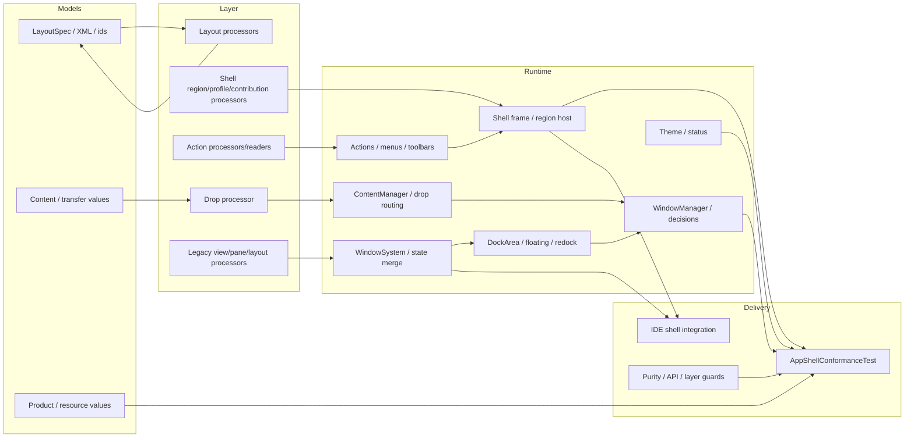

<!--

    Licensed to the Apache Software Foundation (ASF) under one
    or more contributor license agreements.  See the NOTICE file
    distributed with this work for additional information
    regarding copyright ownership.  The ASF licenses this file
    to you under the Apache License, Version 2.0 (the
    "License"); you may not use this file except in compliance
    with the License.  You may obtain a copy of the License at

      http://www.apache.org/licenses/LICENSE-2.0

    Unless required by applicable law or agreed to in writing,
    software distributed under the License is distributed on an
    "AS IS" BASIS, WITHOUT WARRANTIES OR CONDITIONS OF ANY
    KIND, either express or implied.  See the License for the
    specific language governing permissions and limitations
    under the License.

-->
# 26. Testing, build, and conformance

**Baseline:** `60143d8f59`.
This chapter inventories the tests and build targets that exist in the checkout. No fresh test pass counts are claimed; the documentation work did not execute the Ant build.

## 26.1 Headless JavaFX support

### Shared JVM properties

FX test modules load [`nbfx-tests/test-fx.properties`](../../../nbfx-tests/test-fx.properties) before `projectized.xml`:

```properties
test-unit-sys-prop.glass.platform=Headless
test-unit-sys-prop.prism.order=sw
test-unit-sys-prop.java.library.path=${basedir}/../../nbfx-libs/libs.nbfx.javafx/release/modules/lib
```

This uses the JDK's headless Glass platform and software Prism, with the pinned JavaFX native directory from `nbfx-libs/libs.nbfx.javafx`. It does not use Monocle. The properties are not inherited from a test dependency; each FX module loads the shared file.

`nbfx.platform.shell` also sets:

```properties
test-unit-sys-prop.java.util.prefs.PreferencesFactory=org.netbeans.junit.internal.MemoryPreferencesFactory
```

so shell tests do not modify the developer's real Java preferences. The module targets Java 25 (`javac.release=25`).

### `JavaFxTestSupport`

[`JavaFxTestSupport.java`](../../../nbfx-tests/nbfx.test.fx/src/org/netbeans/modules/nbfx/test/fx/JavaFxTestSupport.java) is test-only support in the non-shipped `nbfx-qa` cluster:

- starts JavaFX once per test JVM with `Platform.startup`;
- sets `Platform.setImplicitExit(false)` so hiding the last window does not kill later tests;
- runs tasks through `Platform.runLater` and waits up to 30 seconds;
- rethrows `AssertionError` directly and wraps other failures in `AssertionError`;
- provides `hideWindows()` to avoid repaint errors during toolkit shutdown.

Headless support covers stages, scenes, tab panes, layout, and basic interaction logic. It is not a replacement for real display, multi-monitor, native-window, or OS-level drag/drop testing.

## 26.2 Build and test targets

Run from the repository root.

| Command | What it does |
|---|---|
| `ant bootstrap` | Initializes the pinned submodule, applies patches, generates cluster config, fetches/unpacks pinned JavaFX, creates overlay, writes git info |
| `ant build` | Bootstraps and builds the full `nbfx` cluster configuration |
| `ant platform-build` | Builds `nbfx-platform` configuration and invokes the platform-delivery guard wrapper |
| `ant test` | Bootstraps, builds test-only QA cluster, runs `test-unit` for every selected module, then checks JUnit XML |
| `ant test -Dtest.modules=nbfx-platform/*` | Restricts module discovery to platform modules |
| `ant platform-test` | Depends on `platform-build`, then runs tests for `nbfx-platform/*` |
| `ant appshell-conformance` | Depends on `platform-build`, selects `nbfx.platform.shell`, and requests `**/AppShellConformanceTest.class` |
| `ant module -Dmodule=nbfx-platform/nbfx.platform.shell -Dmodule.target=test-unit` | Fast loop for one already-built module; builds QA test support first |
| `ant check-purity` | Runs source/dependency/jar/packaging and specialized guards |
| `ant check-purity -Dnbfx.purity.strict=true` | Fails Ant when any purity count is nonzero |
| `ant check-api` | Checks governed exported packages/public top-level types against `docs/plan/api-snapshot.txt` |
| `ant guards` | Runs `check-purity`, `check-figures`, and `check-api`; does not build or test |
| `ant api-audit` | Writes read-only `build/api-audit.txt`; not a gate |

### `ant test` result handling

The target in [`build.xml`](../../../build.xml):

1. finds `build.xml` files under the overlaid `netbeans/nbfx-*/*` selected by `test.modules`;
2. writes the module list to `build/test-modules.txt`;
3. deletes stale `TEST-*.xml` so a failed build cannot look like a pass;
4. runs all module `test-unit` targets with `failonerror=false`;
5. runs [`TestResults.java`](../../../nbfx-tests/tools/TestResults.java).

`TestResults` expects JUnit XML for every module containing a `*Test.java`. It uses regexes rather than an XML parser: it detects missing result files, a missing `<testsuite ...>` opener, reported failures/errors, and expected-versus-actual module result-count mismatches. It does not validate general XML well-formedness. It prints runtime counts; this manual deliberately does not freeze them.

### Conformance-filter caveat

`appshell-conformance` passes `test.includes=**/AppShellConformanceTest.class` to `test`, but `test` does not explicitly forward that property in its `<subant>` call. The target definitely selects the shell module; do not assume a class-only run without checking the produced JUnit XML. This is a build-harness uncertainty, not a source behavior claim.

### Platform delivery caveat

`platform-build` invokes `check-platform-delivery`, but that wrapper uses `failonerror=false`, stores the exit result, and only echoes a count. It does not itself fail on a nonzero guard result. Read `[platform] ...` output. The aggregate `check-purity` target can fail on the count when strict mode is enabled.

Sources: [`build.xml`](../../../build.xml), [`check-purity.xml`](../../../check-purity.xml), [`TestResults.java`](../../../nbfx-tests/tools/TestResults.java), [`nbfx.platform.shell/build.xml`](../../../nbfx-platform/nbfx.platform.shell/build.xml), [`nbfx.platform.shell/nbproject/project.properties`](../../../nbfx-platform/nbfx.platform.shell/nbproject/project.properties).

## 26.3 `AppShellConformanceTest`

Source: [`AppShellConformanceTest.java`](../../../nbfx-platform/nbfx.platform.shell/test/unit/src/org/netbeans/modules/nbfx/platform/shell/AppShellConformanceTest.java).

| Test | What it proves |
|---|---|
| `noIdeModulesOnThePlatformClasspath` | `org.netbeans.modules.nbfx.ide.workbench.JavaFXLaunchApp` cannot be loaded; `ShellApplication` is present; `ShellAppProvider` selects it |
| `defaultShellApplicationStarts` | Default shell starts; frame/status/main pane/sliding area exist; generated custom pane/area are instantiated; keep-when-empty works; `ViewManager` places registered, unregistered, and unknown-area views with fallback |
| `actionRegistryWorksWithoutIdeModules` | A programmatically registered `RunnableCommand` resolves and runs without IDE modules |
| `propertySheetOutputProgressAndWizardsWork` | Properties provider contract works; Properties view is registered; output console and wizard registry/displayer exist. The body does not contain a separate progress-behavior assertion despite the method name. |

`@After` hides all windows. The fixture is stronger than a normal module test because it asserts a classpath boundary, but it is not a full CJAP target conformance suite: it does not exercise `LayoutSpec` runtime construction, `SessionState`, `WindowClosePolicy`, `DockPolicySpec` production wiring, `WindowActivation`, external-drop payload extraction, `TabMover` focus-loss cancellation, `FocusController`, `OverlayHost`, arbitrary content docking, or per-window profile frames.

Related guard: [`PlatformDeliveryGuard.java`](../../../nbfx-tests/tools/PlatformDeliveryGuard.java) rejects `nbfx-ide`/`nbfx-java` cluster selections and jar-name prefixes in the platform cluster and requires the shell jar. It is a configuration/packaging check, not a recursive class dependency analysis.

## 26.4 Behavior-to-test coverage map



Target-only or still-unwired behaviors have no complete baseline test node: `ShellRuntime`, target `api.docking`/`api.theme`, live `LayoutSpec` adoption, `SessionState`/`WindowStateStore`, per-window chrome frames, owner-window close propagation, complete close-policy veto/persistence, production `DockPolicySpec` resolver/pointer integration, `FocusController`, and `OverlayHost`. `WindowClosePolicy` itself now has unit coverage.

## 26.5 Real unit tests and what they prove

Paths below are under each module's `test/unit/src`. Support classes such as `ShellProcessorTestSupport`, `LayoutProcessorTestSupport`, `MemoryPreferences`, and fixtures are not themselves test suites.

### `nbfx.api.shell`

| Test file | Proven behavior |
|---|---|
| [`ShellProfileResolverTest`](../../../nbfx-platform/nbfx.api.shell/test/unit/src/org/netbeans/api/nbfx/shell/ShellProfileResolverTest.java) | Explicit/hint/policy/neutral precedence, decoration override, unknown hint fallback, duplicate ids, missing neutral profile |
| [`ShellProfileRegistryTest`](../../../nbfx-platform/nbfx.api.shell/test/unit/src/org/netbeans/api/nbfx/shell/ShellProfileRegistryTest.java) | Profile discovery and malformed-folder isolation |
| [`ShellProfileApiTest`](../../../nbfx-platform/nbfx.api.shell/test/unit/src/org/netbeans/api/nbfx/shell/ShellProfileApiTest.java) | Immutable allow-list, inclusive empty/legacy profiles, policy copy, window dimension validation |
| [`ChromeProfilePolicyProviderTest`](../../../nbfx-platform/nbfx.api.shell/test/unit/src/org/netbeans/api/nbfx/shell/ChromeProfilePolicyProviderTest.java) | Named policy resolution, no-provider result, duplicate/null/invalid provider failure |
| [`ShellRegionTest`](../../../nbfx-platform/nbfx.api.shell/test/unit/src/org/netbeans/api/nbfx/shell/ShellRegionTest.java) | Built-in canonicalization, namespaced product ids, malformed rejection, profile-set copy |
| [`ShellRegionRegistryTest`](../../../nbfx-platform/nbfx.api.shell/test/unit/src/org/netbeans/api/nbfx/shell/ShellRegionRegistryTest.java) | Direct-folder discovery, profile filtering, duplicate canonical id handling |
| [`ShellContributionRegistryTest`](../../../nbfx-platform/nbfx.api.shell/test/unit/src/org/netbeans/api/nbfx/shell/ShellContributionRegistryTest.java) | Metadata-only discovery, fresh filtered instances, malformed/nested/wrong-type skips |
| [`ShellFrameApiTest`](../../../nbfx-platform/nbfx.api.shell/test/unit/src/org/netbeans/api/nbfx/shell/ShellFrameApiTest.java) | Legacy profile defaults, stable id override, required region context, optional renderer disposal |
| [`DockPolicyTest`](../../../nbfx-platform/nbfx.api.shell/test/unit/src/org/netbeans/api/nbfx/shell/DockPolicyTest.java) | `allOf`/`anyOf` ordering, short-circuiting, placement refinement, empty-policy reason, `DockPolicySpec` kind/area/placement/mode/cross-area/float gates, defensive set copies |
| [`DockWindowContractTest`](../../../nbfx-platform/nbfx.api.shell/test/unit/src/org/netbeans/api/nbfx/shell/DockWindowContractTest.java) | Window id canonical form/namespace requirement, 11-argument `WindowOptions` default `CLOSE_CONTENT`, null close-policy rejection, opaque content-state copy |
| [`PaneRoleTest`](../../../nbfx-platform/nbfx.api.shell/test/unit/src/org/netbeans/api/nbfx/shell/PaneRoleTest.java) | Legacy role canonicality, word validation, MAIN editor kind, product-role equality |
| [`ShellRegionRegistrationProcessorTest`](../../../nbfx-platform/nbfx.api.shell/test/unit/src/org/netbeans/api/nbfx/shell/ShellRegionRegistrationProcessorTest.java) | Region metadata generation/equality, repeatable container, product kinds, invalid/duplicate rejection, service discovery |
| [`ShellContributionRegistrationProcessorTest`](../../../nbfx-platform/nbfx.api.shell/test/unit/src/org/netbeans/api/nbfx/shell/ShellContributionRegistrationProcessorTest.java) | Direct instance generation, DOCK rejection, profile/constructor/type/duplicate checks, service discovery |
| [`ShellProfileRegistrationProcessorTest`](../../../nbfx-platform/nbfx.api.shell/test/unit/src/org/netbeans/api/nbfx/shell/ShellProfileRegistrationProcessorTest.java) | Repeatable profile folders, file-safe/enum/id validation, duplicate rejection, service discovery |

### `nbfx.api.layout`

| Test file | Proven behavior |
|---|---|
| [`LayoutIdTest`](../../../nbfx-platform/nbfx.api.layout/test/unit/src/org/netbeans/api/nbfx/layout/LayoutIdTest.java) | Built-in short forms, namespaced id round trips, malformed rejection |
| [`LayoutSpecTest`](../../../nbfx-platform/nbfx.api.layout/test/unit/src/org/netbeans/api/nbfx/layout/LayoutSpecTest.java) | Zero-content layout, nested splits, references, duplicate identities, defensive copies, divider endpoints/range/order, normalization/idempotence |
| [`LayoutXmlTest`](../../../nbfx-platform/nbfx.api.layout/test/unit/src/org/netbeans/api/nbfx/layout/LayoutXmlTest.java) | Deterministic round trips, inheritance, includes/ownership/depth/cycles, grammar/path diagnostics, unsafe XML/version rejection |
| [`LayoutRegistryTest`](../../../nbfx-platform/nbfx.api.layout/test/unit/src/org/netbeans/api/nbfx/layout/LayoutRegistryTest.java) | Valid catalog reads, malformed skips, unknown-area group skips |
| [`LayoutRegistrationProcessorTest`](../../../nbfx-platform/nbfx.api.layout/test/unit/src/org/netbeans/api/nbfx/layout/LayoutRegistrationProcessorTest.java) | Self-contained resource, repeatable container, XML/id/bundle/duplicate/UTF-8/file-id validation |
| [`ViewAreaRegistrationProcessorTest`](../../../nbfx-platform/nbfx.api.layout/test/unit/src/org/netbeans/api/nbfx/layout/ViewAreaRegistrationProcessorTest.java) | Area metadata equality, bundle checks, defaults/canonicalization/repeatability, invalid weight/id/duplicates |
| [`DockGroupRegistrationProcessorTest`](../../../nbfx-platform/nbfx.api.layout/test/unit/src/org/netbeans/api/nbfx/layout/DockGroupRegistrationProcessorTest.java) | Group metadata, inherited presentation/policy, repeatability/canonical area, invalid/duplicate ids |

### `nbfx.api.content`

| Test file | Proven behavior |
|---|---|
| [`ContentVocabularyTest`](../../../nbfx-platform/nbfx.api.content/test/unit/src/org/netbeans/api/nbfx/content/ContentVocabularyTest.java) | Content id/kind values, namespace requirement, state payload copy/instance-key requirement |
| [`ContentContractTest`](../../../nbfx-platform/nbfx.api.content/test/unit/src/org/netbeans/api/nbfx/content/ContentContractTest.java) | Factory round trip and neutral content requirements |
| [`TransferVocabularyTest`](../../../nbfx-platform/nbfx.api.content/test/unit/src/org/netbeans/api/nbfx/content/TransferVocabularyTest.java) | Transfer kind parsing, MOVE/COPY/LINK, all neutral placements |
| [`TransferContractTest`](../../../nbfx-platform/nbfx.api.content/test/unit/src/org/netbeans/api/nbfx/content/TransferContractTest.java) | Drop target/global fallback, target-kind parsing, decision effect/reason validation, request metadata |
| [`DropRegistrationProcessorTest`](../../../nbfx-platform/nbfx.api.content/test/unit/src/org/netbeans/api/nbfx/content/DropRegistrationProcessorTest.java) | Handler layer generation, canonical source/target metadata, invalid sources/duplicates, service discovery |

### `nbfx.platform.content`

| Test file | Proven behavior |
|---|---|
| [`DefaultContentManagerTest`](../../../nbfx-platform/nbfx.platform.content/test/unit/src/org/netbeans/modules/nbfx/platform/content/DefaultContentManagerTest.java) | First-open active, id lookup, duplicate suppression, close/dispose, veto, active advancement/clear |
| [`ContentStateStoreTest`](../../../nbfx-platform/nbfx.platform.content/test/unit/src/org/netbeans/modules/nbfx/platform/content/ContentStateStoreTest.java) | Opaque payload round trip, distinct instance keys, replacement, clear |
| [`DropRouterTest`](../../../nbfx-platform/nbfx.platform.content/test/unit/src/org/netbeans/modules/nbfx/platform/content/DropRouterTest.java) | Target-priority routing, URI/text/node sources, first rejection without reevaluation, no-handler key, wrong target/source skips |

### `nbfx.platform.workspace`

| Test file | Proven behavior |
|---|---|
| [`FxWindowSystemTest`](../../../nbfx-platform/nbfx.platform.workspace/test/unit/src/org/netbeans/modules/nbfx/platform/workspace/FxWindowSystemTest.java) | Layer defaults, persisted override, stale/never pruning, geometry, save/reload, profile id, corrupt partial fallback, reset, phase guards, listener notification/discovery |
| [`DockAreaTest`](../../../nbfx-platform/nbfx.platform.workspace/test/unit/src/org/netbeans/modules/nbfx/platform/workspace/DockAreaTest.java) | Minimize/restore anchors, empty-pane lifecycle, keep-when-empty, tree application, maximize set-aside, main-row semantics, detach/redock validation |
| [`DockTreesTest`](../../../nbfx-platform/nbfx.platform.workspace/test/unit/src/org/netbeans/modules/nbfx/platform/workspace/DockTreesTest.java) | Derived/explicit dividers, flexible remainder, equal shares |
| [`WindowLayoutRegistryTest`](../../../nbfx-platform/nbfx.platform.workspace/test/unit/src/org/netbeans/modules/nbfx/platform/workspace/WindowLayoutRegistryTest.java) | Declared legacy tree read and empty-divider weight derivation |
| [`WindowEnvironmentTest`](../../../nbfx-platform/nbfx.platform.workspace/test/unit/src/org/netbeans/modules/nbfx/platform/workspace/WindowEnvironmentTest.java) | Safe default environment behavior |

### `nbfx.platform.shell`

| Test file | Proven behavior |
|---|---|
| [`WindowManagerTest`](../../../nbfx-platform/nbfx.platform.shell/test/unit/src/org/netbeans/modules/nbfx/platform/shell/WindowManagerTest.java) | Group/content operations, unique group ids, close lifecycle, policy rejection, into/before/after/split/edge/FLOAT, float/redock, hide/show/close, window enumeration, native floating close with `HIDE` and `REDOCK` |
| [`CustomWindowTest`](../../../nbfx-platform/nbfx.platform.shell/test/unit/src/org/netbeans/modules/nbfx/platform/shell/CustomWindowTest.java) | Custom create/enumerate/close, `HIDE` close remaining managed, custom `REDOCK` rejection, remembered bounds across managers |
| [`TabMoverTest`](../../../nbfx-platform/nbfx.platform.shell/test/unit/src/org/netbeans/modules/nbfx/platform/shell/TabMoverTest.java) | Escape and explicit `cancelActive()` end keyboard move mode without changing the tab's pane |
| [`WindowActivationTest`](../../../nbfx-platform/nbfx.platform.shell/test/unit/src/org/netbeans/modules/nbfx/platform/shell/WindowActivationTest.java) | `WindowActivation.show` shows the stage and calls `toFront()`; it does not assert `requestFocus()` |
| [`ExternalDropRoutingTest`](../../../nbfx-platform/nbfx.platform.shell/test/unit/src/org/netbeans/modules/nbfx/platform/shell/ExternalDropRoutingTest.java) | Neutral `ExternalDrop` records route FILES/URIS/TEXT/NODES, preserve source priority/rejection, and ignore tab drags/navigator-owned targets |
| [`ShellRegionHostImplTest`](../../../nbfx-platform/nbfx.platform.shell/test/unit/src/org/netbeans/modules/nbfx/platform/shell/ShellRegionHostImplTest.java) | Stable wrappers, update/dispose, null/parented/failing contribution isolation, DOCK ownership, profile intersection, FX guard, duplicate roots/kind changes, overlay bounds/a11y, scoped actions, default-frame arrangement |
| [`CustomShellProviderTest`](../../../nbfx-platform/nbfx.platform.shell/test/unit/src/org/netbeans/modules/nbfx/platform/shell/CustomShellProviderTest.java) | Runtime host/default services, duplicate-provider failure, omitted/raw DOCK rollback |
| [`ShellProfileStartupTest`](../../../nbfx-platform/nbfx.platform.shell/test/unit/src/org/netbeans/modules/nbfx/platform/shell/ShellProfileStartupTest.java) | Product profile published before provider creation |
| [`ShellProfileSelectionTest`](../../../nbfx-platform/nbfx.platform.shell/test/unit/src/org/netbeans/modules/nbfx/platform/shell/ShellProfileSelectionTest.java) | Neutral/hint/policy/explicit precedence, missing/duplicate product policy failure, pre-show decoration |
| [`ShellSmokeTest`](../../../nbfx-platform/nbfx.platform.shell/test/unit/src/org/netbeans/modules/nbfx/platform/shell/ShellSmokeTest.java) | Checks `ShellAppProvider` and manually builds tab panes, a dock area, and a view tab without IDE modules; full `ShellApplication` startup is covered by `AppShellConformanceTest` |
| [`ShellChromeTest`](../../../nbfx-platform/nbfx.platform.shell/test/unit/src/org/netbeans/modules/nbfx/platform/shell/ShellChromeTest.java) | Empty chrome safety, default chrome creation, context lookup retention |
| [`ShellWindowProviderTest`](../../../nbfx-platform/nbfx.platform.shell/test/unit/src/org/netbeans/modules/nbfx/platform/shell/ShellWindowProviderTest.java) | Provider/context expose the same window |
| [`ShellContentManagerTest`](../../../nbfx-platform/nbfx.platform.shell/test/unit/src/org/netbeans/modules/nbfx/platform/shell/ShellContentManagerTest.java) | Per-shell content manager publication in lookup |
| [`ViewContentLifecycleTest`](../../../nbfx-platform/nbfx.platform.shell/test/unit/src/org/netbeans/modules/nbfx/platform/shell/ViewContentLifecycleTest.java) | View tabs publish open/close to content manager |
| [`EditorContentLifecycleTest`](../../../nbfx-platform/nbfx.platform.shell/test/unit/src/org/netbeans/modules/nbfx/platform/shell/EditorContentLifecycleTest.java) | Editor tabs publish open/close to content manager |
| [`EditorContentTest`](../../../nbfx-platform/nbfx.platform.shell/test/unit/src/org/netbeans/modules/nbfx/platform/shell/EditorContentTest.java) | Stable/distinct editor identities, adapter delegation, empty state, harmless close without context |
| [`NbfxTabPaneFloatTest`](../../../nbfx-platform/nbfx.platform.shell/test/unit/src/org/netbeans/modules/nbfx/platform/shell/NbfxTabPaneFloatTest.java) | Source-kind preservation, content preservation on redock/close, normal close unregister |
| [`DockRuntimeIsolationTest`](../../../nbfx-platform/nbfx.platform.shell/test/unit/src/org/netbeans/modules/nbfx/platform/shell/DockRuntimeIsolationTest.java) | Separate runtime areas/panes, static-facade non-replacement on direct construction, isolated dispose, zero-content reset shape |
| [`DockingCompositionTest`](../../../nbfx-platform/nbfx.platform.shell/test/unit/src/org/netbeans/modules/nbfx/platform/shell/DockingCompositionTest.java) | Area/lifecycle lookups use resolved composition |
| [`WindowCompositionTest`](../../../nbfx-platform/nbfx.platform.shell/test/unit/src/org/netbeans/modules/nbfx/platform/shell/WindowCompositionTest.java) | Role/area pane resolution, fallback role, weight-derived dividers, editor exclusion/order |
| [`WindowPaneRegistryTest`](../../../nbfx-platform/nbfx.platform.shell/test/unit/src/org/netbeans/modules/nbfx/platform/shell/WindowPaneRegistryTest.java) | Product/platform pane discovery, reserved-role and editor-pane restrictions |
| [`WindowPaneProviderTest`](../../../nbfx-platform/nbfx.platform.shell/test/unit/src/org/netbeans/modules/nbfx/platform/shell/WindowPaneProviderTest.java) | Wrong-role rejection, host factory context, priority selection |
| [`CustomPaneRegistrationTest`](../../../nbfx-platform/nbfx.platform.shell/test/unit/src/org/netbeans/modules/nbfx/platform/shell/CustomPaneRegistrationTest.java) | Generated custom pane/area layer registration |
| [`SessionRestorerTest`](../../../nbfx-platform/nbfx.platform.shell/test/unit/src/org/netbeans/modules/nbfx/platform/shell/SessionRestorerTest.java) | Restored view tabs move to default view pane |
| [`AppStateLayoutTest`](../../../nbfx-platform/nbfx.platform.shell/test/unit/src/org/netbeans/modules/nbfx/platform/shell/AppStateLayoutTest.java) | Corrupt role handling, minimized/anchor/editor-kind round trips, pre-sliding compatibility, pruned-anchor remapping |
| [`ShellMenuBarTest`](../../../nbfx-platform/nbfx.platform.shell/test/unit/src/org/netbeans/modules/nbfx/platform/shell/ShellMenuBarTest.java) | Dynamic sections, localized range updates/separators, submenus, profile/action-reference filtering, Configure Window separator |
| [`ShellToolBarsTest`](../../../nbfx-platform/nbfx.platform.shell/test/unit/src/org/netbeans/modules/nbfx/platform/shell/ShellToolBarsTest.java) | Toolbar/item profile filters, drag handles, action-reference profiles, empty-bar skip |
| [`ShellCommandsProviderTest`](../../../nbfx-platform/nbfx.platform.shell/test/unit/src/org/netbeans/modules/nbfx/platform/shell/ShellCommandsProviderTest.java) | Document-scoped close/close-others commands |
| [`ShellBrandingTest`](../../../nbfx-platform/nbfx.platform.shell/test/unit/src/org/netbeans/modules/nbfx/platform/shell/ShellBrandingTest.java) | Priority selection, empty appearance defaults, deterministic ties |
| [`ShellIconProviderTest`](../../../nbfx-platform/nbfx.platform.shell/test/unit/src/org/netbeans/modules/nbfx/platform/shell/ShellIconProviderTest.java) | Command icon precedence, provider fallback, null result |
| [`ViewTabsTitleTest`](../../../nbfx-platform/nbfx.platform.shell/test/unit/src/org/netbeans/modules/nbfx/platform/shell/ViewTabsTitleTest.java) | View title display and live title following |
| [`ViewManagerServiceTest`](../../../nbfx-platform/nbfx.platform.shell/test/unit/src/org/netbeans/modules/nbfx/platform/shell/ViewManagerServiceTest.java) | Open-view reporting/listener and kind filtering |
| [`NbfxGlobalContextProviderTest`](../../../nbfx-platform/nbfx.platform.shell/test/unit/src/org/netbeans/modules/nbfx/platform/shell/NbfxGlobalContextProviderTest.java) | Active view/editor/navigator precedence and selection retention |
| [`DefaultWindowEnvironmentTest`](../../../nbfx-platform/nbfx.platform.shell/test/unit/src/org/netbeans/modules/nbfx/platform/shell/DefaultWindowEnvironmentTest.java) | Late contribution discovery and detached window scope |
| [`WindowEnvironmentCapabilityTest`](../../../nbfx-platform/nbfx.platform.shell/test/unit/src/org/netbeans/modules/nbfx/platform/shell/WindowEnvironmentCapabilityTest.java) | Focused capability composition, tab-home precedence, detached bars context |
| [`DropAccessibilityTest`](../../../nbfx-platform/nbfx.platform.shell/test/unit/src/org/netbeans/modules/nbfx/platform/shell/DropAccessibilityTest.java) | Accepted/rejected announcements and raw policy-key fallback |
| [`UiReadyTest`](../../../nbfx-platform/nbfx.platform.shell/test/unit/src/org/netbeans/modules/nbfx/platform/shell/UiReadyTest.java) | Annotated UI-ready task dispatch |
| [`PlatformShellRegionsTest`](../../../nbfx-platform/nbfx.platform.shell/test/unit/src/org/netbeans/modules/nbfx/platform/shell/PlatformShellRegionsTest.java) | Required neutral regions and exactly one DOCK |
| [`PlatformChromeFixtureTest`](../../../nbfx-platform/nbfx.platform.shell/test/unit/src/org/netbeans/modules/nbfx/platform/shell/PlatformChromeFixtureTest.java) | Default shell shows generated platform contributions |
| [`AppShellConformanceTest`](../../../nbfx-platform/nbfx.platform.shell/test/unit/src/org/netbeans/modules/nbfx/platform/shell/AppShellConformanceTest.java) | Platform-only classpath/startup/services fixture described above |

### Actions, views, product, resources, layer, status, and theme

| Module / test | Proven behavior |
|---|---|
| [`ActionRegistrationProcessorTest`](../../../nbfx-platform/nbfx.api.actions/test/unit/src/org/netbeans/api/nbfx/actions/ActionRegistrationProcessorTest.java) | One command with references across menu/toolbar/context/shell surfaces; metadata/hints; wrong type/duplicate rejection |
| [`ActionLayerReaderTest`](../../../nbfx-platform/nbfx.api.actions/test/unit/src/org/netbeans/api/nbfx/actions/ActionLayerReaderTest.java) | Ordering/ties, submenus, MIME/context/language/profile filters, null/blank profile, wrong-type isolation |
| [`LayerMenuBuilderTest`](../../../nbfx-platform/nbfx.api.actions/test/unit/src/org/netbeans/api/nbfx/actions/LayerMenuBuilderTest.java) | Ordered/nested items, unknown refs, context overrides, canonical versus owned scoped commands, disposal/rollback |
| [`ContextSensitiveCommandTest`](../../../nbfx-platform/nbfx.api.actions/test/unit/src/org/netbeans/api/nbfx/actions/ContextSensitiveCommandTest.java) | Observed context changes, direct evaluation, explicit snapshot, listener rollback on failure |
| [`ActionRegistryImplTest`](../../../nbfx-platform/nbfx.platform.actions/test/unit/src/org/netbeans/modules/nbfx/platform/actions/ActionRegistryImplTest.java) | Layer-only loading, scoped document tracking, layer override/mismatch skip, provider fallback |
| [`ActionSurfaceAcceptanceTest`](../../../nbfx-platform/nbfx.platform.actions/test/unit/src/org/netbeans/modules/nbfx/platform/actions/ActionSurfaceAcceptanceTest.java) | Same command resolves from menu, toolbar, ribbon, and brand surface |
| [`ViewAreaTest`](../../../nbfx-platform/nbfx.api.views/test/unit/src/org/netbeans/api/nbfx/view/ViewAreaTest.java) | Legacy defaults, case-insensitive id lookup, location mapping, weight bounds |
| [`ViewRegistryTest`](../../../nbfx-platform/nbfx.api.views/test/unit/src/org/netbeans/api/nbfx/views/ViewRegistryTest.java) | Bottom area, metadata/order/window-system attributes, removed-location/layer fallback, find behavior |
| [`ViewAreaRegistryTest`](../../../nbfx-platform/nbfx.api.views/test/unit/src/org/netbeans/api/nbfx/views/ViewAreaRegistryTest.java) | Invalid weight skip, custom/default override |
| [`ViewContentTest`](../../../nbfx-platform/nbfx.api.views/test/unit/src/org/netbeans/api/nbfx/views/ViewContentTest.java) | Metadata/lifecycle adapter, unsafe id sanitization, blank-id fallback |
| [`ViewsProcessorTest`](../../../nbfx-platform/nbfx.api.views/test/unit/src/org/netbeans/api/nbfx/views/ViewsProcessorTest.java) | View/area/pane/window-layout/dynamic-menu generation, wrong SPI rejection |
| [`TabPaneActivationTest`](../../../nbfx-platform/nbfx.api.views/test/unit/src/org/netbeans/api/nbfx/views/TabPaneActivationTest.java) | Focus-in activation, replacement/removal behavior, moving active mark |
| [`NavigatorRevealerTest`](../../../nbfx-platform/nbfx.api.views/test/unit/src/org/netbeans/api/nbfx/view/NavigatorRevealerTest.java) | Indexed reveal does not fall back to unindexed provider |
| [`ThemedImageViewTest`](../../../nbfx-platform/nbfx.api.views/test/unit/src/org/netbeans/api/nbfx/icons/ThemedImageViewTest.java) | Dark icon name placement with/without extension |
| [`ProductTest`](../../../nbfx-platform/nbfx.api.product/test/unit/src/org/netbeans/api/nbfx/product/ProductTest.java) | Defensive copies, identity/URI validation, default ids/desktop associations |
| [`ProductProviderTest`](../../../nbfx-platform/nbfx.api.product/test/unit/src/org/netbeans/api/nbfx/product/ProductProviderTest.java) | Exactly-one resolution, missing/duplicate/null failure, no priority |
| [`ResourceRefTest`](../../../nbfx-platform/nbfx.api.resources/test/unit/src/org/netbeans/api/nbfx/resources/ResourceRefTest.java) | Module/path storage and blank/absolute-path rejection |
| [`LayerInstancesTest`](../../../nbfx-platform/nbfx.api.layer/test/unit/src/org/netbeans/api/nbfx/layer/LayerInstancesTest.java) | Position ordering, wrong/missing/factory skips, metadata retention, no instantiation during discovery, warn-once |
| [`StatusElementRegistryTest`](../../../nbfx-platform/nbfx.api.status/test/unit/src/org/netbeans/api/nbfx/status/StatusElementRegistryTest.java) | Slot/position/id ordering, shell lookup initialization, layer attributes |
| [`StatusRegistrationProcessorTest`](../../../nbfx-platform/nbfx.api.status/test/unit/src/org/netbeans/api/nbfx/status/StatusRegistrationProcessorTest.java) | Status fragment generation and wrong SPI rejection |
| [`StatusMessageTest`](../../../nbfx-platform/nbfx.platform.status/test/unit/src/org/netbeans/modules/nbfx/platform/status/StatusMessageTest.java) | Current transient message and listener notification/clear |
| [`MenusTest`](../../../nbfx-platform/nbfx.platform.menus/test/unit/src/org/netbeans/modules/nbfx/platform/menus/MenusTest.java) | Generated top-level menu bundle titles |
| [`NbfxThemeTest`](../../../nbfx-platform/nbfx.platform.theme/test/unit/src/org/netbeans/modules/nbfx/platform/theme/NbfxThemeTest.java) | Bundled schemes/names/resources, platform defaults, common stylesheet order, token default coverage |

### IDE workbench integration

| Test file | Proven behavior |
|---|---|
| [`AppChromeTest`](../../../nbfx-ide/nbfx.ide.workbench/test/unit/src/org/netbeans/modules/nbfx/ide/workbench/AppChromeTest.java) | IDE main window uses generic chrome |
| [`DetachedBarsTest`](../../../nbfx-ide/nbfx.ide.workbench/test/unit/src/org/netbeans/modules/nbfx/ide/workbench/DetachedBarsTest.java) | Detached profile/toolbars and View-menu toolbar toggles |
| [`NavigatorPaneProviderTest`](../../../nbfx-ide/nbfx.ide.workbench/test/unit/src/org/netbeans/modules/nbfx/ide/workbench/NavigatorPaneProviderTest.java) | First-run navigator provider tab attachment |
| [`ProjectStateTest`](../../../nbfx-ide/nbfx.ide.workbench/test/unit/src/org/netbeans/modules/nbfx/ide/workbench/ProjectStateTest.java) | Legacy single-project migration, shared tree state, recents/project/tree round trip |
| [`IdeShellCommandResolverTest`](../../../nbfx-ide/nbfx.ide.workbench/test/unit/src/org/netbeans/modules/nbfx/ide/workbench/IdeShellCommandResolverTest.java) | Scoped command caching/disposal and registry fallback |
| [`ScenarioTest`](../../../nbfx-ide/nbfx.ide.workbench/test/unit/src/org/netbeans/modules/nbfx/ide/workbench/ScenarioTest.java) | Headless open/edit/build/run/commit scenario |

## 26.6 Purity, API, layer, and delivery guards

| Guard | Enforces | Important limit |
|---|---|---|
| `check-sources` | No forbidden Swing/AWT/legacy OpenIDE/window imports in nbfx main sources, with two named exclusions | Textual import scan |
| `check-java-source` | Java semantic API imports only in policy-allowed modules | Policy-based |
| `check-dependencies` | No forbidden module dependencies, with two named IDE bridge exclusions | XML textual scan |
| `check-jars` | No `javax/swing/` or `java/awt/` classes bundled in nbfx jars | Built-artifact scan |
| `check-packaging` | No `core.windows` jar/locale jar in selected clusters | File-name/path scan |
| `NamingGuard` | Public naming conventions | Static source analysis |
| `NamespaceGuard` | Namespace/package split rules | Static source analysis |
| `BaselineGuard` | Repository baseline constraints | Static source analysis |
| `LoggingGuard` | Logging conventions | Static source analysis |
| `LanguageGuard` | Language registry boundaries | Static source analysis |
| `LayerGuard --layers` | No upward cluster edges; permits declared `java → javafx` sibling edge | Module dependency graph only |
| `LayerGuard --api` | `nbfx.api.*` modules do not depend on implementation modules (except libs) | Does not prove target acyclic domain graph |
| `AppShellGuard` | Platform main sources contain no IDE/project/Java/parsing imports; `api.shell` also excludes editor/platform implementation imports | Textual source scan; tests excluded from main-source rule |
| `BundleGuard` | Bundle-key conventions | Static source analysis |
| `PlatformDeliveryGuard` | Platform config has no nbfx IDE/Java clusters; platform jar names have no IDE/Java prefix; shell jar exists | Jar names, not class dependency closure |
| `check-figures` | Generated plan figures match tree | Documentation count guard |
| `check-api` | Exported packages/public top-level types match `docs/plan/api-snapshot.txt` | Type-level only; not method signatures or binary compatibility |

`ApiSnapshot` explicitly states that method compatibility is handled by `apichanges.xml` until sigtest is enabled. The current snapshot includes Legacy shell APIs and the static theme implementation; it is not the final CJAP API freeze.

Sources: [`check-purity.xml`](../../../check-purity.xml), [`LayerGuard.java`](../../../nbfx-tests/tools/LayerGuard.java), [`AppShellGuard.java`](../../../nbfx-tests/tools/AppShellGuard.java), [`PlatformDeliveryGuard.java`](../../../nbfx-tests/tools/PlatformDeliveryGuard.java), [`ApiSnapshot.java`](../../../docs/plan/tools/ApiSnapshot.java), [`api-snapshot.txt`](../../../docs/plan/api-snapshot.txt).

## 26.7 Coverage gaps and non-claims

The baseline tests do **not** establish the following target behaviors:

- `ShellRuntime` per-application ownership or removal of process-wide registries/facades.
- Public `api.docking`/`api.theme` module contracts.
- Live dock construction from `LayoutSpec`, standalone area/group catalogs, or layout XML.
- `SessionState`, `WindowStateStore`, one-time old-session migration with backup, or production `ContentStateStore` wiring.
- Complete MAIN/FLOATING/CUSTOM per-window profile/frame/decoration restore.
- `WindowClosePolicy` exists and has unit coverage, but owner-window close propagation, complete dirty-content veto behavior, close-policy persistence, and the target default floating `REDOCK` remain incomplete. The actual 11-argument/default policy is `CLOSE_CONTENT`.
- Close-policy edge cases not proved by tests: native custom-window close/programmatic-close races, multi-tab `REDOCK` with mixed home targets, missing-home/main fallback behavior, and the silent no-destination path.
- `WindowActivation.show` calls `requestFocus()` in source, but `WindowActivationTest` proves only show/`toFront`; actual OS focus acquisition is not established. `TabMover` listens for window focus loss, but `TabMoverTest` proves only Escape/explicit cancellation, not real focus-loss delivery.
- `ExternalDropRoutingTest` constructs neutral records directly. It does not prove `ExternalDrop.from(DragEvent)`, real `Dragboard` behavior, private `application/x-nbfx-files` precedence or returned-list immutability in `FileDragAndDrop.localFilesFrom`, whitespace-only TEXT, a tab drag carrying title TEXT, an earlier synthetic `drop.no-handler` masking a later real rejection, discovery order, or end-to-end JavaFX drag/drop.
- Production `DockPolicySpec` resolver wiring and pointer-drag policy integration.
- `FocusController` and three-fact focus/context restoration.
- `OverlayHost`, anchored HUD lifecycle, pass-through/HUD/interactive input rules, or `ShellFrame.overlays()`.
- Arbitrary `Content` docking independent of view/editor tab adapters.
- Production target ordering and end-to-end drop routing, global fallback wiring, Escape cancel, or handler exception containment. Source priority is covered by `ExternalDropRoutingTest`, and target priority by `DropRouterTest`.
- Target `ThemeManager`/`ThemeScope` behavior across detached/dialog/popup/scoped content.
- Target status scopes beyond the window status bar.
- Target node model/NodeView, workspace/settings/diagnostics/plugin lifecycle.
- Full target a11y, RTL, high-contrast, reduced-motion, performance, leak, or multi-monitor acceptance.

The target test matrix in the [implementation plan](../../plan/cjap-shell-ui-implementation.md) remains a requirement list, not evidence that those tests exist here.

Continue with [current-to-target migration](27-current-to-target-migration.md) for sequencing, or [glossary and source index](28-glossary-and-source-index.md) for the complete file map.
