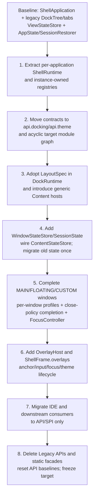

<!--

    Licensed to the Apache Software Foundation (ASF) under one
    or more contributor license agreements.  See the NOTICE file
    distributed with this work for additional information
    regarding copyright ownership.  The ASF licenses this file
    to you under the Apache License, Version 2.0 (the
    "License"); you may not use this file except in compliance
    with the License.  You may obtain a copy of the License at

      http://www.apache.org/licenses/LICENSE-2.0

    Unless required by applicable law or agreed to in writing,
    software distributed under the License is distributed on an
    "AS IS" BASIS, WITHOUT WARRANTIES OR CONDITIONS OF ANY
    KIND, either express or implied.  See the License for the
    specific language governing permissions and limitations
    under the License.

-->
# 27. Current-to-target migration

**Baseline:** `60143d8f59`.
**Target sources:** [ADR 0001](../../architecture/adr-0001-cjap-shell-ui.md), [CJAP target reference](../../reference/cjap-shell-ui.md), and [implementation plan](../../plan/cjap-shell-ui-implementation.md).

The ADR deliberately accepts nbfx-owned public API breaks. Old APIs are deleted after consumer migration, not deprecated forever. Persisted session formats are the exception: migrate them once, retain a backup, and provide deterministic fallback.

## 27.1 Current-to-target matrix

| Area | Baseline | Status | Target direction |
|---|---|---|---|
| Application ownership | `ShellApplication` owns runtime fields; one shell per JVM; tab/dock state and `Docking` facade are process-wide | **Legacy** | One `ShellRuntime` per product application instance owns `DockRuntime`, `WindowSystem`, content/views/theme/focus |
| Product metadata | Immutable `ProductProvider`/`Product` family exists; shell uses only `chromeProfilePolicyId` | **Partial** | Product metadata drives identity, icons, style, About, layout/shell/theme/profile defaults and packaging |
| Default/custom shell | `ShellProvider`, `ShellFrame`, runtime region host, exact DOCK mount work for main shell | **Implemented** | Same contract, plus `overlays()` when `OverlayHost` exists; no subclassing |
| Shell context | `ShellContext(Lookup)` with nullable service accessors | **Legacy** | Target multi-service context with explicit defaults/Optional access and no deprecated overloads |
| Shell window facade | Exposes `Stage`, `BorderPane`, `TabPane`, `slidingArea`, `WindowManager` | **Legacy** | Exposes `Window`, `Parent`, `WindowManager`, `WindowSystem`; no concrete pane types |
| Shell regions | Declarative ids/kinds/spec/contributions/actions; runtime host; main default regions | **Implemented** | Same model across every window; full renderer set and contribution invalidation |
| Chrome profiles | Declarative profiles, policy, resolver, main-window pre-frame selection and decoration | **Partial** | MAIN/FLOATING/CUSTOM select and restore their own profile/frame before creation |
| Actions | Registration/reference reuse, context/profile filters, owned scoped commands | **Implemented** | Unified target action package/module; remove provider and editor-specific fallback APIs |
| Layout model | Pure `LayoutSpec`, builder, XML, annotations, validation/normalization | **Implemented** | Keep pure model; make it the runtime's actual composition input |
| Live layout input | `WindowPanes`, `ViewAreas`, `WindowLayouts`, `DockTree`, `WindowComposition` | **Legacy** | `LayoutSpec` → `ViewArea` → `DockGroupSpec` → hosts/content |
| Docking contracts | `DockRequest`/`DockDecision`/`DockPolicy`/`DockPolicySpec` in `api.shell`; `DockPlacement` in `api.content`; implementation `DockHost` in workspace | **Partial** | Move the existing contracts to `api.docking`, then add production `DockPolicySpec` resolver wiring and pointer integration |
| WindowManager | Content/group operations, split/edge/FLOAT, float/redock, custom windows | **Partial** | Same public surface over generic `Content` and all window kinds; remove tab-specific resolution |
| Generic content | `Content`, factory/state/requirements, per-shell manager, view/editor adapters | **Partial** | Arbitrary content docks/floats/redocks without view/editor tab assumptions |
| Content persistence | `ContentStateStore` implemented and tested, not wired to shell | **Partial** | Store owns only opaque payloads keyed by id/instance key; window store owns order/placement |
| Window/session persistence | `WindowState`/`AreaState` + `ViewStateStore`; separate `AppState`/`SessionRestorer` | **Legacy** | `WindowStateStore` owns `SessionState`; one-window `WindowState`; one-time migration/backup/fallback |
| Windows | Main/floating/custom handles; hide/close; custom bounds | **Partial** | Full geometry/owner/modality/profile/decoration/state restore and close propagation |
| Close policy | `WindowClosePolicy` HIDE/REDOCK/CLOSE_CONTENT; 11-argument/default `CLOSE_CONTENT`; floating/custom behavior implemented | **Partial** | Target default floating `REDOCK`, owner-window propagation, complete veto behavior, and policy persistence |
| Focus | `WindowActivation.show` does show/toFront/requestFocus; `TabMover` cancels on window focus loss; active-component bridges remain | **Partial** | `FocusController` separates OS activation, logical selection, keyboard focus and restores deterministically |
| Drop | Neutral contracts, layer registration, content/group/area routing, `ExternalDrop` payload extraction, legacy file fallback | **Partial** | Full target routing order, global fallback, Escape cancel, authoritative decision, keyboard equivalents, real Dragboard/e2e coverage |
| Theme | Token API in `platform.theme`; static `NbfxTheme` | **Legacy** | `api.theme.ThemeManager`, `Theme`, `ThemeTokens`, `ThemeScope`, `HostTheme`, policy; delete static public state |
| Status | Window status bar with left/fill/right registrations | **Partial** | `StatusScope.WINDOW/AREA/GROUP/CONTENT` and multiple hosts |
| Overlays | Visual shell OVERLAY region and slide/progress overlays | **Partial** | Distinct `OverlayHost`/`OverlaySpec` anchored HUD model plus `ShellFrame.overlays()` |
| Nodes/views | Legacy view APIs plus properties/output; no target node model/NodeView | **Partial** | Unified `api.views`, node model/explorer/NodeView and dynamic views |
| Diagnostics | Logging, reason keys, test XML, API audit | **Partial** | Public diagnostics/event/source-health model |
| Extensions | NBM lookup/layer contributions | **Partial** | `api.plugins` ownership/invalidation/unload lifecycle |
| Static UI state | `Docking`, `NbfxTheme`, registries and one-window provider | **Legacy** | Per-application instances; old public statics removed |
| API governance | Type-level snapshot includes Legacy APIs; method sigtests deferred | **Legacy** | Target-only signatures, `arch.xml`, `apichanges`, sigtests and reference-product proof |

## 27.2 Migration path

The order is dependency-driven: runtime ownership precedes safe module moves; a generic host precedes arbitrary-content multiwindow behavior; persistence ownership precedes reliable multiwindow restore; close/focus behavior precedes overlay interaction; consumers migrate before public deletion.

## 27.3 Stage 1 — `ShellRuntime` and per-application ownership

### Current blockers

- `ShellApplication` is one per JVM and directly owns `DockRuntime`, `WindowManager`, `ContentManager`, `AppState`, and lifecycle fields.
- `Docking.active` is static and public facades delegate to the most recently created runtime.
- `NbfxTabPane` registries and window environment/composition helpers are process-wide.
- `ShellWindowProvider` publishes one global window.
- `NbfxTheme` is static.

### Work

1. Introduce `ShellRuntime` as the owner of one `DockRuntime`, `WindowSystem`, `ContentManager`, `ViewManager`, theme manager, and later `FocusController`.
2. Make `ShellApplication` a thin composition/launch adapter; products use `ShellProvider`, not subclasses.
3. Move tab/pane/window registries and active-runtime lookup behind the instance.
4. Publish per-window `ShellContext`/lookup instead of relying on one global shell.
5. Keep any temporary `Docking` delegation internal to the migration and remove its public surface in Stage 8.
6. Add isolated-runtime tests for two application instances in one JVM, including independent layout, content, theme, and shutdown.

### Exit gate

No product or API module needs a static UI singleton to obtain its runtime. Existing `DockRuntimeIsolationTest` proves only the current lower-level runtime isolation, not complete `ShellRuntime` isolation.

## 27.4 Stage 2 — `api.docking` and `api.theme`

### Current blockers

- There is no `nbfx.api.docking` module. `DockRequest`, `DockDecision`, `DockPolicy`, and the already-implemented `DockPolicySpec` live in `api.shell`; placement/mode live in `api.content`; an incompatible internal `DockHost` lives in `platform.workspace`.
- `DockPolicy.fromSpec` is pure and unit-tested only. Production content-kind/group-area resolvers and pointer-drag integration are not wired.
- There is no `nbfx.api.theme` module. Public token types and static `NbfxTheme` live in `platform.theme`.
- `api.layout` is already JavaFX-free and should remain M-tier.

### Work

1. Create target API modules with explicit public packages and dependency direction from the ADR.
2. Move the existing `DockPolicySpec`, `DockRequest`, `DockDecision`, and executable `DockPolicy` to `api.docking`, together with the target public `DockHost`; keep `DockPlacement`/`TransferMode` in `api.content`. Do not invent a second spec type.
3. Wire `DockPolicy.fromSpec` to production content-kind/group-area resolvers and pointer docking only when that integration slice lands; the factory itself already exists.
4. Move theme contracts and implementation behind `api.theme`; introduce `ThemeManager` before removing static state.
5. Update shell/content/layout signatures and consumers in the same coordinated domain change; do not add permanent public compatibility adapters.
6. Add API-only downstream fixture compilation and layer/API guards for the new graph.

### Exit gate

`api.shell` no longer owns docking policy contracts; `api.theme` has no implementation dependency; target dependency direction is acyclic and guarded.

## 27.5 Stage 3 — `LayoutSpec` runtime adoption and generic content hosts

### Current blockers

- `DockRuntime` consumes `WindowComposition` and `DockTree`, not `LayoutSpec`.
- `WindowCompositionResolver` reads `WindowPanes`/`WindowLayouts`/`ViewAreas`.
- `DefaultWindowManager.findTab` recognizes only `ViewContent`, `EditorContent`, and `nbfx:view.<id>`.
- Physical group identity is attached to `NbfxTabPane`; there is no target public `DockHost` content lifecycle.

### Work

1. Add a `LayoutSpec`-driven construction path in `DockRuntime`: materialize areas/groups, split/group tree, slots, presentations, capacity, lifetime, style, and zero-content groups.
2. Preserve current `DockArea` split/minimize/maximize/drop behavior behind the new host abstraction rather than rewriting it blindly.
3. Translate legacy first-run `DockTree`/pane declarations into the new internal model only for transition; do not make that translation a permanent public API.
4. Introduce target `DockHost` semantics: stable Node, capacity, immutable content snapshot, detach-only remove, observable empty/state, resource-only dispose.
5. Make `WindowManager` resolve arbitrary `Content` through host/content identity, not tab implementation objects.
6. Keep content Node identity stable across move, split, float, redock, and presentation changes.

### Exit gate

A product-defined `LayoutSpec` with zero content renders; arbitrary non-editor/non-view `Content` can attach, move, split, float, and redock; existing DockArea interaction tests remain green through the adapter.

## 27.6 Stage 4 — `WindowStateStore`, `SessionState`, and content payloads

### Current blockers

- `WindowState` means whole-main-window/view state; `AreaState` stores view ids and detach geometry.
- `ViewStateStore` persists that state under `org/netbeans/modules/nbfx/window`.
- `AppState`/`SessionRestorer` separately persist pane/tab trees, editor paths, minimized/maximized state, toolbars, settings, custom bounds, and project tree state.
- `ContentStateStore` is not wired into production shell lifecycle.
- There is no `SessionState` or `WindowStateStore`.

### Work

1. Define one-window `WindowState` containing areas/groups/tree/dividers, content ids/order/active, geometry/profile/decoration, and content-state references.
2. Define `SessionState` containing all windows plus active window id; `DockWindow.state()` returns one-window state and `WindowSystem.snapshot()` returns session state.
3. Make `WindowStateStore` the sole owner of order/placement/window geometry.
4. Wire `ContentStateStore` to `Content.saveState()`/`ContentFactory.create(ContentState)` and key payloads by `ContentId` plus instance key only.
5. Implement one-time migration from `ViewStateStore` and `AppState`/`SessionRestorer`: read old data, write a backup, write new format immediately, and log diagnostics.
6. Define deterministic fallback for missing content/window/monitor/corruption: normalized product default layout, no JavaFX types persisted.
7. Migrate custom-window bounds and main/floating geometry into the new ownership model.

### Exit gate

New state round-trips without JavaFX types; old fixture migrates once with backup; corrupt/missing state repeatedly falls back deterministically; content payload store cannot alter order or placement.

## 27.7 Stage 5 — Per-window chrome/profiles, close policy, and focus

### Current blockers

- Main-window profile selection occurs before frame creation; floating/custom windows do not build declarative profile frames.
- `WindowOptions.profile` on custom windows is only echoed into `state().profileId()`.
- Floating chrome comes from legacy `DetachedBarsProvider`/window environment.
- `WindowClosePolicy` now exists, but the 11-argument constructor and internal floating default select `CLOSE_CONTENT`, not the target default `REDOCK`.
- `HIDE` works for floating/custom windows; floating `REDOCK` uses home/main fallback; custom `REDOCK` is intentionally invalid. Owner-window propagation and policy persistence are absent.
- Close veto behavior is incomplete: custom `CLOSE_CONTENT` directly disposes `WindowContent`, and floating `REDOCK` bypasses normal close confirmation.
- `WindowActivation.show` and `TabMover` focus-loss cancellation exist, but there is no `FocusController`.

### Work

1. Resolve profile/decoration for every `WindowKind` using explicit options, content/group hint, product default, policy fallback, and neutral fallback.
2. Build a per-window `ShellContext`, region host, frame, and theme attachment before showing each window.
3. Restore persisted profile id before frame creation, not after the window exists.
4. Align the default floating close policy with target `REDOCK` at the coordinated behavior cutover, while retaining explicit `HIDE`/`CLOSE_CONTENT`.
5. Apply owner-window close policy to owned floating/custom windows, complete dirty-content veto behavior, and persist the selected policy.
6. Add `FocusController` with independent OS-window activation, logical active group/content, and keyboard focus; reuse `WindowActivation`/`TabMover` behavior rather than duplicating it.
7. Restore focus/action context after float, redock, close, and overlay dismissal; menus use a context snapshot.

### Exit gate

MAIN/FLOATING/CUSTOM windows can have different persisted chrome; close behavior is explicit and vetoable; focus/context restoration is deterministic across windows.

## 27.8 Stage 6 — `OverlayHost` and HUD lifecycle

### Current blockers

- The shell OVERLAY region is a visual slot; `ShellFrame` has no `overlays()`.
- Progress/slide overlays are implementation-specific, not anchored HUD contracts.
- No `OverlaySpec`, `OverlayAnchor`, `OverlayInputMode`, or `OverlayContent` exists.

### Work

1. Add `OverlayHost` to `api.content` and `ShellFrame.overlays()` to `api.shell` in the same slice.
2. Implement `OverlaySpec` validation, including `focusable=true` only for `INTERACTIVE`.
3. Keep shell OVERLAY region, `PresentationId.OVERLAY`, and anchored `OverlayHost` as distinct concepts.
4. Anchor overlays to content/group/area/window and reattach across move/float/redock.
5. Implement pass-through/HUD/interactive pointer, focus, action-context, accessibility, and theme behavior.
6. Persist overlay state with its owner and dispose/reattach on owner close/move.

### Exit gate

HUD does not steal map/content gestures; palette overlays participate in focus/context; empty overlays do not pick pointer bounds; owner lifecycle is leak-free.

## 27.9 Stage 7 — IDE and downstream consumer migration

### Current IDE coupling

[`JavaFXLaunchApp`](../../../nbfx-ide/nbfx.ide.workbench/src/org/netbeans/modules/nbfx/ide/workbench/JavaFXLaunchApp.java) still extends `ShellApplication` and uses legacy hooks plus `AppState`, `SessionRestorer`, and `WindowPane` APIs. Other concrete consumers include:

- [`ProjectBranding`](../../../nbfx-ide/nbfx.ide.workbench/src/org/netbeans/modules/nbfx/ide/workbench/ProjectBranding.java) — `ShellBranding`;
- [`NavigatorPaneProvider`](../../../nbfx-ide/nbfx.ide.workbench/src/org/netbeans/modules/nbfx/ide/workbench/NavigatorPaneProvider.java) — `WindowPaneProvider`, `WindowPaneHost`, `AppState`;
- [`ProjectState`](../../../nbfx-ide/nbfx.ide.workbench/src/org/netbeans/modules/nbfx/ide/workbench/ProjectState.java) — `AppState` session migration;
- project/search/usages context-menu contributors — `FileContextMenuContributor`/`ElementContextMenuContributor`;
- [`ProjectProblemsUi`](../../../nbfx-ide/nbfx.project.ui/src/org/netbeans/modules/nbfx/project/ui/problems/ProjectProblemsUi.java) — static `NbfxTheme`.

### Work packages

1. Replace `JavaFXLaunchApp` subclass chrome with a `ShellProvider`/declarative shell or neutral default.
2. Move product identity/style from `ShellBranding` to `Product`/`ProductStyle`.
3. Replace navigator pane construction and startup layout assumptions with `LayoutSpec`/view routing.
4. Move project/session/tree persistence to target workspace/window/content stores.
5. Replace editor/file context contributors with layer references and `NodeContextMenuBuilder`.
6. Replace static theme calls with per-window/scoped `ThemeManager`/`ThemeScope`.
7. Compile an API-only product fixture with no T0, IDE, project, Java, or loader imports.
8. Run platform-only conformance, full IDE scenario, and downstream build before deletion.

### Exit gate

No IDE/product source imports the APIs scheduled for deletion; full build and scenario tests pass using target APIs only.

## 27.10 Stage 8 — Delete old APIs and freeze

### ADR deletion list

Delete rather than adapt after Stage 7:

- `ShellBranding`;
- `ShellChromeProvider` and transitional `ShellChrome` shape;
- `WindowPane*` and `WindowPaneHost`;
- Legacy `org.netbeans.api.nbfx.shell.PaneRole` semantics;
- `ViewLocation` — named by the ADR, but no `ViewLocation` source type was found in this baseline, so there is nothing to delete here;
- public `Docking`, `AppState`, and `SessionRestorer`;
- public static `NbfxTheme`;
- duplicate `org.netbeans.api.nbfx.view` package after consolidation into target `views`;
- `FileContextMenuContributor` and `ElementContextMenuContributor`;
- provider-command and editor-specific scoped fallback methods once layer/scoped actions cover all consumers;
- deprecated `ShellContext.command(..., preferFile)` and `ShellCommandResolver.resolve(..., preferFile)` overloads.

### Deletion gate

1. Persisted-state migration is complete and verified with backup/fallback.
2. Source searches and API-only fixture compilation show zero consumer references.
3. Generated layer paths and processors no longer emit deleted schemas.
4. Platform conformance and full IDE/Java tests pass.
5. Reset API snapshots/signatures in the same domain PR that deletes the old API, not before.
6. Update `arch.xml`, `apichanges.xml`, sigtests, public-package declarations, and documentation together.
7. Remove friend-package exemptions that only supported the old implementation.

## 27.11 Naming and schema migration map

| Existing baseline | Target |
|---|---|
| `ShellBranding` | `Product` / `ProductIdentity` / `ProductStyle` |
| `ShellChromeProvider` | `ShellProvider` |
| `ShellChrome` | `ShellFrame` + `ShellContribution` / renderers |
| `WindowPane*` | `ViewArea` + `LayoutSpec` + `DockGroupSpec` |
| `api.shell.PaneRole` | `api.layout.PaneRole` plus group/window state |
| lightweight `api.views.ViewArea` | logical `api.layout.ViewArea` |
| `WindowLayouts` / `DockTree` | `Layouts` / `LayoutSpec` |
| `ViewLocation` semantics | `DockLocation` |
| `WindowManager` | retained and extended over generic content/groups |
| `WindowSystem` | retained as layout/session lifecycle |
| `WindowState` / `AreaState` | evolved one-window state; `SessionState` added |
| `EditorDocument` / `EditorService` | retained as content/document capabilities |
| `ContentManager` | retained as generic lifecycle/router |
| `ViewProvider` / `ViewManager` | retained in unified target views package |
| `FileContextMenuContributor` / `ElementContextMenuContributor` | layer refs + `NodeContextMenuBuilder` |
| static `NbfxTheme` | `ThemeManager` / `ThemeScope` |
| public `Docking` / `AppState` / `SessionRestorer` | internal `DockRuntime` / `WindowStateStore` / `ContentStateStore` |
| duplicate `view` package | unified `views` package |

## 27.12 Migration risks and controls

| Risk | Control |
|---|---|
| Runtime ownership change breaks tests/products that rely on “latest shell” statics | Introduce instance lookup first; keep only temporary internal delegation; test two runtimes concurrently |
| Moving contracts creates API cycles | Follow ADR direction; keep `AreaStyle` in layout and transfer vocabulary in content; run `LayerGuard --api` plus an API-only fixture |
| Layout adoption regresses split/minimize/maximize/drop behavior | Adapt existing `DockArea`; preserve its tests; compare old/new layouts and interaction scenarios |
| Arbitrary content docking loses Node identity or ownership | Define host detach/dispose semantics; ContentManager alone closes/disposes; assert Node identity in tests |
| State migration loses user layout or duplicates writes | One-time reader, backup, immediate new-format write, deterministic fallback, corruption fixtures |
| Per-window profile restore happens too late | Resolve from persisted state before frame/stage show; test provider observes profile at creation |
| Close/focus changes cause data loss or context theft | Explicit close policy, dirty veto, three-fact focus tests, owner-window propagation tests |
| Overlays steal input or leak with owner | Normative input modes, focusable validation, anchor lifecycle and leak tests |
| IDE migration exposes T0 types | API/SPI-only fixture and AppShellGuard; remove friend exemptions only after consumers compile |
| Old APIs deleted before replacement is proven | Domain deletion PR requires replacement tests, consumer migration, and API baseline reset together |

The target reference still lists open decisions such as exact area/template model, whether `PaneKind` stays closed, final store naming, renderer registration mechanism, NodeView placement, and cross-window routing ownership. Treat those as design decisions to close before API freeze, not as implemented baseline behavior.

For exact current signatures use [public API catalog](23-public-api-catalog.md); for current generated metadata use [annotations and layer schema](24-annotations-and-layer-schema.md); for test gates use [testing, build, and conformance](26-testing-build-and-conformance.md).
